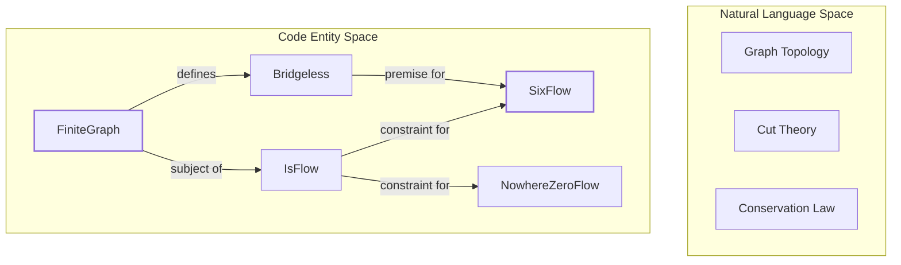
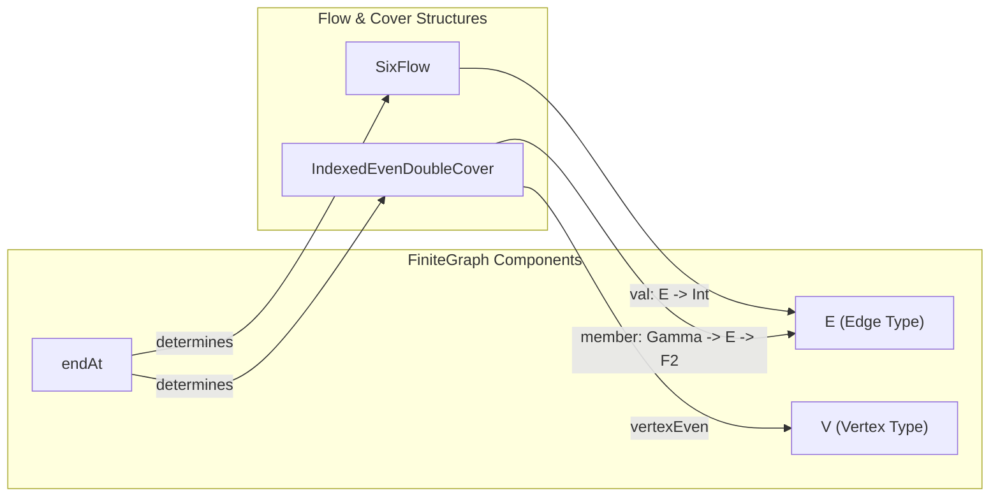

<!-- source: DeepWiki mcp.deepwiki.com · repo openai/cdc-lean · page 2.1 FiniteGraph: Vertices, Edges, and Predicates · fetched 2026-10-26 -->

# FiniteGraph: Vertices, Edges, and Predicates

Relevant source files

The following files were used as context for generating this wiki page:

- [CDCLean/Basic.lean](CDCLean/Basic.lean)
- [CDCLean/GeneralGraph.lean](CDCLean/GeneralGraph.lean)

This page provides a detailed technical reference for the `FiniteGraph` structure and its associated predicates as defined in the CDCLean project. The `FiniteGraph` serves as the primary representation for general loopless multigraphs, providing the foundation for flow theory and the eventual construction of cycle double covers.

## The FiniteGraph Structure

A `FiniteGraph` is defined as a multigraph where edges are treated as distinct objects. Rather than defining a graph by a set of vertices and a set of pairs, CDCLean defines it by the incidence relationship between edge ends and vertices.

### Implementation Details
The structure is defined in [CDCLean/GeneralGraph.lean:17-19](). It requires two finite types, `V` (Vertices) and `E` (Edges).

*   **`endAt`**: A function `E → Fin 2 → V` that maps each edge object and one of its two ends (represented by `Fin 2`) to a vertex [CDCLean/GeneralGraph.lean:18-18]().
*   **`loopless`**: A proof obligation ensuring that for every edge `e`, the vertex at end `0` is not the same as the vertex at end `1` [CDCLean/GeneralGraph.lean:19-19]().

### Incidence and Degree
To facilitate calculations at the vertex level, the library introduces the concept of "half-edges."

| Entity | Definition | Description |
| :--- | :--- | :--- |
| `HalfEdge E` | `E × Fin 2` | A specific end of a specific edge object [CDCLean/GeneralGraph.lean:27-27](). |
| `vertex` | `G.endAt h.1 h.2` | The vertex associated with a given `HalfEdge` [CDCLean/GeneralGraph.lean:30-30](). |
| `halfEdgesAt v` | `{h // G.vertex h = v}` | The subtype of all half-edges incident to vertex `v` [CDCLean/GeneralGraph.lean:33-33](). |
| `degree v` | `Fintype.card` | The number of half-edges incident to `v` [CDCLean/GeneralGraph.lean:39-39](). |

**Sources:** [CDCLean/GeneralGraph.lean:17-39]()

## Graph Predicates and Cuts

The project relies on standard graph-theoretic predicates to define the conditions under which a Cycle Double Cover exists.

### Cuts and Bridgelessness
A cut is defined based on a subset of vertices $S$. An edge "crosses" the cut if one of its endpoints is in $S$ and the other is not.

*   **`Crosses S e`**: A proposition that is true if `(G.endAt e 0 ∈ S) ≠ (G.endAt e 1 ∈ S)` [CDCLean/GeneralGraph.lean:42-43]().
*   **`cut G S`**: The `Finset E` containing all edges that satisfy `Crosses S` [CDCLean/GeneralGraph.lean:46-48]().
*   **`Bridgeless G`**: The property that no cut in the graph contains exactly one edge [CDCLean/GeneralGraph.lean:52-52](). This is a fundamental requirement for the Cycle Double Cover Conjecture.

### Flow Definitions
Flows are functions on edges that satisfy conservation laws at each vertex.

*   **`IsFlow f`**: Defines signed conservation. For a vertex `v`, the sum of values on edges where `v` is the "start" (end 0) minus the sum where `v` is the "end" (end 1) must be zero [CDCLean/GeneralGraph.lean:55-58]().
*   **`IsNowhereZero f`**: Ensures that the flow value `f e` is never the additive zero for any edge `e` [CDCLean/GeneralGraph.lean:60-60]().
*   **`SixFlow`**: A specific structure representing an integer nowhere-zero 6-flow. It includes a `bound` proof that the absolute value of the flow is between 1 and 5 inclusive [CDCLean/GeneralGraph.lean:63-66]().
*   **`NowhereZeroFlow A`**: A generalized structure for nowhere-zero flows taking values in an arbitrary `AddCommGroup A` [CDCLean/GeneralGraph.lean:69-72]().

**Sources:** [CDCLean/GeneralGraph.lean:42-72]()

## Logical Relationships

The following diagram maps the relationship between the high-level graph properties and the Lean structures that implement them.

### Data Flow: From Graph to Flow Properties

**Sources:** [CDCLean/GeneralGraph.lean:17-72]()

## Trust Boundaries and Covers

### Seymour's Six-Flow Theorem
The project treats Seymour's result as a formal boundary. The `SeymourSixFlowStatement` is a `Prop` stating that every bridgeless `FiniteGraph` has a `SixFlow` [CDCLean/GeneralGraph.lean:75-77](). In the main proof, this is provided as an argument rather than an axiom.

### Indexed Even Double Cover
The `IndexedEvenDoubleCover` is the structure that bridges the gap between flows and cycles. It represents a collection of edge sets (indexed by `Gamma`, which is $F_2^3$) such that every edge is covered exactly twice across all sets.

*   **`member`**: A mapping `Gamma → E → F₂` indicating if an edge belongs to the set indexed by a specific `Gamma` element [CDCLean/GeneralGraph.lean:81-81]().
*   **`vertexEven`**: A proof that for every index `s` and vertex `v`, the number of incident edges in the set is even (sum in $F_2$ is 0) [CDCLean/GeneralGraph.lean:82-85]().
*   **`coveredTwice`**: A proof that for every edge `e`, there are exactly two indices `s` where `member s e = 1` [CDCLean/GeneralGraph.lean:86-87]().

### Structure Association Diagram

**Sources:** [CDCLean/GeneralGraph.lean:17-87](), [CDCLean/Basic.lean:25-25]()

---

