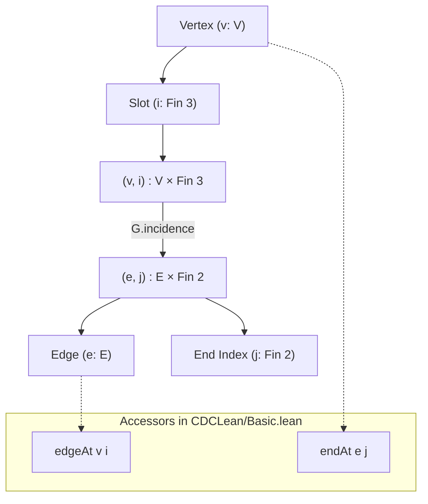
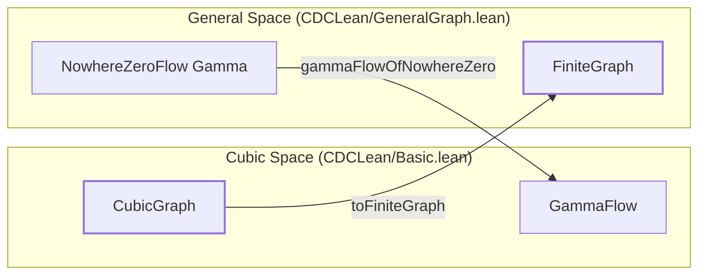

<!-- source: DeepWiki mcp.deepwiki.com · repo openai/cdc-lean · page 2.2 CubicGraph: Three-Slot Incidence Structure · fetched 2026-10-26 -->

# CubicGraph: Three-Slot Incidence Structure

Relevant source files

The following files were used as context for generating this wiki page:

- [CDCLean/Basic.lean](CDCLean/Basic.lean)
- [CDCLean/CubicBridge.lean](CDCLean/CubicBridge.lean)

The `CubicGraph` structure is the central combinatorial representation used in the CDCLean project for the middle stages of the Cycle Double Cover proof. While general graphs are represented via `FiniteGraph`, the core labeling and flow transfer algorithms operate on cubic (3-regular) graphs. This page details the specialized incidence structure that makes these proofs formalizable without the usual complexities of orientation or edge-indexing.

## The Incidence Equivalence

In CDCLean, a cubic graph is defined not by an adjacency list or a set of edges, but by a bijection between "vertex slots" and "edge ends."

*   **Vertex Slots**: Each vertex $v \in V$ is associated with exactly 3 slots, represented by `V × Fin 3`.
*   **Edge Ends**: Each edge $e \in E$ is associated with exactly 2 ends, represented by `E × Fin 2`.

The structure `CubicGraph` defines this as an equivalence `incidence : (V × Fin 3) ≃ (E × Fin 2)` [CDCLean/Basic.lean:30-31](). This approach ensures that:
1.  **3-Regularity is Definitional**: Every vertex must have exactly 3 incident edge-ends by the nature of the `Fin 3` type.
2.  **Multigraph Support**: Parallel edges are distinct elements in the type `E`, and the bijection naturally handles multiple edges between the same vertex pair.
3.  **No Edge Reuse**: The bijective nature of `incidence` prevents a single edge end from being attached to two different vertices.

### Structure Definition

| Field | Type | Description |
| :--- | :--- | :--- |
| `incidence` | `(V × Fin 3) ≃ (E × Fin 2)` | The bijection defining graph topology. |
| `loopless` | `∀ e : E, (incidence.symm (e, 0)).1 ≠ (incidence.symm (e, 1)).1` | Constraint ensuring the two ends of an edge attach to different vertices. |

Sources: [CDCLean/Basic.lean:30-34]()

## Key Functions and Accessors

The library provides several helper functions to navigate this incidence structure:

*   **`edgeAt v i`**: Returns the edge object $e \in E$ occupying the $i$-th slot at vertex $v$ [CDCLean/Basic.lean:40-40]().
*   **`endAt e j`**: Returns the vertex $v \in V$ where the $j$-th end of edge $e$ is attached [CDCLean/Basic.lean:43-43]().
*   **`edgeAt_injective`**: A proof that for a fixed vertex $v$, the mapping from slots to edges is injective (i.e., three distinct edges, or three distinct ends of edges, meet at $v$) [CDCLean/Basic.lean:60-80]().

### Data Flow: Slot to Edge Resolution

The following diagram illustrates how the `incidence` equivalence resolves the relationship between vertices and edges.

**Diagram: Incidence Resolution Logic**

Sources: [CDCLean/Basic.lean:39-59]()

## Flow Theory: GammaFlow

In a cubic graph, the concept of a flow is simplified. Because the project works in characteristic two (specifically the group $\Gamma = \mathbb{F}_2^3$), orientation signs are unnecessary ($x = -x$).

### Gamma Group
The group `Gamma` is defined as `Fin 3 → ZMod 2` [CDCLean/Basic.lean:25-25](). This represents the additive group $\mathbb{F}_2^3$.

### GammaFlow Structure
A `GammaFlow` on a `CubicGraph` $G$ consists of:
1.  **`val`**: A mapping $E \to \Gamma$ [CDCLean/Basic.lean:96-96]().
2.  **`nowhereZero`**: A requirement that no edge is assigned the zero element [CDCLean/Basic.lean:97-97]().
3.  **`conservation`**: For every vertex $v$, the sum of the values on the three incident edges is zero: $\sum_{i \in \text{Fin 3}} \text{val}(G.\text{edgeAt } v\ i) = 0$ [CDCLean/Basic.lean:98-98]().

Sources: [CDCLean/Basic.lean:21-26](), [CDCLean/Basic.lean:95-99]()

## Integration with FiniteGraph

While `CubicGraph` is the primary structure for the labeling proof, it can be projected back to the more general `FiniteGraph` type.

### The `toFiniteGraph` Projection
The function `toFiniteGraph` forgets the three-slot structure but retains the `endAt` mapping and the `loopless` property [CDCLean/CubicBridge.lean:17-21]().

### The Summation Identity
A critical bridge between the two representations is the theorem `sum_edgeEnds_eq_sum_vertexSlots`. This theorem allows the proof to reindex a summation over all edge ends into a summation over all vertex slots:
$$\sum_{e \in E} \sum_{j \in \text{Fin 2}} h(e, j) = \sum_{v \in V} \sum_{i \in \text{Fin 3}} h(G.\text{edgeAt } v\ i, (G.\text{incidence } (v, i)).2)$$
This identity is used to prove that a flow in the general sense (conserved at vertices) matches the cubic definition of flow [CDCLean/Basic.lean:82-89]().

**Diagram: Type Relationship and Flow Conversion**

Sources: [CDCLean/CubicBridge.lean:16-22](), [CDCLean/CubicBridge.lean:43-58]()

## Why the Cubic Representation?

The `CubicGraph` representation is chosen for three specific technical reasons:
1.  **Definitional Double-Counting**: The identity $\sum \text{deg}(v) = 2|E|$ becomes a definitional consequence of the bijection `(V × Fin 3) ≃ (E × Fin 2)`, as $|V| \times 3 = |E| \times 2$ [CDCLean/Basic.lean:82-89]().
2.  **Simplification of Even Covers**: The construction of an even double cover from a $\Gamma$-flow (detailed in Stage 3) relies on analyzing the local configuration of the 3 edges at each vertex. Having these edges explicitly indexed by `Fin 3` simplifies the case analysis.
3.  **Compatibility with Expansion**: The process of expanding a general graph into a cubic one (Stage 1) naturally produces these "slots" via the `RotationSystem` [CDCLean/Expansion.lean]().

Sources: [CDCLean/Basic.lean:11-15](), [CDCLean/CubicBridge.lean:24-37]()

---

