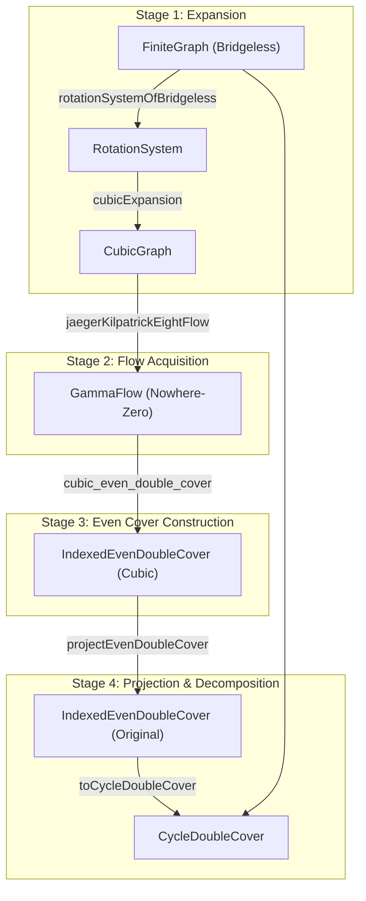

<!-- source: DeepWiki mcp.deepwiki.com · repo openai/cdc-lean · page 3 Proof Pipeline: From Bridgeless Graph to Cycle Double Cover · fetched 2026-10-26 -->

# Proof Pipeline: From Bridgeless Graph to Cycle Double Cover

Relevant source files

The following files were used as context for generating this wiki page:

- [CDCLean.lean](CDCLean.lean)
- [CDCLean/Main.lean](CDCLean/Main.lean)

This page provides a high-level overview of the four-stage pipeline used to prove that every bridgeless graph admits a cycle double cover. The proof is structured as a series of transformations: first expanding an arbitrary graph into a cubic one, obtaining a flow on that cubic graph, converting that flow into an even double cover, and finally projecting that cover back to the original graph to be decomposed into cycles.

The primary entry point for this pipeline is `cycleDoubleCover_of_bridgeless` [CDCLean/Main.lean:58-67](), which composes these stages into a unified formal proof.

## Pipeline Overview

The following diagram illustrates the flow of data and proof obligations across the four stages of the pipeline.

### Logical Data Flow

**Sources:** [CDCLean/Main.lean:24-67](), [CDCLean/Expansion.lean:1-20](), [CDCLean/EvenCover.lean:1-10]()

---

## Stage 1: Cubic Expansion via Rotation Systems
The first stage transforms an arbitrary `FiniteGraph` into a `CubicGraph`. Because the cycle double cover construction is most naturally defined on 3-regular graphs, this expansion step is critical for handling general bridgeless graphs.

- **Rotation System**: For any bridgeless graph, a `RotationSystem` is constructed [CDCLean/Main.lean:62]().
- **Expansion**: The graph is expanded into a cubic structure where each original vertex of degree $n$ becomes a cycle of $n$ "ring edges" connected to the original edges via "spokes".
- **Preservation**: A key property of this stage is `expansionGraph_bridgeless`, which ensures that if the original graph is bridgeless, its cubic expansion remains bridgeless [CDCLean/Main.lean:64-65]().

For details, see [Stage 1: Cubic Expansion via Rotation Systems](#3.1).

---

## Stage 2: Nowhere-Zero Gamma-Flow via Jaeger–Kilpatrick
Once the graph is cubic and bridgeless, the pipeline must find a specific type of flow. The project formalizes the Jaeger–Kilpatrick Eight-Flow Theorem to guarantee the existence of a nowhere-zero `Gamma`-flow (where $\Gamma \cong \mathbb{F}_2^3$).

- **Flow Existence**: The function `jaegerKilpatrickEightFlow` provides the necessary flow for any bridgeless cubic graph [CDCLean/Main.lean:66]().
- **Group Structure**: The flow uses the `Gamma` group, which is essential for the subsequent labeling and cover construction.

For details, see [Stage 2: Nowhere-Zero Gamma-Flow via Jaeger–Kilpatrick](#3.2).

---

## Stage 3: Even Double Cover Construction for Cubic Graphs
This stage converts the `GammaFlow` on the cubic graph into an `IndexedEvenDoubleCover`. This is the mathematical core of the reduction, where the algebraic properties of the flow are translated into geometric properties of edge covers.

- **Cubic Labeling**: The flow is used to generate a `CubicLabeling`, which assigns values to edge-ends such that parity conditions are satisfied [CDCLean/Main.lean:50-51]().
- **Even Cover**: The labeling is transformed into an `IndexedEvenDoubleCover`, a collection of edge sets where every vertex is incident to an even number of edges from each set, and every edge is covered exactly twice.

For details, see [Stage 3: Even Double Cover Construction for Cubic Graphs](#3.3).

---

## Stage 4: Projection and Cycle Decomposition
The final stage maps the results from the cubic expansion back to the original graph and produces the final `CycleDoubleCover`.

- **Projection**: The `projectEvenDoubleCover` function maps the even double cover of the cubic expansion `K` back to an even double cover of the original graph `G` [CDCLean/Main.lean:52]().
- **Decomposition**: Finally, `toCycleDoubleCover` invokes the cycle decomposition theorem to break down the even edge sets into individual cycles, satisfying the Cycle Double Cover Conjecture for the input graph [CDCLean/Main.lean:53]().

For details, see [Stage 4: Projection and Cycle Decomposition](#3.4).

---

## Mapping Code Entities to Pipeline Stages

The following table maps the high-level stages to the specific Lean functions and types that implement them.

| Stage | Key Function | Input Type | Output Type |
| :--- | :--- | :--- | :--- |
| **1. Expansion** | `cubicExpansion` | `FiniteGraph` | `CubicGraph` |
| **2. Flow** | `jaegerKilpatrickEightFlow` | `CubicGraph` | `NowhereZeroFlow Gamma` |
| **3. Even Cover** | `cubic_even_double_cover` | `GammaFlow` | `IndexedEvenDoubleCover` |
| **4. Projection** | `projectEvenDoubleCover` | `IndexedEvenDoubleCover` | `CycleDoubleCover` |

**Sources:** [CDCLean/Main.lean:58-67](), [CDCLean/Expansion.lean:1-20](), [CDCLean/CycleDecomposition.lean:1-15]()

---

