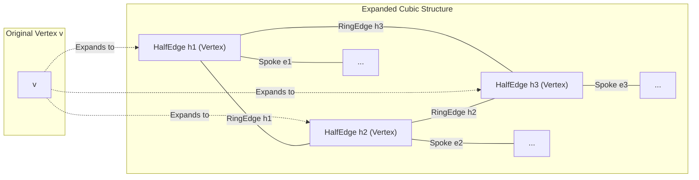
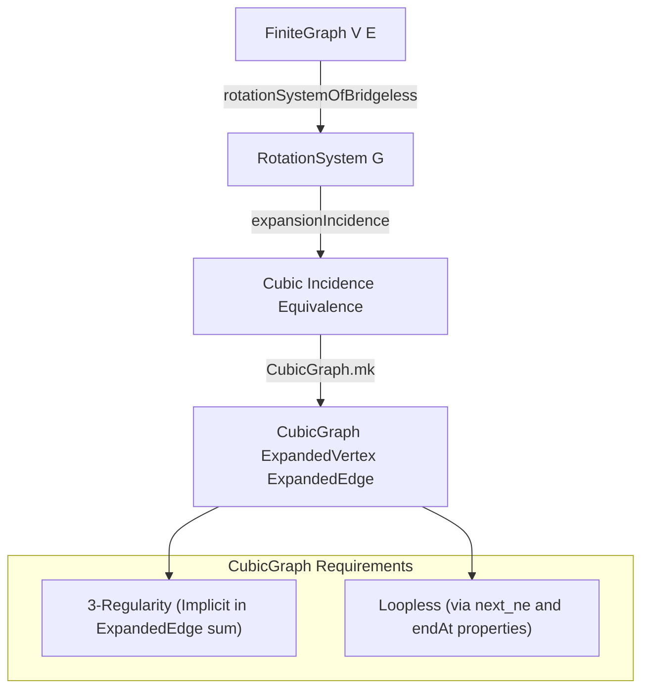

<!-- source: DeepWiki mcp.deepwiki.com · repo openai/cdc-lean · page 3.1 Stage 1: Cubic Expansion via Rotation Systems · fetched 2026-10-26 -->

# Stage 1: Cubic Expansion via Rotation Systems

Relevant source files

The following files were used as context for generating this wiki page:

- [CDCLean/Expansion.lean](CDCLean/Expansion.lean)

This stage of the proof pipeline transforms an arbitrary bridgeless `FiniteGraph` into a `CubicGraph`. This reduction is necessary because the Jaeger–Kilpatrick flow theorem and subsequent even double cover constructions are defined over cubic (3-regular) structures.

## Overview

The transformation is a "vertex-ring expansion." Each vertex $v$ of the original graph $G$ with degree $d$ is replaced by a cycle (ring) of $d$ new vertices in the cubic graph $G'$. Each original half-edge incident to $v$ becomes a "spoke" edge attached to one of these ring vertices. The resulting graph is 3-regular by construction: each vertex is incident to exactly one spoke and two ring edges.

Sources: [CDCLean/Expansion.lean:5-10]()

## The Rotation System

To arrange the half-edges of a vertex into a cycle, the system uses a `RotationSystem`. This structure defines a cyclic permutation of half-edges around each vertex fiber.

### RotationSystem Definition
A `RotationSystem` for a graph `G` consists of:
- `next`: A permutation of all `HalfEdge E`.
- `sameVertex`: A proof that `next` only permutes half-edges incident to the same vertex.
- `next_ne`: A proof that `next h ≠ h` (prevents self-loops in the expansion rings).
- `fiberTransitive`: A proof that the permutation is transitive on the set of half-edges at any given vertex (ensures one single ring per original vertex).

Sources: [CDCLean/Expansion.lean:22-28]()

### Constructing the System
For any bridgeless graph, a `RotationSystem` is constructed by:
1.  Verifying that every vertex has `degree ≠ 1` (since a degree-1 vertex implies a bridge).
2.  Using `fiberCycle` to create a cyclic permutation on each vertex's fiber by identifying it with `Fin n` and applying `finRotate`.
3.  Combining these into a global `rotationPerm`.

Sources: [CDCLean/Expansion.lean:65-74](), [CDCLean/Expansion.lean:146-152](), [CDCLean/Expansion.lean:156-174]()

## Expanded Graph Structure

The cubic expansion defines new types for vertices and edges that map back to the original graph's components.

### Code Entity Mapping: Expansion Components

| Concept | Code Entity | Type / Definition |
| :--- | :--- | :--- |
| **Expanded Vertex** | `ExpandedVertex` | Equivalent to `HalfEdge E` of the original graph. |
| **Expanded Edge** | `ExpandedEdge` | `Spoke E ⊕ RingEdge E` |
| **Spoke Edge** | `Spoke e` | Corresponds to the original edge $e \in E$. |
| **Ring Edge** | `RingEdge h` | Connects `h` to `next h` in the expansion. |

Sources: [CDCLean/Expansion.lean:206-215]()

### Incidence and Adjacency
The function `expansionIncidence` defines how these new edges connect to the expanded vertices:
- A `Spoke e` connects `(e, 0)` and `(e, 1)`.
- A `RingEdge h` connects vertex `h` and vertex `next h`.

Sources: [CDCLean/Expansion.lean:217-230]()

## The CubicGraph Instance

The function `cubicExpansion` packages these definitions into a `CubicGraph` instance.

Sources: [CDCLean/Expansion.lean:243-254]()

## Preservation of Properties

A critical part of Stage 1 is proving that the expansion preserves the essential topological properties of the original graph.

### Bridgelessness Preservation
The theorem `expansionGraph_bridgeless` proves that if the original `FiniteGraph` is bridgeless, its `cubicExpansion` is also bridgeless.
- If a `Spoke` were a bridge in the cubic graph, the corresponding edge in the original graph would be a bridge.
- If a `RingEdge` were a bridge, it would imply the vertex fiber is not connected, contradicting `fiberTransitive`.

Sources: [CDCLean/Expansion.lean:321-322](), [CDCLean/Expansion.lean:341-355]()

### Flow Projection
The module also provides `projectEvenDoubleCover`, which allows an `IndexedEvenDoubleCover` found on the cubic expansion to be projected back to the original graph. This ensures that the cycles found in the simplified cubic world are valid for the original arbitrary graph.

Sources: [CDCLean/Expansion.lean:365-385]()

## Key Functions and Types

| Function/Type | File & Lines | Description |
| :--- | :--- | :--- |
| `RotationSystem` | [CDCLean/Expansion.lean:22-28]() | Structure defining the cyclic ordering of half-edges. |
| `rotationSystemOfBridgeless` | [CDCLean/Expansion.lean:188-191]() | Main constructor for the rotation system. |
| `cubicExpansion` | [CDCLean/Expansion.lean:243-254]() | Creates the `CubicGraph` instance from the expansion. |
| `expansionGraph_bridgeless` | [CDCLean/Expansion.lean:321-322]() | Proof that expansion preserves the bridgeless property. |
| `projectEvenDoubleCover` | [CDCLean/Expansion.lean:385-385]() | Projects an even double cover back to the original edge set. |

Sources: [CDCLean/Expansion.lean:22-385]()

---

