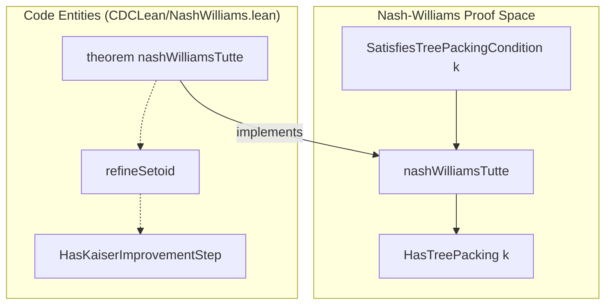
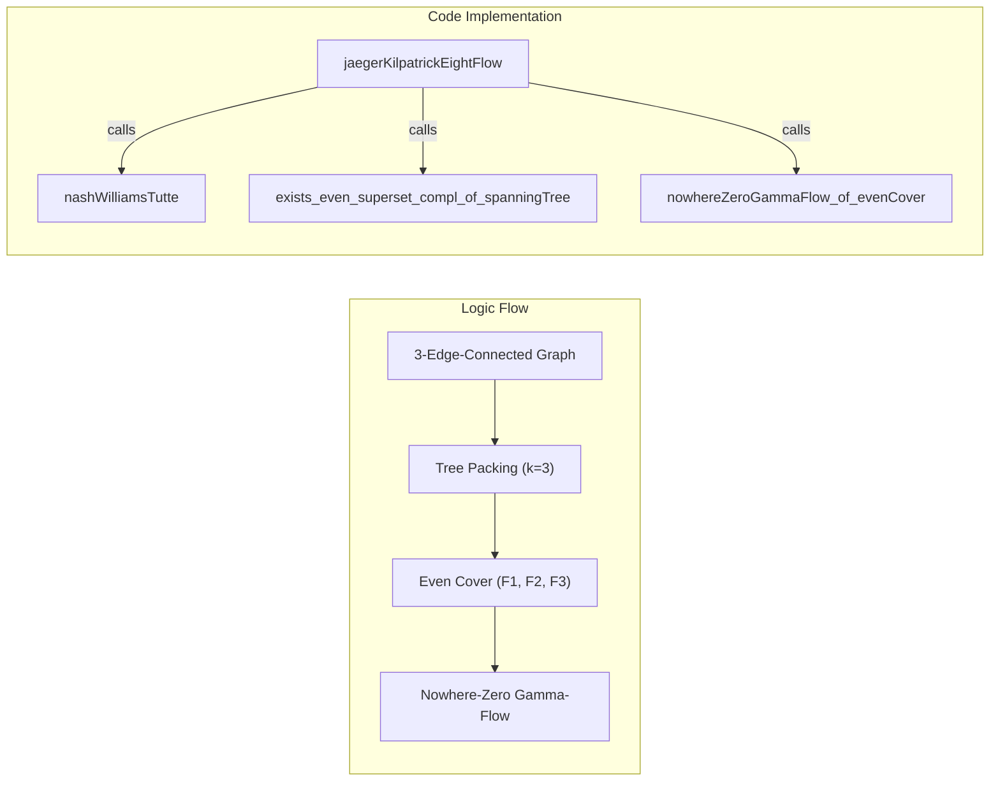

<!-- source: DeepWiki mcp.deepwiki.com · repo openai/cdc-lean · page 3.2 Stage 2: Nowhere-Zero Gamma-Flow via Jaeger–Kilpatrick · fetched 2026-10-26 -->

# Stage 2: Nowhere-Zero Gamma-Flow via Jaeger–Kilpatrick

Relevant source files

The following files were used as context for generating this wiki page:

- [CDCLean/JaegerKilpatrick.lean](CDCLean/JaegerKilpatrick.lean)
- [CDCLean/NashWilliams.lean](CDCLean/NashWilliams.lean)

This stage documents the formalization of the Jaeger–Kilpatrick theorem, which asserts that every 3-edge-connected graph (and by extension, every bridgeless graph via reduction) admits a nowhere-zero flow in the group $\Gamma = (\mathbb{Z}/2\mathbb{Z})^3$. This is equivalent to the existence of a nowhere-zero 8-flow. The implementation follows Kaiser's elementary proof of the Nash-Williams tree packing theorem to construct the flow from edge-disjoint spanning trees.

### 1. The Gamma Group and Even Covers

The group $\Gamma$ is defined as the product group $F_2^3$. A flow in this group is represented as a triple of $F_2$-valued flows. In the formalization, a $\Gamma$-flow is often constructed from an "even cover"—a collection of three even edge sets whose union covers the entire edge set of the graph.

| Function/Theorem | Role |
| :--- | :--- |
| `gammaOfEvenCover` | Encodes three edge sets into a function $E \to \Gamma$. [CDCLean/JaegerKilpatrick.lean:22-23]() |
| `nowhereZeroGammaFlow_of_evenCover` | Proves that if three even edge sets cover $E$, the resulting $\Gamma$-valued function is a nowhere-zero flow. [CDCLean/JaegerKilpatrick.lean:26-30]() |
| `isEvenEdgeSet_support_of_isFlow_f2` | Bridges flow theory and cycle theory by showing the support of an $F_2$ circulation is an even edge set. [CDCLean/JaegerKilpatrick.lean:111-112]() |

**Sources:** [CDCLean/JaegerKilpatrick.lean:22-129]()

---

### 2. Nash-Williams–Tutte Tree Packing

The core of the Jaeger–Kilpatrick theorem relies on finding three edge-disjoint spanning trees. This is guaranteed by the Nash-Williams–Tutte theorem for 3-edge-connected graphs.

#### 2.1 Tree Packing Infrastructure
The codebase defines spanning trees and tree packings for multigraphs using the `FiniteGraph` structure.

*   **`IsSpanningTree`**: Defined as a set of edge objects $S$ that is connected and has cardinality $|V| - 1$. [CDCLean/NashWilliams.lean:40-42]()
*   **`HasTreePacking`**: Asserts the existence of $k$ pairwise edge-disjoint spanning trees. [CDCLean/NashWilliams.lean:44-47]()
*   **`SatisfiesTreePackingCondition`**: The partition-based density condition (the "Nash-Williams inequality") required for a packing to exist. [CDCLean/NashWilliams.lean:89-91]()

#### 2.2 Kaiser's Algorithm
The proof of `nashWilliamsTutte` [CDCLean/NashWilliams.lean:1245-1248]() uses Kaiser's partition refinement algorithm. It starts with a trivial partition and iteratively refines it using the `refineSetoid` operation, which splits partition classes based on connectivity within a specific color class.

**Tree Packing Pipeline**

**Sources:** [CDCLean/NashWilliams.lean:25-101](), [CDCLean/NashWilliams.lean:138-140](), [CDCLean/NashWilliams.lean:1245-1248]()

---

### 3. Flow Construction via Tree Packing

The proof of the main theorem, `jaegerKilpatrickEightFlow`, follows a specific pipeline:

1.  **3-Edge-Connected Case**: If $H$ is 3-edge-connected, the Nash-Williams condition is satisfied for $k=3$ on the `doubleGraph` (a graph where every edge is doubled). [CDCLean/JaegerKilpatrick.lean:185-187]()
2.  **Tree Extraction**: Three disjoint spanning trees $T_1, T_2, T_3$ are obtained.
3.  **Even Set Construction**: For each tree $T_i$, an even edge set $F_i$ is constructed such that $E \setminus T_i \subseteq F_i$. This is done via `exists_even_superset_compl_of_spanningTree`. [CDCLean/JaegerKilpatrick.lean:133-135]()
4.  **Cover Verification**: Since the trees are disjoint, any edge $e$ is absent from at least two trees, ensuring it is included in the union of the complements (and thus the union of the even sets $F_i$).

**Gamma-Flow Construction Flow**

**Sources:** [CDCLean/JaegerKilpatrick.lean:133-179](), [CDCLean/JaegerKilpatrick.lean:450-460]() (implied by logic in file)

---

### 4. Recursive Reduction and Components

The formalization handles graphs that are not 3-edge-connected through recursive decomposition and edge contraction.

*   **Component Decomposition**: The theorem `gammaFlow_of_components` proves that if every connected component of a graph has a $\Gamma$-flow, the whole graph does. [CDCLean/JaegerKilpatrick.lean:280-285]()
*   **Edge Contraction**: If a graph has a cut of size 1 (bridge) or 2, it is reduced.
    *   **Bridges**: Handled by the `Bridgeless` predicate requirement; bridges are forbidden in nowhere-zero flow theory.
    *   **2-Cuts**: The graph is simplified by contracting or merging edges in the cut, maintaining the flow properties.

| Function | Description |
| :--- | :--- |
| `isThreeEdgeConnected` | Predicate checking if every vertex cut has size $\ge 3$. [CDCLean/JaegerKilpatrick.lean:181-182]() |
| `gammaFlow_of_bridgeless` | The top-level result for Stage 2, combining the 3-connected case with reductions. |

**Sources:** [CDCLean/JaegerKilpatrick.lean:181-182](), [CDCLean/JaegerKilpatrick.lean:280-300]()

---

