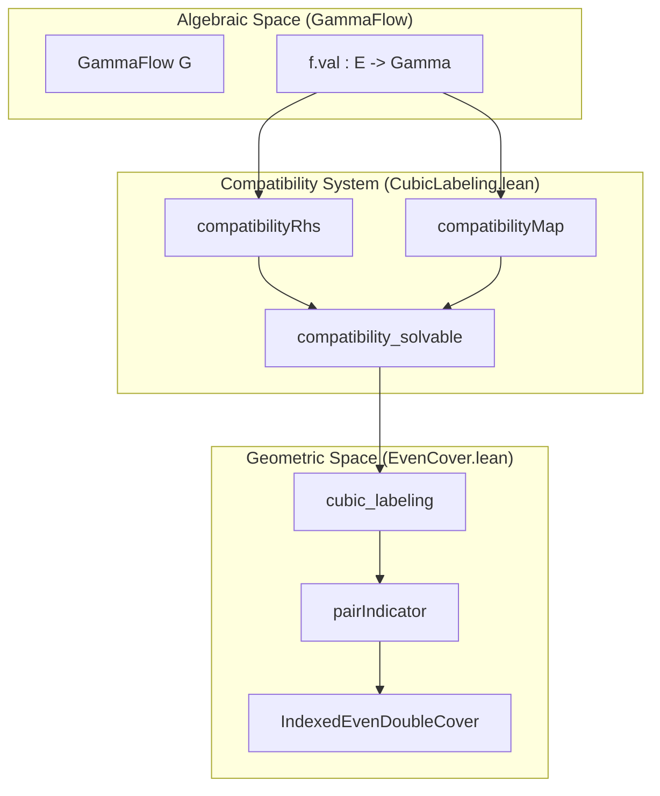
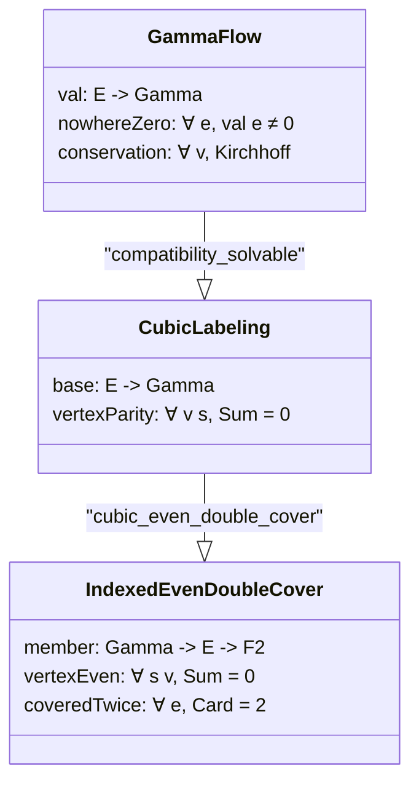

<!-- source: DeepWiki mcp.deepwiki.com · repo openai/cdc-lean · page 3.3 Stage 3: Even Double Cover Construction for Cubic Graphs · fetched 2026-10-26 -->

# Stage 3: Even Double Cover Construction for Cubic Graphs

Relevant source files

The following files were used as context for generating this wiki page:

- [CDCLean/CubicBridge.lean](CDCLean/CubicBridge.lean)
- [CDCLean/CubicLabeling.lean](CDCLean/CubicLabeling.lean)
- [CDCLean/EvenCover.lean](CDCLean/EvenCover.lean)

This stage documents the transformation of a $\Gamma$-flow (where $\Gamma = \mathbb{F}_2^3$) on a cubic graph into an `IndexedEvenDoubleCover`. This is the core combinatorial step of the Cycle Double Cover proof, where the algebraic properties of the flow are translated into a geometric covering of the graph by eight even edge sets.

## Overview of the Construction

The construction relies on assigning to each edge $e$ an affine pair of elements $\{p_e, p_e + f(e)\} \subset \Gamma$. A labeling is considered "compatible" if, at every vertex, the indicators of these pairs sum to zero for every element $s \in \Gamma$. This ensures that for every $s$, the set of edges whose pair contains $s$ forms an even subgraph (a collection of cycles).

### The Cubic Labeling Structure

The `CubicLabeling` structure encapsulates the local pair assignments and the global parity requirement.

| Field | Type | Description |
| :--- | :--- | :--- |
| `base` | `E → Gamma` | The base point $p_e$ for the affine pair on edge $e$. |
| `vertexParity` | `∀ v s, ... = 0` | Proof that at vertex $v$, for any $s \in \Gamma$, the indicators sum to $0$. |

**Sources:** [CDCLean/CubicLabeling.lean:1-10](), [CDCLean/EvenCover.lean:32-34]()

## Data Flow: Flow to Even Cover

The following diagram illustrates how a `GammaFlow` is processed through the compatibility system to produce the final `IndexedEvenDoubleCover`.

### System Entity Map: Construction Pipeline

**Sources:** [CDCLean/CubicLabeling.lean:36-46](), [CDCLean/CubicLabeling.lean:167-169](), [CDCLean/EvenCover.lean:32-45]()

## The Compatibility System

To ensure the vertex parity condition holds, the project solves a linear system over $\mathbb{F}_2$.

### 1. Pair Indicator and Local Parity
The function `pairIndicator` [CDCLean/CubicLabeling.lean:18-18]() returns $1$ if $s \in \{p, p+h\}$ and $0$ otherwise. The theorem `local_pair_parity` [CDCLean/CubicLabeling.lean:22-27]() is a kernel-verified fact (`decide`) stating that if three flow values $x, y, z$ sum to zero at a vertex, there exist base points such that the sum of the indicators is zero for all $s$.

### 2. Linear Map and Solvability
The construction defines a linear map `compatibilityMap` [CDCLean/CubicLabeling.lean:44-55]() and a target vector `compatibilityRhs` [CDCLean/CubicLabeling.lean:40-41]().
*   **`compatibilityMap`**: Represents the constraints imposed by edge boundaries and the flow values.
*   **`compatibilityRhs`**: The specific configuration required by the local base points $g_{v,e}$.

The theorem `compatibility_solvable` [CDCLean/CubicLabeling.lean:167-168]() proves that a solution always exists by showing that all "dual obstructions" vanish. This is a formalized version of the dual-obstruction calculation from the Jaeger-Kilpatrick manuscript.

**Sources:** [CDCLean/CubicLabeling.lean:18-55](), [CDCLean/CubicLabeling.lean:167-180]()

## Indexed Even Double Covers

Once a `CubicLabeling` is obtained via `cubic_labeling`, it is converted into an `IndexedEvenDoubleCover`.

### Structure Definition
The `IndexedEvenDoubleCover` [CDCLean/EvenCover.lean:18-22]() requires:
1.  **`member`**: An indicator function mapping each element of $\Gamma$ and each edge $E$ to $\mathbb{F}_2$.
2.  **`vertexEven`**: For every $s \in \Gamma$, the edges incident to any vertex $v$ must sum to $0 \pmod 2$.
3.  **`coveredTwice`**: Every edge $e$ must be present in exactly two of the eight edge sets.

### Final Construction
The function `cubic_even_double_cover` [CDCLean/EvenCover.lean:32-43]() constructs this object. It uses `pairIndicator_card` [CDCLean/EvenCover.lean:26-29]() to prove the `coveredTwice` property, which relies on the fact that an affine pair $\{p, p+h\}$ with $h \neq 0$ contains exactly two elements.

### Entity Relationship: Labeling to Cover

**Sources:** [CDCLean/CubicLabeling.lean:167-169](), [CDCLean/EvenCover.lean:18-22](), [CDCLean/EvenCover.lean:32-45]()

## Key Theorems and Verification
*   **`local_pair_parity`**: [CDCLean/CubicLabeling.lean:22-27]() (Verified via `decide`).
*   **`local_dual_identity`**: [CDCLean/CubicLabeling.lean:106-114]() (Verified via `decide`).
*   **`pairIndicator_card`**: [CDCLean/EvenCover.lean:26-29]() (Verified via `decide`).

These theorems use Lean's `decide` tactic to exhaustively check all cases in the finite group $\Gamma = \mathbb{F}_2^3$, ensuring the combinatorial foundations are correct without requiring complex group theory proofs in the main pipeline.

**Sources:** [CDCLean/CubicLabeling.lean:22-114](), [CDCLean/EvenCover.lean:26-29]()

---

