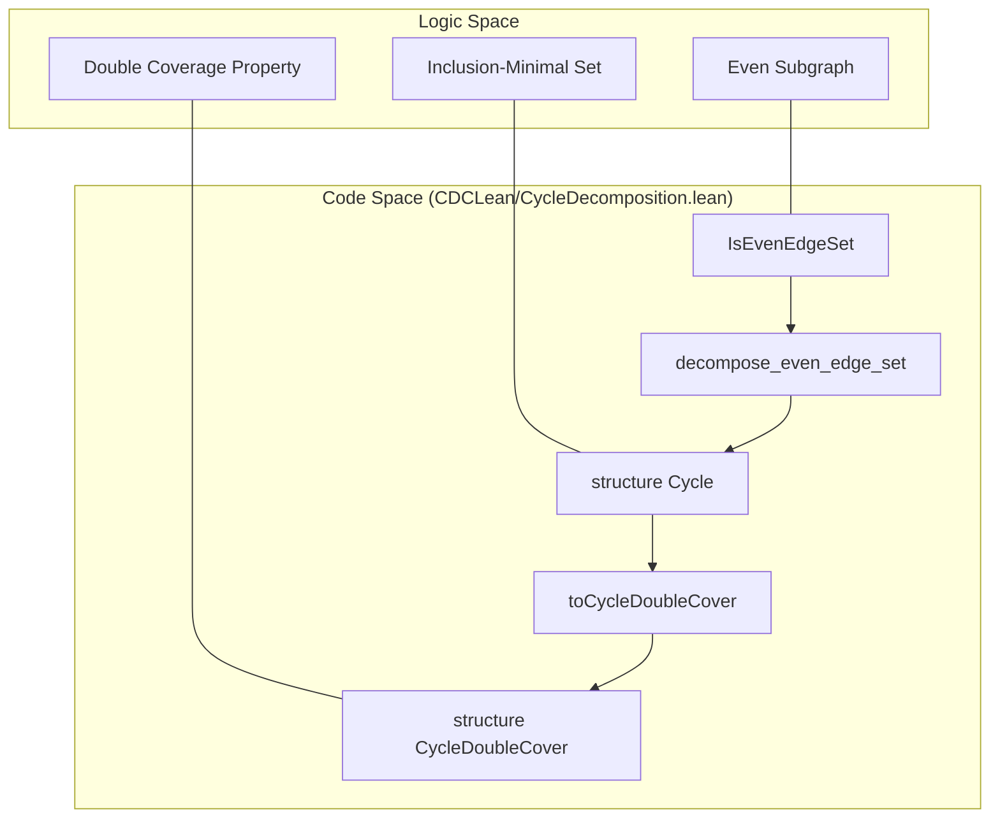

<!-- source: DeepWiki mcp.deepwiki.com · repo openai/cdc-lean · page 3.4 Stage 4: Projection and Cycle Decomposition · fetched 2026-10-26 -->

# Stage 4: Projection and Cycle Decomposition

Relevant source files

The following files were used as context for generating this wiki page:

- [CDCLean/CycleDecomposition.lean](CDCLean/CycleDecomposition.lean)
- [CDCLean/Expansion.lean](CDCLean/Expansion.lean)

The final stage of the Cycle Double Cover (CDC) proof involves two primary tasks: mapping the even double cover found on the cubic expansion back to the original graph, and decomposing the resulting even edge sets into a collection of cycles.

## 1. Projection from Cubic Expansion

Once an `IndexedEvenDoubleCover` is constructed for the `cubicExpansion` of a graph, it must be projected back to the original `FiniteGraph`. This is handled by `projectEvenDoubleCover` in [CDCLean/Expansion.lean:406-417]().

### The Projection Mechanism
The `cubicExpansion` graph's edges consist of two types: **Spokes** (which correspond directly to original edges) and **RingEdges** (which are internal to the expanded vertex structures). 
- The projection function iterates through the three elements of the `Gamma` group.
- For each group element, it filters the original edge set $E$ to include only those edges whose corresponding "Spoke" in the expanded graph is part of the even double cover for that group index.
- Because the cubic cover is an `IndexedEvenDoubleCover`, every edge in the expanded graph is covered exactly twice. Since Spokes map 1-to-1 with original edges, every original edge is also covered exactly twice across the three projected edge sets.

### Preservation of Parity
The core of the projection proof is `project_even` [CDCLean/Expansion.lean:381-404](), which ensures that if an edge set is "even" in the cubic expansion, its projection is "even" in the original graph. This relies on the fact that the expansion preserves the parity of incidences at each vertex fiber.

| Function | Role | Source |
| :--- | :--- | :--- |
| `projectEvenDoubleCover` | Maps the cubic cover to three even edge sets on the original graph. | [CDCLean/Expansion.lean:406-417]() |
| `project_even` | Proves that the projected edge sets satisfy `IsEvenEdgeSet`. | [CDCLean/Expansion.lean:381-404]() |

**Sources:** [CDCLean/Expansion.lean:381-417]()

---

## 2. Cycle Decomposition

After projection, we have three sets of edges, each forming an even subgraph. The Cycle Double Cover conjecture requires a list of **cycles** (inclusion-minimal even sets). The file `CDCLean/CycleDecomposition.lean` provides the machinery to break these even sets into cycles.

### Definitions
- **`IsEvenEdgeSet`**: Defined as a set of edges where every vertex has an even incidence count (sum of incidences in $\mathbb{F}_2$ is 0) [CDCLean/CycleDecomposition.lean:34-35]().
- **`Cycle`**: A structure representing a nonempty, inclusion-minimal even edge set [CDCLean/CycleDecomposition.lean:51-56]().
- **`CycleDoubleCover`**: A list of cycles such that every edge in the graph appears in exactly two cycles [CDCLean/CycleDecomposition.lean:104-106]().

### The Decomposition Algorithm
The function `decompose_even_edge_set` [CDCLean/CycleDecomposition.lean:118-120]() uses strong induction on the size of the edge set. 
1. If the set is empty, the list of cycles is empty.
2. If the set is already minimal, it is a single cycle.
3. If it is not minimal, there exists a proper subset that is even. The algorithm splits the set into that subset and its complement (which is also even by `even_sdiff` [CDCLean/CycleDecomposition.lean:108-114]()), and recursively decomposes both.

### Data Flow: Even Sets to CycleDoubleCover
The final step is `toCycleDoubleCover` [CDCLean/CycleDecomposition.lean:201-205](), which takes the three projected even edge sets and runs `decompose_even_edge_set` on each, concatenating the results into a single `CycleDoubleCover`.

#### Mapping Logic to Code Entities
The following diagram illustrates how the abstract mathematical requirements of a Cycle Double Cover are satisfied by specific Lean structures and functions.

**Entity Mapping: From Even Sets to Cycle Double Cover**

**Sources:** [CDCLean/CycleDecomposition.lean:34-120](), [CDCLean/CycleDecomposition.lean:201-205]()

---

## 3. Implementation Details

### Parallel Edges
In multigraphs, two parallel edges between the same vertices form a cycle of length two. The library explicitly handles this via `parallelPairCycle` [CDCLean/CycleDecomposition.lean:65-100](), which constructs a `Cycle` from two edges satisfying `AreParallel`.

### Data Flow Diagram
The following diagram shows the complete transformation from a `GammaFlow` on a `CubicGraph` to the final `CycleDoubleCover` on the original `FiniteGraph`.

**Process Flow: Stage 3 to Stage 4**

### Key Functions and Structures

| Entity | Description | File Reference |
| :--- | :--- | :--- |
| `Cycle` | Fields: `edges`, `nonempty`, `even`, `minimal`. | [CycleDecomposition.lean:51-56]() |
| `CycleDoubleCover` | Fields: `cycles`, `coveredTwice`. | [CycleDecomposition.lean:104-106]() |
| `parallelPairCycle` | Proves two parallel edges form a minimal even set. | [CycleDecomposition.lean:65-66]() |
| `decompose_even_edge_set` | Recursive theorem producing a `List G.Cycle`. | [CycleDecomposition.lean:118-120]() |
| `toCycleDoubleCover` | Top-level constructor for the final proof object. | [CycleDecomposition.lean:201-205]() |

**Sources:** [CDCLean/CycleDecomposition.lean:34-205](), [CDCLean/Expansion.lean:381-417]()

---

