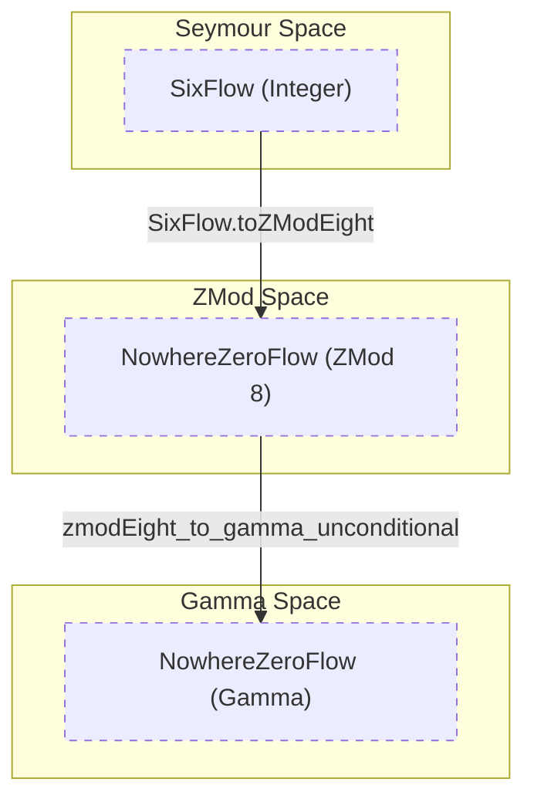
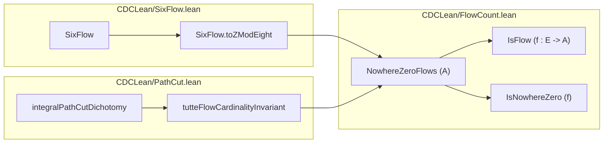

<!-- source: DeepWiki mcp.deepwiki.com · repo openai/cdc-lean · page 4 Flow Theory Subsystem · fetched 2026-10-26 -->

# Flow Theory Subsystem

Relevant source files

The following files were used as context for generating this wiki page:

- [CDCLean/FlowCount.lean](CDCLean/FlowCount.lean)
- [CDCLean/PathCut.lean](CDCLean/PathCut.lean)
- [CDCLean/SixFlow.lean](CDCLean/SixFlow.lean)

The **Flow Theory Subsystem** provides the algebraic infrastructure required to bridge Seymour's 6-flow theorem with the Jaeger–Kilpatrick 8-flow construction used in the Cycle Double Cover proof. It handles the conversion of integer flows to group-valued flows and proves that the existence of a nowhere-zero flow depends only on the order of the coefficient group, not its structure.

## Overview of the Flow Pipeline

The proof pipeline for flow acquisition follows three logical steps:
1.  **Integer to $\mathbb{Z}_8$**: An integer 6-flow (where values are in $\{\pm 1, \dots, \pm 5\}$) is reduced modulo 8. Because the absolute values are strictly less than 8, the flow remains nowhere-zero in $\mathbb{Z}_8$.
2.  **Group-Order Transfer**: Tutte's flow invariance theorem is used to prove that if a graph has a nowhere-zero $\mathbb{Z}_8$-flow, it must also have a nowhere-zero $\Gamma$-flow (where $\Gamma = \mathbb{F}_2^3$), since $|\mathbb{Z}_8| = |\Gamma| = 8$.
3.  **Path-Cut Dichotomy**: The transfer theorem is supported by a fundamental dichotomy: for any edge, there is either an integer cycle passing through it (allowing value adjustment) or a cut that forces its value to zero.

### Flow Theory Data Flow

The following diagram illustrates how flow types are transformed across the subsystem:

**Flow Transformation Sequence**

**Sources:** [CDCLean/SixFlow.lean:20-37](), [CDCLean/PathCut.lean:58-62]()

## Seymour 6-Flow Reduction

The entry point for the flow subsystem is the reduction of a `SixFlow` to a `ZMod 8` flow. A `SixFlow` is defined as an integer circulation where each edge value $x$ satisfies $1 \le |x| \le 5$. 

The function `SixFlow.toZModEight` performs this casting. The proof of correctness relies on the fact that for any integer $x$ where $0 < |x| < 8$, the residue $x \pmod 8$ is non-zero in `ZMod 8`. This ensures that the "nowhere-zero" property is preserved during the reduction.

For details on the `SixFlow` structure and the trust boundary for Seymour's theorem, see [Seymour 6-Flow Reduction (SixFlow and ZMod 8)](#4.1).

**Sources:** [CDCLean/SixFlow.lean:4-37]()

## Tutte's Group-Order Transfer

The core of the subsystem is the implementation of Tutte's theorem on the cardinality of nowhere-zero flows. The theorem states that for a finite graph $G$ and a finite abelian group $A$, the number of nowhere-zero $A$-flows is a polynomial in $|A|-1$.

### Key Components
| Entity | Description | File Reference |
| :--- | :--- | :--- |
| `NowhereZeroFlows A` | The finite type of all nowhere-zero flows with coefficients in group `A`. | [CDCLean/FlowCount.lean:25-27]() |
| `FlowCardinalityInvariant` | The property that $|NowhereZeroFlows A| = |NowhereZeroFlows B|$ if $|A| = |B|$. | [CDCLean/FlowCount.lean:235-240]() |
| `integralPathCutDichotomy` | The constructive proof that every edge is either part of a cycle or part of a cut. | [CDCLean/PathCut.lean:21-51]() |

The `zmodEight_to_gamma_unconditional` theorem applies this theory to specifically move from `ZMod 8` to `Gamma` ($\mathbb{F}_2^3$). This transfer is "unconditional" because the `integralPathCutDichotomy` is proved within the library, requiring no external axioms about group theory or graph connectivity.

For details on the inclusion-exclusion reduction and the path-cut recurrence, see [Tutte's Group-Order Transfer (FlowCount and PathCut)](#4.2).

**Sources:** [CDCLean/FlowCount.lean:7-15](), [CDCLean/PathCut.lean:53-62]()

## Code Entity Map

This diagram maps the high-level flow concepts to the specific Lean entities and predicates defined in the source files.

**Flow Entity Relationship**

**Sources:** [CDCLean/FlowCount.lean:25-35](), [CDCLean/PathCut.lean:21-56](), [CDCLean/SixFlow.lean:21-22]()

---

