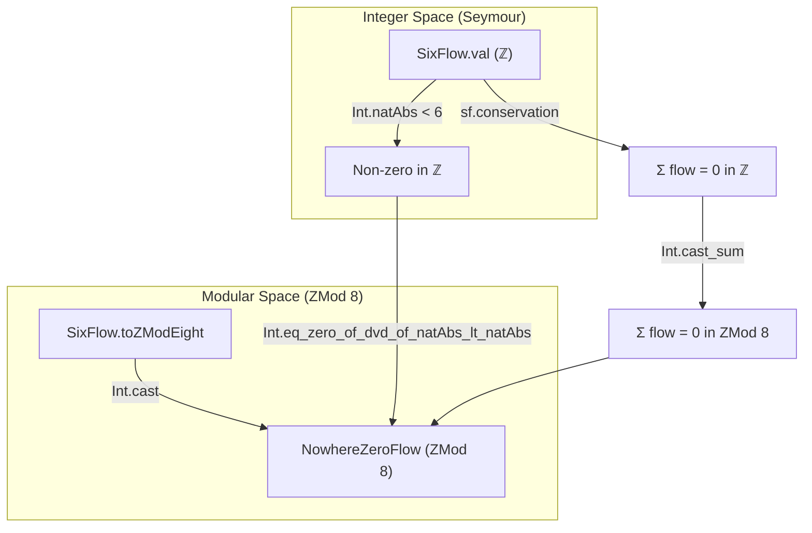
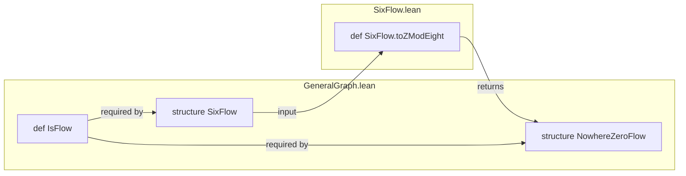

<!-- source: DeepWiki mcp.deepwiki.com · repo openai/cdc-lean · page 4.1 Seymour 6-Flow Reduction (SixFlow and ZMod 8) · fetched 2026-10-26 -->

# Seymour 6-Flow Reduction (SixFlow and ZMod 8)

Relevant source files

The following files were used as context for generating this wiki page:

- [CDCLean/GeneralGraph.lean](CDCLean/GeneralGraph.lean)
- [CDCLean/SixFlow.lean](CDCLean/SixFlow.lean)

This page documents the formalization of integer 6-flows and their reduction to modular flows. In the CDCLean pipeline, this represents the transition from Seymour's 6-flow theorem (an external premise) to the internal group-valued flow machinery used to construct cycle double covers.

## Overview

The `SixFlow` structure represents an integer-valued circulation where each edge value is constrained to the set $\{-5, -4, -3, -2, -1, 1, 2, 3, 4, 5\}$. Because these values are strictly between $-8$ and $8$ (and non-zero), they can be safely cast into `ZMod 8` without losing the "nowhere-zero" property. This reduction is a prerequisite for the Gamma-flow transfer, which eventually enables the construction of the even double cover.

### Logic Flow: From Integers to ZMod 8

The following diagram illustrates how an integer flow is transformed into a modular flow while preserving the conservation laws.

**Flow Reduction Data Path**

Sources: [CDCLean/SixFlow.lean:21-37](), [CDCLean/GeneralGraph.lean:63-67]()

## The SixFlow Structure

The `SixFlow` structure is defined on a `FiniteGraph`. It captures the properties of an integer flow as specified in Seymour's 6-flow theorem.

| Field | Type | Description |
| :--- | :--- | :--- |
| `val` | `E → ℤ` | The assignment of an integer to each edge. |
| `conservation` | `G.IsFlow val` | The signed sum of values at every vertex is zero. |
| `bound` | `∀ e, 0 < natAbs (val e) ∧ natAbs (val e) < 6` | Ensures the flow is nowhere-zero and bounded by 6. |

Sources: [CDCLean/GeneralGraph.lean:63-67]()

### Trust Boundary: SeymourSixFlowStatement

Because Seymour's 6-flow theorem is a deep result in graph theory, CDCLean treats it as a trust boundary. The property `SeymourSixFlowStatement` defines the proposition that every bridgeless finite graph admits a `SixFlow`. This allows the rest of the proof to proceed conditionally on this statement.

Sources: [CDCLean/GeneralGraph.lean:75-77]()

## Reduction to ZMod 8

The function `SixFlow.toZModEight` performs the casting of the integer flow into the group `ZMod 8`. 

### Conservation Preservation
The proof that conservation holds in `ZMod 8` is handled by applying `Int.cast` to the integer conservation equality. The lemmas `Int.cast_sub` and `Int.cast_sum` ensure that the sum-of-differences structure is maintained in the modular ring [CDCLean/SixFlow.lean:23-26]().

### Nowhere-Zero Preservation
The most critical part of the reduction is ensuring that no non-zero integer value becomes zero in `ZMod 8`. This is guaranteed because:
1.  The `SixFlow.bound` ensures the absolute value of the flow on any edge $e$ is strictly less than 6 [CDCLean/GeneralGraph.lean:66-66]().
2.  Since $6 < 8$, the absolute value is strictly less than the modulus [CDCLean/SixFlow.lean:34-35]().
3.  An integer $z$ maps to $0 \pmod n$ if and only if $n$ divides $z$. If $0 < |z| < n$, then $n$ cannot divide $z$, so the image in `ZMod n` is non-zero [CDCLean/SixFlow.lean:32-36]().

**Code Entity Map: SixFlow to NowhereZeroFlow**

Sources: [CDCLean/GeneralGraph.lean:55-72](), [CDCLean/SixFlow.lean:21-22]()

## Key Functions and Definitions

### FiniteGraph.IsFlow
Defines the signed conservation law for a function $f$ on edges. For a vertex $v$, it calculates the sum of values on edges where $v$ is the first endpoint (index 0) and subtracts the sum of values where $v$ is the second endpoint (index 1).
Sources: [CDCLean/GeneralGraph.lean:55-58]()

### SixFlow.toZModEight
The primary constructor for converting integer flows to modular flows. It produces a `NowhereZeroFlow (ZMod 8)` which is the required input for the subsequent `zmodEight_to_gamma_unconditional` transfer.
Sources: [CDCLean/SixFlow.lean:21-37]()

| Entity | Location | Role |
| :--- | :--- | :--- |
| `SixFlow` | [CDCLean/GeneralGraph.lean:63]() | Defines integer 6-flow constraints. |
| `NowhereZeroFlow` | [CDCLean/GeneralGraph.lean:69]() | Generic group-valued flow structure. |
| `toZModEight` | [CDCLean/SixFlow.lean:21]() | Logic for casting $\mathbb{Z} \to \mathbb{Z}_8$. |
| `SeymourSixFlowStatement` | [CDCLean/GeneralGraph.lean:75]() | The logical premise for flow existence. |

Sources: [CDCLean/GeneralGraph.lean:63-77](), [CDCLean/SixFlow.lean:21-22]()

---

