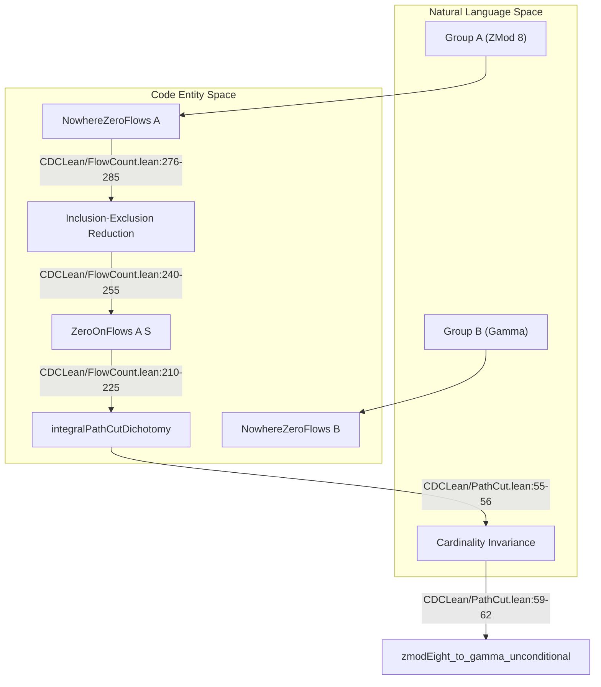
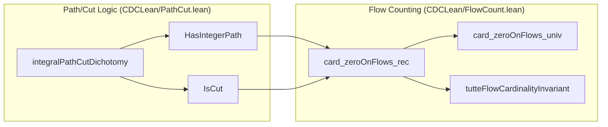

<!-- source: DeepWiki mcp.deepwiki.com · repo openai/cdc-lean · page 4.2 Tutte's Group-Order Transfer (FlowCount and PathCut) · fetched 2026-10-26 -->

# Tutte's Group-Order Transfer (FlowCount and PathCut)

Relevant source files

The following files were used as context for generating this wiki page:

- [CDCLean/FlowCount.lean](CDCLean/FlowCount.lean)
- [CDCLean/PathCut.lean](CDCLean/PathCut.lean)

This page documents the formalization of Tutte's flow cardinality invariance theorem. This theorem establishes that for a fixed finite graph $G$, the number of nowhere-zero $A$-flows depends only on the order of the finite abelian group $A$, not its specific structure [CDCLean/FlowCount.lean:7-10](). This result is critical for the CDCLean project as it allows the transfer of a nowhere-zero flow from $\mathbb{Z}_8$ (obtained via Seymour's 6-flow theorem) to the group $\Gamma = (\mathbb{Z}_2)^3$ without requiring additional axioms [CDCLean/FlowCount.lean:12-16]().

## Overview of Flow Counting

The proof strategy employs inclusion-exclusion to reduce the problem of counting nowhere-zero flows to the problem of counting flows that vanish on a specific edge set $S$ [CDCLean/FlowCount.lean:12-13]().

### Key Definitions

| Entity | Description | File Reference |
| :--- | :--- | :--- |
| `NowhereZeroFlows A` | Subtype of functions $E \to A$ that satisfy the flow conservation law and are nowhere zero. | [CDCLean/FlowCount.lean:26-27]() |
| `Flows A` | Subtype of functions $E \to A$ satisfying flow conservation, allowing zeros. | [CDCLean/FlowCount.lean:35-35]() |
| `ZeroOnFlows A S` | Flows that are constrained to be zero on a specific subset of edges $S \subseteq E$. | [CDCLean/FlowCount.lean:44-45]() |
| `FlowCardinalityInvariant` | The predicate stating that for any two finite abelian groups $A$ and $B$ of the same order, the number of nowhere-zero flows is equal. | [CDCLean/FlowCount.lean:258-261]() |

### Data Flow: From Groups to Cardinality

The following diagram illustrates how the codebase relates group structures to the final flow transfer.

**Group-Order Transfer Pipeline**

Sources: [CDCLean/FlowCount.lean:210-285](), [CDCLean/PathCut.lean:55-62]()

## The Path-Cut Dichotomy

The core of the invariance proof is an edge-addition recurrence. For a fixed set of forbidden edges $S$, the endpoints of a distinguished edge $e \in S$ either:
1.  Are joined by an integer chain supported outside $S$ (a path).
2.  Form a cut crossed by no allowed edge (a cut).

This is formalized as `integralPathCutDichotomy` [CDCLean/PathCut.lean:21-22]().

### Recursive Reduction Logic

The function `card_zeroOnFlows_rec` [CDCLean/FlowCount.lean:210-213]() computes the number of flows by considering an edge $e \notin S$:
*   If there is a cycle correction (path), the cardinality is $|A| \cdot |ZeroOnFlows(S \cup \{e\})|$.
*   If there is a separating cut, the cardinality is $|ZeroOnFlows(S \cup \{e\})|$.

This recurrence eventually reduces to the base case where $S$ contains all edges (`Finset.univ`), where there is exactly one flow (the zero flow) [CDCLean/FlowCount.lean:98-113]().

**Recurrence and Path-Cut Interaction**

Sources: [CDCLean/FlowCount.lean:98-113](), [CDCLean/FlowCount.lean:210-256](), [CDCLean/PathCut.lean:21-56]()

## Group Transfer: ZMod 8 to Gamma

The final objective of this subsystem is `zmodEight_to_gamma_unconditional` [CDCLean/PathCut.lean:59-62]().

1.  **Seymour's Theorem**: Provides a `NowhereZeroFlow (ZMod 8)` (via `SixFlow.toZModEight`).
2.  **Invariance Proof**: `tutteFlowCardinalityInvariant` is proven using the path-cut dichotomy [CDCLean/PathCut.lean:55-56]().
3.  **Transfer**: Since $|\mathbb{Z}_8| = 8$ and $|\Gamma| = 2^3 = 8$, the existence of a flow in one group implies existence in the other [CDCLean/FlowCount.lean:314-319]().

### Key Functions

*   `integralPathCutDichotomy`: Proves that for any edge and edge-set, either an integer path exists or a cut exists [CDCLean/PathCut.lean:21-51]().
*   `flowCardinalityInvariant_of_pathCut`: The inductive proof that the path-cut dichotomy implies group-order invariance [CDCLean/FlowCount.lean:253-256]().
*   `zmodEight_to_gamma`: The specific application of the invariance to the groups $\mathbb{Z}_8$ and $\Gamma$ [CDCLean/FlowCount.lean:314-319]().

Sources: [CDCLean/FlowCount.lean:253-319](), [CDCLean/PathCut.lean:21-62]()

---

