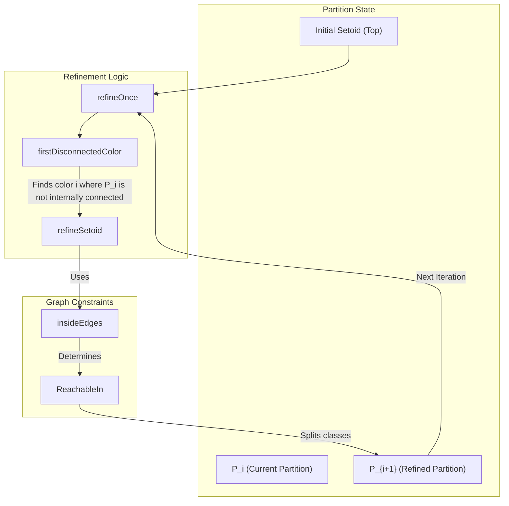
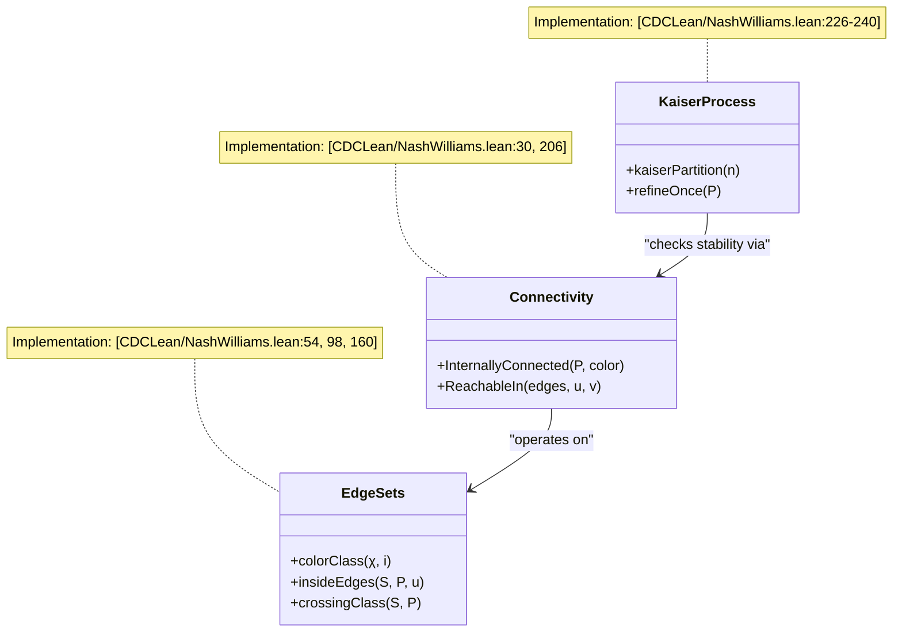

<!-- source: DeepWiki mcp.deepwiki.com · repo openai/cdc-lean · page 5.1 Partition Refinement and Kaiser's Algorithm · fetched 2026-10-26 -->

# Partition Refinement and Kaiser's Algorithm

Relevant source files

The following files were used as context for generating this wiki page:

- [CDCLean/NashWilliams.lean](CDCLean/NashWilliams.lean)

This page provides a technical deep dive into the partition refinement process used in the proof of the Nash-Williams–Tutte spanning tree packing theorem. The core of the implementation in `CDCLean/NashWilliams.lean` follows Kaiser's elementary algorithm, which uses a deterministic refinement sequence to find a stable partition that satisfies the tree-packing condition.

## Overview of the Refinement Process

Kaiser's algorithm relies on iteratively refining a partition of vertices (represented as a `Setoid V`) based on the connectivity of specific edge sets. In the context of the `nashWilliamsTutte` theorem, we aim to find $k$ edge-disjoint spanning trees. The refinement process identifies whether a given edge-coloring provides sufficient connectivity or if the partition must be further subdivided to satisfy the packing inequality.

### Key Data Structures

The refinement logic operates on the following primary entities:

| Entity | Code Symbol | Role |
| :--- | :--- | :--- |
| **Support Graph** | `supportGraph` | A `SimpleGraph` representation of a set of multiedges used for reachability queries [CDCLean/NashWilliams.lean:25-27](). |
| **Crossing Edges** | `crossingEdges` | The set of all edges in $G$ that connect different classes of a partition $P$ [CDCLean/NashWilliams.lean:50-52](). |
| **Inside Edges** | `insideEdges` | Edges belonging to a specific set $S$ whose endpoints both reside within the same class of $P$ [CDCLean/NashWilliams.lean:98-100](). |
| **Setoid Refinement** | `refineSetoid` | The fundamental step that splits a class of $P$ into connected components based on `insideEdges` [CDCLean/NashWilliams.lean:138-152](). |

**Sources:** [CDCLean/NashWilliams.lean:25-152]()

## Kaiser Partition Sequence

The refinement is driven by the `kaiserPartition` sequence. This sequence starts with the trivial partition (one class containing all vertices) and iteratively applies `refineOnce`.

### Refinement Logic Flow

The following diagram illustrates the relationship between the partition refinement functions and the underlying graph connectivity.

**Diagram: Partition Refinement Data Flow**

**Sources:** [CDCLean/NashWilliams.lean:138-250]()

### Implementation Details

1.  **Internally Connected**: A partition $P$ is `InternallyConnected` with respect to an edge coloring $\chi$ and color $i$ if, for every class in $P$, the edges of color $i$ inside that class make the class connected [CDCLean/NashWilliams.lean:206-208]().
2.  **First Disconnected Color**: The function `firstDisconnectedColor` searches for the smallest index $i < k$ such that $P$ is not internally connected by color $i$ [CDCLean/NashWilliams.lean:216-218]().
3.  **Refine Once**: If a disconnected color $i$ is found, `refineOnce` returns `refineSetoid P (colorClass χ i)`. Otherwise, it returns $P$ itself, indicating a stable state [CDCLean/NashWilliams.lean:226-231]().
4.  **Kaiser Partition**: This is defined recursively as $P_{n+1} = \text{refineOnce}(P_n)$ [CDCLean/NashWilliams.lean:237-240]().

**Sources:** [CDCLean/NashWilliams.lean:206-240]()

## Stable Partitions and Existence Proof

The refinement process is guaranteed to terminate because the number of classes in the partition is bounded by the number of vertices $|V|$, and each non-trivial `refineSetoid` step strictly increases the number of classes.

### The `kaiserStablePartition`
A partition is considered "stable" if `refineOnce P χ = P`. This occurs if and only if $P$ is `InternallyConnected` for all colors $i \in \{0, \dots, k-1\}$ [CDCLean/NashWilliams.lean:247-250]().

### Mapping Code Entities to Mathematical Concepts

The following diagram bridges the algorithmic implementation to the formal properties required by the Nash-Williams proof.

**Diagram: Kaiser Algorithm to Code Entity Mapping**

**Sources:** [CDCLean/NashWilliams.lean:30-240]()

## Deterministic Refinement and Nash-Williams

The deterministic nature of `kaiserPartition` is crucial for the "sufficiency" part of the `nashWilliamsTutte` theorem. By starting with a coloring $\chi$ that maximizes a specific lexicographic objective (involving the number of components and the "level" of superfluous edges), the algorithm ensures that a stable partition $P$ eventually satisfies:

$$k \cdot (|V/P| - 1) \leq |CrossingEdges(P)|$$

If this condition is violated, Kaiser's exchange argument (detailed in Section 5.2) provides a way to modify the coloring $\chi$ to improve the objective function, contradicting the maximality of the initial coloring.

### Key Functions Summary

| Function | File Location | Purpose |
| :--- | :--- | :--- |
| `refineSetoid` | [CDCLean/NashWilliams.lean:138]() | Core logic for splitting partition classes. |
| `InternallyConnected` | [CDCLean/NashWilliams.lean:206]() | Predicate for stability check. |
| `firstDisconnectedColor` | [CDCLean/NashWilliams.lean:216]() | Deterministic choice of the next color to refine. |
| `kaiserPartition` | [CDCLean/NashWilliams.lean:237]() | The sequence of partitions driving the proof. |

**Sources:** [CDCLean/NashWilliams.lean:138-237]()

---

