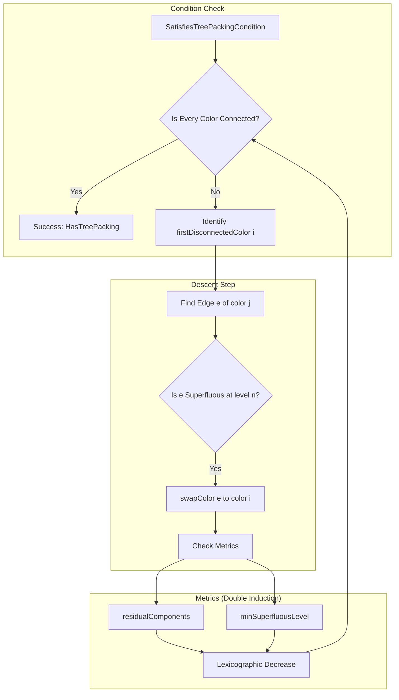
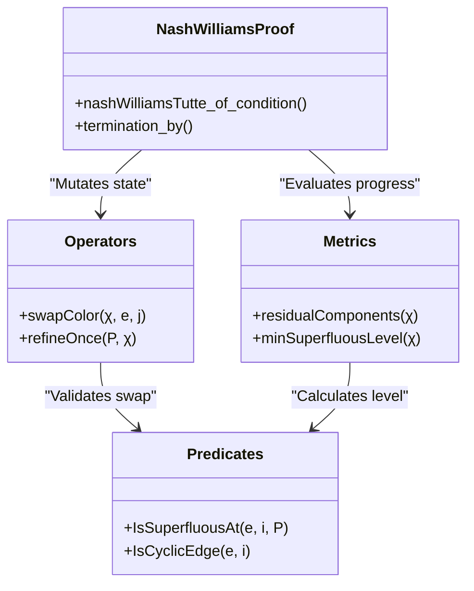

<!-- source: DeepWiki mcp.deepwiki.com · repo openai/cdc-lean · page 5.2 Exchange Argument and Lexicographic Descent · fetched 2026-10-26 -->

# Exchange Argument and Lexicographic Descent

Relevant source files

The following files were used as context for generating this wiki page:

- [CDCLean/NashWilliams.lean](CDCLean/NashWilliams.lean)

This page documents the sufficiency direction of the Nash-Williams–Tutte theorem (the proof that the partition condition implies the existence of $k$ edge-disjoint spanning trees). The implementation follows Kaiser’s elementary exchange argument, utilizing a double induction on the number of residual components and a "superfluous level" metric to prove termination.

## Exchange Mechanism and Edge Swapping

The core of the constructive proof is the ability to swap an edge of one color for an edge of another color to improve the connectivity of a specific tree without destroying the spanning property of others.

### `swapColor`
The function `swapColor` performs a local modification to an edge coloring $\chi: E \to \text{Fin } k$. It reassigns a specific edge $e$ from its current color to a new target color $j$.

[CDCLean/NashWilliams.lean:244-246]()

### `IsCyclicEdge`
An edge $e$ is "cyclic" for a color $i$ if its removal from the set of edges of color $i$ does not disconnect the graph. Because spanning trees are defined by the cardinality $|V|-1$ and connectivity, an edge $e \in T_i$ is cyclic if and only if $T_i \setminus \{e\}$ remains connected.

[CDCLean/NashWilliams.lean:255-257]()

### Improvement Steps
The predicate `HasKaiserImprovementStep` identifies a state where a local swap can strictly improve the "quality" of the tree packing. An improvement step exists if there is an edge $e$ of color $i$ and a target color $j$ such that $e$ is cyclic in color $i$ and $e$ connects two different components of color $j$.

[CDCLean/NashWilliams.lean:329-333]()

**Sources:**
- `CDCLean/NashWilliams.lean` [244-246](), [255-257](), [329-333]()

---

## Superfluous Edges and Levels

To guide the descent, the proof tracks "superfluous" edges—edges that can be removed from a tree without losing connectivity—and categorizes them by their "level" in the Kaiser partition sequence.

### `IsSuperfluousAt`
An edge $e$ is superfluous at color $i$ and partition $P$ if it is a cyclic edge for color $i$ and its endpoints belong to the same class in $P$.

[CDCLean/NashWilliams.lean:341-343]()

### `minSuperfluousLevel`
The Kaiser partition sequence $P_0, P_1, \dots$ (generated by `kaiserPartition`) eventually stabilizes. The "level" of a superfluous edge $e$ is the smallest $n$ such that $e$ is superfluous with respect to $P_n$. The `minSuperfluousLevel` is the minimum such $n$ across all colors and all edges.

[CDCLean/NashWilliams.lean:352-358]()

### Logic Flow of the Exchange Argument

The following diagram illustrates how the exchange argument moves an edge $e$ across colors to reduce the number of components or the level of superfluous edges.

**Title: Exchange Logic and Lexicographic Descent**

**Sources:**
- `CDCLean/NashWilliams.lean` [341-343](), [352-358](), [421-432]()

---

## Lexicographic Descent and Termination

The proof that the exchange process terminates relies on a double induction over a pair of natural numbers:
1.  **`residualComponents`**: The sum of the number of connected components across all $k$ colors, minus the ideal state ($k$ components).
2.  **`minSuperfluousLevel`**: The minimum level at which an edge is superfluous.

### Termination Proof Structure
The theorem `nashWilliamsTutte_of_condition` uses the `termination_by` clause in Lean to specify this lexicographic ordering.

[CDCLean/NashWilliams.lean:458-461]()

| State Variable | Definition | Role in Descent |
| :--- | :--- | :--- |
| `residualComponents` | $\sum_{i < k} (\text{count components of } T_i) - k$ | Primary metric; decreases when a swap connects a previously disconnected color. |
| `minSuperfluousLevel` | $\min \{ n \mid \exists e, i, \text{IsSuperfluousAt } G \ e \ i \ (P_n) \}$ | Secondary metric; decreases when a swap moves a superfluous edge to a lower partition level. |

### System Entity Map: Descent Implementation

This diagram maps the mathematical concepts of the descent to the specific functions in `NashWilliams.lean`.

**Title: Code Entities for Lexicographic Descent**

**Sources:**
- `CDCLean/NashWilliams.lean` [421-432](), [458-461](), [352-358]()

---

## Final Sufficiency Result

The final result of this exchange argument is the sufficiency direction of the Nash-Williams–Tutte theorem. It establishes that if a graph $G$ satisfies the partition inequality for $k$, it must possess $k$ edge-disjoint spanning trees.

### `nashWilliamsTutte`
The top-level theorem in this module combines the necessity (trivial) and sufficiency (proven via descent) directions.

[CDCLean/NashWilliams.lean:475-478]()

**Sources:**
- `CDCLean/NashWilliams.lean` [475-478]()

---

