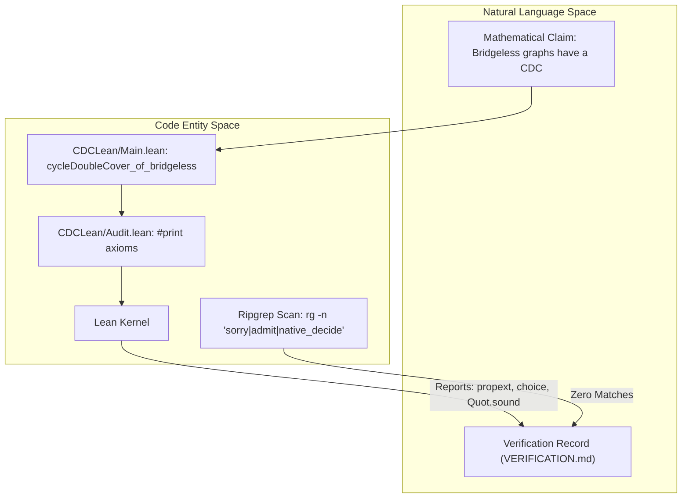

<!-- source: DeepWiki mcp.deepwiki.com · repo openai/cdc-lean · page 6 Axiom Audit and Formal Verification Record · fetched 2026-10-26 -->

# Axiom Audit and Formal Verification Record

Relevant source files

The following files were used as context for generating this wiki page:

- [CDCLean/Audit.lean](CDCLean/Audit.lean)
- [README.md](README.md)
- [VERIFICATION.md](VERIFICATION.md)

The **Axiom Audit and Formal Verification Record** documents the integrity verification layer of the CDCLean project. This layer ensures that the formal proof of the Cycle Double Cover conjecture—specifically the `cycleDoubleCover_of_bridgeless` theorem—is logically sound and free of unvetted assumptions. The project employs a multi-layered verification strategy combining Lean's kernel axiom reporting, source-code hygiene scans, and a structured audit module.

## Verification Architecture

The verification process is designed to bridge the gap between high-level mathematical claims and the low-level Lean kernel. It relies on the `#print axioms` command to recursively inspect the dependency tree of theorems.

### Integrity Verification Flow
The following diagram illustrates how the verification tools interact with the codebase to produce the verification record.

"Verification Toolchain Flow"

Sources: [CDCLean/Audit.lean:1-21](), [README.md:31-39](), [VERIFICATION.md:10-25]()

## The Audit Module: CDCLean/Audit.lean

The file `CDCLean/Audit.lean` serves as the centralized trust anchor for the project. It imports the entire proof pipeline and executes `#print axioms` on key checkpoints to verify that no "sorry" (incomplete proofs) or project-specific axioms have leaked into the core logic.

### Permitted Axioms
The project is considered "unconditional" because it relies only on the standard Lean 4 / Mathlib foundational axioms:
1.  `propext`: Propositional extensionality.
2.  `Classical.choice`: The axiom of choice (required for non-constructive graph theory).
3.  `Quot.sound`: The quotient soundness axiom.

Any theorem reporting axioms beyond these three (such as `native_decide` or user-defined `axiom` declarations) is flagged as a verification failure.

Sources: [CDCLean/Audit.lean:6-9](), [VERIFICATION.md:22-24]()

## Source-Scan Hygiene Check

In addition to kernel-level checks, the project mandates a source-level hygiene scan using `ripgrep`. This prevents the use of "trust-me" tactics or unsafe language features that might bypass the kernel's standard dependency tracking.

| Command Component | Purpose |
| :--- | :--- |
| `\bsorry\b` | Ensures no unfinished proof obligations remain. |
| `\badmit\b` | Detects deprecated placeholder tactics. |
| `\bnative_decide\b` | Prevents reliance on the host's compiled code for truth (Kernel-only reduction). |
| `^\s*(axiom\|opaque\|unsafe)\b` | Blocks unvetted axioms or code that bypasses the logic engine. |

Sources: [README.md:33-36](), [VERIFICATION.md:12-15]()

## Verification Record (VERIFICATION.md)

The `VERIFICATION.md` file provides a timestamped log of a clean audit. It records the specific toolchain versions (Lean `v4.31.0` and a specific Mathlib git revision) used to produce the proof, ensuring reproducibility.

### Toolchain and Result Summary
*   **Lean Version:** `v4.31.0` [VERIFICATION.md:7-7]()
*   **Mathlib Revision:** `9a9483a92959bc92bd6a60176dd1fe597298c1f8` [VERIFICATION.md:8-8]()
*   **Audit Result:** 1727 Lake jobs succeeded with zero warnings and zero forbidden axioms [VERIFICATION.md:20-25]().

## Sub-Pages

### [Audited Theorems and Critical Checkpoints](#6.1)
This page lists every specific theorem targeted by the `Audit.lean` module, from `cycleDoubleCover_of_bridgeless` down to local parity lemmas like `local_pair_parity`. It explains what each checkpoint verifies about the proof's axiom dependencies.
For details, see [Audited Theorems and Critical Checkpoints](#6.1).

### [Conditional Theorem Boundary: CubicTheorem](#6.2)
This page documents how the project handles external dependencies (like Seymour’s 6-flow theorem) by structuring them as explicit theorem arguments in `CDCLean/CubicTheorem.lean`. This ensures that even "conditional" results are verified relative to their premises without introducing new axioms.
For details, see [Conditional Theorem Boundary: CubicTheorem](#6.2).

Sources: [CDCLean/Audit.lean:11-20](), [VERIFICATION.md:26-30]()

---

