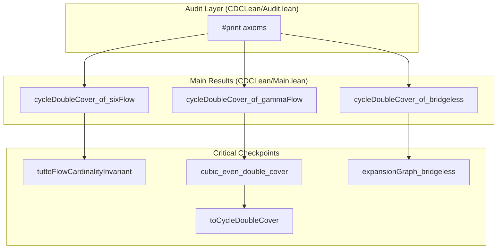
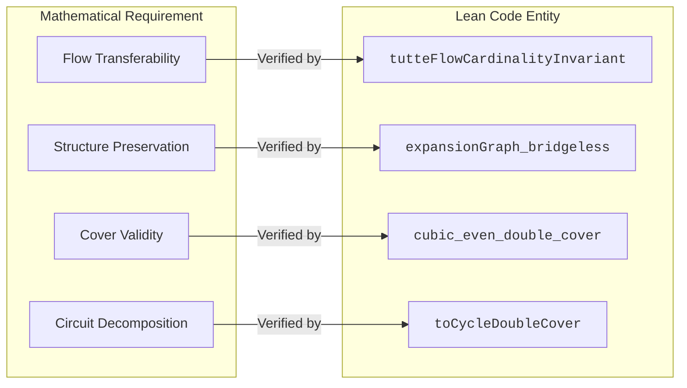

<!-- source: DeepWiki mcp.deepwiki.com · repo openai/cdc-lean · page 6.1 Audited Theorems and Critical Checkpoints · fetched 2026-10-26 -->

# 6.1 Audited Theorems and Critical Checkpoints

Relevant source files

The following files were used as context for generating this wiki page:

- [CDCLean/Audit.lean](CDCLean/Audit.lean)
- [CDCLean/Main.lean](CDCLean/Main.lean)

This page documents the formal verification layer of the CDCLean project. The integrity of the Cycle Double Cover proof relies on ensuring that the high-level theorems do not inadvertently rely on unproven axioms (such as `sorry` or `admit`) or non-standard logical foundations. The `CDCLean/Audit.lean` module serves as the primary verification tool, utilizing the Lean kernel's `#print axioms` command to inspect the dependency graph of the core results.

## Overview of the Audit Mechanism

The audit process verifies that every step in the pipeline—from cubic expansion to cycle decomposition—is grounded in the standard Lean 4 axioms: `propext`, `Classical.choice`, and `Quot.sound` [CDCLean/Audit.lean:6-9](). By running the audit module, the system generates a definitive list of all primitive assumptions used by the theorems listed below.

### Verification Data Flow

The following diagram illustrates how the audit module interfaces with the proof pipeline to verify logical consistency across different mathematical domains.

**Audit Verification Flow**

**Sources:** [CDCLean/Audit.lean:11-20](), [CDCLean/Main.lean:24-67]()

---

## Primary Audited Theorems

These theorems represent the top-level entry points of the library. Their audit ensures the entire CDC conjecture (or its flow-based reductions) is verified.

### 1. `cycleDoubleCover_of_bridgeless`
*   **Purpose:** The final proof of the Cycle Double Cover Conjecture for any finite bridgeless graph.
*   **Verification Role:** It confirms the successful composition of the Jaeger-Kilpatrick 8-flow theorem with the cubic expansion and even double cover projection.
*   **Location:** [CDCLean/Main.lean:58-67]()
*   **Audit Checkpoint:** [CDCLean/Audit.lean:20]()

### 2. `cycleDoubleCover_of_sixFlow`
*   **Purpose:** Proves that if Seymour's 6-flow theorem is assumed, a Cycle Double Cover exists.
*   **Verification Role:** This isolates the "Flow-to-CDC" construction. It verifies that the transformation from an integer 6-flow to a $\Gamma$-flow (via Tutte's transfer) and then to a cover is logically sound.
*   **Location:** [CDCLean/Main.lean:24-40]()
*   **Audit Checkpoint:** [CDCLean/Audit.lean:18]()

### 3. `cycleDoubleCover_of_gammaFlow`
*   **Purpose:** A mid-level entry point that constructs a CDC given a $\Gamma$-flow on a cubic expansion.
*   **Verification Role:** Ensures the `projectEvenDoubleCover` and `toCycleDoubleCover` logic is correct independently of how the flow was obtained.
*   **Location:** [CDCLean/Main.lean:44-53]()
*   **Audit Checkpoint:** [CDCLean/Audit.lean:19]()

---

## Critical Checkpoints and Axiom Dependencies

The audit module targets specific lemmas that bridge different graph-theoretic representations. These are the "critical checkpoints."

| Theorem / Lemma | File Location | Verification Purpose |
| :--- | :--- | :--- |
| `local_pair_parity` | `CDCLean/CubicLabeling.lean` | Verifies the parity logic at each cubic vertex slot. |
| `local_dual_identity` | `CDCLean/CubicLabeling.lean` | Ensures the dual labeling of edge-ends is consistent. |
| `compatibility_solvable` | `CDCLean/CubicLabeling.lean` | Verifies the existence of a labeling given the flow constraints. |
| `cubic_even_double_cover` | `CDCLean/EvenCover.lean` | The core construction for cubic graphs. |
| `expansionGraph_bridgeless` | `CDCLean/Expansion.lean` | Confirms that the rotation system expansion preserves bridgelessness. |
| `tutteFlowCardinalityInvariant` | `CDCLean/FlowCount.lean` | Verifies Tutte's theorem on group-order independence for flows. |
| `toCycleDoubleCover` | `CDCLean/CycleDecomposition.lean` | Validates the decomposition of even edge sets into cycles. |

### Logic Space to Code Entity Space

This diagram maps the abstract mathematical requirements to the specific Lean entities that the audit module inspects to ensure no "black box" axioms are used.

**Checkpoint Mapping**

**Sources:** [CDCLean/Audit.lean:11-17](), [CDCLean/Main.lean:31-40]()

### Implementation Detail: The `#print axioms` Command
The audit is implemented by calling `#print axioms` on the symbols listed in `CDCLean/Audit.lean`. For instance:
*   `#print axioms CDCLean.FiniteGraph.tutteFlowCardinalityInvariant` [CDCLean/Audit.lean:16]() checks that the proof of Tutte's transfer does not use `sorry`.
*   `#print axioms CDCLean.cycleDoubleCover_of_sixFlow` [CDCLean/Audit.lean:18]() checks the entire integration, including the `SeymourSixFlowStatement` premise.

**Sources:**
- `CDCLean/Audit.lean:1-21`
- `CDCLean/Main.lean:1-70`

---

