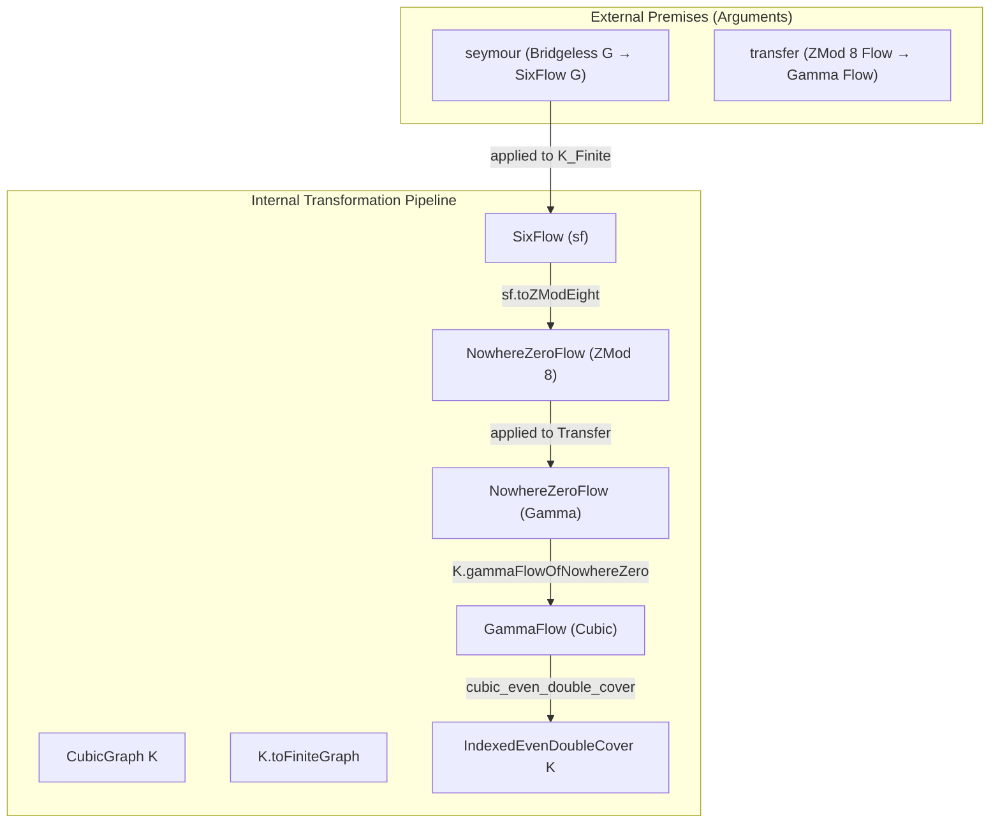
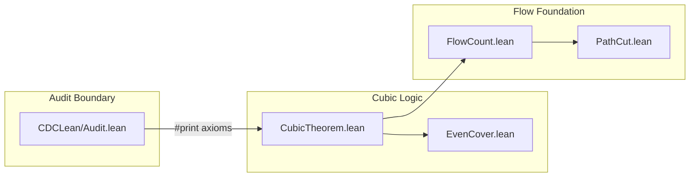

<!-- source: DeepWiki mcp.deepwiki.com · repo openai/cdc-lean · page 6.2 Conditional Theorem Boundary: CubicTheorem · fetched 2026-10-26 -->

# Conditional Theorem Boundary: CubicTheorem

Relevant source files

The following files were used as context for generating this wiki page:

- [CDCLean/Audit.lean](CDCLean/Audit.lean)
- [CDCLean/CubicTheorem.lean](CDCLean/CubicTheorem.lean)

This page documents the formal structure of the cubic case of the Cycle Double Cover (CDC) conjecture within `CDCLean/CubicTheorem.lean`. The implementation is designed to create a clear "trust boundary" by isolating the internal cubic graph proofs from external premises, such as Seymour's 6-flow theorem and Tutte's group-order transfer theorem.

## Overview of the Cubic Boundary

The cubic theorem serves as a bridge between high-level flow existence results and the concrete construction of even double covers. In `CDCLean`, this is structured to make external dependencies explicit as theorem arguments. This approach allows the verification of the cubic-specific logic independently of whether the 6-flow theorem is treated as an axiom or a proved lemma.

### Key Definitions

| Entity | Role | Source |
| :--- | :--- | :--- |
| `OrderEightFlowTransferStatement` | A `Prop` defining the requirement that a $\mathbb{Z}_8$-flow implies a $\Gamma$-flow. | [CDCLean/CubicTheorem.lean:13-16]() |
| `cubic_even_double_cover_of_sixFlow` | The main conditional theorem linking Seymour's 6-flow to an `IndexedEvenDoubleCover`. | [CDCLean/CubicTheorem.lean:21-31]() |
| `cubic_even_double_cover_of_sixFlow_of_cardinalityInvariant` | A variant using the `FlowCardinalityInvariant` predicate directly. | [CDCLean/CubicTheorem.lean:35-44]() |

Sources: [CDCLean/CubicTheorem.lean:1-47]()

## Data Flow: From Flow to Even Double Cover

The following diagram illustrates how the `CubicTheorem` module orchestrates the transformation of a 6-flow (provided by the `seymour` hypothesis) into an `IndexedEvenDoubleCover` using the internal `cubic_even_double_cover` construction.

### Logic Flow in cubic_even_double_cover_of_sixFlow

Sources: [CDCLean/CubicTheorem.lean:21-31](), [CDCLean/SixFlow.lean:1-50]() (for `toZModEight`), [CDCLean/EvenCover.lean:1-100]() (for `cubic_even_double_cover`)

## Implementation Details

### OrderEightFlowTransferStatement
The `OrderEightFlowTransferStatement` is a specialized proposition stating that for every `FiniteGraph`, the existence of a nowhere-zero $\mathbb{Z}_8$-flow implies the existence of a nowhere-zero $\Gamma$-flow (where $\Gamma = \mathbb{F}_2^3$). 

While this is proved unconditionally in the `FlowCount` and `PathCut` modules, it is retained as a named definition in `CubicTheorem.lean` to provide a precise integration boundary for the manuscript's proof structure.
- **File Location**: [CDCLean/CubicTheorem.lean:13-16]()

### Theorem Variants
The module provides two ways to satisfy the flow transfer requirement:

1.  **Explicit Transfer Function**: `cubic_even_double_cover_of_sixFlow` accepts a function `transfer` that performs the mapping between flow types.
    - Source: [CDCLean/CubicTheorem.lean:21-31]()
2.  **Cardinality Invariant**: `cubic_even_double_cover_of_sixFlow_of_cardinalityInvariant` accepts the `FlowCardinalityInvariant` property for the specific graph. It uses `K.toFiniteGraph.zmodEight_to_gamma` to derive the $\Gamma$-flow.
    - Source: [CDCLean/CubicTheorem.lean:35-44]()

### System Mapping: Code Entities to Logic
This table bridges the natural language requirements of the CDC conjecture to the specific Lean entities used in the cubic boundary.

| Natural Language Concept | Code Entity | File Reference |
| :--- | :--- | :--- |
| Bridgeless Condition | `FiniteGraph.Bridgeless` | [CDCLean/GeneralGraph.lean:172-173]() |
| Integer 6-Flow | `SixFlow` | [CDCLean/SixFlow.lean:20-24]() |
| Group Order Transfer | `zmodEight_to_gamma` | [CDCLean/FlowCount.lean:305-310]() |
| Cubic Graph Conversion | `K.toFiniteGraph` | [CDCLean/Basic.lean:68-75]() |
| Double Cover Result | `IndexedEvenDoubleCover` | [CDCLean/GeneralGraph.lean:250-258]() |

Sources: [CDCLean/CubicTheorem.lean:21-44](), [CDCLean/GeneralGraph.lean:1-300](), [CDCLean/Basic.lean:1-100]()

## Integration with Audit
The theorems in `CubicTheorem.lean` are essential for the kernel trust audit performed in `CDCLean/Audit.lean`. By checking the axioms of `cycleDoubleCover_of_sixFlow`, the system ensures that the entire cubic pipeline—from flow acquisition to cycle decomposition—relies only on the standard Lean axioms (`propext`, `Classical.choice`, and `Quot.sound`).

Sources: [CDCLean/Audit.lean:1-21](), [CDCLean/CubicTheorem.lean:1-5]()

---

