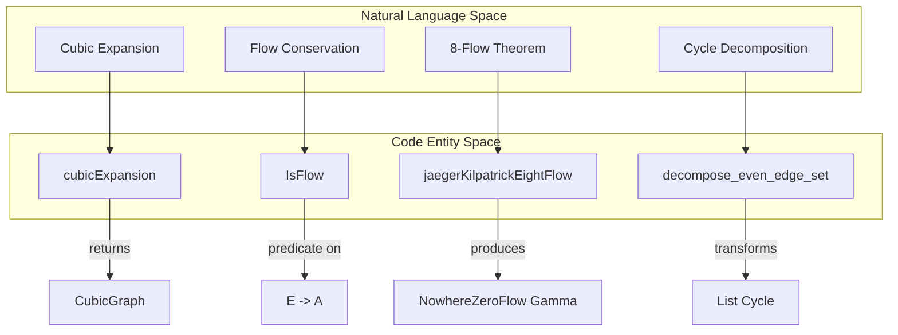

<!-- source: DeepWiki mcp.deepwiki.com · repo openai/cdc-lean · page 7 Glossary · fetched 2026-10-26 -->

# Glossary

Relevant source files

The following files were used as context for generating this wiki page:

- [CDCLean/Basic.lean](CDCLean/Basic.lean)
- [CDCLean/CubicBridge.lean](CDCLean/CubicBridge.lean)
- [CDCLean/CubicLabeling.lean](CDCLean/CubicLabeling.lean)
- [CDCLean/CubicTheorem.lean](CDCLean/CubicTheorem.lean)
- [CDCLean/CycleDecomposition.lean](CDCLean/CycleDecomposition.lean)
- [CDCLean/EvenCover.lean](CDCLean/EvenCover.lean)
- [CDCLean/Expansion.lean](CDCLean/Expansion.lean)
- [CDCLean/FlowCount.lean](CDCLean/FlowCount.lean)
- [CDCLean/GeneralGraph.lean](CDCLean/GeneralGraph.lean)
- [CDCLean/JaegerKilpatrick.lean](CDCLean/JaegerKilpatrick.lean)
- [CDCLean/Main.lean](CDCLean/Main.lean)
- [CDCLean/NashWilliams.lean](CDCLean/NashWilliams.lean)
- [CDCLean/PathCut.lean](CDCLean/PathCut.lean)
- [CDCLean/SixFlow.lean](CDCLean/SixFlow.lean)
- [README.md](README.md)
- [VERIFICATION.md](VERIFICATION.md)

This page provides definitions for the domain-specific terminology, mathematical structures, and Lean-specific idioms used in the CDCLean formalization. It serves as a technical reference for onboarding engineers to map mathematical concepts to their implementation in the codebase.

## 1. Core Graph Structures

### FiniteGraph
The primary representation for general multigraphs. Unlike simple graphs, `FiniteGraph` allows multiple edges between the same pair of vertices and represents edges as first-class objects.
- **Implementation**: Defined as a structure with a vertex type `V`, an edge type `E`, and a function `endAt : E → Fin 2 → V` mapping each edge end to a vertex [CDCLean/GeneralGraph.lean:13-17]().
- **Loopless Constraint**: Every edge `e` must satisfy `endAt e 0 ≠ endAt e 1` [CDCLean/GeneralGraph.lean:16-16]().

### CubicGraph
A specialized graph structure where every vertex has degree exactly three.
- **Implementation**: Uses an incidence equivalence `(V × Fin 3) ≃ (E × Fin 2)` to bijectively map three "slots" at each vertex to the two ends of each edge [CDCLean/Basic.lean:30-34]().
- **Role**: Serves as the domain for the affine-pair construction and the primary target for expansion from general graphs.

### HalfEdge
A specific end of a specific edge.
- **Definition**: A subtype of `E × Fin 2` representing a directed incidence [CDCLean/GeneralGraph.lean:19-20]().
- **Usage**: Used extensively in `Expansion.lean` to define the vertex set of the expanded cubic graph [CDCLean/Expansion.lean:211-213]().

### RotationSystem
A combinatorial structure used to transform a general graph into a cubic one.
- **Components**: A permutation `next` on `HalfEdge` objects that cycles through incidences at a vertex [CDCLean/Expansion.lean:22-28]().
- **Fiber Transitivity**: Ensures that the `next` permutation can reach all half-edges incident to a given vertex, preserving connectivity during expansion [CDCLean/Expansion.lean:26-28]().

Sources: [CDCLean/GeneralGraph.lean:13-20](), [CDCLean/Basic.lean:30-34](), [CDCLean/Expansion.lean:22-28]().

---

## 2. Flow Theory Concepts

### Gamma ($\Gamma$)
The additive group used for the core labeling argument.
- **Definition**: The elementary abelian 2-group $( \mathbb{Z}/2\mathbb{Z} )^3$, implemented as `Fin 3 → ZMod 2` [CDCLean/Basic.lean:25-25]().

### IsFlow
A predicate defining the flow conservation law (Kirchhoff's Law) for a function from edges to an additive group.
- **Implementation**: For each vertex $v$, the sum of flow on incoming edges minus the sum of flow on outgoing edges must equal zero [CDCLean/GeneralGraph.lean:47-50]().
- **Cubic Case**: In characteristic two (like $\Gamma$), orientation signs disappear; conservation is simply the sum of values on the three edges incident to a vertex [CDCLean/Basic.lean:98-98]().

### NowhereZeroFlow
A flow where no edge is assigned the zero element of the group.
- **Structure**: A subtype `f : E → A` satisfying `IsFlow f` and `∀ e, f e ≠ 0` [CDCLean/GeneralGraph.lean:56-59]().

### SixFlow
A nowhere-zero flow with values in the set $\{ \pm 1, \pm 2, \pm 3, \pm 4, \pm 5 \}$.
- **Usage**: Represents the output of Seymour’s 6-flow theorem, which is converted to a `ZMod 8` flow and eventually a `Gamma` flow [CDCLean/SixFlow.lean:20-25]().

Sources: [CDCLean/Basic.lean:25-98](), [CDCLean/GeneralGraph.lean:47-59](), [CDCLean/SixFlow.lean:20-25]().

---

## 3. Double Covers and Decompositions

### Cycle
In this codebase, a cycle is defined as a nonempty inclusion-minimal even edge set.
- **Implementation**: A structure containing a `Finset E` of edges, a proof of non-emptiness, a proof that the set is even, and a proof of minimality [CDCLean/CycleDecomposition.lean:51-56]().

### IndexedEvenDoubleCover
A collection of even edge sets (one for each element of $\Gamma$) that together cover every edge exactly twice.
- **Structure**: Maps each $s \in \Gamma$ to a set of edges such that for every edge $e$, the number of sets containing $e$ is exactly two [CDCLean/GeneralGraph.lean:75-80]().

### CycleDoubleCover
The final goal of the proof: a list of `Cycle` objects such that every edge in the graph appears in exactly two cycles.
- **Definition**: A structure containing `cycles : List G.Cycle` and a proof `coveredTwice` [CDCLean/CycleDecomposition.lean:104-107]().

Sources: [CDCLean/CycleDecomposition.lean:51-107](), [CDCLean/GeneralGraph.lean:75-80]().

---

## 4. Key Mathematical Mappings

### System-to-Code Entity Map

The following diagram bridges the mathematical concepts found in literature to the specific entities implemented in the Lean codebase.

**Mathematical to Code Entity Mapping**

Sources: [CDCLean/Expansion.lean:211-215](), [CDCLean/GeneralGraph.lean:47-50](), [CDCLean/JaegerKilpatrick.lean:454-457](), [CDCLean/CycleDecomposition.lean:118-120]().

---

## 5. Data Flow of the Main Theorem

The `cycleDoubleCover_of_bridgeless` theorem coordinates several subsystems to transform a bridgeless graph into its cycle double cover.

**Main Proof Pipeline**

```mermaid
graph LR
    G["FiniteGraph (Bridgeless)"] -- "rotationSystemOfBridgeless" --> R["RotationSystem"]
    R -- "cubicExpansion" --> K["CubicGraph"]
    K -- "jaegerKilpatrickEightFlow" --> Gamma["NowhereZeroFlow Gamma"]
    Gamma -- "cubic_even_double_cover" --> EDC["IndexedEvenDoubleCover"]
    EDC -- "projectEvenDoubleCover" --> PEDC["Projected Even Cover"]
    PEDC -- "toCycleDoubleCover" --> CDC["CycleDoubleCover"]

    style G stroke-width:2px
    style CDC stroke-width:4px
```

Sources: [CDCLean/Main.lean:58-67](), [CDCLean/Expansion.lean:334-338](), [CDCLean/CycleDecomposition.lean:195-198]().

---

## 6. Abbreviations and Lean Idioms

| Term | Definition | Source |
| :--- | :--- | :--- |
| `F₂` | The field with two elements (ZMod 2). | [CDCLean/Basic.lean:22]() |
| `Gamma` | The group $(\mathbb{Z}/2\mathbb{Z})^3$. | [CDCLean/Basic.lean:25]() |
| `hb` | Conventionally used as a variable name for a "bridgeless" proof term. | [CDCLean/Main.lean:27]() |
| `hK` | Conventionally used as a variable name for a property of the cubic graph `K`. | [CDCLean/Main.lean:31]() |
| `decide` | A Lean tactic used to prove propositions by computational evaluation (used for local parity facts). | [CDCLean/CubicLabeling.lean:27]() |
| `omega` | A Lean tactic for solving linear integer arithmetic goals. | [CDCLean/Expansion.lean:39]() |
| `sorry` | A placeholder for an incomplete proof. (Audited to be absent in the final build). | [VERIFICATION.md:15]() |

Sources: [CDCLean/Basic.lean:22-25](), [CDCLean/Main.lean:27-31](), [CDCLean/CubicLabeling.lean:27-27](), [CDCLean/Expansion.lean:39-39](), [VERIFICATION.md:15-15]().