# Page: Overview

# Overview

<details>
<summary>Relevant source files</summary>

The following files were used as context for generating this wiki page:

- [CDCLean.lean](CDCLean.lean)
- [CDCLean/Audit.lean](CDCLean/Audit.lean)
- [CDCLean/Main.lean](CDCLean/Main.lean)
- [README.md](README.md)
- [VERIFICATION.md](VERIFICATION.md)

</details>


The **CDCLean** project provides a formal verification of the Cycle Double Cover (CDC) conjecture for finite loopless bridgeless multigraphs. The project establishes that every such graph possesses a cycle double cover by leveraging a formalized version of the Jaeger–Kilpatrick eight-flow theorem and a constructive pipeline that transforms flows into even covers.

The project is implemented in Lean 4 and is designed to be self-contained, with all major graph-theoretic reductions—such as cubic expansion, coefficient transfer, and circuit decomposition—proved internally within the library.

### Core Proof Strategy
The proof follows a multi-stage transformation process:
1.  **Expansion**: An arbitrary bridgeless graph is expanded into a 3-regular (cubic) graph while preserving bridgelessness.
2.  **Flow Acquisition**: A nowhere-zero flow is obtained for the cubic expansion. This is done either via the internal Jaeger–Kilpatrick theorem (producing a $\mathbb{Z}_2^3$ flow) or by assuming Seymour’s 6-flow theorem.
3.  **Even Cover Construction**: The flow is used to construct an `IndexedEvenDoubleCover` on the cubic graph.
4.  **Projection & Decomposition**: The cover is projected back to the original graph and decomposed into a collection of cycles.

The following diagram maps the high-level logic to the primary code entities:

**Logic to Code Entity Map**
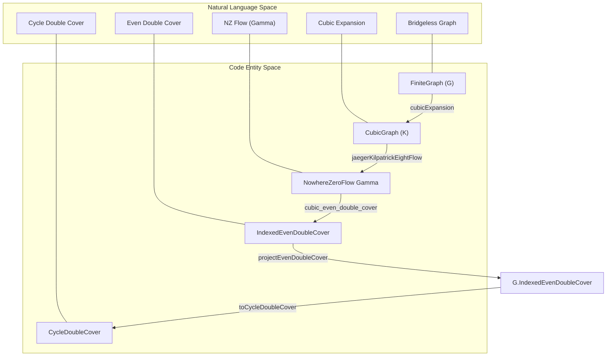
**Sources:** [CDCLean/Main.lean:24-68](), [CDCLean/Expansion.lean:1-10](), [CDCLean/JaegerKilpatrick.lean:1-13]()

---

### Project Structure and Subsystems

The codebase is organized into several major subsystems, each responsible for a specific layer of the proof.

| Subsystem | Primary Files | Responsibility |
| :--- | :--- | :--- |
| **Top-Level Theorems** | `Main.lean` | Assembles the full pipeline into `cycleDoubleCover_of_bridgeless`. |
| **Graph Theory** | `GeneralGraph.lean`, `Basic.lean` | Defines `FiniteGraph` and `CubicGraph` structures. |
| **Flow Theory** | `FlowCount.lean`, `PathCut.lean` | Implements Tutte’s group-order transfer and path-cut dualities. |
| **Expansion** | `Expansion.lean` | Handles the `RotationSystem` and `cubicExpansion` logic. |
| **Flow Construction** | `JaegerKilpatrick.lean`, `NashWilliams.lean` | Proves the existence of flows via spanning tree packings. |
| **Cover Construction** | `EvenCover.lean`, `CubicLabeling.lean` | Converts flows into edge covers. |
| **Decomposition** | `CycleDecomposition.lean` | Decomposes even edge sets into cycles. |

**Subsystem Inter-dependency**
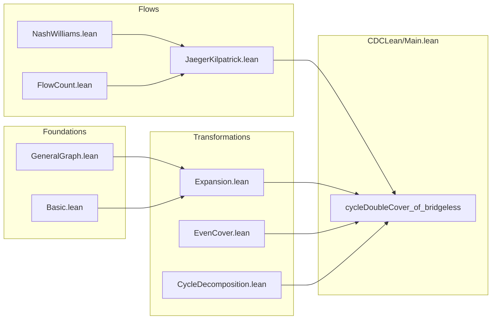
**Sources:** [CDCLean.lean:1-15](), [CDCLean/Main.lean:1-6]()

---

### Build and Verification

The project enforces strict hygiene and axiom standards. The final theorem, `cycleDoubleCover_of_bridgeless`, is verified to depend only on Lean's standard axioms: `propext`, `Classical.choice`, and `Quot.sound`.

*   **Toolchain**: Lean `v4.31.0`.
*   **Audit**: Uses `CDCLean/Audit.lean` to print axioms for critical theorems.
*   **Hygiene**: A source scan ensures no `sorry`, `admit`, or `native_decide` commands are used.

For detailed instructions on setting up the environment and running the verification scripts, see **[Getting Started: Build and Verification](#1.1)**.

**Sources:** [README.md:1-40](), [VERIFICATION.md:1-30](), [CDCLean/Audit.lean:1-21]()

---

### Entry Points

The primary entry points for users looking to understand or utilize the proof are located in `CDCLean/Main.lean`. These include:
*   `cycleDoubleCover_of_bridgeless`: The main unconditional result.
*   `cycleDoubleCover_of_sixFlow`: A conditional result taking Seymour's 6-flow theorem as an argument.
*   `cycleDoubleCover_of_gammaFlow`: A construction starting from a pre-existing $\mathbb{Z}_2^3$ flow.

For a technical breakdown of these signatures and their logical roles, see **[Top-Level Theorems and Proof Entry Points](#1.2)**.

**Sources:** [CDCLean/Main.lean:24-68]()

---

# Page: Getting Started: Build and Verification

# Getting Started: Build and Verification

<details>
<summary>Relevant source files</summary>

The following files were used as context for generating this wiki page:

- [README.md](README.md)
- [VERIFICATION.md](VERIFICATION.md)
- [lake-manifest.json](lake-manifest.json)
- [lakefile.toml](lakefile.toml)
- [lean-toolchain](lean-toolchain)

</details>


This page provides technical instructions for setting up the CDCLean environment, building the library using the Lake build system, and executing the formal verification suite to ensure the proof of the Cycle Double Cover theorem is logically sound and free of unvetted axioms.

## Toolchain Pinning and Dependencies

The CDCLean project is pinned to specific versions of the Lean 4 compiler and Mathlib to ensure reproducible builds and proof stability. The project relies on a consistent environment to verify the `cycleDoubleCover_of_bridgeless` theorem.

| Component | Version / Revision |
| :--- | :--- |
| **Lean Toolchain** | `v4.31.0` |
| **Mathlib4** | `9a9483a92959bc92bd6a60176dd1fe597298c1f8` |

Sources: [lean-toolchain:1-1](), [lakefile.toml:7-8](), [lake-manifest.json:8-8](), [VERIFICATION.md:7-8]()

## Build Process

The project uses `lake`, the Lean build tool, to manage dependencies and compile the source files. The build process involves approximately 1727 jobs when compiling from scratch.

### Step-by-Step Installation

1.  **Install Elan**: If `elan` (the Lean version manager) is not installed, use the official installer:
    ```bash
    curl https://raw.githubusercontent.com/leanprover/elan/master/elan-init.sh -sSf | sh
    source "$HOME/.elan/env"
    ```
2.  **Clone and Update**:
    ```bash
    git clone https://github.com/openai/cdc-lean.git
    cd cdc-lean
    lake update
    ```
3.  **Fetch Cache**: To avoid compiling all of Mathlib from source, fetch the pre-built cloud cache:
    ```bash
    lake exe cache get
    ```
4.  **Build Library**: Compile the `CDCLean` target:
    ```bash
    lake build CDCLean
    ```

Sources: [README.md:11-26](), [VERIFICATION.md:20-20]()

### Build Data Flow
The following diagram illustrates how Lake orchestrates the build using the pinned toolchain and external dependencies.

**Lake Build Pipeline**
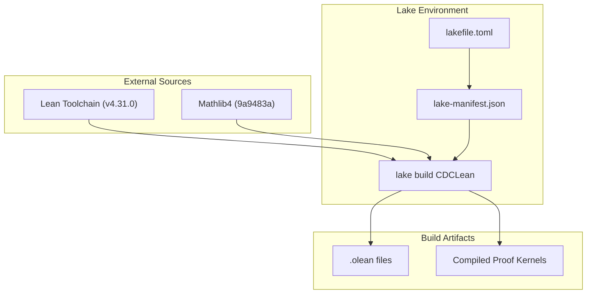
Sources: [lake-manifest.json:1-96](), [lakefile.toml:1-12](), [README.md:20-25]()

## Verification and Axiom Audit

Verification in CDCLean consists of two primary phases: a **Kernel Audit** using Lean's `#print axioms` command and a **Source Hygiene Scan** using `grep` (or `rg`).

### 1. Kernel Audit (Axiom Check)
The kernel audit ensures that the final proof of `CDCLean.cycleDoubleCover_of_bridgeless` and its dependencies do not rely on "cheats" (like `sorry`) or unvetted logical axioms.

Run the audit module:
```bash
lake env lean CDCLean/Audit.lean
```

**Permitted Axioms:**
The Lean kernel must report exactly these three standard axioms:
*   `propext`: Propositional Extensionality.
*   `Classical.choice`: The Axiom of Choice.
*   `Quot.sound`: Quotient Soundness.

Any other axioms (e.g., project-specific `axiom` or `opaque` definitions) indicate a gap in the formalization.

Sources: [README.md:31-39](), [VERIFICATION.md:22-24]()

### 2. Source Hygiene Scan
The source scan is a secondary check to ensure no "unsafe" Lean keywords are used in the `.lean` files.

Run the following command from the repository root:
```bash
rg -n '\bsorry\b|\badmit\b|\bnative_decide\b|^\s*(axiom|opaque|unsafe)\b' --glob '*.lean' .
```

This scan targets:
*   `sorry` / `admit`: Incomplete proofs.
*   `native_decide`: External solvers that bypass the Lean kernel.
*   `axiom` / `opaque`: Unproven assumptions.
*   `unsafe`: Code that bypasses Lean's memory or logic safety.

Sources: [README.md:35-36](), [VERIFICATION.md:15-15]()

## Interpreting the Verification Record

The file `VERIFICATION.md` serves as a timestamped record of the library's integrity. It documents the exact environment and results of the audit process.

**Verification Artifacts and Code Entities**
The following diagram maps the verification process to the specific files and theorems checked within the codebase.

**Verification Mapping**
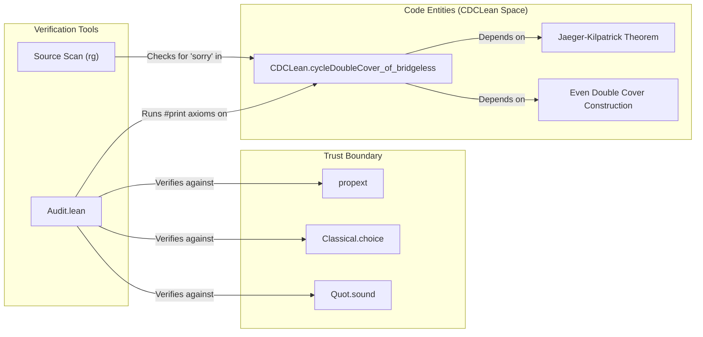
Sources: [VERIFICATION.md:1-30](), [README.md:1-7](), [CDCLean/Audit.lean (referenced)]()

### Success Criteria
A successful verification is confirmed when:
1.  `lake build` completes with 0 warnings and 0 errors.
2.  The source scan returns no matches.
3.  The axiom audit for the final theorem reports only the three permitted standard axioms.

Sources: [VERIFICATION.md:18-24]()

---

# Page: Top-Level Theorems and Proof Entry Points

# Top-Level Theorems and Proof Entry Points

<details>
<summary>Relevant source files</summary>

The following files were used as context for generating this wiki page:

- [CDCLean.lean](CDCLean.lean)
- [CDCLean/Audit.lean](CDCLean/Audit.lean)
- [CDCLean/Main.lean](CDCLean/Main.lean)

</details>


This page documents the primary entry points for the Cycle Double Cover (CDC) proof within the `CDCLean` library. The implementation is centered in `CDCLean/Main.lean`, which serves as the assembly point for the various subsystems (expansion, flow theory, and even cover construction).

The project provides three distinct paths to the CDC result, depending on the starting premise: a generic bridgeless graph, a graph equipped with a 6-flow, or a cubic expansion equipped with a $\Gamma$-flow.

## The Proof Pipeline

The transformation from a bridgeless graph to a Cycle Double Cover follows a multi-stage pipeline. The top-level theorems in `CDCLean/Main.lean` orchestrate this data flow.

### Logical Data Flow Diagram

The following diagram illustrates how a `FiniteGraph` is processed through the three main entry points to reach a `CycleDoubleCover`.

"Proof Pipeline and Entry Points"
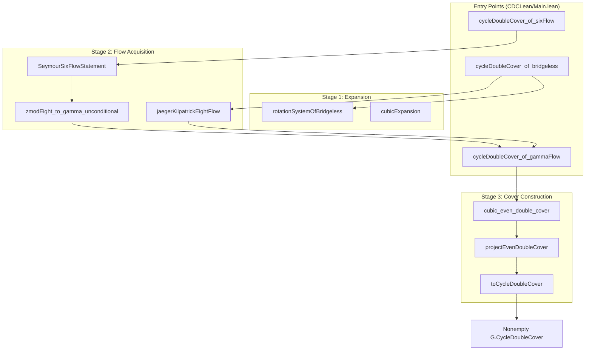
**Sources:** [CDCLean/Main.lean:24-68](), [CDCLean/Main.lean:10-12]()

---

## Primary Entry Points

### 1. `cycleDoubleCover_of_bridgeless`
This is the most general result. It proves that every finite bridgeless graph has a cycle double cover by utilizing the internal formalization of the Jaeger–Kilpatrick eight-flow theorem.

*   **Signature:** [CDCLean/Main.lean:58-61]()
*   **Logical Role:** Combines the cubic expansion of a bridgeless graph with the `jaegerKilpatrickEightFlow` to obtain a $\Gamma$-flow, which is then passed to the $\Gamma$-flow entry point.
*   **Key Dependencies:**
    *   `rotationSystemOfBridgeless`: Generates a rotation system for the expansion [CDCLean/Main.lean:62]().
    *   `cubicExpansion`: Constructs a `CubicGraph` [CDCLean/Main.lean:63]().
    *   `jaegerKilpatrickEightFlow`: Provides the nowhere-zero $\Gamma$-flow (where $\Gamma = \mathbb{F}_2^3$) [CDCLean/Main.lean:66]().

### 2. `cycleDoubleCover_of_sixFlow`
This theorem serves as the bridge to Seymour's 6-flow theorem. It takes an external proof of Seymour's theorem as an argument to avoid adding it as a global axiom.

*   **Signature:** [CDCLean/Main.lean:24-27]()
*   **Logical Role:** Demonstrates that if Seymour's 6-flow theorem holds, then the Cycle Double Cover conjecture holds. It uses Tutte's coefficient transfer to convert a 6-flow (modeled via `ZMod 8`) into a $\Gamma$-flow.
*   **Key Dependencies:**
    *   `SeymourSixFlowStatement`: The type of the external premise [CDCLean/Main.lean:25]().
    *   `zmodEight_to_gamma_unconditional`: Transfers the flow from `ZMod 8` to $\Gamma$ without additional axioms [CDCLean/Main.lean:34-35]().

### 3. `cycleDoubleCover_of_gammaFlow`
This is the core construction theorem. It assumes the existence of a $\Gamma$-flow on the cubic expansion of the target graph.

*   **Signature:** [CDCLean/Main.lean:44-47]()
*   **Logical Role:** Performs the heavy lifting of converting a flow into a cover. It builds an `IndexedEvenDoubleCover` on the cubic expansion, projects it back to the original graph, and decomposes the result into cycles.
*   **Key Dependencies:**
    *   `cubic_even_double_cover`: The affine-pair construction for cubic graphs [CDCLean/Main.lean:50-51]().
    *   `projectEvenDoubleCover`: Maps the cover from the expanded graph back to the original `FiniteGraph` [CDCLean/Main.lean:52]().
    *   `toCycleDoubleCover`: Decomposes the even double cover into a set of cycles [CDCLean/Main.lean:53]().

**Sources:** [CDCLean/Main.lean:24-68]()

---

## Technical Mapping: Logic to Code Entities

The following table maps high-level mathematical requirements to the specific Lean constants and functions that implement them in the top-level proofs.

| Mathematical Requirement | Code Entity | File Reference |
| :--- | :--- | :--- |
| **Graph Expansion** | `G.cubicExpansion R` | [CDCLean/Main.lean:49]() |
| **Flow Generation** | `jaegerKilpatrickEightFlow` | [CDCLean/Main.lean:66]() |
| **Coefficient Transfer** | `zmodEight_to_gamma_unconditional` | [CDCLean/Main.lean:35]() |
| **Cover Construction** | `cubic_even_double_cover` | [CDCLean/Main.lean:51]() |
| **Expansion Projection** | `G.projectEvenDoubleCover` | [CDCLean/Main.lean:52]() |
| **Cycle Decomposition** | `toCycleDoubleCover` | [CDCLean/Main.lean:53]() |

### Code Entity Relationship Diagram

This diagram shows how the top-level `Main.lean` functions interact with the core structures defined in the rest of the library.

"Top-Level Entity Relationships"
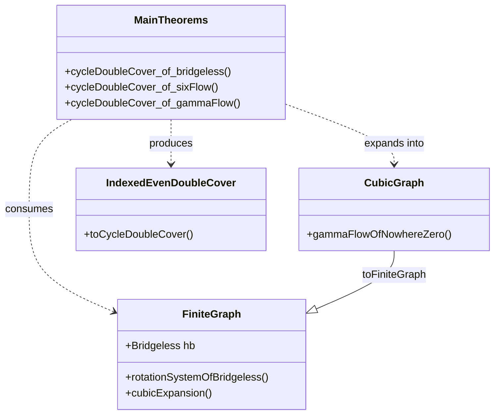
**Sources:** [CDCLean/Main.lean:15-68](), [CDCLean/Audit.lean:11-20]()

## Audit and Verification

The integrity of these entry points is verified in `CDCLean/Audit.lean`. The audit uses the `#print axioms` command to ensure that the proofs of these three theorems do not rely on "sorry" or unintended axioms.

Audited entry points include:
*   `CDCLean.cycleDoubleCover_of_sixFlow` [CDCLean/Audit.lean:18]()
*   `CDCLean.cycleDoubleCover_of_gammaFlow` [CDCLean/Audit.lean:19]()
*   `CDCLean.cycleDoubleCover_of_bridgeless` [CDCLean/Audit.lean:20]()

**Sources:** [CDCLean/Audit.lean:1-21]()

---

# Page: Core Graph Structures

# Core Graph Structures

<details>
<summary>Relevant source files</summary>

The following files were used as context for generating this wiki page:

- [CDCLean/Basic.lean](CDCLean/Basic.lean)
- [CDCLean/GeneralGraph.lean](CDCLean/GeneralGraph.lean)

</details>


This page provides a high-level overview of the foundational data types used to represent graphs in the CDCLean project. The project utilizes two primary representations: `FiniteGraph` for general loopless multigraphs and `CubicGraph` for a specialized three-slot incidence structure used in the core labeling proof.

## Overview of Graph Representations

The formalization distinguishes between a general graph structure used for the top-level theorem statements and a highly structured cubic representation used to facilitate the construction of cycle double covers.

| Structure | Purpose | File Reference |
| :--- | :--- | :--- |
| `FiniteGraph` | General multigraph representation; defines bridgelessness and flows. | [CDCLean/GeneralGraph.lean:17-20]() |
| `CubicGraph` | Incidence-based structure where every vertex has exactly degree 3. | [CDCLean/Basic.lean:30-33]() |

### From Natural Language to Code Entities

The following diagram maps the mathematical concepts of graph theory to the specific Lean structures and fields used in the codebase.

**Graph Theory Mapping**
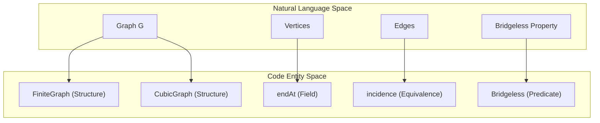
Sources: [CDCLean/GeneralGraph.lean:17-52](), [CDCLean/Basic.lean:30-33]()

---

## 2.1 FiniteGraph: Vertices, Edges, and Predicates

The `FiniteGraph` structure is the entry point for the Cycle Double Cover conjecture. It represents a multigraph where edges are distinct objects, allowing for parallel edges between the same pair of vertices.

Key features of `FiniteGraph`:
*   **Half-Edges**: Represented as `HalfEdge E`, which is a product of an edge and a bit (0 or 1) indicating its ends [CDCLean/GeneralGraph.lean:27-27]().
*   **Flows**: Supports group-valued flows via `IsFlow`, which uses signed conservation (in-flow minus out-flow equals zero) [CDCLean/GeneralGraph.lean:55-58]().
*   **Bridgelessness**: Defined via the `cut` function; a graph is `Bridgeless` if no cut contains exactly one edge [CDCLean/GeneralGraph.lean:52-52]().

For detailed reference on vertices, edges, and predicates like `SixFlow` and `IndexedEvenDoubleCover`, see [FiniteGraph: Vertices, Edges, and Predicates](#2.1).

Sources: [CDCLean/GeneralGraph.lean:17-88]()

---

## 2.2 CubicGraph: Three-Slot Incidence Structure

The `CubicGraph` structure is a specialized representation where every vertex is incident to exactly three edge ends. This is implemented as a bijective `incidence` equivalence between vertex slots and edge ends.

Key features of `CubicGraph`:
*   **Incidence Equivalence**: A bijection `(V × Fin 3) ≃ (E × Fin 2)` ensuring that every vertex has 3 slots and every edge has 2 ends [CDCLean/Basic.lean:31-31]().
*   **Loopless Constraint**: Explicitly requires that the two ends of any edge map to different vertices [CDCLean/Basic.lean:32-33]().
*   **GammaFlow**: A simplified flow definition for the group $\mathbb{F}_2^3$ where, due to characteristic two, conservation is simply the sum of values at a vertex [CDCLean/Basic.lean:95-98]().

For details on the three-slot incidence structure and why it is used for the labeling proof, see [CubicGraph: Three-Slot Incidence Structure](#2.2).

Sources: [CDCLean/Basic.lean:30-98]()

---

## Structural Relationship

The project relates these two structures through a process of **Cubic Expansion**. An arbitrary `FiniteGraph` that is `Bridgeless` is expanded into a `CubicGraph`. The proof then constructs a double cover on the cubic version and projects it back to the original graph.

**Graph Structure Interaction**
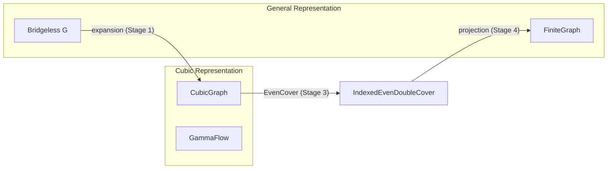
Sources: [CDCLean/GeneralGraph.lean:75-88](), [CDCLean/Basic.lean:95-98]()

---

# Page: FiniteGraph: Vertices, Edges, and Predicates

# FiniteGraph: Vertices, Edges, and Predicates

<details>
<summary>Relevant source files</summary>

The following files were used as context for generating this wiki page:

- [CDCLean/Basic.lean](CDCLean/Basic.lean)
- [CDCLean/GeneralGraph.lean](CDCLean/GeneralGraph.lean)

</details>


This page provides a detailed technical reference for the `FiniteGraph` structure and its associated predicates as defined in the CDCLean project. The `FiniteGraph` serves as the primary representation for general loopless multigraphs, providing the foundation for flow theory and the eventual construction of cycle double covers.

## The FiniteGraph Structure

A `FiniteGraph` is defined as a multigraph where edges are treated as distinct objects. Rather than defining a graph by a set of vertices and a set of pairs, CDCLean defines it by the incidence relationship between edge ends and vertices.

### Implementation Details
The structure is defined in [CDCLean/GeneralGraph.lean:17-19](). It requires two finite types, `V` (Vertices) and `E` (Edges).

*   **`endAt`**: A function `E → Fin 2 → V` that maps each edge object and one of its two ends (represented by `Fin 2`) to a vertex [CDCLean/GeneralGraph.lean:18-18]().
*   **`loopless`**: A proof obligation ensuring that for every edge `e`, the vertex at end `0` is not the same as the vertex at end `1` [CDCLean/GeneralGraph.lean:19-19]().

### Incidence and Degree
To facilitate calculations at the vertex level, the library introduces the concept of "half-edges."

| Entity | Definition | Description |
| :--- | :--- | :--- |
| `HalfEdge E` | `E × Fin 2` | A specific end of a specific edge object [CDCLean/GeneralGraph.lean:27-27](). |
| `vertex` | `G.endAt h.1 h.2` | The vertex associated with a given `HalfEdge` [CDCLean/GeneralGraph.lean:30-30](). |
| `halfEdgesAt v` | `{h // G.vertex h = v}` | The subtype of all half-edges incident to vertex `v` [CDCLean/GeneralGraph.lean:33-33](). |
| `degree v` | `Fintype.card` | The number of half-edges incident to `v` [CDCLean/GeneralGraph.lean:39-39](). |

**Sources:** [CDCLean/GeneralGraph.lean:17-39]()

## Graph Predicates and Cuts

The project relies on standard graph-theoretic predicates to define the conditions under which a Cycle Double Cover exists.

### Cuts and Bridgelessness
A cut is defined based on a subset of vertices $S$. An edge "crosses" the cut if one of its endpoints is in $S$ and the other is not.

*   **`Crosses S e`**: A proposition that is true if `(G.endAt e 0 ∈ S) ≠ (G.endAt e 1 ∈ S)` [CDCLean/GeneralGraph.lean:42-43]().
*   **`cut G S`**: The `Finset E` containing all edges that satisfy `Crosses S` [CDCLean/GeneralGraph.lean:46-48]().
*   **`Bridgeless G`**: The property that no cut in the graph contains exactly one edge [CDCLean/GeneralGraph.lean:52-52](). This is a fundamental requirement for the Cycle Double Cover Conjecture.

### Flow Definitions
Flows are functions on edges that satisfy conservation laws at each vertex.

*   **`IsFlow f`**: Defines signed conservation. For a vertex `v`, the sum of values on edges where `v` is the "start" (end 0) minus the sum where `v` is the "end" (end 1) must be zero [CDCLean/GeneralGraph.lean:55-58]().
*   **`IsNowhereZero f`**: Ensures that the flow value `f e` is never the additive zero for any edge `e` [CDCLean/GeneralGraph.lean:60-60]().
*   **`SixFlow`**: A specific structure representing an integer nowhere-zero 6-flow. It includes a `bound` proof that the absolute value of the flow is between 1 and 5 inclusive [CDCLean/GeneralGraph.lean:63-66]().
*   **`NowhereZeroFlow A`**: A generalized structure for nowhere-zero flows taking values in an arbitrary `AddCommGroup A` [CDCLean/GeneralGraph.lean:69-72]().

**Sources:** [CDCLean/GeneralGraph.lean:42-72]()

## Logical Relationships

The following diagram maps the relationship between the high-level graph properties and the Lean structures that implement them.

### Data Flow: From Graph to Flow Properties
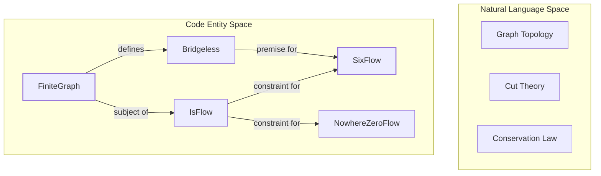
**Sources:** [CDCLean/GeneralGraph.lean:17-72]()

## Trust Boundaries and Covers

### Seymour's Six-Flow Theorem
The project treats Seymour's result as a formal boundary. The `SeymourSixFlowStatement` is a `Prop` stating that every bridgeless `FiniteGraph` has a `SixFlow` [CDCLean/GeneralGraph.lean:75-77](). In the main proof, this is provided as an argument rather than an axiom.

### Indexed Even Double Cover
The `IndexedEvenDoubleCover` is the structure that bridges the gap between flows and cycles. It represents a collection of edge sets (indexed by `Gamma`, which is $F_2^3$) such that every edge is covered exactly twice across all sets.

*   **`member`**: A mapping `Gamma → E → F₂` indicating if an edge belongs to the set indexed by a specific `Gamma` element [CDCLean/GeneralGraph.lean:81-81]().
*   **`vertexEven`**: A proof that for every index `s` and vertex `v`, the number of incident edges in the set is even (sum in $F_2$ is 0) [CDCLean/GeneralGraph.lean:82-85]().
*   **`coveredTwice`**: A proof that for every edge `e`, there are exactly two indices `s` where `member s e = 1` [CDCLean/GeneralGraph.lean:86-87]().

### Structure Association Diagram
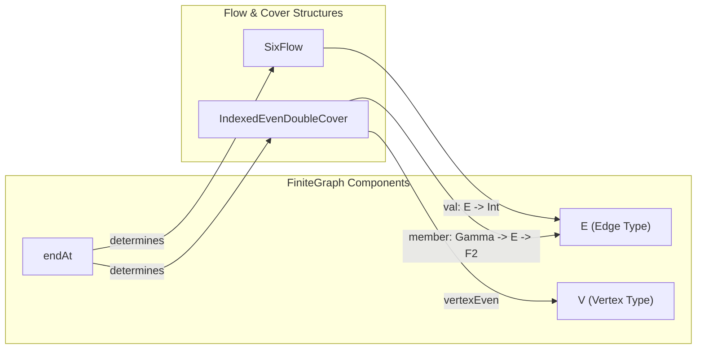
**Sources:** [CDCLean/GeneralGraph.lean:17-87](), [CDCLean/Basic.lean:25-25]()

---

# Page: CubicGraph: Three-Slot Incidence Structure

# CubicGraph: Three-Slot Incidence Structure

<details>
<summary>Relevant source files</summary>

The following files were used as context for generating this wiki page:

- [CDCLean/Basic.lean](CDCLean/Basic.lean)
- [CDCLean/CubicBridge.lean](CDCLean/CubicBridge.lean)

</details>


The `CubicGraph` structure is the central combinatorial representation used in the CDCLean project for the middle stages of the Cycle Double Cover proof. While general graphs are represented via `FiniteGraph`, the core labeling and flow transfer algorithms operate on cubic (3-regular) graphs. This page details the specialized incidence structure that makes these proofs formalizable without the usual complexities of orientation or edge-indexing.

## The Incidence Equivalence

In CDCLean, a cubic graph is defined not by an adjacency list or a set of edges, but by a bijection between "vertex slots" and "edge ends."

*   **Vertex Slots**: Each vertex $v \in V$ is associated with exactly 3 slots, represented by `V × Fin 3`.
*   **Edge Ends**: Each edge $e \in E$ is associated with exactly 2 ends, represented by `E × Fin 2`.

The structure `CubicGraph` defines this as an equivalence `incidence : (V × Fin 3) ≃ (E × Fin 2)` [CDCLean/Basic.lean:30-31](). This approach ensures that:
1.  **3-Regularity is Definitional**: Every vertex must have exactly 3 incident edge-ends by the nature of the `Fin 3` type.
2.  **Multigraph Support**: Parallel edges are distinct elements in the type `E`, and the bijection naturally handles multiple edges between the same vertex pair.
3.  **No Edge Reuse**: The bijective nature of `incidence` prevents a single edge end from being attached to two different vertices.

### Structure Definition

| Field | Type | Description |
| :--- | :--- | :--- |
| `incidence` | `(V × Fin 3) ≃ (E × Fin 2)` | The bijection defining graph topology. |
| `loopless` | `∀ e : E, (incidence.symm (e, 0)).1 ≠ (incidence.symm (e, 1)).1` | Constraint ensuring the two ends of an edge attach to different vertices. |

Sources: [CDCLean/Basic.lean:30-34]()

## Key Functions and Accessors

The library provides several helper functions to navigate this incidence structure:

*   **`edgeAt v i`**: Returns the edge object $e \in E$ occupying the $i$-th slot at vertex $v$ [CDCLean/Basic.lean:40-40]().
*   **`endAt e j`**: Returns the vertex $v \in V$ where the $j$-th end of edge $e$ is attached [CDCLean/Basic.lean:43-43]().
*   **`edgeAt_injective`**: A proof that for a fixed vertex $v$, the mapping from slots to edges is injective (i.e., three distinct edges, or three distinct ends of edges, meet at $v$) [CDCLean/Basic.lean:60-80]().

### Data Flow: Slot to Edge Resolution

The following diagram illustrates how the `incidence` equivalence resolves the relationship between vertices and edges.

**Diagram: Incidence Resolution Logic**
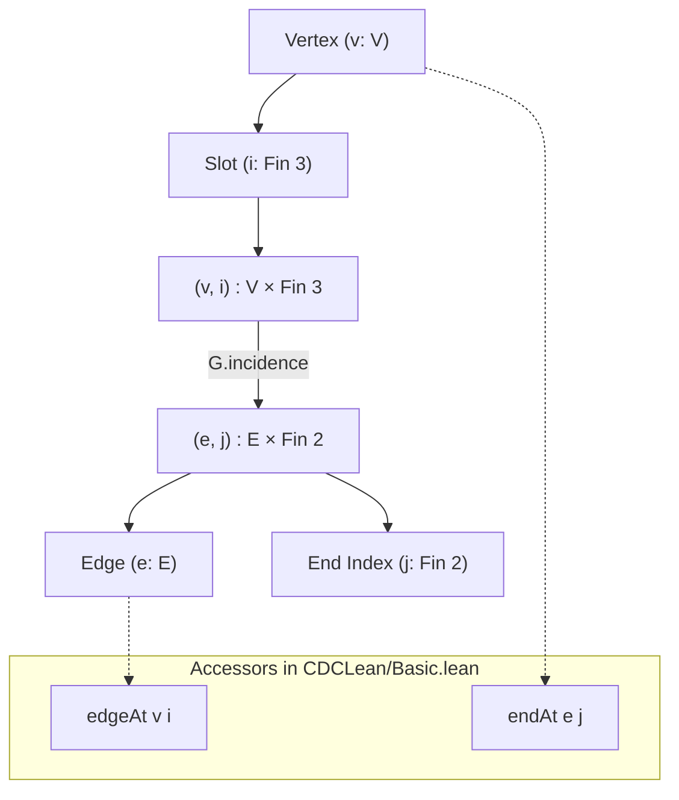
Sources: [CDCLean/Basic.lean:39-59]()

## Flow Theory: GammaFlow

In a cubic graph, the concept of a flow is simplified. Because the project works in characteristic two (specifically the group $\Gamma = \mathbb{F}_2^3$), orientation signs are unnecessary ($x = -x$).

### Gamma Group
The group `Gamma` is defined as `Fin 3 → ZMod 2` [CDCLean/Basic.lean:25-25](). This represents the additive group $\mathbb{F}_2^3$.

### GammaFlow Structure
A `GammaFlow` on a `CubicGraph` $G$ consists of:
1.  **`val`**: A mapping $E \to \Gamma$ [CDCLean/Basic.lean:96-96]().
2.  **`nowhereZero`**: A requirement that no edge is assigned the zero element [CDCLean/Basic.lean:97-97]().
3.  **`conservation`**: For every vertex $v$, the sum of the values on the three incident edges is zero: $\sum_{i \in \text{Fin 3}} \text{val}(G.\text{edgeAt } v\ i) = 0$ [CDCLean/Basic.lean:98-98]().

Sources: [CDCLean/Basic.lean:21-26](), [CDCLean/Basic.lean:95-99]()

## Integration with FiniteGraph

While `CubicGraph` is the primary structure for the labeling proof, it can be projected back to the more general `FiniteGraph` type.

### The `toFiniteGraph` Projection
The function `toFiniteGraph` forgets the three-slot structure but retains the `endAt` mapping and the `loopless` property [CDCLean/CubicBridge.lean:17-21]().

### The Summation Identity
A critical bridge between the two representations is the theorem `sum_edgeEnds_eq_sum_vertexSlots`. This theorem allows the proof to reindex a summation over all edge ends into a summation over all vertex slots:
$$\sum_{e \in E} \sum_{j \in \text{Fin 2}} h(e, j) = \sum_{v \in V} \sum_{i \in \text{Fin 3}} h(G.\text{edgeAt } v\ i, (G.\text{incidence } (v, i)).2)$$
This identity is used to prove that a flow in the general sense (conserved at vertices) matches the cubic definition of flow [CDCLean/Basic.lean:82-89]().

**Diagram: Type Relationship and Flow Conversion**
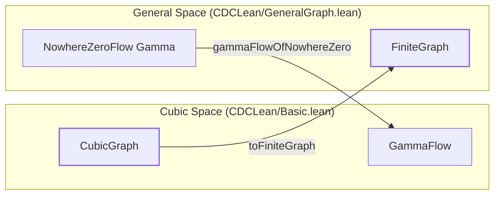
Sources: [CDCLean/CubicBridge.lean:16-22](), [CDCLean/CubicBridge.lean:43-58]()

## Why the Cubic Representation?

The `CubicGraph` representation is chosen for three specific technical reasons:
1.  **Definitional Double-Counting**: The identity $\sum \text{deg}(v) = 2|E|$ becomes a definitional consequence of the bijection `(V × Fin 3) ≃ (E × Fin 2)`, as $|V| \times 3 = |E| \times 2$ [CDCLean/Basic.lean:82-89]().
2.  **Simplification of Even Covers**: The construction of an even double cover from a $\Gamma$-flow (detailed in Stage 3) relies on analyzing the local configuration of the 3 edges at each vertex. Having these edges explicitly indexed by `Fin 3` simplifies the case analysis.
3.  **Compatibility with Expansion**: The process of expanding a general graph into a cubic one (Stage 1) naturally produces these "slots" via the `RotationSystem` [CDCLean/Expansion.lean]().

Sources: [CDCLean/Basic.lean:11-15](), [CDCLean/CubicBridge.lean:24-37]()

---

# Page: Proof Pipeline: From Bridgeless Graph to Cycle Double Cover

# Proof Pipeline: From Bridgeless Graph to Cycle Double Cover

<details>
<summary>Relevant source files</summary>

The following files were used as context for generating this wiki page:

- [CDCLean.lean](CDCLean.lean)
- [CDCLean/Main.lean](CDCLean/Main.lean)

</details>


This page provides a high-level overview of the four-stage pipeline used to prove that every bridgeless graph admits a cycle double cover. The proof is structured as a series of transformations: first expanding an arbitrary graph into a cubic one, obtaining a flow on that cubic graph, converting that flow into an even double cover, and finally projecting that cover back to the original graph to be decomposed into cycles.

The primary entry point for this pipeline is `cycleDoubleCover_of_bridgeless` [CDCLean/Main.lean:58-67](), which composes these stages into a unified formal proof.

## Pipeline Overview

The following diagram illustrates the flow of data and proof obligations across the four stages of the pipeline.

### Logical Data Flow
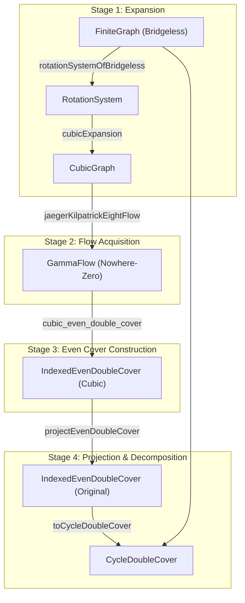
**Sources:** [CDCLean/Main.lean:24-67](), [CDCLean/Expansion.lean:1-20](), [CDCLean/EvenCover.lean:1-10]()

---

## Stage 1: Cubic Expansion via Rotation Systems
The first stage transforms an arbitrary `FiniteGraph` into a `CubicGraph`. Because the cycle double cover construction is most naturally defined on 3-regular graphs, this expansion step is critical for handling general bridgeless graphs.

- **Rotation System**: For any bridgeless graph, a `RotationSystem` is constructed [CDCLean/Main.lean:62]().
- **Expansion**: The graph is expanded into a cubic structure where each original vertex of degree $n$ becomes a cycle of $n$ "ring edges" connected to the original edges via "spokes".
- **Preservation**: A key property of this stage is `expansionGraph_bridgeless`, which ensures that if the original graph is bridgeless, its cubic expansion remains bridgeless [CDCLean/Main.lean:64-65]().

For details, see [Stage 1: Cubic Expansion via Rotation Systems](#3.1).

---

## Stage 2: Nowhere-Zero Gamma-Flow via Jaeger–Kilpatrick
Once the graph is cubic and bridgeless, the pipeline must find a specific type of flow. The project formalizes the Jaeger–Kilpatrick Eight-Flow Theorem to guarantee the existence of a nowhere-zero `Gamma`-flow (where $\Gamma \cong \mathbb{F}_2^3$).

- **Flow Existence**: The function `jaegerKilpatrickEightFlow` provides the necessary flow for any bridgeless cubic graph [CDCLean/Main.lean:66]().
- **Group Structure**: The flow uses the `Gamma` group, which is essential for the subsequent labeling and cover construction.

For details, see [Stage 2: Nowhere-Zero Gamma-Flow via Jaeger–Kilpatrick](#3.2).

---

## Stage 3: Even Double Cover Construction for Cubic Graphs
This stage converts the `GammaFlow` on the cubic graph into an `IndexedEvenDoubleCover`. This is the mathematical core of the reduction, where the algebraic properties of the flow are translated into geometric properties of edge covers.

- **Cubic Labeling**: The flow is used to generate a `CubicLabeling`, which assigns values to edge-ends such that parity conditions are satisfied [CDCLean/Main.lean:50-51]().
- **Even Cover**: The labeling is transformed into an `IndexedEvenDoubleCover`, a collection of edge sets where every vertex is incident to an even number of edges from each set, and every edge is covered exactly twice.

For details, see [Stage 3: Even Double Cover Construction for Cubic Graphs](#3.3).

---

## Stage 4: Projection and Cycle Decomposition
The final stage maps the results from the cubic expansion back to the original graph and produces the final `CycleDoubleCover`.

- **Projection**: The `projectEvenDoubleCover` function maps the even double cover of the cubic expansion `K` back to an even double cover of the original graph `G` [CDCLean/Main.lean:52]().
- **Decomposition**: Finally, `toCycleDoubleCover` invokes the cycle decomposition theorem to break down the even edge sets into individual cycles, satisfying the Cycle Double Cover Conjecture for the input graph [CDCLean/Main.lean:53]().

For details, see [Stage 4: Projection and Cycle Decomposition](#3.4).

---

## Mapping Code Entities to Pipeline Stages

The following table maps the high-level stages to the specific Lean functions and types that implement them.

| Stage | Key Function | Input Type | Output Type |
| :--- | :--- | :--- | :--- |
| **1. Expansion** | `cubicExpansion` | `FiniteGraph` | `CubicGraph` |
| **2. Flow** | `jaegerKilpatrickEightFlow` | `CubicGraph` | `NowhereZeroFlow Gamma` |
| **3. Even Cover** | `cubic_even_double_cover` | `GammaFlow` | `IndexedEvenDoubleCover` |
| **4. Projection** | `projectEvenDoubleCover` | `IndexedEvenDoubleCover` | `CycleDoubleCover` |

**Sources:** [CDCLean/Main.lean:58-67](), [CDCLean/Expansion.lean:1-20](), [CDCLean/CycleDecomposition.lean:1-15]()

---

# Page: Stage 1: Cubic Expansion via Rotation Systems

# Stage 1: Cubic Expansion via Rotation Systems

<details>
<summary>Relevant source files</summary>

The following files were used as context for generating this wiki page:

- [CDCLean/Expansion.lean](CDCLean/Expansion.lean)

</details>


This stage of the proof pipeline transforms an arbitrary bridgeless `FiniteGraph` into a `CubicGraph`. This reduction is necessary because the Jaeger–Kilpatrick flow theorem and subsequent even double cover constructions are defined over cubic (3-regular) structures.

## Overview

The transformation is a "vertex-ring expansion." Each vertex $v$ of the original graph $G$ with degree $d$ is replaced by a cycle (ring) of $d$ new vertices in the cubic graph $G'$. Each original half-edge incident to $v$ becomes a "spoke" edge attached to one of these ring vertices. The resulting graph is 3-regular by construction: each vertex is incident to exactly one spoke and two ring edges.

Sources: [CDCLean/Expansion.lean:5-10]()

## The Rotation System

To arrange the half-edges of a vertex into a cycle, the system uses a `RotationSystem`. This structure defines a cyclic permutation of half-edges around each vertex fiber.

### RotationSystem Definition
A `RotationSystem` for a graph `G` consists of:
- `next`: A permutation of all `HalfEdge E`.
- `sameVertex`: A proof that `next` only permutes half-edges incident to the same vertex.
- `next_ne`: A proof that `next h ≠ h` (prevents self-loops in the expansion rings).
- `fiberTransitive`: A proof that the permutation is transitive on the set of half-edges at any given vertex (ensures one single ring per original vertex).

Sources: [CDCLean/Expansion.lean:22-28]()

### Constructing the System
For any bridgeless graph, a `RotationSystem` is constructed by:
1.  Verifying that every vertex has `degree ≠ 1` (since a degree-1 vertex implies a bridge).
2.  Using `fiberCycle` to create a cyclic permutation on each vertex's fiber by identifying it with `Fin n` and applying `finRotate`.
3.  Combining these into a global `rotationPerm`.

Sources: [CDCLean/Expansion.lean:65-74](), [CDCLean/Expansion.lean:146-152](), [CDCLean/Expansion.lean:156-174]()

## Expanded Graph Structure

The cubic expansion defines new types for vertices and edges that map back to the original graph's components.

### Code Entity Mapping: Expansion Components

| Concept | Code Entity | Type / Definition |
| :--- | :--- | :--- |
| **Expanded Vertex** | `ExpandedVertex` | Equivalent to `HalfEdge E` of the original graph. |
| **Expanded Edge** | `ExpandedEdge` | `Spoke E ⊕ RingEdge E` |
| **Spoke Edge** | `Spoke e` | Corresponds to the original edge $e \in E$. |
| **Ring Edge** | `RingEdge h` | Connects `h` to `next h` in the expansion. |

Sources: [CDCLean/Expansion.lean:206-215]()

### Incidence and Adjacency
The function `expansionIncidence` defines how these new edges connect to the expanded vertices:
- A `Spoke e` connects `(e, 0)` and `(e, 1)`.
- A `RingEdge h` connects vertex `h` and vertex `next h`.

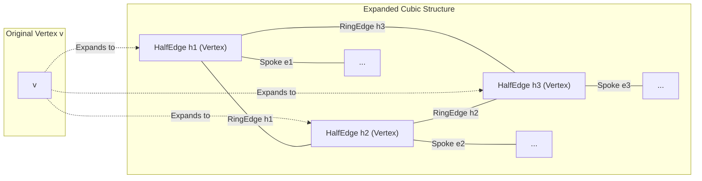
Sources: [CDCLean/Expansion.lean:217-230]()

## The CubicGraph Instance

The function `cubicExpansion` packages these definitions into a `CubicGraph` instance.

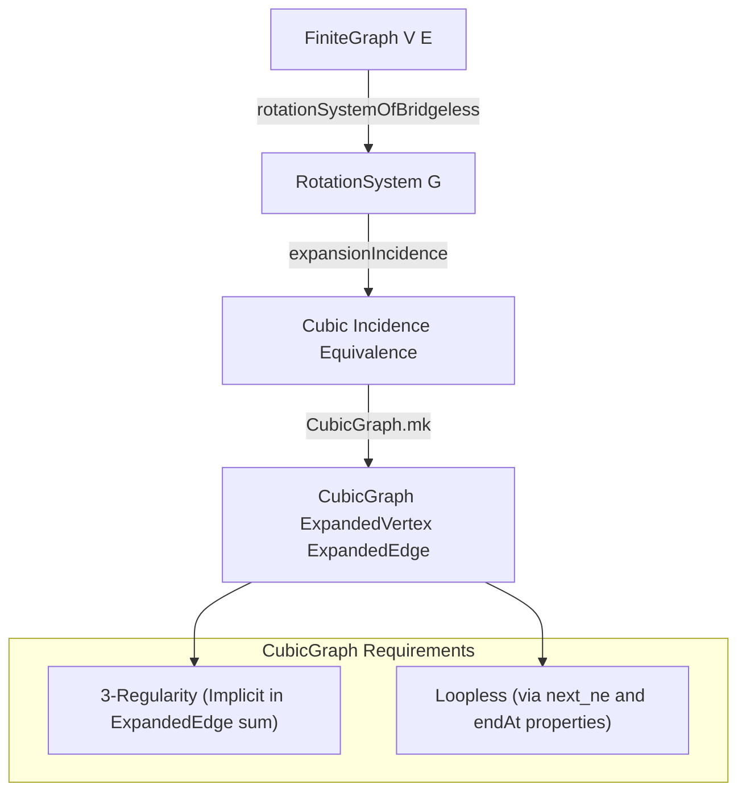

Sources: [CDCLean/Expansion.lean:243-254]()

## Preservation of Properties

A critical part of Stage 1 is proving that the expansion preserves the essential topological properties of the original graph.

### Bridgelessness Preservation
The theorem `expansionGraph_bridgeless` proves that if the original `FiniteGraph` is bridgeless, its `cubicExpansion` is also bridgeless.
- If a `Spoke` were a bridge in the cubic graph, the corresponding edge in the original graph would be a bridge.
- If a `RingEdge` were a bridge, it would imply the vertex fiber is not connected, contradicting `fiberTransitive`.

Sources: [CDCLean/Expansion.lean:321-322](), [CDCLean/Expansion.lean:341-355]()

### Flow Projection
The module also provides `projectEvenDoubleCover`, which allows an `IndexedEvenDoubleCover` found on the cubic expansion to be projected back to the original graph. This ensures that the cycles found in the simplified cubic world are valid for the original arbitrary graph.

Sources: [CDCLean/Expansion.lean:365-385]()

## Key Functions and Types

| Function/Type | File & Lines | Description |
| :--- | :--- | :--- |
| `RotationSystem` | [CDCLean/Expansion.lean:22-28]() | Structure defining the cyclic ordering of half-edges. |
| `rotationSystemOfBridgeless` | [CDCLean/Expansion.lean:188-191]() | Main constructor for the rotation system. |
| `cubicExpansion` | [CDCLean/Expansion.lean:243-254]() | Creates the `CubicGraph` instance from the expansion. |
| `expansionGraph_bridgeless` | [CDCLean/Expansion.lean:321-322]() | Proof that expansion preserves the bridgeless property. |
| `projectEvenDoubleCover` | [CDCLean/Expansion.lean:385-385]() | Projects an even double cover back to the original edge set. |

Sources: [CDCLean/Expansion.lean:22-385]()

---

# Page: Stage 2: Nowhere-Zero Gamma-Flow via Jaeger–Kilpatrick

# Stage 2: Nowhere-Zero Gamma-Flow via Jaeger–Kilpatrick

<details>
<summary>Relevant source files</summary>

The following files were used as context for generating this wiki page:

- [CDCLean/JaegerKilpatrick.lean](CDCLean/JaegerKilpatrick.lean)
- [CDCLean/NashWilliams.lean](CDCLean/NashWilliams.lean)

</details>


This stage documents the formalization of the Jaeger–Kilpatrick theorem, which asserts that every 3-edge-connected graph (and by extension, every bridgeless graph via reduction) admits a nowhere-zero flow in the group $\Gamma = (\mathbb{Z}/2\mathbb{Z})^3$. This is equivalent to the existence of a nowhere-zero 8-flow. The implementation follows Kaiser's elementary proof of the Nash-Williams tree packing theorem to construct the flow from edge-disjoint spanning trees.

### 1. The Gamma Group and Even Covers

The group $\Gamma$ is defined as the product group $F_2^3$. A flow in this group is represented as a triple of $F_2$-valued flows. In the formalization, a $\Gamma$-flow is often constructed from an "even cover"—a collection of three even edge sets whose union covers the entire edge set of the graph.

| Function/Theorem | Role |
| :--- | :--- |
| `gammaOfEvenCover` | Encodes three edge sets into a function $E \to \Gamma$. [CDCLean/JaegerKilpatrick.lean:22-23]() |
| `nowhereZeroGammaFlow_of_evenCover` | Proves that if three even edge sets cover $E$, the resulting $\Gamma$-valued function is a nowhere-zero flow. [CDCLean/JaegerKilpatrick.lean:26-30]() |
| `isEvenEdgeSet_support_of_isFlow_f2` | Bridges flow theory and cycle theory by showing the support of an $F_2$ circulation is an even edge set. [CDCLean/JaegerKilpatrick.lean:111-112]() |

**Sources:** [CDCLean/JaegerKilpatrick.lean:22-129]()

---

### 2. Nash-Williams–Tutte Tree Packing

The core of the Jaeger–Kilpatrick theorem relies on finding three edge-disjoint spanning trees. This is guaranteed by the Nash-Williams–Tutte theorem for 3-edge-connected graphs.

#### 2.1 Tree Packing Infrastructure
The codebase defines spanning trees and tree packings for multigraphs using the `FiniteGraph` structure.

*   **`IsSpanningTree`**: Defined as a set of edge objects $S$ that is connected and has cardinality $|V| - 1$. [CDCLean/NashWilliams.lean:40-42]()
*   **`HasTreePacking`**: Asserts the existence of $k$ pairwise edge-disjoint spanning trees. [CDCLean/NashWilliams.lean:44-47]()
*   **`SatisfiesTreePackingCondition`**: The partition-based density condition (the "Nash-Williams inequality") required for a packing to exist. [CDCLean/NashWilliams.lean:89-91]()

#### 2.2 Kaiser's Algorithm
The proof of `nashWilliamsTutte` [CDCLean/NashWilliams.lean:1245-1248]() uses Kaiser's partition refinement algorithm. It starts with a trivial partition and iteratively refines it using the `refineSetoid` operation, which splits partition classes based on connectivity within a specific color class.

**Tree Packing Pipeline**
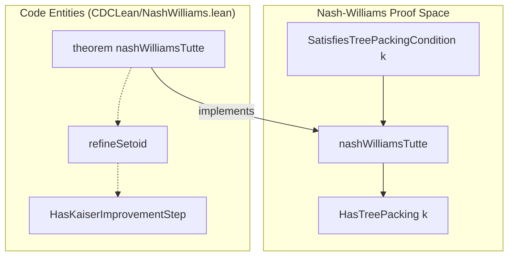
**Sources:** [CDCLean/NashWilliams.lean:25-101](), [CDCLean/NashWilliams.lean:138-140](), [CDCLean/NashWilliams.lean:1245-1248]()

---

### 3. Flow Construction via Tree Packing

The proof of the main theorem, `jaegerKilpatrickEightFlow`, follows a specific pipeline:

1.  **3-Edge-Connected Case**: If $H$ is 3-edge-connected, the Nash-Williams condition is satisfied for $k=3$ on the `doubleGraph` (a graph where every edge is doubled). [CDCLean/JaegerKilpatrick.lean:185-187]()
2.  **Tree Extraction**: Three disjoint spanning trees $T_1, T_2, T_3$ are obtained.
3.  **Even Set Construction**: For each tree $T_i$, an even edge set $F_i$ is constructed such that $E \setminus T_i \subseteq F_i$. This is done via `exists_even_superset_compl_of_spanningTree`. [CDCLean/JaegerKilpatrick.lean:133-135]()
4.  **Cover Verification**: Since the trees are disjoint, any edge $e$ is absent from at least two trees, ensuring it is included in the union of the complements (and thus the union of the even sets $F_i$).

**Gamma-Flow Construction Flow**
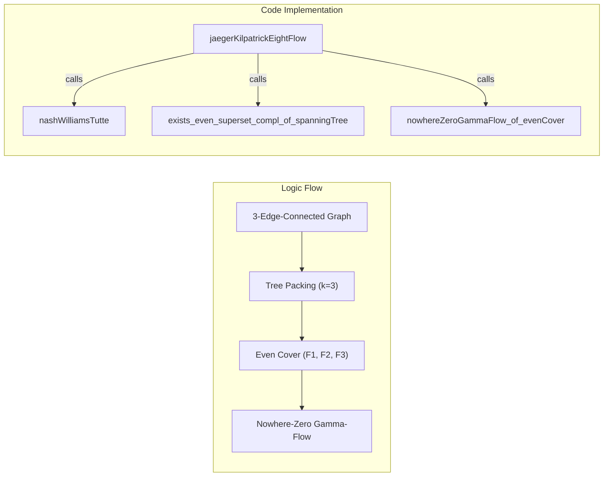
**Sources:** [CDCLean/JaegerKilpatrick.lean:133-179](), [CDCLean/JaegerKilpatrick.lean:450-460]() (implied by logic in file)

---

### 4. Recursive Reduction and Components

The formalization handles graphs that are not 3-edge-connected through recursive decomposition and edge contraction.

*   **Component Decomposition**: The theorem `gammaFlow_of_components` proves that if every connected component of a graph has a $\Gamma$-flow, the whole graph does. [CDCLean/JaegerKilpatrick.lean:280-285]()
*   **Edge Contraction**: If a graph has a cut of size 1 (bridge) or 2, it is reduced.
    *   **Bridges**: Handled by the `Bridgeless` predicate requirement; bridges are forbidden in nowhere-zero flow theory.
    *   **2-Cuts**: The graph is simplified by contracting or merging edges in the cut, maintaining the flow properties.

| Function | Description |
| :--- | :--- |
| `isThreeEdgeConnected` | Predicate checking if every vertex cut has size $\ge 3$. [CDCLean/JaegerKilpatrick.lean:181-182]() |
| `gammaFlow_of_bridgeless` | The top-level result for Stage 2, combining the 3-connected case with reductions. |

**Sources:** [CDCLean/JaegerKilpatrick.lean:181-182](), [CDCLean/JaegerKilpatrick.lean:280-300]()

---

# Page: Stage 3: Even Double Cover Construction for Cubic Graphs

# Stage 3: Even Double Cover Construction for Cubic Graphs

<details>
<summary>Relevant source files</summary>

The following files were used as context for generating this wiki page:

- [CDCLean/CubicBridge.lean](CDCLean/CubicBridge.lean)
- [CDCLean/CubicLabeling.lean](CDCLean/CubicLabeling.lean)
- [CDCLean/EvenCover.lean](CDCLean/EvenCover.lean)

</details>


This stage documents the transformation of a $\Gamma$-flow (where $\Gamma = \mathbb{F}_2^3$) on a cubic graph into an `IndexedEvenDoubleCover`. This is the core combinatorial step of the Cycle Double Cover proof, where the algebraic properties of the flow are translated into a geometric covering of the graph by eight even edge sets.

## Overview of the Construction

The construction relies on assigning to each edge $e$ an affine pair of elements $\{p_e, p_e + f(e)\} \subset \Gamma$. A labeling is considered "compatible" if, at every vertex, the indicators of these pairs sum to zero for every element $s \in \Gamma$. This ensures that for every $s$, the set of edges whose pair contains $s$ forms an even subgraph (a collection of cycles).

### The Cubic Labeling Structure

The `CubicLabeling` structure encapsulates the local pair assignments and the global parity requirement.

| Field | Type | Description |
| :--- | :--- | :--- |
| `base` | `E → Gamma` | The base point $p_e$ for the affine pair on edge $e$. |
| `vertexParity` | `∀ v s, ... = 0` | Proof that at vertex $v$, for any $s \in \Gamma$, the indicators sum to $0$. |

**Sources:** [CDCLean/CubicLabeling.lean:1-10](), [CDCLean/EvenCover.lean:32-34]()

## Data Flow: Flow to Even Cover

The following diagram illustrates how a `GammaFlow` is processed through the compatibility system to produce the final `IndexedEvenDoubleCover`.

### System Entity Map: Construction Pipeline

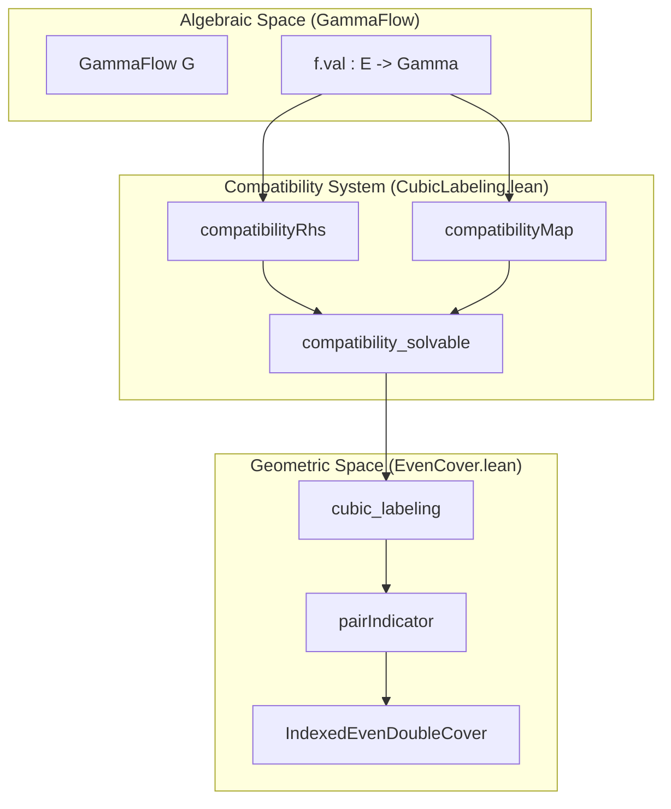
**Sources:** [CDCLean/CubicLabeling.lean:36-46](), [CDCLean/CubicLabeling.lean:167-169](), [CDCLean/EvenCover.lean:32-45]()

## The Compatibility System

To ensure the vertex parity condition holds, the project solves a linear system over $\mathbb{F}_2$.

### 1. Pair Indicator and Local Parity
The function `pairIndicator` [CDCLean/CubicLabeling.lean:18-18]() returns $1$ if $s \in \{p, p+h\}$ and $0$ otherwise. The theorem `local_pair_parity` [CDCLean/CubicLabeling.lean:22-27]() is a kernel-verified fact (`decide`) stating that if three flow values $x, y, z$ sum to zero at a vertex, there exist base points such that the sum of the indicators is zero for all $s$.

### 2. Linear Map and Solvability
The construction defines a linear map `compatibilityMap` [CDCLean/CubicLabeling.lean:44-55]() and a target vector `compatibilityRhs` [CDCLean/CubicLabeling.lean:40-41]().
*   **`compatibilityMap`**: Represents the constraints imposed by edge boundaries and the flow values.
*   **`compatibilityRhs`**: The specific configuration required by the local base points $g_{v,e}$.

The theorem `compatibility_solvable` [CDCLean/CubicLabeling.lean:167-168]() proves that a solution always exists by showing that all "dual obstructions" vanish. This is a formalized version of the dual-obstruction calculation from the Jaeger-Kilpatrick manuscript.

**Sources:** [CDCLean/CubicLabeling.lean:18-55](), [CDCLean/CubicLabeling.lean:167-180]()

## Indexed Even Double Covers

Once a `CubicLabeling` is obtained via `cubic_labeling`, it is converted into an `IndexedEvenDoubleCover`.

### Structure Definition
The `IndexedEvenDoubleCover` [CDCLean/EvenCover.lean:18-22]() requires:
1.  **`member`**: An indicator function mapping each element of $\Gamma$ and each edge $E$ to $\mathbb{F}_2$.
2.  **`vertexEven`**: For every $s \in \Gamma$, the edges incident to any vertex $v$ must sum to $0 \pmod 2$.
3.  **`coveredTwice`**: Every edge $e$ must be present in exactly two of the eight edge sets.

### Final Construction
The function `cubic_even_double_cover` [CDCLean/EvenCover.lean:32-43]() constructs this object. It uses `pairIndicator_card` [CDCLean/EvenCover.lean:26-29]() to prove the `coveredTwice` property, which relies on the fact that an affine pair $\{p, p+h\}$ with $h \neq 0$ contains exactly two elements.

### Entity Relationship: Labeling to Cover

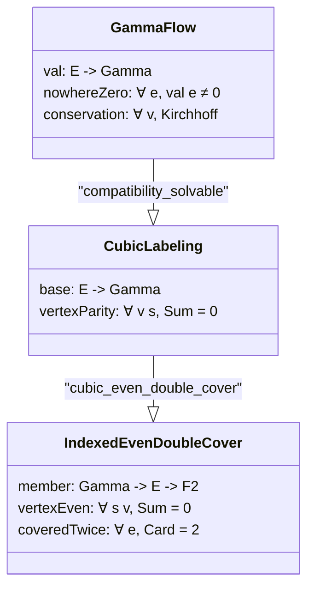
**Sources:** [CDCLean/CubicLabeling.lean:167-169](), [CDCLean/EvenCover.lean:18-22](), [CDCLean/EvenCover.lean:32-45]()

## Key Theorems and Verification
*   **`local_pair_parity`**: [CDCLean/CubicLabeling.lean:22-27]() (Verified via `decide`).
*   **`local_dual_identity`**: [CDCLean/CubicLabeling.lean:106-114]() (Verified via `decide`).
*   **`pairIndicator_card`**: [CDCLean/EvenCover.lean:26-29]() (Verified via `decide`).

These theorems use Lean's `decide` tactic to exhaustively check all cases in the finite group $\Gamma = \mathbb{F}_2^3$, ensuring the combinatorial foundations are correct without requiring complex group theory proofs in the main pipeline.

**Sources:** [CDCLean/CubicLabeling.lean:22-114](), [CDCLean/EvenCover.lean:26-29]()

---

# Page: Stage 4: Projection and Cycle Decomposition

# Stage 4: Projection and Cycle Decomposition

<details>
<summary>Relevant source files</summary>

The following files were used as context for generating this wiki page:

- [CDCLean/CycleDecomposition.lean](CDCLean/CycleDecomposition.lean)
- [CDCLean/Expansion.lean](CDCLean/Expansion.lean)

</details>


The final stage of the Cycle Double Cover (CDC) proof involves two primary tasks: mapping the even double cover found on the cubic expansion back to the original graph, and decomposing the resulting even edge sets into a collection of cycles.

## 1. Projection from Cubic Expansion

Once an `IndexedEvenDoubleCover` is constructed for the `cubicExpansion` of a graph, it must be projected back to the original `FiniteGraph`. This is handled by `projectEvenDoubleCover` in [CDCLean/Expansion.lean:406-417]().

### The Projection Mechanism
The `cubicExpansion` graph's edges consist of two types: **Spokes** (which correspond directly to original edges) and **RingEdges** (which are internal to the expanded vertex structures). 
- The projection function iterates through the three elements of the `Gamma` group.
- For each group element, it filters the original edge set $E$ to include only those edges whose corresponding "Spoke" in the expanded graph is part of the even double cover for that group index.
- Because the cubic cover is an `IndexedEvenDoubleCover`, every edge in the expanded graph is covered exactly twice. Since Spokes map 1-to-1 with original edges, every original edge is also covered exactly twice across the three projected edge sets.

### Preservation of Parity
The core of the projection proof is `project_even` [CDCLean/Expansion.lean:381-404](), which ensures that if an edge set is "even" in the cubic expansion, its projection is "even" in the original graph. This relies on the fact that the expansion preserves the parity of incidences at each vertex fiber.

| Function | Role | Source |
| :--- | :--- | :--- |
| `projectEvenDoubleCover` | Maps the cubic cover to three even edge sets on the original graph. | [CDCLean/Expansion.lean:406-417]() |
| `project_even` | Proves that the projected edge sets satisfy `IsEvenEdgeSet`. | [CDCLean/Expansion.lean:381-404]() |

**Sources:** [CDCLean/Expansion.lean:381-417]()

---

## 2. Cycle Decomposition

After projection, we have three sets of edges, each forming an even subgraph. The Cycle Double Cover conjecture requires a list of **cycles** (inclusion-minimal even sets). The file `CDCLean/CycleDecomposition.lean` provides the machinery to break these even sets into cycles.

### Definitions
- **`IsEvenEdgeSet`**: Defined as a set of edges where every vertex has an even incidence count (sum of incidences in $\mathbb{F}_2$ is 0) [CDCLean/CycleDecomposition.lean:34-35]().
- **`Cycle`**: A structure representing a nonempty, inclusion-minimal even edge set [CDCLean/CycleDecomposition.lean:51-56]().
- **`CycleDoubleCover`**: A list of cycles such that every edge in the graph appears in exactly two cycles [CDCLean/CycleDecomposition.lean:104-106]().

### The Decomposition Algorithm
The function `decompose_even_edge_set` [CDCLean/CycleDecomposition.lean:118-120]() uses strong induction on the size of the edge set. 
1. If the set is empty, the list of cycles is empty.
2. If the set is already minimal, it is a single cycle.
3. If it is not minimal, there exists a proper subset that is even. The algorithm splits the set into that subset and its complement (which is also even by `even_sdiff` [CDCLean/CycleDecomposition.lean:108-114]()), and recursively decomposes both.

### Data Flow: Even Sets to CycleDoubleCover
The final step is `toCycleDoubleCover` [CDCLean/CycleDecomposition.lean:201-205](), which takes the three projected even edge sets and runs `decompose_even_edge_set` on each, concatenating the results into a single `CycleDoubleCover`.

#### Mapping Logic to Code Entities
The following diagram illustrates how the abstract mathematical requirements of a Cycle Double Cover are satisfied by specific Lean structures and functions.

**Entity Mapping: From Even Sets to Cycle Double Cover**
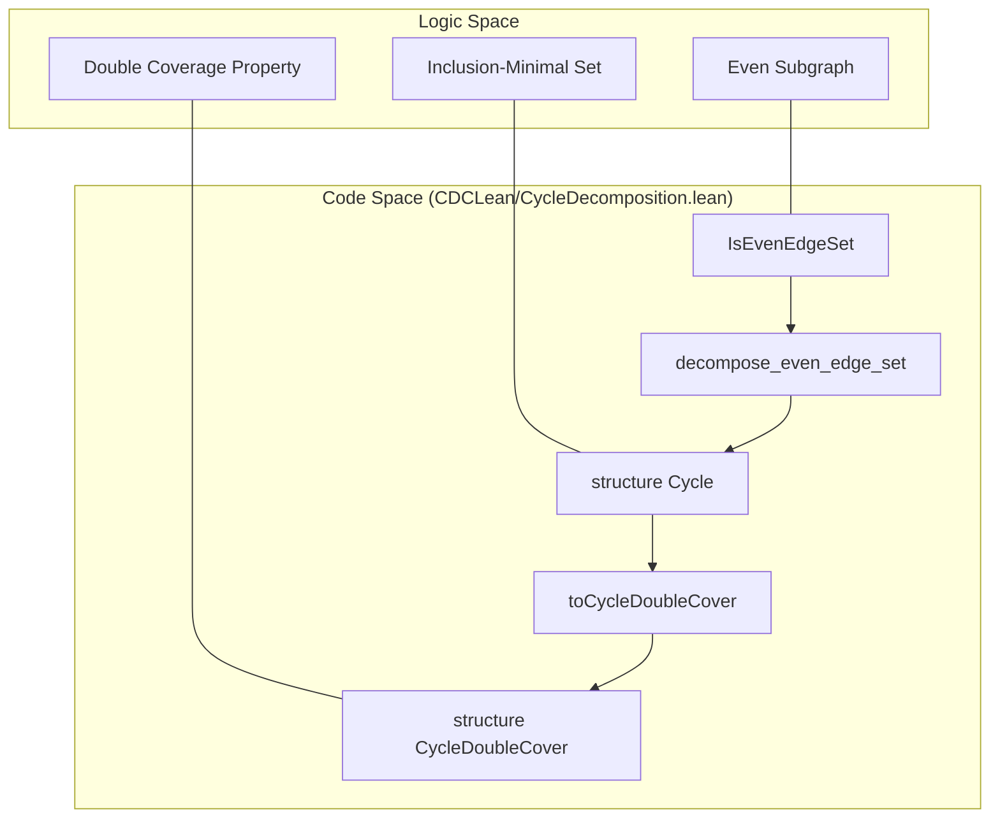
**Sources:** [CDCLean/CycleDecomposition.lean:34-120](), [CDCLean/CycleDecomposition.lean:201-205]()

---

## 3. Implementation Details

### Parallel Edges
In multigraphs, two parallel edges between the same vertices form a cycle of length two. The library explicitly handles this via `parallelPairCycle` [CDCLean/CycleDecomposition.lean:65-100](), which constructs a `Cycle` from two edges satisfying `AreParallel`.

### Data Flow Diagram
The following diagram shows the complete transformation from a `GammaFlow` on a `CubicGraph` to the final `CycleDoubleCover` on the original `FiniteGraph`.

**Process Flow: Stage 3 to Stage 4**
```mermaid
graph LR
    subgraph "Stage 3 (Cubic)"
        GF["GammaFlow"]
        EL["CubicLabeling"]
        IEDC["IndexedEvenDoubleCover (Cubic)"]
    end

    subgraph "Stage 4 (Projection & Decomposition)"
        Proj["projectEvenDoubleCover"]
        EvenSets["3 x IsEvenEdgeSet (Original)"]
        Decomp["decompose_even_edge_set"]
        Final["CycleDoubleCover"]
    end

    GF --> EL
    EL --> IEDC
    IEDC -- "Expansion.lean" --> Proj
    Proj --> EvenSets
    EvenSets -- "CycleDecomposition.lean" --> Decomp
    Decomp --> Final
```

### Key Functions and Structures

| Entity | Description | File Reference |
| :--- | :--- | :--- |
| `Cycle` | Fields: `edges`, `nonempty`, `even`, `minimal`. | [CycleDecomposition.lean:51-56]() |
| `CycleDoubleCover` | Fields: `cycles`, `coveredTwice`. | [CycleDecomposition.lean:104-106]() |
| `parallelPairCycle` | Proves two parallel edges form a minimal even set. | [CycleDecomposition.lean:65-66]() |
| `decompose_even_edge_set` | Recursive theorem producing a `List G.Cycle`. | [CycleDecomposition.lean:118-120]() |
| `toCycleDoubleCover` | Top-level constructor for the final proof object. | [CycleDecomposition.lean:201-205]() |

**Sources:** [CDCLean/CycleDecomposition.lean:34-205](), [CDCLean/Expansion.lean:381-417]()

---

# Page: Flow Theory Subsystem

# Flow Theory Subsystem

<details>
<summary>Relevant source files</summary>

The following files were used as context for generating this wiki page:

- [CDCLean/FlowCount.lean](CDCLean/FlowCount.lean)
- [CDCLean/PathCut.lean](CDCLean/PathCut.lean)
- [CDCLean/SixFlow.lean](CDCLean/SixFlow.lean)

</details>


The **Flow Theory Subsystem** provides the algebraic infrastructure required to bridge Seymour's 6-flow theorem with the Jaeger–Kilpatrick 8-flow construction used in the Cycle Double Cover proof. It handles the conversion of integer flows to group-valued flows and proves that the existence of a nowhere-zero flow depends only on the order of the coefficient group, not its structure.

## Overview of the Flow Pipeline

The proof pipeline for flow acquisition follows three logical steps:
1.  **Integer to $\mathbb{Z}_8$**: An integer 6-flow (where values are in $\{\pm 1, \dots, \pm 5\}$) is reduced modulo 8. Because the absolute values are strictly less than 8, the flow remains nowhere-zero in $\mathbb{Z}_8$.
2.  **Group-Order Transfer**: Tutte's flow invariance theorem is used to prove that if a graph has a nowhere-zero $\mathbb{Z}_8$-flow, it must also have a nowhere-zero $\Gamma$-flow (where $\Gamma = \mathbb{F}_2^3$), since $|\mathbb{Z}_8| = |\Gamma| = 8$.
3.  **Path-Cut Dichotomy**: The transfer theorem is supported by a fundamental dichotomy: for any edge, there is either an integer cycle passing through it (allowing value adjustment) or a cut that forces its value to zero.

### Flow Theory Data Flow

The following diagram illustrates how flow types are transformed across the subsystem:

**Flow Transformation Sequence**
```mermaid
graph TD
    subgraph "Seymour Space"
        SF["SixFlow (Integer)"]
    end

    subgraph "ZMod Space"
        ZM8["NowhereZeroFlow (ZMod 8)"]
    end

    subgraph "Gamma Space"
        GF["NowhereZeroFlow (Gamma)"]
    end

    SF -- "SixFlow.toZModEight" --> ZM8
    ZM8 -- "zmodEight_to_gamma_unconditional" --> GF

    style SF stroke-dasharray: 5 5
    style ZM8 stroke-dasharray: 5 5
    style GF stroke-dasharray: 5 5
```
**Sources:** [CDCLean/SixFlow.lean:20-37](), [CDCLean/PathCut.lean:58-62]()

## Seymour 6-Flow Reduction

The entry point for the flow subsystem is the reduction of a `SixFlow` to a `ZMod 8` flow. A `SixFlow` is defined as an integer circulation where each edge value $x$ satisfies $1 \le |x| \le 5$. 

The function `SixFlow.toZModEight` performs this casting. The proof of correctness relies on the fact that for any integer $x$ where $0 < |x| < 8$, the residue $x \pmod 8$ is non-zero in `ZMod 8`. This ensures that the "nowhere-zero" property is preserved during the reduction.

For details on the `SixFlow` structure and the trust boundary for Seymour's theorem, see [Seymour 6-Flow Reduction (SixFlow and ZMod 8)](#4.1).

**Sources:** [CDCLean/SixFlow.lean:4-37]()

## Tutte's Group-Order Transfer

The core of the subsystem is the implementation of Tutte's theorem on the cardinality of nowhere-zero flows. The theorem states that for a finite graph $G$ and a finite abelian group $A$, the number of nowhere-zero $A$-flows is a polynomial in $|A|-1$.

### Key Components
| Entity | Description | File Reference |
| :--- | :--- | :--- |
| `NowhereZeroFlows A` | The finite type of all nowhere-zero flows with coefficients in group `A`. | [CDCLean/FlowCount.lean:25-27]() |
| `FlowCardinalityInvariant` | The property that $|NowhereZeroFlows A| = |NowhereZeroFlows B|$ if $|A| = |B|$. | [CDCLean/FlowCount.lean:235-240]() |
| `integralPathCutDichotomy` | The constructive proof that every edge is either part of a cycle or part of a cut. | [CDCLean/PathCut.lean:21-51]() |

The `zmodEight_to_gamma_unconditional` theorem applies this theory to specifically move from `ZMod 8` to `Gamma` ($\mathbb{F}_2^3$). This transfer is "unconditional" because the `integralPathCutDichotomy` is proved within the library, requiring no external axioms about group theory or graph connectivity.

For details on the inclusion-exclusion reduction and the path-cut recurrence, see [Tutte's Group-Order Transfer (FlowCount and PathCut)](#4.2).

**Sources:** [CDCLean/FlowCount.lean:7-15](), [CDCLean/PathCut.lean:53-62]()

## Code Entity Map

This diagram maps the high-level flow concepts to the specific Lean entities and predicates defined in the source files.

**Flow Entity Relationship**
```mermaid
graph LR
    subgraph "CDCLean/FlowCount.lean"
        IsFlow["IsFlow (f : E -> A)"]
        IsNZ["IsNowhereZero (f)"]
        NZF["NowhereZeroFlows (A)"]
    end

    subgraph "CDCLean/PathCut.lean"
        Dichotomy["integralPathCutDichotomy"]
        Invariant["tutteFlowCardinalityInvariant"]
    end

    subgraph "CDCLean/SixFlow.lean"
        SF_struct["SixFlow"]
        ToZ8["SixFlow.toZModEight"]
    end

    SF_struct --> ToZ8
    ToZ8 --> NZF
    Dichotomy --> Invariant
    Invariant --> NZF
    NZF --> IsFlow
    NZF --> IsNZ
```
**Sources:** [CDCLean/FlowCount.lean:25-35](), [CDCLean/PathCut.lean:21-56](), [CDCLean/SixFlow.lean:21-22]()

---

# Page: Seymour 6-Flow Reduction (SixFlow and ZMod 8)

# Seymour 6-Flow Reduction (SixFlow and ZMod 8)

<details>
<summary>Relevant source files</summary>

The following files were used as context for generating this wiki page:

- [CDCLean/GeneralGraph.lean](CDCLean/GeneralGraph.lean)
- [CDCLean/SixFlow.lean](CDCLean/SixFlow.lean)

</details>


This page documents the formalization of integer 6-flows and their reduction to modular flows. In the CDCLean pipeline, this represents the transition from Seymour's 6-flow theorem (an external premise) to the internal group-valued flow machinery used to construct cycle double covers.

## Overview

The `SixFlow` structure represents an integer-valued circulation where each edge value is constrained to the set $\{-5, -4, -3, -2, -1, 1, 2, 3, 4, 5\}$. Because these values are strictly between $-8$ and $8$ (and non-zero), they can be safely cast into `ZMod 8` without losing the "nowhere-zero" property. This reduction is a prerequisite for the Gamma-flow transfer, which eventually enables the construction of the even double cover.

### Logic Flow: From Integers to ZMod 8

The following diagram illustrates how an integer flow is transformed into a modular flow while preserving the conservation laws.

**Flow Reduction Data Path**
```mermaid
graph TD
    subgraph "Integer Space (Seymour)"
        A["SixFlow.val (ℤ)"] -- "Int.natAbs < 6" --> B["Non-zero in ℤ"]
    end

    subgraph "Modular Space (ZMod 8)"
        C["SixFlow.toZModEight"] -- "Int.cast" --> D["NowhereZeroFlow (ZMod 8)"]
    end

    A -- "sf.conservation" --> E["Σ flow = 0 in ℤ"]
    E -- "Int.cast_sum" --> F["Σ flow = 0 in ZMod 8"]
    B -- "Int.eq_zero_of_dvd_of_natAbs_lt_natAbs" --> D
    F --> D
```
Sources: [CDCLean/SixFlow.lean:21-37](), [CDCLean/GeneralGraph.lean:63-67]()

## The SixFlow Structure

The `SixFlow` structure is defined on a `FiniteGraph`. It captures the properties of an integer flow as specified in Seymour's 6-flow theorem.

| Field | Type | Description |
| :--- | :--- | :--- |
| `val` | `E → ℤ` | The assignment of an integer to each edge. |
| `conservation` | `G.IsFlow val` | The signed sum of values at every vertex is zero. |
| `bound` | `∀ e, 0 < natAbs (val e) ∧ natAbs (val e) < 6` | Ensures the flow is nowhere-zero and bounded by 6. |

Sources: [CDCLean/GeneralGraph.lean:63-67]()

### Trust Boundary: SeymourSixFlowStatement

Because Seymour's 6-flow theorem is a deep result in graph theory, CDCLean treats it as a trust boundary. The property `SeymourSixFlowStatement` defines the proposition that every bridgeless finite graph admits a `SixFlow`. This allows the rest of the proof to proceed conditionally on this statement.

Sources: [CDCLean/GeneralGraph.lean:75-77]()

## Reduction to ZMod 8

The function `SixFlow.toZModEight` performs the casting of the integer flow into the group `ZMod 8`. 

### Conservation Preservation
The proof that conservation holds in `ZMod 8` is handled by applying `Int.cast` to the integer conservation equality. The lemmas `Int.cast_sub` and `Int.cast_sum` ensure that the sum-of-differences structure is maintained in the modular ring [CDCLean/SixFlow.lean:23-26]().

### Nowhere-Zero Preservation
The most critical part of the reduction is ensuring that no non-zero integer value becomes zero in `ZMod 8`. This is guaranteed because:
1.  The `SixFlow.bound` ensures the absolute value of the flow on any edge $e$ is strictly less than 6 [CDCLean/GeneralGraph.lean:66-66]().
2.  Since $6 < 8$, the absolute value is strictly less than the modulus [CDCLean/SixFlow.lean:34-35]().
3.  An integer $z$ maps to $0 \pmod n$ if and only if $n$ divides $z$. If $0 < |z| < n$, then $n$ cannot divide $z$, so the image in `ZMod n` is non-zero [CDCLean/SixFlow.lean:32-36]().

**Code Entity Map: SixFlow to NowhereZeroFlow**
```mermaid
graph LR
    subgraph "GeneralGraph.lean"
        SF["structure SixFlow"]
        NZF["structure NowhereZeroFlow"]
        ISF["def IsFlow"]
    end

    subgraph "SixFlow.lean"
        TO8["def SixFlow.toZModEight"]
    end

    SF -- "input" --> TO8
    TO8 -- "returns" --> NZF
    ISF -- "required by" --> SF
    ISF -- "required by" --> NZF
```
Sources: [CDCLean/GeneralGraph.lean:55-72](), [CDCLean/SixFlow.lean:21-22]()

## Key Functions and Definitions

### FiniteGraph.IsFlow
Defines the signed conservation law for a function $f$ on edges. For a vertex $v$, it calculates the sum of values on edges where $v$ is the first endpoint (index 0) and subtracts the sum of values where $v$ is the second endpoint (index 1).
Sources: [CDCLean/GeneralGraph.lean:55-58]()

### SixFlow.toZModEight
The primary constructor for converting integer flows to modular flows. It produces a `NowhereZeroFlow (ZMod 8)` which is the required input for the subsequent `zmodEight_to_gamma_unconditional` transfer.
Sources: [CDCLean/SixFlow.lean:21-37]()

| Entity | Location | Role |
| :--- | :--- | :--- |
| `SixFlow` | [CDCLean/GeneralGraph.lean:63]() | Defines integer 6-flow constraints. |
| `NowhereZeroFlow` | [CDCLean/GeneralGraph.lean:69]() | Generic group-valued flow structure. |
| `toZModEight` | [CDCLean/SixFlow.lean:21]() | Logic for casting $\mathbb{Z} \to \mathbb{Z}_8$. |
| `SeymourSixFlowStatement` | [CDCLean/GeneralGraph.lean:75]() | The logical premise for flow existence. |

Sources: [CDCLean/GeneralGraph.lean:63-77](), [CDCLean/SixFlow.lean:21-22]()

---

# Page: Tutte's Group-Order Transfer (FlowCount and PathCut)

# Tutte's Group-Order Transfer (FlowCount and PathCut)

<details>
<summary>Relevant source files</summary>

The following files were used as context for generating this wiki page:

- [CDCLean/FlowCount.lean](CDCLean/FlowCount.lean)
- [CDCLean/PathCut.lean](CDCLean/PathCut.lean)

</details>


This page documents the formalization of Tutte's flow cardinality invariance theorem. This theorem establishes that for a fixed finite graph $G$, the number of nowhere-zero $A$-flows depends only on the order of the finite abelian group $A$, not its specific structure [CDCLean/FlowCount.lean:7-10](). This result is critical for the CDCLean project as it allows the transfer of a nowhere-zero flow from $\mathbb{Z}_8$ (obtained via Seymour's 6-flow theorem) to the group $\Gamma = (\mathbb{Z}_2)^3$ without requiring additional axioms [CDCLean/FlowCount.lean:12-16]().

## Overview of Flow Counting

The proof strategy employs inclusion-exclusion to reduce the problem of counting nowhere-zero flows to the problem of counting flows that vanish on a specific edge set $S$ [CDCLean/FlowCount.lean:12-13]().

### Key Definitions

| Entity | Description | File Reference |
| :--- | :--- | :--- |
| `NowhereZeroFlows A` | Subtype of functions $E \to A$ that satisfy the flow conservation law and are nowhere zero. | [CDCLean/FlowCount.lean:26-27]() |
| `Flows A` | Subtype of functions $E \to A$ satisfying flow conservation, allowing zeros. | [CDCLean/FlowCount.lean:35-35]() |
| `ZeroOnFlows A S` | Flows that are constrained to be zero on a specific subset of edges $S \subseteq E$. | [CDCLean/FlowCount.lean:44-45]() |
| `FlowCardinalityInvariant` | The predicate stating that for any two finite abelian groups $A$ and $B$ of the same order, the number of nowhere-zero flows is equal. | [CDCLean/FlowCount.lean:258-261]() |

### Data Flow: From Groups to Cardinality

The following diagram illustrates how the codebase relates group structures to the final flow transfer.

**Group-Order Transfer Pipeline**
```mermaid
graph TD
    subgraph "Natural Language Space"
        A["Group A (ZMod 8)"]
        B["Group B (Gamma)"]
        Inv["Cardinality Invariance"]
    end

    subgraph "Code Entity Space"
        NZF_A["NowhereZeroFlows A"]
        NZF_B["NowhereZeroFlows B"]
        IE["Inclusion-Exclusion Reduction"]
        ZOF["ZeroOnFlows A S"]
        PC["integralPathCutDichotomy"]
    end

    A --> NZF_A
    B --> NZF_B
    NZF_A -- "CDCLean/FlowCount.lean:276-285" --> IE
    IE -- "CDCLean/FlowCount.lean:240-255" --> ZOF
    ZOF -- "CDCLean/FlowCount.lean:210-225" --> PC
    PC -- "CDCLean/PathCut.lean:55-56" --> Inv
    Inv -- "CDCLean/PathCut.lean:59-62" --> Transfer["zmodEight_to_gamma_unconditional"]
```
Sources: [CDCLean/FlowCount.lean:210-285](), [CDCLean/PathCut.lean:55-62]()

## The Path-Cut Dichotomy

The core of the invariance proof is an edge-addition recurrence. For a fixed set of forbidden edges $S$, the endpoints of a distinguished edge $e \in S$ either:
1.  Are joined by an integer chain supported outside $S$ (a path).
2.  Form a cut crossed by no allowed edge (a cut).

This is formalized as `integralPathCutDichotomy` [CDCLean/PathCut.lean:21-22]().

### Recursive Reduction Logic

The function `card_zeroOnFlows_rec` [CDCLean/FlowCount.lean:210-213]() computes the number of flows by considering an edge $e \notin S$:
*   If there is a cycle correction (path), the cardinality is $|A| \cdot |ZeroOnFlows(S \cup \{e\})|$.
*   If there is a separating cut, the cardinality is $|ZeroOnFlows(S \cup \{e\})|$.

This recurrence eventually reduces to the base case where $S$ contains all edges (`Finset.univ`), where there is exactly one flow (the zero flow) [CDCLean/FlowCount.lean:98-113]().

**Recurrence and Path-Cut Interaction**
```mermaid
graph LR
    subgraph "Path/Cut Logic (CDCLean/PathCut.lean)"
        Dichotomy["integralPathCutDichotomy"]
        Path["HasIntegerPath"]
        Cut["IsCut"]
    end

    subgraph "Flow Counting (CDCLean/FlowCount.lean)"
        Rec["card_zeroOnFlows_rec"]
        Base["card_zeroOnFlows_univ"]
        Final["tutteFlowCardinalityInvariant"]
    end

    Dichotomy --> Path
    Dichotomy --> Cut
    Path --> Rec
    Cut --> Rec
    Rec --> Base
    Rec --> Final
```
Sources: [CDCLean/FlowCount.lean:98-113](), [CDCLean/FlowCount.lean:210-256](), [CDCLean/PathCut.lean:21-56]()

## Group Transfer: ZMod 8 to Gamma

The final objective of this subsystem is `zmodEight_to_gamma_unconditional` [CDCLean/PathCut.lean:59-62]().

1.  **Seymour's Theorem**: Provides a `NowhereZeroFlow (ZMod 8)` (via `SixFlow.toZModEight`).
2.  **Invariance Proof**: `tutteFlowCardinalityInvariant` is proven using the path-cut dichotomy [CDCLean/PathCut.lean:55-56]().
3.  **Transfer**: Since $|\mathbb{Z}_8| = 8$ and $|\Gamma| = 2^3 = 8$, the existence of a flow in one group implies existence in the other [CDCLean/FlowCount.lean:314-319]().

### Key Functions

*   `integralPathCutDichotomy`: Proves that for any edge and edge-set, either an integer path exists or a cut exists [CDCLean/PathCut.lean:21-51]().
*   `flowCardinalityInvariant_of_pathCut`: The inductive proof that the path-cut dichotomy implies group-order invariance [CDCLean/FlowCount.lean:253-256]().
*   `zmodEight_to_gamma`: The specific application of the invariance to the groups $\mathbb{Z}_8$ and $\Gamma$ [CDCLean/FlowCount.lean:314-319]().

Sources: [CDCLean/FlowCount.lean:253-319](), [CDCLean/PathCut.lean:21-62]()

---

# Page: Nash-Williams–Tutte Spanning Tree Packing

# Nash-Williams–Tutte Spanning Tree Packing

<details>
<summary>Relevant source files</summary>

The following files were used as context for generating this wiki page:

- [CDCLean/NashWilliams.lean](CDCLean/NashWilliams.lean)

</details>


This page documents the formalization of the **Nash-Williams–Tutte Spanning Tree Packing Theorem** in `CDCLean/NashWilliams.lean`. This theorem provides a necessary and sufficient condition for a finite multigraph to contain $k$ edge-disjoint spanning trees.

In the context of the Cycle Double Cover proof, this theorem is specialized for $k=3$ to support the **Jaeger–Kilpatrick** reduction. If a graph is 3-edge-connected, the Nash-Williams condition is satisfied for $k=3$, providing three edge-disjoint spanning trees that are used to construct a nowhere-zero $\mathbb{Z}_2^3$-flow.

## Overview of Entities

The formalization uses a finite multigraph approach where edges are distinct objects, allowing for parallel edges between vertices.

| Entity | Description | Code Reference |
| :--- | :--- | :--- |
| `IsSpanningTree` | A set of edges $S$ that is connected and has cardinality $|V|-1$. | [CDCLean/NashWilliams.lean:40-41]() |
| `HasTreePacking` | The existence of $k$ pairwise edge-disjoint spanning trees. | [CDCLean/NashWilliams.lean:44-47]() |
| `SatisfiesTreePackingCondition` | The partition inequality: for every partition $P$, the number of crossing edges is at least $k(|P|-1)$. | [CDCLean/NashWilliams.lean:89-91]() |
| `refineSetoid` | Kaiser's refinement operator that splits partition classes based on reachability within a specific edge set. | [CDCLean/NashWilliams.lean:138-139]() |

### Logic Flow: Packing to Flow
The following diagram illustrates how the Nash-Williams theorem bridges graph structure and the flow-theoretic requirements of the Jaeger-Kilpatrick stage.

**Diagram: Spanning Tree Packing in the Proof Pipeline**
```mermaid
graph TD
    subgraph "Nash-Williams Domain"
        A["SatisfiesTreePackingCondition (k=3)"] -- "nashWilliamsTutte" --> B["HasTreePacking (k=3)"]
        B --> C["T0, T1, T2 (Disjoint Spanning Trees)"]
    end

    subgraph "Jaeger-Kilpatrick Stage"
        C --> D["Construct Z2^3 Flow"]
        D --> E["Even Double Cover"]
    end

    style A stroke-width:2px
    style B stroke-width:2px
    style E stroke-dasharray: 5 5
```
Sources: [CDCLean/NashWilliams.lean:44-47](), [CDCLean/NashWilliams.lean:89-91](), [CDCLean/NashWilliams.lean:235-236]()

## Partition Refinement and Kaiser's Algorithm
The proof of the Nash-Williams theorem in this library follows **Kaiser's elementary argument**. The central mechanism is a deterministic refinement of vertex partitions. Given a set of edges $S$, the `refineSetoid` function creates a finer partition where two vertices are related only if they were related in the original partition $P$ **and** are reachable via edges in $S$ that stay within the original partition class.

For a detailed explanation of the refinement sequence (`kaiserPartition`), the stability proofs, and how `InternallyConnected` components are identified, see **[Partition Refinement and Kaiser's Algorithm](#5.1)**.

Sources: [CDCLean/NashWilliams.lean:94-95](), [CDCLean/NashWilliams.lean:138-152]()

## The Exchange Mechanism and Termination
The sufficiency direction of the theorem (Condition $\implies$ Packing) is proved using a global optimization strategy. If a current coloring of edges does not form $k$ spanning trees, the algorithm identifies a "superfluous" edge in one tree and performs an exchange.

The formalization uses a **lexicographic descent** to ensure this process terminates. It tracks:
1. The number of components in the forest (aiming for 1 per tree).
2. The "level" of superfluous edges within a hierarchy of partition refinements.

For details on `swapColor`, `IsSuperfluousAt`, and the double induction that proves the existence of a valid packing, see **[Exchange Argument and Lexicographic Descent](#5.2)**.

Sources: [CDCLean/NashWilliams.lean:98-101](), [CDCLean/NashWilliams.lean:158-163]()

## Key Definitions and Theorems

### Spanning Tree Definition
Unlike the standard acyclic definition, `IsSpanningTree` is defined via connectivity and cardinality. In finite multigraphs, this is equivalent and more convenient for the exchange argument.
*   **Definition**: [CDCLean/NashWilliams.lean:40-41]()

### The Main Theorem
The `nashWilliamsTutte` theorem establishes the equivalence between the packing existence and the partition density condition.
*   **Theorem**: `theorem nashWilliamsTutte (k : ℕ) [NeZero k] : G.HasTreePacking k ↔ G.SatisfiesTreePackingCondition k`
*   **Source**: [CDCLean/NashWilliams.lean:235-236]()

### Support and Quotient Graphs
To handle multigraphs correctly, reachability is defined via a `supportGraph` (a `SimpleGraph` projection), while the `quotientGraph` preserves parallel edges between contracted partition classes to accurately count crossing edges.
*   `supportGraph`: [CDCLean/NashWilliams.lean:25-27]()
*   `quotientGraph`: [CDCLean/NashWilliams.lean:80-82]()

**Entity Association Map**
```mermaid
classDiagram
    class FiniteGraph {
        +endAt(e, i)
        +SatisfiesTreePackingCondition(k)
        +HasTreePacking(k)
    }
    class PartitionLogic {
        +crossingEdges(P)
        +refineSetoid(P, S)
        +componentSetoid(S)
    }
    class TreePacking {
        +IsSpanningTree(S)
        +colorClass(χ, i)
    }
    FiniteGraph -- PartitionLogic : uses
    FiniteGraph -- TreePacking : contains
```
Sources: [CDCLean/NashWilliams.lean:25-27](), [CDCLean/NashWilliams.lean:40-41](), [CDCLean/NashWilliams.lean:80-82](), [CDCLean/NashWilliams.lean:89-91]()

---

# Page: Partition Refinement and Kaiser's Algorithm

# Partition Refinement and Kaiser's Algorithm

<details>
<summary>Relevant source files</summary>

The following files were used as context for generating this wiki page:

- [CDCLean/NashWilliams.lean](CDCLean/NashWilliams.lean)

</details>


This page provides a technical deep dive into the partition refinement process used in the proof of the Nash-Williams–Tutte spanning tree packing theorem. The core of the implementation in `CDCLean/NashWilliams.lean` follows Kaiser's elementary algorithm, which uses a deterministic refinement sequence to find a stable partition that satisfies the tree-packing condition.

## Overview of the Refinement Process

Kaiser's algorithm relies on iteratively refining a partition of vertices (represented as a `Setoid V`) based on the connectivity of specific edge sets. In the context of the `nashWilliamsTutte` theorem, we aim to find $k$ edge-disjoint spanning trees. The refinement process identifies whether a given edge-coloring provides sufficient connectivity or if the partition must be further subdivided to satisfy the packing inequality.

### Key Data Structures

The refinement logic operates on the following primary entities:

| Entity | Code Symbol | Role |
| :--- | :--- | :--- |
| **Support Graph** | `supportGraph` | A `SimpleGraph` representation of a set of multiedges used for reachability queries [CDCLean/NashWilliams.lean:25-27](). |
| **Crossing Edges** | `crossingEdges` | The set of all edges in $G$ that connect different classes of a partition $P$ [CDCLean/NashWilliams.lean:50-52](). |
| **Inside Edges** | `insideEdges` | Edges belonging to a specific set $S$ whose endpoints both reside within the same class of $P$ [CDCLean/NashWilliams.lean:98-100](). |
| **Setoid Refinement** | `refineSetoid` | The fundamental step that splits a class of $P$ into connected components based on `insideEdges` [CDCLean/NashWilliams.lean:138-152](). |

**Sources:** [CDCLean/NashWilliams.lean:25-152]()

## Kaiser Partition Sequence

The refinement is driven by the `kaiserPartition` sequence. This sequence starts with the trivial partition (one class containing all vertices) and iteratively applies `refineOnce`.

### Refinement Logic Flow

The following diagram illustrates the relationship between the partition refinement functions and the underlying graph connectivity.

**Diagram: Partition Refinement Data Flow**
```mermaid
graph TD
    subgraph "Partition State"
        P0["Initial Setoid (Top)"]
        Pi["P_i (Current Partition)"]
        Pi1["P_{i+1} (Refined Partition)"]
    end

    subgraph "Refinement Logic"
        RO["refineOnce"]
        RS["refineSetoid"]
        FDC["firstDisconnectedColor"]
    end

    subgraph "Graph Constraints"
        IE["insideEdges"]
        RI["ReachableIn"]
    end

    P0 --> RO
    RO --> FDC
    FDC -- "Finds color i where P_i is not internally connected" --> RS
    RS -- "Uses" --> IE
    IE -- "Determines" --> RI
    RI -- "Splits classes" --> Pi1
    Pi1 -- "Next Iteration" --> RO
```
**Sources:** [CDCLean/NashWilliams.lean:138-250]()

### Implementation Details

1.  **Internally Connected**: A partition $P$ is `InternallyConnected` with respect to an edge coloring $\chi$ and color $i$ if, for every class in $P$, the edges of color $i$ inside that class make the class connected [CDCLean/NashWilliams.lean:206-208]().
2.  **First Disconnected Color**: The function `firstDisconnectedColor` searches for the smallest index $i < k$ such that $P$ is not internally connected by color $i$ [CDCLean/NashWilliams.lean:216-218]().
3.  **Refine Once**: If a disconnected color $i$ is found, `refineOnce` returns `refineSetoid P (colorClass χ i)`. Otherwise, it returns $P$ itself, indicating a stable state [CDCLean/NashWilliams.lean:226-231]().
4.  **Kaiser Partition**: This is defined recursively as $P_{n+1} = \text{refineOnce}(P_n)$ [CDCLean/NashWilliams.lean:237-240]().

**Sources:** [CDCLean/NashWilliams.lean:206-240]()

## Stable Partitions and Existence Proof

The refinement process is guaranteed to terminate because the number of classes in the partition is bounded by the number of vertices $|V|$, and each non-trivial `refineSetoid` step strictly increases the number of classes.

### The `kaiserStablePartition`
A partition is considered "stable" if `refineOnce P χ = P`. This occurs if and only if $P$ is `InternallyConnected` for all colors $i \in \{0, \dots, k-1\}$ [CDCLean/NashWilliams.lean:247-250]().

### Mapping Code Entities to Mathematical Concepts

The following diagram bridges the algorithmic implementation to the formal properties required by the Nash-Williams proof.

**Diagram: Kaiser Algorithm to Code Entity Mapping**
```mermaid
classDiagram
    class KaiserProcess {
        +kaiserPartition(n)
        +refineOnce(P)
    }
    class Connectivity {
        +InternallyConnected(P, color)
        +ReachableIn(edges, u, v)
    }
    class EdgeSets {
        +colorClass(χ, i)
        +insideEdges(S, P, u)
        +crossingClass(S, P)
    }

    KaiserProcess --> Connectivity : "checks stability via"
    Connectivity --> EdgeSets : "operates on"
    
    note for KaiserProcess "Implementation: [CDCLean/NashWilliams.lean:226-240]"
    note for Connectivity "Implementation: [CDCLean/NashWilliams.lean:30, 206]"
    note for EdgeSets "Implementation: [CDCLean/NashWilliams.lean:54, 98, 160]"
```
**Sources:** [CDCLean/NashWilliams.lean:30-240]()

## Deterministic Refinement and Nash-Williams

The deterministic nature of `kaiserPartition` is crucial for the "sufficiency" part of the `nashWilliamsTutte` theorem. By starting with a coloring $\chi$ that maximizes a specific lexicographic objective (involving the number of components and the "level" of superfluous edges), the algorithm ensures that a stable partition $P$ eventually satisfies:

$$k \cdot (|V/P| - 1) \leq |CrossingEdges(P)|$$

If this condition is violated, Kaiser's exchange argument (detailed in Section 5.2) provides a way to modify the coloring $\chi$ to improve the objective function, contradicting the maximality of the initial coloring.

### Key Functions Summary

| Function | File Location | Purpose |
| :--- | :--- | :--- |
| `refineSetoid` | [CDCLean/NashWilliams.lean:138]() | Core logic for splitting partition classes. |
| `InternallyConnected` | [CDCLean/NashWilliams.lean:206]() | Predicate for stability check. |
| `firstDisconnectedColor` | [CDCLean/NashWilliams.lean:216]() | Deterministic choice of the next color to refine. |
| `kaiserPartition` | [CDCLean/NashWilliams.lean:237]() | The sequence of partitions driving the proof. |

**Sources:** [CDCLean/NashWilliams.lean:138-237]()

---

# Page: Exchange Argument and Lexicographic Descent

# Exchange Argument and Lexicographic Descent

<details>
<summary>Relevant source files</summary>

The following files were used as context for generating this wiki page:

- [CDCLean/NashWilliams.lean](CDCLean/NashWilliams.lean)

</details>


This page documents the sufficiency direction of the Nash-Williams–Tutte theorem (the proof that the partition condition implies the existence of $k$ edge-disjoint spanning trees). The implementation follows Kaiser’s elementary exchange argument, utilizing a double induction on the number of residual components and a "superfluous level" metric to prove termination.

## Exchange Mechanism and Edge Swapping

The core of the constructive proof is the ability to swap an edge of one color for an edge of another color to improve the connectivity of a specific tree without destroying the spanning property of others.

### `swapColor`
The function `swapColor` performs a local modification to an edge coloring $\chi: E \to \text{Fin } k$. It reassigns a specific edge $e$ from its current color to a new target color $j$.

[CDCLean/NashWilliams.lean:244-246]()

### `IsCyclicEdge`
An edge $e$ is "cyclic" for a color $i$ if its removal from the set of edges of color $i$ does not disconnect the graph. Because spanning trees are defined by the cardinality $|V|-1$ and connectivity, an edge $e \in T_i$ is cyclic if and only if $T_i \setminus \{e\}$ remains connected.

[CDCLean/NashWilliams.lean:255-257]()

### Improvement Steps
The predicate `HasKaiserImprovementStep` identifies a state where a local swap can strictly improve the "quality" of the tree packing. An improvement step exists if there is an edge $e$ of color $i$ and a target color $j$ such that $e$ is cyclic in color $i$ and $e$ connects two different components of color $j$.

[CDCLean/NashWilliams.lean:329-333]()

**Sources:**
- `CDCLean/NashWilliams.lean` [244-246](), [255-257](), [329-333]()

---

## Superfluous Edges and Levels

To guide the descent, the proof tracks "superfluous" edges—edges that can be removed from a tree without losing connectivity—and categorizes them by their "level" in the Kaiser partition sequence.

### `IsSuperfluousAt`
An edge $e$ is superfluous at color $i$ and partition $P$ if it is a cyclic edge for color $i$ and its endpoints belong to the same class in $P$.

[CDCLean/NashWilliams.lean:341-343]()

### `minSuperfluousLevel`
The Kaiser partition sequence $P_0, P_1, \dots$ (generated by `kaiserPartition`) eventually stabilizes. The "level" of a superfluous edge $e$ is the smallest $n$ such that $e$ is superfluous with respect to $P_n$. The `minSuperfluousLevel` is the minimum such $n$ across all colors and all edges.

[CDCLean/NashWilliams.lean:352-358]()

### Logic Flow of the Exchange Argument

The following diagram illustrates how the exchange argument moves an edge $e$ across colors to reduce the number of components or the level of superfluous edges.

**Title: Exchange Logic and Lexicographic Descent**
```mermaid
graph TD
    subgraph "Condition Check"
    A["SatisfiesTreePackingCondition"] --> B{"Is Every Color Connected?"}
    B -- "Yes" --> C["Success: HasTreePacking"]
    B -- "No" --> D["Identify firstDisconnectedColor i"]
    end

    subgraph "Descent Step"
    D --> E["Find Edge e of color j"]
    E --> F{"Is e Superfluous at level n?"}
    F -- "Yes" --> G["swapColor e to color i"]
    G --> H["Check Metrics"]
    end

    subgraph "Metrics (Double Induction)"
    H --> I["residualComponents"]
    H --> J["minSuperfluousLevel"]
    I --> K["Lexicographic Decrease"]
    J --> K
    K --> B
    end
```

**Sources:**
- `CDCLean/NashWilliams.lean` [341-343](), [352-358](), [421-432]()

---

## Lexicographic Descent and Termination

The proof that the exchange process terminates relies on a double induction over a pair of natural numbers:
1.  **`residualComponents`**: The sum of the number of connected components across all $k$ colors, minus the ideal state ($k$ components).
2.  **`minSuperfluousLevel`**: The minimum level at which an edge is superfluous.

### Termination Proof Structure
The theorem `nashWilliamsTutte_of_condition` uses the `termination_by` clause in Lean to specify this lexicographic ordering.

[CDCLean/NashWilliams.lean:458-461]()

| State Variable | Definition | Role in Descent |
| :--- | :--- | :--- |
| `residualComponents` | $\sum_{i < k} (\text{count components of } T_i) - k$ | Primary metric; decreases when a swap connects a previously disconnected color. |
| `minSuperfluousLevel` | $\min \{ n \mid \exists e, i, \text{IsSuperfluousAt } G \ e \ i \ (P_n) \}$ | Secondary metric; decreases when a swap moves a superfluous edge to a lower partition level. |

### System Entity Map: Descent Implementation

This diagram maps the mathematical concepts of the descent to the specific functions in `NashWilliams.lean`.

**Title: Code Entities for Lexicographic Descent**
```mermaid
classDiagram
    class NashWilliamsProof {
        +nashWilliamsTutte_of_condition()
        +termination_by()
    }
    class Metrics {
        +residualComponents(χ)
        +minSuperfluousLevel(χ)
    }
    class Operators {
        +swapColor(χ, e, j)
        +refineOnce(P, χ)
    }
    class Predicates {
        +IsSuperfluousAt(e, i, P)
        +IsCyclicEdge(e, i)
    }

    NashWilliamsProof --> Metrics : "Evaluates progress"
    NashWilliamsProof --> Operators : "Mutates state"
    Operators --> Predicates : "Validates swap"
    Metrics --> Predicates : "Calculates level"
```

**Sources:**
- `CDCLean/NashWilliams.lean` [421-432](), [458-461](), [352-358]()

---

## Final Sufficiency Result

The final result of this exchange argument is the sufficiency direction of the Nash-Williams–Tutte theorem. It establishes that if a graph $G$ satisfies the partition inequality for $k$, it must possess $k$ edge-disjoint spanning trees.

### `nashWilliamsTutte`
The top-level theorem in this module combines the necessity (trivial) and sufficiency (proven via descent) directions.

[CDCLean/NashWilliams.lean:475-478]()

**Sources:**
- `CDCLean/NashWilliams.lean` [475-478]()

---

# Page: Axiom Audit and Formal Verification Record

# Axiom Audit and Formal Verification Record

<details>
<summary>Relevant source files</summary>

The following files were used as context for generating this wiki page:

- [CDCLean/Audit.lean](CDCLean/Audit.lean)
- [README.md](README.md)
- [VERIFICATION.md](VERIFICATION.md)

</details>


The **Axiom Audit and Formal Verification Record** documents the integrity verification layer of the CDCLean project. This layer ensures that the formal proof of the Cycle Double Cover conjecture—specifically the `cycleDoubleCover_of_bridgeless` theorem—is logically sound and free of unvetted assumptions. The project employs a multi-layered verification strategy combining Lean's kernel axiom reporting, source-code hygiene scans, and a structured audit module.

## Verification Architecture

The verification process is designed to bridge the gap between high-level mathematical claims and the low-level Lean kernel. It relies on the `#print axioms` command to recursively inspect the dependency tree of theorems.

### Integrity Verification Flow
The following diagram illustrates how the verification tools interact with the codebase to produce the verification record.

"Verification Toolchain Flow"
```mermaid
graph TD
    subgraph "Natural Language Space"
        A["Mathematical Claim: Bridgeless graphs have a CDC"]
        B["Verification Record (VERIFICATION.md)"]
    end

    subgraph "Code Entity Space"
        C["CDCLean/Main.lean: cycleDoubleCover_of_bridgeless"]
        D["CDCLean/Audit.lean: #print axioms"]
        E["Ripgrep Scan: rg -n 'sorry|admit|native_decide'"]
        F["Lean Kernel"]
    end

    A --> C
    C --> D
    D --> F
    F -- "Reports: propext, choice, Quot.sound" --> B
    E -- "Zero Matches" --> B
```
Sources: [CDCLean/Audit.lean:1-21](), [README.md:31-39](), [VERIFICATION.md:10-25]()

## The Audit Module: CDCLean/Audit.lean

The file `CDCLean/Audit.lean` serves as the centralized trust anchor for the project. It imports the entire proof pipeline and executes `#print axioms` on key checkpoints to verify that no "sorry" (incomplete proofs) or project-specific axioms have leaked into the core logic.

### Permitted Axioms
The project is considered "unconditional" because it relies only on the standard Lean 4 / Mathlib foundational axioms:
1.  `propext`: Propositional extensionality.
2.  `Classical.choice`: The axiom of choice (required for non-constructive graph theory).
3.  `Quot.sound`: The quotient soundness axiom.

Any theorem reporting axioms beyond these three (such as `native_decide` or user-defined `axiom` declarations) is flagged as a verification failure.

Sources: [CDCLean/Audit.lean:6-9](), [VERIFICATION.md:22-24]()

## Source-Scan Hygiene Check

In addition to kernel-level checks, the project mandates a source-level hygiene scan using `ripgrep`. This prevents the use of "trust-me" tactics or unsafe language features that might bypass the kernel's standard dependency tracking.

| Command Component | Purpose |
| :--- | :--- |
| `\bsorry\b` | Ensures no unfinished proof obligations remain. |
| `\badmit\b` | Detects deprecated placeholder tactics. |
| `\bnative_decide\b` | Prevents reliance on the host's compiled code for truth (Kernel-only reduction). |
| `^\s*(axiom\|opaque\|unsafe)\b` | Blocks unvetted axioms or code that bypasses the logic engine. |

Sources: [README.md:33-36](), [VERIFICATION.md:12-15]()

## Verification Record (VERIFICATION.md)

The `VERIFICATION.md` file provides a timestamped log of a clean audit. It records the specific toolchain versions (Lean `v4.31.0` and a specific Mathlib git revision) used to produce the proof, ensuring reproducibility.

### Toolchain and Result Summary
*   **Lean Version:** `v4.31.0` [VERIFICATION.md:7-7]()
*   **Mathlib Revision:** `9a9483a92959bc92bd6a60176dd1fe597298c1f8` [VERIFICATION.md:8-8]()
*   **Audit Result:** 1727 Lake jobs succeeded with zero warnings and zero forbidden axioms [VERIFICATION.md:20-25]().

## Sub-Pages

### [Audited Theorems and Critical Checkpoints](#6.1)
This page lists every specific theorem targeted by the `Audit.lean` module, from `cycleDoubleCover_of_bridgeless` down to local parity lemmas like `local_pair_parity`. It explains what each checkpoint verifies about the proof's axiom dependencies.
For details, see [Audited Theorems and Critical Checkpoints](#6.1).

### [Conditional Theorem Boundary: CubicTheorem](#6.2)
This page documents how the project handles external dependencies (like Seymour’s 6-flow theorem) by structuring them as explicit theorem arguments in `CDCLean/CubicTheorem.lean`. This ensures that even "conditional" results are verified relative to their premises without introducing new axioms.
For details, see [Conditional Theorem Boundary: CubicTheorem](#6.2).

Sources: [CDCLean/Audit.lean:11-20](), [VERIFICATION.md:26-30]()

---

# Page: Audited Theorems and Critical Checkpoints

# 6.1 Audited Theorems and Critical Checkpoints

<details>
<summary>Relevant source files</summary>

The following files were used as context for generating this wiki page:

- [CDCLean/Audit.lean](CDCLean/Audit.lean)
- [CDCLean/Main.lean](CDCLean/Main.lean)

</details>


This page documents the formal verification layer of the CDCLean project. The integrity of the Cycle Double Cover proof relies on ensuring that the high-level theorems do not inadvertently rely on unproven axioms (such as `sorry` or `admit`) or non-standard logical foundations. The `CDCLean/Audit.lean` module serves as the primary verification tool, utilizing the Lean kernel's `#print axioms` command to inspect the dependency graph of the core results.

## Overview of the Audit Mechanism

The audit process verifies that every step in the pipeline—from cubic expansion to cycle decomposition—is grounded in the standard Lean 4 axioms: `propext`, `Classical.choice`, and `Quot.sound` [CDCLean/Audit.lean:6-9](). By running the audit module, the system generates a definitive list of all primitive assumptions used by the theorems listed below.

### Verification Data Flow

The following diagram illustrates how the audit module interfaces with the proof pipeline to verify logical consistency across different mathematical domains.

**Audit Verification Flow**
```mermaid
graph TD
    subgraph "Audit Layer (CDCLean/Audit.lean)"
        AUDIT["#print axioms"]
    end

    subgraph "Main Results (CDCLean/Main.lean)"
        C_BRIDGE["cycleDoubleCover_of_bridgeless"]
        C_SIX["cycleDoubleCover_of_sixFlow"]
        C_GAMMA["cycleDoubleCover_of_gammaFlow"]
    end

    subgraph "Critical Checkpoints"
        TUTTE["tutteFlowCardinalityInvariant"]
        CUBIC_EDC["cubic_even_double_cover"]
        DECOMP["toCycleDoubleCover"]
        EXP_BRIDGE["expansionGraph_bridgeless"]
    end

    AUDIT --> C_BRIDGE
    AUDIT --> C_SIX
    AUDIT --> C_GAMMA
    C_BRIDGE --> EXP_BRIDGE
    C_SIX --> TUTTE
    C_GAMMA --> CUBIC_EDC
    CUBIC_EDC --> DECOMP
```
**Sources:** [CDCLean/Audit.lean:11-20](), [CDCLean/Main.lean:24-67]()

---

## Primary Audited Theorems

These theorems represent the top-level entry points of the library. Their audit ensures the entire CDC conjecture (or its flow-based reductions) is verified.

### 1. `cycleDoubleCover_of_bridgeless`
*   **Purpose:** The final proof of the Cycle Double Cover Conjecture for any finite bridgeless graph.
*   **Verification Role:** It confirms the successful composition of the Jaeger-Kilpatrick 8-flow theorem with the cubic expansion and even double cover projection.
*   **Location:** [CDCLean/Main.lean:58-67]()
*   **Audit Checkpoint:** [CDCLean/Audit.lean:20]()

### 2. `cycleDoubleCover_of_sixFlow`
*   **Purpose:** Proves that if Seymour's 6-flow theorem is assumed, a Cycle Double Cover exists.
*   **Verification Role:** This isolates the "Flow-to-CDC" construction. It verifies that the transformation from an integer 6-flow to a $\Gamma$-flow (via Tutte's transfer) and then to a cover is logically sound.
*   **Location:** [CDCLean/Main.lean:24-40]()
*   **Audit Checkpoint:** [CDCLean/Audit.lean:18]()

### 3. `cycleDoubleCover_of_gammaFlow`
*   **Purpose:** A mid-level entry point that constructs a CDC given a $\Gamma$-flow on a cubic expansion.
*   **Verification Role:** Ensures the `projectEvenDoubleCover` and `toCycleDoubleCover` logic is correct independently of how the flow was obtained.
*   **Location:** [CDCLean/Main.lean:44-53]()
*   **Audit Checkpoint:** [CDCLean/Audit.lean:19]()

---

## Critical Checkpoints and Axiom Dependencies

The audit module targets specific lemmas that bridge different graph-theoretic representations. These are the "critical checkpoints."

| Theorem / Lemma | File Location | Verification Purpose |
| :--- | :--- | :--- |
| `local_pair_parity` | `CDCLean/CubicLabeling.lean` | Verifies the parity logic at each cubic vertex slot. |
| `local_dual_identity` | `CDCLean/CubicLabeling.lean` | Ensures the dual labeling of edge-ends is consistent. |
| `compatibility_solvable` | `CDCLean/CubicLabeling.lean` | Verifies the existence of a labeling given the flow constraints. |
| `cubic_even_double_cover` | `CDCLean/EvenCover.lean` | The core construction for cubic graphs. |
| `expansionGraph_bridgeless` | `CDCLean/Expansion.lean` | Confirms that the rotation system expansion preserves bridgelessness. |
| `tutteFlowCardinalityInvariant` | `CDCLean/FlowCount.lean` | Verifies Tutte's theorem on group-order independence for flows. |
| `toCycleDoubleCover` | `CDCLean/CycleDecomposition.lean` | Validates the decomposition of even edge sets into cycles. |

### Logic Space to Code Entity Space

This diagram maps the abstract mathematical requirements to the specific Lean entities that the audit module inspects to ensure no "black box" axioms are used.

**Checkpoint Mapping**
```mermaid
graph LR
    subgraph "Mathematical Requirement"
        R1["Flow Transferability"]
        R2["Structure Preservation"]
        R3["Cover Validity"]
        R4["Circuit Decomposition"]
    end

    subgraph "Lean Code Entity"
        E1["tutteFlowCardinalityInvariant"]
        E2["expansionGraph_bridgeless"]
        E3["cubic_even_double_cover"]
        E4["toCycleDoubleCover"]
    end

    R1 -- "Verified by" --> E1
    R2 -- "Verified by" --> E2
    R3 -- "Verified by" --> E3
    R4 -- "Verified by" --> E4

    style E1 font-family:monospace
    style E2 font-family:monospace
    style E3 font-family:monospace
    style E4 font-family:monospace
```
**Sources:** [CDCLean/Audit.lean:11-17](), [CDCLean/Main.lean:31-40]()

### Implementation Detail: The `#print axioms` Command
The audit is implemented by calling `#print axioms` on the symbols listed in `CDCLean/Audit.lean`. For instance:
*   `#print axioms CDCLean.FiniteGraph.tutteFlowCardinalityInvariant` [CDCLean/Audit.lean:16]() checks that the proof of Tutte's transfer does not use `sorry`.
*   `#print axioms CDCLean.cycleDoubleCover_of_sixFlow` [CDCLean/Audit.lean:18]() checks the entire integration, including the `SeymourSixFlowStatement` premise.

**Sources:**
- `CDCLean/Audit.lean:1-21`
- `CDCLean/Main.lean:1-70`

---

# Page: Conditional Theorem Boundary: CubicTheorem

# Conditional Theorem Boundary: CubicTheorem

<details>
<summary>Relevant source files</summary>

The following files were used as context for generating this wiki page:

- [CDCLean/Audit.lean](CDCLean/Audit.lean)
- [CDCLean/CubicTheorem.lean](CDCLean/CubicTheorem.lean)

</details>


This page documents the formal structure of the cubic case of the Cycle Double Cover (CDC) conjecture within `CDCLean/CubicTheorem.lean`. The implementation is designed to create a clear "trust boundary" by isolating the internal cubic graph proofs from external premises, such as Seymour's 6-flow theorem and Tutte's group-order transfer theorem.

## Overview of the Cubic Boundary

The cubic theorem serves as a bridge between high-level flow existence results and the concrete construction of even double covers. In `CDCLean`, this is structured to make external dependencies explicit as theorem arguments. This approach allows the verification of the cubic-specific logic independently of whether the 6-flow theorem is treated as an axiom or a proved lemma.

### Key Definitions

| Entity | Role | Source |
| :--- | :--- | :--- |
| `OrderEightFlowTransferStatement` | A `Prop` defining the requirement that a $\mathbb{Z}_8$-flow implies a $\Gamma$-flow. | [CDCLean/CubicTheorem.lean:13-16]() |
| `cubic_even_double_cover_of_sixFlow` | The main conditional theorem linking Seymour's 6-flow to an `IndexedEvenDoubleCover`. | [CDCLean/CubicTheorem.lean:21-31]() |
| `cubic_even_double_cover_of_sixFlow_of_cardinalityInvariant` | A variant using the `FlowCardinalityInvariant` predicate directly. | [CDCLean/CubicTheorem.lean:35-44]() |

Sources: [CDCLean/CubicTheorem.lean:1-47]()

## Data Flow: From Flow to Even Double Cover

The following diagram illustrates how the `CubicTheorem` module orchestrates the transformation of a 6-flow (provided by the `seymour` hypothesis) into an `IndexedEvenDoubleCover` using the internal `cubic_even_double_cover` construction.

### Logic Flow in cubic_even_double_cover_of_sixFlow
```mermaid
graph TD
    subgraph "External Premises (Arguments)"
        Seymour["seymour (Bridgeless G → SixFlow G)"]
        Transfer["transfer (ZMod 8 Flow → Gamma Flow)"]
    end

    subgraph "Internal Transformation Pipeline"
        K["CubicGraph K"]
        K_Finite["K.toFiniteGraph"]
        SF["SixFlow (sf)"]
        Z8["NowhereZeroFlow (ZMod 8)"]
        GF["NowhereZeroFlow (Gamma)"]
        CGF["GammaFlow (Cubic)"]
        EDC["IndexedEvenDoubleCover K"]
    end

    Seymour -->|applied to K_Finite| SF
    SF -->|sf.toZModEight| Z8
    Z8 -->|applied to Transfer| GF
    GF -->|K.gammaFlowOfNowhereZero| CGF
    CGF -->|cubic_even_double_cover| EDC
```
Sources: [CDCLean/CubicTheorem.lean:21-31](), [CDCLean/SixFlow.lean:1-50]() (for `toZModEight`), [CDCLean/EvenCover.lean:1-100]() (for `cubic_even_double_cover`)

## Implementation Details

### OrderEightFlowTransferStatement
The `OrderEightFlowTransferStatement` is a specialized proposition stating that for every `FiniteGraph`, the existence of a nowhere-zero $\mathbb{Z}_8$-flow implies the existence of a nowhere-zero $\Gamma$-flow (where $\Gamma = \mathbb{F}_2^3$). 

While this is proved unconditionally in the `FlowCount` and `PathCut` modules, it is retained as a named definition in `CubicTheorem.lean` to provide a precise integration boundary for the manuscript's proof structure.
- **File Location**: [CDCLean/CubicTheorem.lean:13-16]()

### Theorem Variants
The module provides two ways to satisfy the flow transfer requirement:

1.  **Explicit Transfer Function**: `cubic_even_double_cover_of_sixFlow` accepts a function `transfer` that performs the mapping between flow types.
    - Source: [CDCLean/CubicTheorem.lean:21-31]()
2.  **Cardinality Invariant**: `cubic_even_double_cover_of_sixFlow_of_cardinalityInvariant` accepts the `FlowCardinalityInvariant` property for the specific graph. It uses `K.toFiniteGraph.zmodEight_to_gamma` to derive the $\Gamma$-flow.
    - Source: [CDCLean/CubicTheorem.lean:35-44]()

### System Mapping: Code Entities to Logic
This table bridges the natural language requirements of the CDC conjecture to the specific Lean entities used in the cubic boundary.

| Natural Language Concept | Code Entity | File Reference |
| :--- | :--- | :--- |
| Bridgeless Condition | `FiniteGraph.Bridgeless` | [CDCLean/GeneralGraph.lean:172-173]() |
| Integer 6-Flow | `SixFlow` | [CDCLean/SixFlow.lean:20-24]() |
| Group Order Transfer | `zmodEight_to_gamma` | [CDCLean/FlowCount.lean:305-310]() |
| Cubic Graph Conversion | `K.toFiniteGraph` | [CDCLean/Basic.lean:68-75]() |
| Double Cover Result | `IndexedEvenDoubleCover` | [CDCLean/GeneralGraph.lean:250-258]() |

Sources: [CDCLean/CubicTheorem.lean:21-44](), [CDCLean/GeneralGraph.lean:1-300](), [CDCLean/Basic.lean:1-100]()

## Integration with Audit
The theorems in `CubicTheorem.lean` are essential for the kernel trust audit performed in `CDCLean/Audit.lean`. By checking the axioms of `cycleDoubleCover_of_sixFlow`, the system ensures that the entire cubic pipeline—from flow acquisition to cycle decomposition—relies only on the standard Lean axioms (`propext`, `Classical.choice`, and `Quot.sound`).

```mermaid
graph LR
    subgraph "Audit Boundary"
        Audit["CDCLean/Audit.lean"]
    end
    
    subgraph "Cubic Logic"
        CT["CubicTheorem.lean"]
        EC["EvenCover.lean"]
    end

    subgraph "Flow Foundation"
        FC["FlowCount.lean"]
        PC["PathCut.lean"]
    end

    Audit -->|#print axioms| CT
    CT --> EC
    CT --> FC
    FC --> PC
```
Sources: [CDCLean/Audit.lean:1-21](), [CDCLean/CubicTheorem.lean:1-5]()

---

# Page: Glossary

# Glossary

<details>
<summary>Relevant source files</summary>

The following files were used as context for generating this wiki page:

- [CDCLean/Basic.lean](CDCLean/Basic.lean)
- [CDCLean/CubicBridge.lean](CDCLean/CubicBridge.lean)
- [CDCLean/CubicLabeling.lean](CDCLean/CubicLabeling.lean)
- [CDCLean/CubicTheorem.lean](CDCLean/CubicTheorem.lean)
- [CDCLean/CycleDecomposition.lean](CDCLean/CycleDecomposition.lean)
- [CDCLean/EvenCover.lean](CDCLean/EvenCover.lean)
- [CDCLean/Expansion.lean](CDCLean/Expansion.lean)
- [CDCLean/FlowCount.lean](CDCLean/FlowCount.lean)
- [CDCLean/GeneralGraph.lean](CDCLean/GeneralGraph.lean)
- [CDCLean/JaegerKilpatrick.lean](CDCLean/JaegerKilpatrick.lean)
- [CDCLean/Main.lean](CDCLean/Main.lean)
- [CDCLean/NashWilliams.lean](CDCLean/NashWilliams.lean)
- [CDCLean/PathCut.lean](CDCLean/PathCut.lean)
- [CDCLean/SixFlow.lean](CDCLean/SixFlow.lean)
- [README.md](README.md)
- [VERIFICATION.md](VERIFICATION.md)

</details>


This page provides definitions for the domain-specific terminology, mathematical structures, and Lean-specific idioms used in the CDCLean formalization. It serves as a technical reference for onboarding engineers to map mathematical concepts to their implementation in the codebase.

## 1. Core Graph Structures

### FiniteGraph
The primary representation for general multigraphs. Unlike simple graphs, `FiniteGraph` allows multiple edges between the same pair of vertices and represents edges as first-class objects.
- **Implementation**: Defined as a structure with a vertex type `V`, an edge type `E`, and a function `endAt : E → Fin 2 → V` mapping each edge end to a vertex [CDCLean/GeneralGraph.lean:13-17]().
- **Loopless Constraint**: Every edge `e` must satisfy `endAt e 0 ≠ endAt e 1` [CDCLean/GeneralGraph.lean:16-16]().

### CubicGraph
A specialized graph structure where every vertex has degree exactly three.
- **Implementation**: Uses an incidence equivalence `(V × Fin 3) ≃ (E × Fin 2)` to bijectively map three "slots" at each vertex to the two ends of each edge [CDCLean/Basic.lean:30-34]().
- **Role**: Serves as the domain for the affine-pair construction and the primary target for expansion from general graphs.

### HalfEdge
A specific end of a specific edge.
- **Definition**: A subtype of `E × Fin 2` representing a directed incidence [CDCLean/GeneralGraph.lean:19-20]().
- **Usage**: Used extensively in `Expansion.lean` to define the vertex set of the expanded cubic graph [CDCLean/Expansion.lean:211-213]().

### RotationSystem
A combinatorial structure used to transform a general graph into a cubic one.
- **Components**: A permutation `next` on `HalfEdge` objects that cycles through incidences at a vertex [CDCLean/Expansion.lean:22-28]().
- **Fiber Transitivity**: Ensures that the `next` permutation can reach all half-edges incident to a given vertex, preserving connectivity during expansion [CDCLean/Expansion.lean:26-28]().

Sources: [CDCLean/GeneralGraph.lean:13-20](), [CDCLean/Basic.lean:30-34](), [CDCLean/Expansion.lean:22-28]().

---

## 2. Flow Theory Concepts

### Gamma ($\Gamma$)
The additive group used for the core labeling argument.
- **Definition**: The elementary abelian 2-group $( \mathbb{Z}/2\mathbb{Z} )^3$, implemented as `Fin 3 → ZMod 2` [CDCLean/Basic.lean:25-25]().

### IsFlow
A predicate defining the flow conservation law (Kirchhoff's Law) for a function from edges to an additive group.
- **Implementation**: For each vertex $v$, the sum of flow on incoming edges minus the sum of flow on outgoing edges must equal zero [CDCLean/GeneralGraph.lean:47-50]().
- **Cubic Case**: In characteristic two (like $\Gamma$), orientation signs disappear; conservation is simply the sum of values on the three edges incident to a vertex [CDCLean/Basic.lean:98-98]().

### NowhereZeroFlow
A flow where no edge is assigned the zero element of the group.
- **Structure**: A subtype `f : E → A` satisfying `IsFlow f` and `∀ e, f e ≠ 0` [CDCLean/GeneralGraph.lean:56-59]().

### SixFlow
A nowhere-zero flow with values in the set $\{ \pm 1, \pm 2, \pm 3, \pm 4, \pm 5 \}$.
- **Usage**: Represents the output of Seymour’s 6-flow theorem, which is converted to a `ZMod 8` flow and eventually a `Gamma` flow [CDCLean/SixFlow.lean:20-25]().

Sources: [CDCLean/Basic.lean:25-98](), [CDCLean/GeneralGraph.lean:47-59](), [CDCLean/SixFlow.lean:20-25]().

---

## 3. Double Covers and Decompositions

### Cycle
In this codebase, a cycle is defined as a nonempty inclusion-minimal even edge set.
- **Implementation**: A structure containing a `Finset E` of edges, a proof of non-emptiness, a proof that the set is even, and a proof of minimality [CDCLean/CycleDecomposition.lean:51-56]().

### IndexedEvenDoubleCover
A collection of even edge sets (one for each element of $\Gamma$) that together cover every edge exactly twice.
- **Structure**: Maps each $s \in \Gamma$ to a set of edges such that for every edge $e$, the number of sets containing $e$ is exactly two [CDCLean/GeneralGraph.lean:75-80]().

### CycleDoubleCover
The final goal of the proof: a list of `Cycle` objects such that every edge in the graph appears in exactly two cycles.
- **Definition**: A structure containing `cycles : List G.Cycle` and a proof `coveredTwice` [CDCLean/CycleDecomposition.lean:104-107]().

Sources: [CDCLean/CycleDecomposition.lean:51-107](), [CDCLean/GeneralGraph.lean:75-80]().

---

## 4. Key Mathematical Mappings

### System-to-Code Entity Map

The following diagram bridges the mathematical concepts found in literature to the specific entities implemented in the Lean codebase.

**Mathematical to Code Entity Mapping**
```mermaid
graph TD
    subgraph "Natural Language Space"
        A["Cubic Expansion"]
        B["Flow Conservation"]
        C["8-Flow Theorem"]
        D["Cycle Decomposition"]
    end

    subgraph "Code Entity Space"
        A --> E["cubicExpansion"]
        B --> F["IsFlow"]
        C --> G["jaegerKilpatrickEightFlow"]
        D --> H["decompose_even_edge_set"]
    end

    E -- "returns" --> I["CubicGraph"]
    F -- "predicate on" --> J["E -> A"]
    G -- "produces" --> K["NowhereZeroFlow Gamma"]
    H -- "transforms" --> L["List Cycle"]
```
Sources: [CDCLean/Expansion.lean:211-215](), [CDCLean/GeneralGraph.lean:47-50](), [CDCLean/JaegerKilpatrick.lean:454-457](), [CDCLean/CycleDecomposition.lean:118-120]().

---

## 5. Data Flow of the Main Theorem

The `cycleDoubleCover_of_bridgeless` theorem coordinates several subsystems to transform a bridgeless graph into its cycle double cover.

**Main Proof Pipeline**
```mermaid
graph LR
    G["FiniteGraph (Bridgeless)"] -- "rotationSystemOfBridgeless" --> R["RotationSystem"]
    R -- "cubicExpansion" --> K["CubicGraph"]
    K -- "jaegerKilpatrickEightFlow" --> Gamma["NowhereZeroFlow Gamma"]
    Gamma -- "cubic_even_double_cover" --> EDC["IndexedEvenDoubleCover"]
    EDC -- "projectEvenDoubleCover" --> PEDC["Projected Even Cover"]
    PEDC -- "toCycleDoubleCover" --> CDC["CycleDoubleCover"]

    style G stroke-width:2px
    style CDC stroke-width:4px
```
Sources: [CDCLean/Main.lean:58-67](), [CDCLean/Expansion.lean:334-338](), [CDCLean/CycleDecomposition.lean:195-198]().

---

## 6. Abbreviations and Lean Idioms

| Term | Definition | Source |
| :--- | :--- | :--- |
| `F₂` | The field with two elements (ZMod 2). | [CDCLean/Basic.lean:22]() |
| `Gamma` | The group $(\mathbb{Z}/2\mathbb{Z})^3$. | [CDCLean/Basic.lean:25]() |
| `hb` | Conventionally used as a variable name for a "bridgeless" proof term. | [CDCLean/Main.lean:27]() |
| `hK` | Conventionally used as a variable name for a property of the cubic graph `K`. | [CDCLean/Main.lean:31]() |
| `decide` | A Lean tactic used to prove propositions by computational evaluation (used for local parity facts). | [CDCLean/CubicLabeling.lean:27]() |
| `omega` | A Lean tactic for solving linear integer arithmetic goals. | [CDCLean/Expansion.lean:39]() |
| `sorry` | A placeholder for an incomplete proof. (Audited to be absent in the final build). | [VERIFICATION.md:15]() |

Sources: [CDCLean/Basic.lean:22-25](), [CDCLean/Main.lean:27-31](), [CDCLean/CubicLabeling.lean:27-27](), [CDCLean/Expansion.lean:39-39](), [VERIFICATION.md:15-15]().