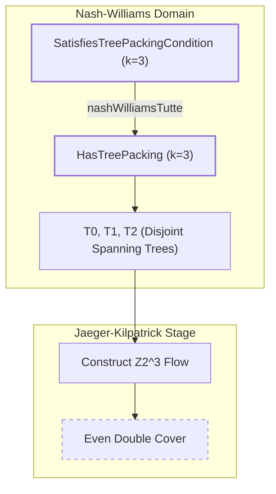
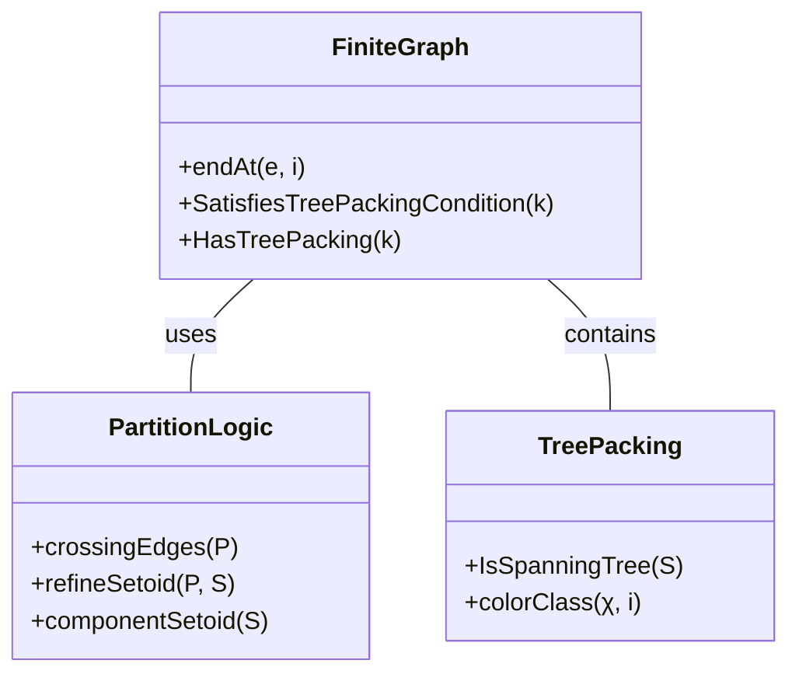

<!-- source: DeepWiki mcp.deepwiki.com · repo openai/cdc-lean · page 5 Nash-Williams–Tutte Spanning Tree Packing · patched3 2026-10-26 -->

# Nash-Williams–Tutte Spanning Tree Packing
# Nash-Williams–Tutte Spanning Tree Packing

Relevant source files

The following files were used as context for generating this wiki page:

- [CDCLean/NashWilliams.lean](CDCLean/NashWilliams.lean)

This page documents the formalization of the **Nash-Williams–Tutte Spanning Tree Packing Theorem** in `CDCLean/NashWilliams.lean`. This theorem provides a necessary and sufficient condition for a finite multigraph to contain $k$ edge-disjoint spanning trees.

In the context of the Cycle Double Cover proof, this theorem is specialized for $k=3$ to support the **Jaeger–Kilpatrick** reduction. If a graph is 3-edge-connected, the Nash-Williams condition is satisfied for $k=3$, providing three edge-disjoint spanning trees that are used to construct a nowhere-zero $\mathbb{Z}_2^3$-flow.

## Overview of Entities

The formalization uses a finite multigraph approach where edges are distinct objects, allowing for parallel edges between vertices.

| Entity | Description | Code Reference |
| :--- | :--- | :--- |
| `IsSpanningTree` | A set of edges $S$ that is connected and has cardinality $|V|-1$. | [CDCLean/NashWilliams.lean:40-41]() |
| `HasTreePacking` | The existence of $k$ pairwise edge-disjoint spanning trees. | [CDCLean/NashWilliams.lean:44-47]() |
| `SatisfiesTreePackingCondition` | The partition inequality: for every partition $P$, the number of crossing edges is at least $k(|P|-1)$. | [CDCLean/NashWilliams.lean:89-91]() |
| `refineSetoid` | Kaiser's refinement operator that splits partition classes based on reachability within a specific edge set. | [CDCLean/NashWilliams.lean:138-139]() |

### Logic Flow: Packing to Flow
The following diagram illustrates how the Nash-Williams theorem bridges graph structure and the flow-theoretic requirements of the Jaeger-Kilpatrick stage.

**Diagram: Spanning Tree Packing in the Proof Pipeline**

Sources: [CDCLean/NashWilliams.lean:44-47](), [CDCLean/NashWilliams.lean:89-91](), [CDCLean/NashWilliams.lean:235-236]()

## Partition Refinement and Kaiser's Algorithm
The proof of the Nash-Williams theorem in this library follows **Kaiser's elementary argument**. The central mechanism is a deterministic refinement of vertex partitions. Given a set of edges $S$, the `refineSetoid` function creates a finer partition where two vertices are related only if they were related in the original partition $P$ **and** are reachable via edges in $S$ that stay within the original partition class.

For a detailed explanation of the refinement sequence (`kaiserPartition`), the stability proofs, and how `InternallyConnected` components are identified, see **[Partition Refinement and Kaiser's Algorithm](#5.1)**.

Sources: [CDCLean/NashWilliams.lean:94-95](), [CDCLean/NashWilliams.lean:138-152]()

## The Exchange Mechanism and Termination
The sufficiency direction of the theorem (Condition $\implies$ Packing) is proved using a global optimization strategy. If a current coloring of edges does not form $k$ spanning trees, the algorithm identifies a "superfluous" edge in one tree and performs an exchange.

The formalization uses a **lexicographic descent** to ensure this process terminates. It tracks:
1. The number of components in the forest (aiming for 1 per tree).
2. The "level" of superfluous edges within a hierarchy of partition refinements.

For details on `swapColor`, `IsSuperfluousAt`, and the double induction that proves the existence of a valid packing, see **[Exchange Argument and Lexicographic Descent](#5.2)**.

Sources: [CDCLean/NashWilliams.lean:98-101](), [CDCLean/NashWilliams.lean:158-163]()

## Key Definitions and Theorems

### Spanning Tree Definition
Unlike the standard acyclic definition, `IsSpanningTree` is defined via connectivity and cardinality. In finite multigraphs, this is equivalent and more convenient for the exchange argument.
*   **Definition**: [CDCLean/NashWilliams.lean:40-41]()

### The Main Theorem
The `nashWilliamsTutte` theorem establishes the equivalence between the packing existence and the partition density condition.
*   **Theorem**: `theorem nashWilliamsTutte (k : ℕ) [NeZero k] : G.HasTreePacking k ↔ G.SatisfiesTreePackingCondition k`
*   **Source**: [CDCLean/NashWilliams.lean:235-236]()

### Support and Quotient Graphs
To handle multigraphs correctly, reachability is defined via a `supportGraph` (a `SimpleGraph` projection), while the `quotientGraph` preserves parallel edges between contracted partition classes to accurately count crossing edges.
*   `supportGraph`: [CDCLean/NashWilliams.lean:25-27]()
*   `quotientGraph`: [CDCLean/NashWilliams.lean:80-82]()

**Entity Association Map**

Sources: [CDCLean/NashWilliams.lean:25-27](), [CDCLean/NashWilliams.lean:40-41](), [CDCLean/NashWilliams.lean:80-82](), [CDCLean/NashWilliams.lean:89-91]()

---

