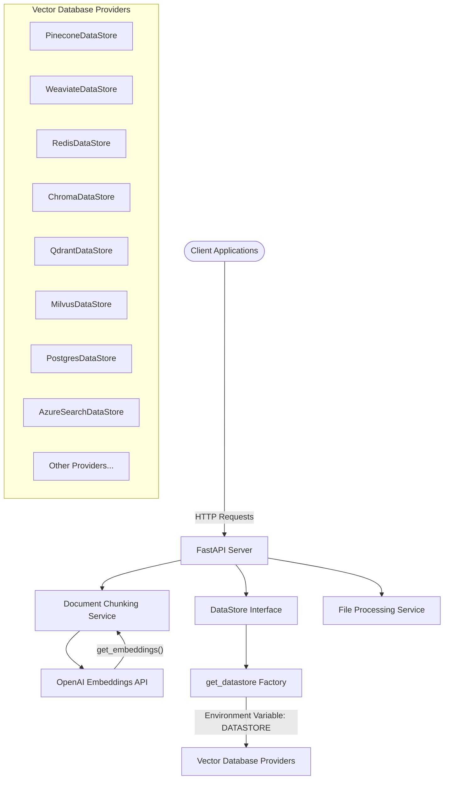
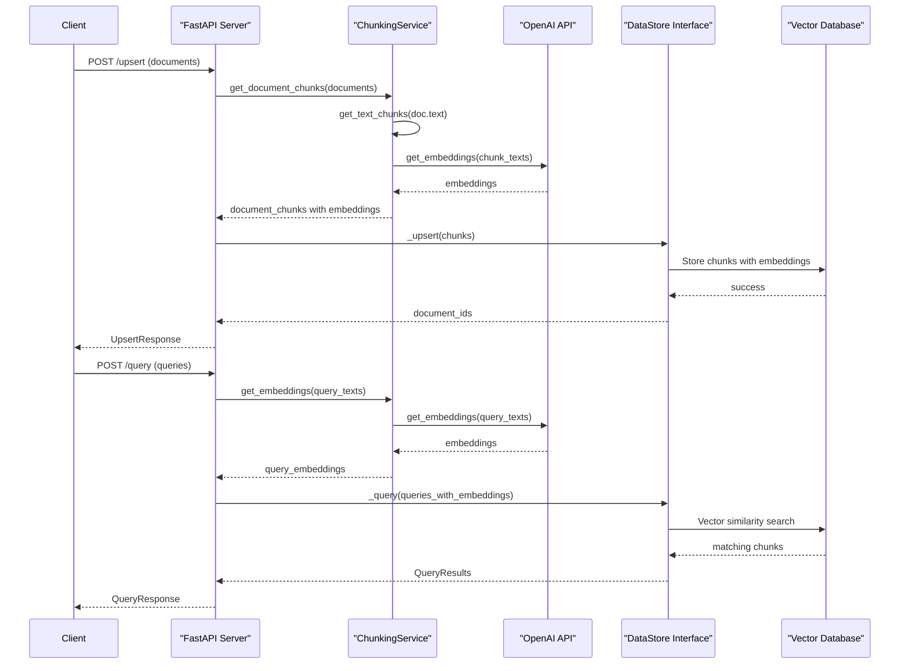
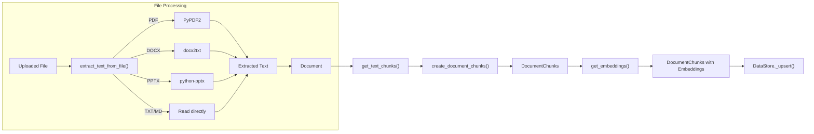
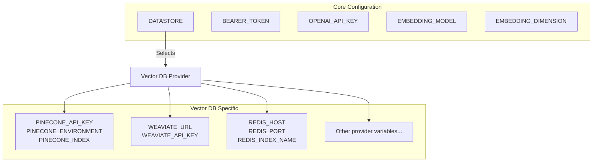

<!-- source: DeepWiki mcp.deepwiki.com · repo openai/chatgpt-retrieval-plugin · page 1 Overview · fetched 2026-10-26 -->

# Overview

<details>
<summary>Relevant source files</summary>

The following files were used as context for generating this wiki page:

- [README.md](README.md)
- [services/chunks.py](services/chunks.py)

</details>


The ChatGPT Retrieval Plugin is a standalone retrieval backend that enables ChatGPT to search and retrieve information from personal or organizational documents. It serves as a flexible solution for semantic search using natural language queries, allowing models to access user-provided documents and generate responses informed by this context.

For detailed information about system architecture and components, see [Architecture](#2). For specifics about how documents are processed, see [Document Processing Pipeline](#2.1).

## System Architecture

The ChatGPT Retrieval Plugin employs a modular architecture that separates concerns between document processing, embedding generation, and vector storage.



The system consists of three primary components:

1. **FastAPI Server**: Handles HTTP requests and exposes API endpoints for document management and queries
2. **Document Chunking Service**: Processes documents by splitting them into manageable chunks and generating embeddings
3. **DataStore Interface**: Provides a unified way to interact with various vector database providers

Sources: [README.md:6-13](), [server/main.py]()

## Core Workflows

The plugin supports two primary workflows: document ingestion (upsert) and semantic search (query).



### Document Upsert Process
1. Client submits documents through the `/upsert` endpoint
2. Documents are split into chunks of approximately 200 tokens
3. OpenAI's embedding model generates vector representations for each chunk
4. Chunks with embeddings are stored in the selected vector database

### Query Process
1. Client submits natural language queries through the `/query` endpoint
2. Queries are converted to embeddings using the same model
3. Vector similarity search identifies the most relevant document chunks
4. Results are returned to the client, optionally filtered by metadata

Sources: [services/chunks.py:152-205](), [README.md:257-272]()

## Document Processing Pipeline

The document processing pipeline transforms raw text into searchable vector representations:



Key components of the chunking process:
- `get_text_chunks()`: Splits documents into chunks of ~200 tokens based on natural breakpoints like periods
- `create_document_chunks()`: Assigns unique IDs and metadata to each chunk
- `get_document_chunks()`: Orchestrates the entire process for multiple documents and handles embedding generation

Sources: [services/chunks.py:25-99](), [services/chunks.py:102-149]()

## Data Store System

The plugin employs a provider pattern through the DataStore interface to support multiple vector databases:

```mermaid
graph TD
    DSI["DataStore Interface"] --> Pinecone["PineconeDataStore"]
    DSI --> Weaviate["WeaviateDataStore"]
    DSI --> Redis["RedisDataStore"]
    DSI --> Chroma["ChromaDataStore"]
    DSI --> Qdrant["QdrantDataStore"]
    DSI --> Milvus["MilvusDataStore"]
    DSI --> Postgres["PostgresDataStore"]
    DSI --> AzureSearch["AzureSearchDataStore"]
    DSI --> Others["Other DataStores..."]
    
    Factory["get_datastore() Factory"] --> |"DATASTORE env var"| DSI
    
    subgraph "Common Interface Methods"
        Upsert["_upsert()"]
        Query["_query()"]
        Delete["delete()"]
    end
    
    DSI --- "Common Interface Methods"
```

All datastore implementations share a common interface with methods:
- `_upsert()`: Store document chunks with embeddings
- `_query()`: Search for similar documents using vector similarity
- `delete()`: Remove documents from the database

The active datastore is selected through the `DATASTORE` environment variable.

Sources: [README.md:362-365](), [datastore/datastore.py]()

## API Endpoints

The plugin exposes several REST endpoints through its FastAPI server:

| Endpoint | Method | Purpose | Description |
|----------|--------|---------|-------------|
| `/upsert` | POST | Add documents | Upload text documents to the vector database |
| `/upsert-file` | POST | Add files | Upload files (PDF, DOCX, TXT, etc.) to the vector database |
| `/query` | POST | Search documents | Find relevant document chunks using natural language |
| `/delete` | DELETE | Remove documents | Delete documents by ID or metadata filter |

Each endpoint expects JSON payloads and returns JSON responses, with proper authentication required.

Sources: [README.md:257-272](), [server/main.py]()

## Configuration System

The plugin is configured through environment variables:



Key configuration variables:
- `DATASTORE`: Specifies which vector database provider to use
- `BEARER_TOKEN`: Authentication token for securing API access
- `OPENAI_API_KEY`: Required for generating embeddings
- `EMBEDDING_MODEL`: The OpenAI model used for embeddings (default: text-embedding-3-large)
- `EMBEDDING_DIMENSION`: Embedding size (default: 256 dimensions)

Additional provider-specific variables configure connection to the selected database.

Sources: [README.md:362-365](), [README.md:80-200]()

## Integration Options

The Retrieval Plugin can be integrated with ChatGPT in several ways:

1. **Custom GPTs**: Create a GPT that uses the plugin for retrieval via the OpenAPI schema
2. **Function Calling**: Use the plugin endpoints as functions in the Chat Completions or Assistants API
3. **Plugins Model (deprecated)**: Use with the older ChatGPT plugins model

The plugin provides a flexible backend for retrieval augmented generation (RAG) patterns, offering more control over embedding dimensions, chunking strategy, and vector database selection than native ChatGPT retrieval.

Sources: [README.md:207-254]()

## Authentication and Security

The plugin supports three authentication methods:

1. **No Authentication**: Open access (suitable only for public documents)
2. **HTTP Bearer Token**: Token-based authentication at user or service level
3. **OAuth**: Third-party authentication flow for higher security

Since the plugin provides access to document content, careful consideration should be given to data privacy and authorization.

Sources: [README.md:281-283](), [README.md:482-495]()

## Embeddings Models

The plugin uses OpenAI's embedding models to generate vector representations:

| Model | Default Dimensions | Adjustable To | Relative Performance |
|-------|-------------------|---------------|---------------------|
| text-embedding-3-large | 3072 | 256-3072 | Highest accuracy |
| text-embedding-3-small | 1536 | 512-1536 | Good balance of cost/accuracy |
| text-embedding-ada-002 | 1536 | 1536 | Legacy model |

The default configuration uses `text-embedding-3-large` with 256 dimensions, which provides a good balance of performance and cost.

Sources: [README.md:284-315]()

---

The ChatGPT Retrieval Plugin bridges the gap between large language models and private document repositories, enabling context-aware responses informed by user-specific content. Its modular architecture and extensive configuration options make it adaptable to a wide range of use cases and deployment scenarios.

---

