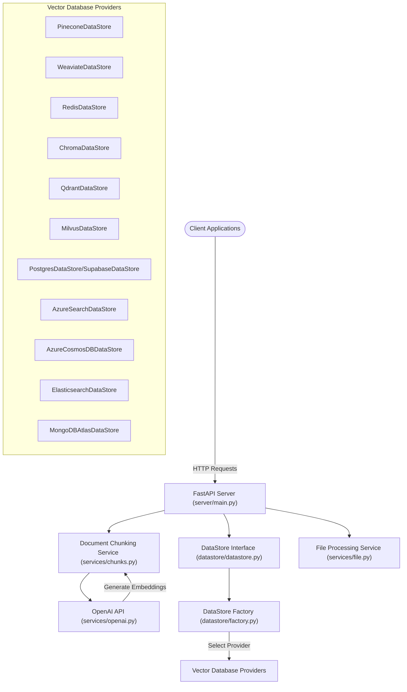
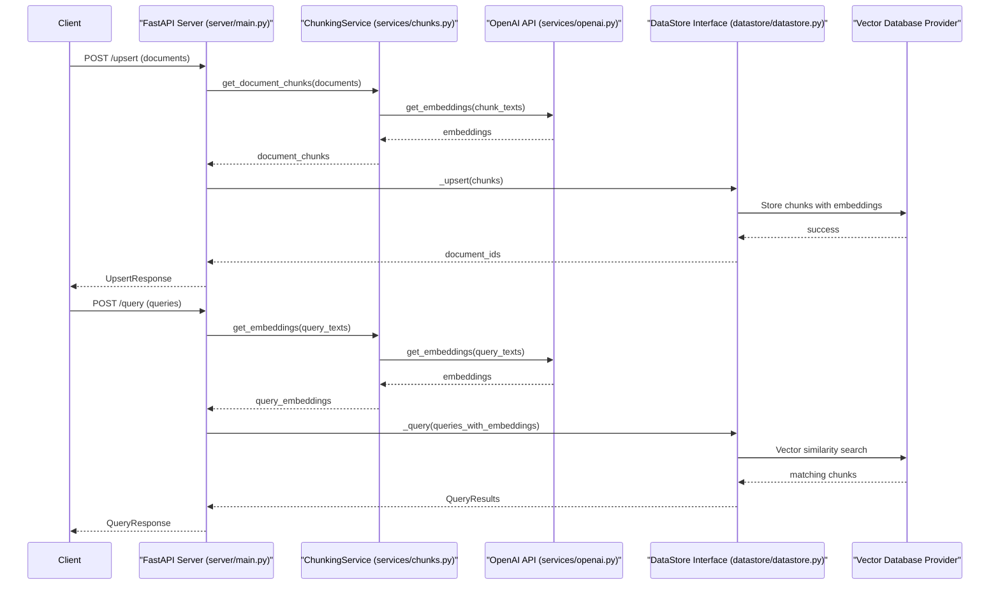
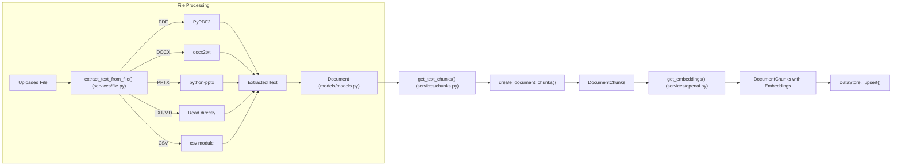
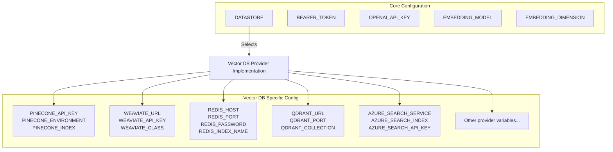

<!-- source: DeepWiki mcp.deepwiki.com · repo openai/chatgpt-retrieval-plugin · page 2 Architecture · fetched 2026-10-26 -->

# Architecture

<details>
<summary>Relevant source files</summary>

The following files were used as context for generating this wiki page:

- [README.md](README.md)
- [poetry.lock](poetry.lock)
- [pyproject.toml](pyproject.toml)
- [services/chunks.py](services/chunks.py)

</details>


This document provides a detailed explanation of the ChatGPT Retrieval Plugin's architecture, components, and data flow. It covers how the system is organized, the relationships between components, and how data moves through the system from ingestion to retrieval. For details about the document processing pipeline specifically, see [Document Processing Pipeline](#2.1).

## System Overview

The ChatGPT Retrieval Plugin is a standalone retrieval backend designed to provide ChatGPT with access to personal or organizational documents through a vector search mechanism. The architecture follows a modular design with clear separation of concerns between API handling, document processing, embedding generation, and vector storage.

### High-Level Architecture Diagram



Sources:
- [README.md:10-24]()
- [pyproject.toml:1-64]()

## Core Components

The system architecture consists of these key components:

1. **FastAPI Server**: Entry point for client applications, exposing RESTful endpoints in `server/main.py`.
2. **DataStore Interface**: Abstract interface in `datastore/datastore.py` that provides unified access to different vector databases.
3. **Document Chunking Service**: Implementation in `services/chunks.py` that handles splitting documents into smaller chunks for embedding.
4. **File Processing Service**: Extracts text from various file formats using `services/file.py`.
5. **OpenAI Service**: Interfaces with OpenAI's API to generate embeddings via `services/openai.py`.
6. **DataStore Factory**: Factory pattern implementation in `datastore/factory.py` that selects the appropriate vector database provider.
7. **Vector Database Providers**: Multiple implementations for storing and querying vector embeddings.

## API Endpoints and Data Flow

The system exposes several API endpoints to interact with documents and the vector database.

### API Endpoints

| Endpoint | Method | Description |
|----------|--------|-------------|
| `/upsert` | POST | Add documents to the vector database |
| `/upsert-file` | POST | Upload a file and add its content to the vector database |
| `/query` | POST | Search the vector database for document chunks matching a query |
| `/delete` | DELETE | Remove documents from the vector database |

### Core Data Flow Diagram



Sources:
- [README.md:256-272]()
- [services/chunks.py:152-205]()

### Document Flow Processes

#### Upsert Flow
1. Client sends documents to the `/upsert` endpoint
2. Server processes documents through the chunking service
3. OpenAI API generates embeddings for each chunk
4. DataStore stores chunks with embeddings in the vector database

#### Query Flow
1. Client sends query to the `/query` endpoint
2. Server gets embeddings for the query from OpenAI
3. DataStore queries the vector database for similar documents
4. Server returns matching document chunks to the client

## DataStore System Architecture

The DataStore system provides a unified interface for interacting with various vector database providers using the adapter pattern.

### DataStore Provider Ecosystem

```mermaid
graph TD
    DSI["DataStore Interface (datastore/datastore.py)"] --> Pinecone["PineconeDataStore"]
    DSI --> Weaviate["WeaviateDataStore"]
    DSI --> Redis["RedisDataStore"]
    DSI --> Chroma["ChromaDataStore"]
    DSI --> Qdrant["QdrantDataStore"]
    DSI --> Milvus["MilvusDataStore"]
    DSI --> Zilliz["ZillizDataStore"]
    DSI --> Postgres["PostgresDataStore"]
    DSI --> Supabase["SupabaseDataStore"]
    DSI --> Azure1["AzureSearchDataStore"]
    DSI --> Azure2["AzureCosmosDBDataStore"]
    DSI --> Elastic["ElasticsearchDataStore"]
    DSI --> MongoDB["MongoDBAtlasDataStore"]
    DSI --> AnalyticDB["AnalyticDBDataStore"]
    
    Factory["get_datastore() (datastore/factory.py)"] --> |"DATASTORE env var"| DSI
    
    subgraph "Common Interface Methods"
        Upsert["_upsert()"]
        Query["_query()"]
        Delete["delete()"]
    end
    
    DSI --- "Common Interface Methods"
```

Sources:
- [README.md:362-447]()
- [pyproject.toml:24-41]()

### DataStore Interface Contract

The `DataStore` abstract base class defines these core methods that all implementations must provide:

```
_upsert(chunks: List[DocumentChunk]) -> List[str]
_query(queries: List[QueryWithEmbedding]) -> List[QueryResult]
delete(filter: Optional[DocumentMetadataFilter] = None, ids: Optional[List[str]] = None) -> bool
```

The `get_datastore()` factory function in `datastore/factory.py` selects the appropriate DataStore implementation based on the `DATASTORE` environment variable, allowing for easy switching between different vector database providers.

## Document Processing

The document processing pipeline is responsible for converting raw documents into embeddings that can be stored and queried efficiently.

### Document Processing Pipeline



Sources:
- [services/chunks.py:25-205]()
- [README.md:538-545]()

The document processing pipeline consists of these key steps:

1. **Text Extraction**: Convert files of various formats to plain text
2. **Text Chunking**: Split documents into manageable chunks using `get_text_chunks()`
3. **Chunk Creation**: Create `DocumentChunk` objects with metadata using `create_document_chunks()`
4. **Embedding Generation**: Generate vector embeddings for each chunk using OpenAI's API
5. **Storage**: Store chunks with their embeddings in the selected vector database

### Chunking Configuration

The chunking process is configured with these parameters in `services/chunks.py`:

```python
CHUNK_SIZE = 200  # Target size of each text chunk in tokens
MIN_CHUNK_SIZE_CHARS = 350  # Minimum size of each text chunk in characters
MIN_CHUNK_LENGTH_TO_EMBED = 5  # Discard chunks shorter than this
EMBEDDINGS_BATCH_SIZE = int(os.environ.get("OPENAI_EMBEDDING_BATCH_SIZE", 128))
```

The chunking algorithm in `get_text_chunks()` attempts to split text at natural boundaries like periods and line breaks while maintaining semantic coherence.

Sources:
- [services/chunks.py:10-23]()

## Configuration and Environment Variables

The plugin is configured through environment variables, with core settings controlling overall behavior and provider-specific variables configuring the connection to different vector databases.

### Configuration Hierarchy



Sources:
- [README.md:82-200]()
- [README.md:362-366]()

### Essential Environment Variables

| Variable | Purpose | Default |
|----------|---------|---------|
| `DATASTORE` | Selects vector database provider | Required |
| `BEARER_TOKEN` | Authentication token for API requests | Required |
| `OPENAI_API_KEY` | API key for OpenAI services | Required |
| `EMBEDDING_MODEL` | Model for embeddings | "text-embedding-3-large" |
| `EMBEDDING_DIMENSION` | Dimension of embeddings | 256 |

Each vector database provider requires its own set of environment variables. The complete list can be found in [README.md:82-200]().

## Authentication Methods

The plugin supports multiple authentication methods:

1. **No Authentication**: Open access without credentials
2. **HTTP Bearer Token**: Authentication using a secret token
   - **User Level (default)**: Each user provides their own token
   - **Service Level**: A single token for all users
3. **OAuth**: Authentication via third-party OAuth provider

The default implementation uses User Level HTTP Bearer Token authentication, where the token is specified in the `BEARER_TOKEN` environment variable.

Sources:
- [README.md:482-497]()

## Summary

The ChatGPT Retrieval Plugin architecture provides a flexible and extensible system for semantic search and retrieval of personal or organizational documents. The key architectural patterns employed include:

1. **Adapter Pattern**: The DataStore interface provides a unified way to interact with various vector database implementations
2. **Factory Pattern**: The get_datastore function selects the appropriate DataStore implementation
3. **Service Layer**: Separate services handle document chunking, embedding, and file processing
4. **RESTful API**: A FastAPI server exposes endpoints for document management and querying

This modular design allows the system to be easily extended with new vector database providers and ensures a clean separation of concerns between the different components.

---

