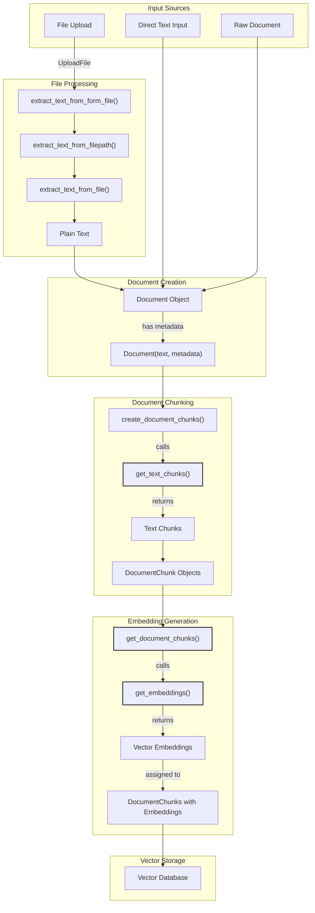
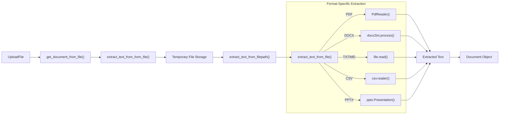
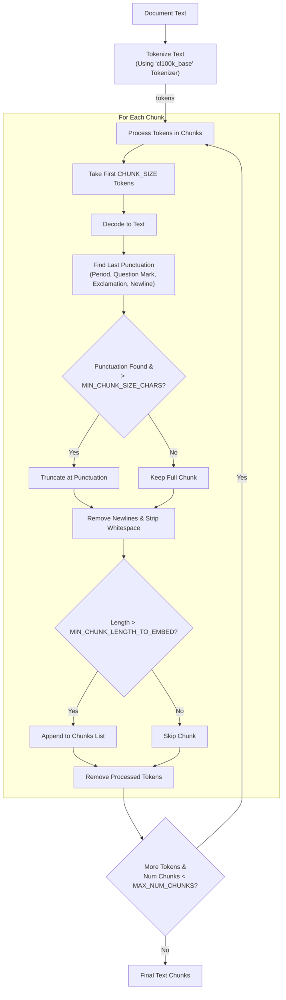
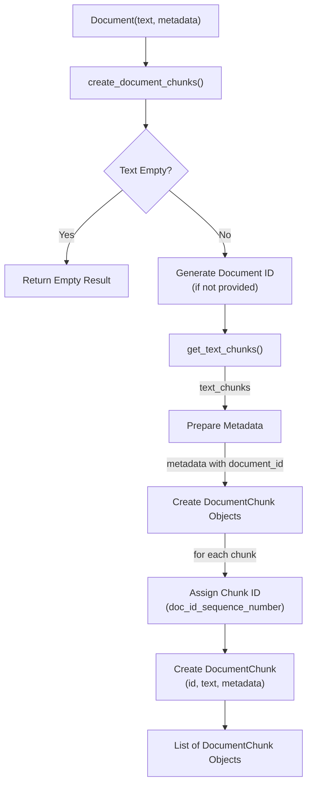
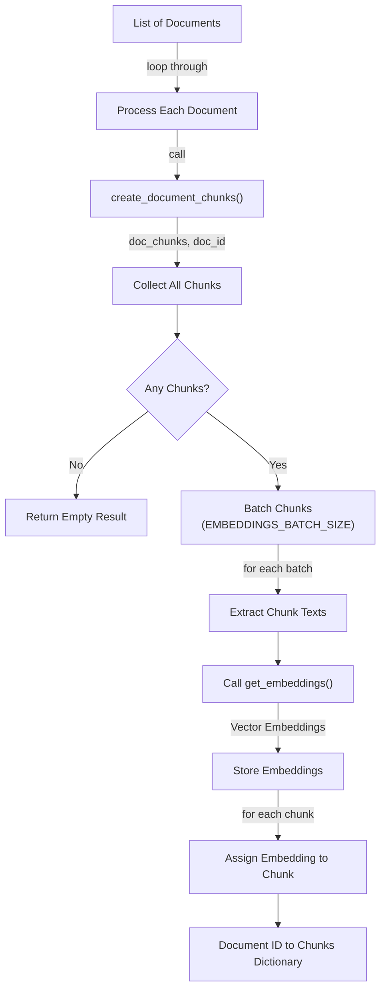
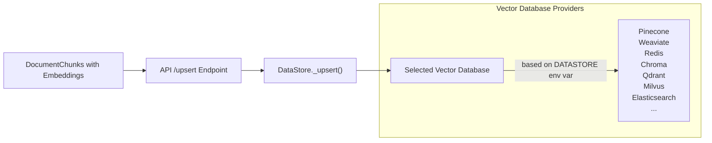
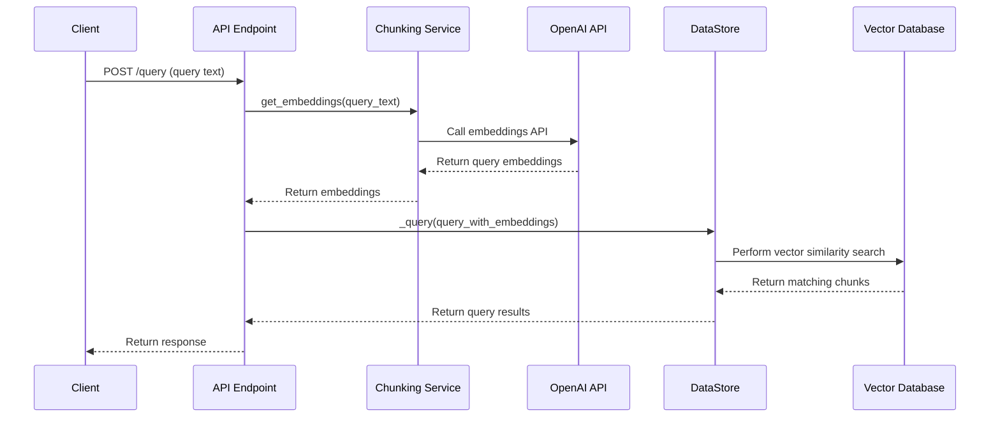

<!-- source: DeepWiki mcp.deepwiki.com · repo openai/chatgpt-retrieval-plugin · page 2.1 Document Processing Pipeline · fetched 2026-10-26 -->

# Document Processing Pipeline

<details>
<summary>Relevant source files</summary>

The following files were used as context for generating this wiki page:

- [README.md](README.md)
- [services/chunks.py](services/chunks.py)
- [services/file.py](services/file.py)

</details>


The Document Processing Pipeline is a core component of the ChatGPT Retrieval Plugin that handles the ingestion, processing, and vectorization of documents. This pipeline transforms raw document data from various formats into semantically searchable vector representations stored in a vector database. This page explains the pipeline's architecture, components, and the flow of data through the system.

For information about storing these processed documents in various vector databases, see [DataStore System](#4).

## Pipeline Overview

The Document Processing Pipeline consists of several key stages that work together to process documents for semantic search:

1. **File Processing** - Extracting text from various file formats (PDF, DOCX, etc.)
2. **Document Chunking** - Splitting documents into manageable chunks for embedding
3. **Embedding Generation** - Generating vector embeddings for each chunk
4. **Vector Storage** - Storing the chunks with their embeddings in a vector database

### Document Processing Pipeline Flow



Sources: [services/chunks.py:25-99](), [services/chunks.py:102-149](), [services/chunks.py:152-205](), [services/file.py:15-118]()

## File Processing

The first stage of the pipeline handles the extraction of text content from various file formats. This process converts structured files into plain text that can be further processed for embedding.

### Supported File Formats

The system supports multiple file formats through dedicated extraction methods:

| File Format | MIME Type | Extraction Method |
|-------------|-----------|-------------------|
| PDF | application/pdf | PyPDF2 |
| Plain Text | text/plain | Direct reading |
| Markdown | text/markdown | Direct reading |
| Word Document (DOCX) | application/vnd.openxmlformats-officedocument.wordprocessingml.document | docx2txt |
| CSV | text/csv | csv module |
| PowerPoint (PPTX) | application/vnd.openxmlformats-officedocument.presentationml.presentation | python-pptx |

### File Processing Flow



Sources: [services/file.py:15-22](), [services/file.py:25-45](), [services/file.py:48-87](), [services/file.py:91-117]()

The file processing system employs a multi-step approach:

1. For uploaded files, the `get_document_from_file()` function processes the upload
2. The file content is read and temporarily stored
3. Based on the MIME type, the appropriate extraction method is selected
4. Text is extracted and returned as a string
5. A `Document` object is created with the extracted text and provided metadata

This approach provides a unified interface for text extraction across multiple file formats.

## Document Chunking

After extracting text from documents, the pipeline splits the text into smaller chunks for more effective processing and retrieval. This chunking process is crucial for managing large documents and optimizing vector search performance.

### Chunking Constants and Configuration

The chunking system is governed by several constants:

| Constant | Default Value | Description |
|----------|---------------|-------------|
| `CHUNK_SIZE` | 200 | Target size of each text chunk in tokens |
| `MIN_CHUNK_SIZE_CHARS` | 350 | Minimum size of each chunk in characters |
| `MIN_CHUNK_LENGTH_TO_EMBED` | 5 | Minimum length for a chunk to be embedded |
| `EMBEDDINGS_BATCH_SIZE` | 128 | Number of embeddings to request at once |
| `MAX_NUM_CHUNKS` | 10000 | Maximum number of chunks per document |

Sources: [services/chunks.py:10-22]()

### Chunking Strategy

The chunking process uses a sophisticated strategy to create semantically meaningful chunks:



Sources: [services/chunks.py:25-99]()

The chunking strategy:
1. Tokenizes the text using the `cl100k_base` tokenizer
2. Processes tokens in chunks of the target size (`CHUNK_SIZE`)
3. Attempts to break chunks at natural boundaries (periods, question marks, etc.)
4. Ensures chunks meet minimum size requirements
5. Formats chunks by removing newlines and whitespace
6. Continues until all text is processed or the maximum number of chunks is reached

This approach ensures that chunks align with natural language boundaries where possible, improving the quality of subsequent embedding and retrieval.

## Document Chunk Creation

After text chunking, the pipeline creates structured `DocumentChunk` objects that include both text and metadata:



Sources: [services/chunks.py:102-149]()

The `create_document_chunks()` function:
1. Handles empty documents
2. Generates a document ID if not provided
3. Splits text into chunks using `get_text_chunks()`
4. Prepares metadata, ensuring the document ID is included
5. Creates `DocumentChunk` objects for each text chunk
6. Assigns unique IDs to each chunk (combining document ID and sequence number)

The resulting list of `DocumentChunk` objects contains all the text chunks with their associated metadata.

## Embedding Generation

The final processing step is generating vector embeddings for each document chunk. This is handled by the `get_document_chunks()` function, which:

1. Processes a list of documents into document chunks
2. Generates embeddings for all chunks
3. Associates embeddings with their respective chunks



Sources: [services/chunks.py:152-205]()

### Embedding Process Details

The embedding generation process:

1. Collects all document chunks across all documents
2. Processes chunks in batches (determined by `EMBEDDINGS_BATCH_SIZE`)
3. Extracts the text from each chunk in the batch
4. Calls the OpenAI API via `get_embeddings()` to generate vector embeddings
5. Assigns each embedding to its corresponding chunk
6. Returns a dictionary mapping document IDs to their chunks with embeddings

By default, the system uses OpenAI's embedding models to generate embeddings. The specific model and embedding dimension are configurable through environment variables:

```
EMBEDDING_DIMENSION=256  # Default dimension for text-embedding-3-large
EMBEDDING_MODEL="text-embedding-3-large"  # Default embedding model
```

## Integration with DataStore System

Once documents are processed and embedded, the resulting chunks are stored in a vector database through the DataStore system. The choice of vector database is configurable, with multiple providers supported.



Sources: [README.md:257-272]()

The processed document chunks are passed to the DataStore system, which handles storage in the selected vector database. For details on the DataStore system and supported providers, see [DataStore System](#4) and [Vector Database Providers](#5).

## Query Flow

When a query is received, the system processes it using a similar pipeline to generate embeddings for the query text:



Sources: [README.md:257-272]()

This flow enables semantic search by comparing the embeddings of the query with the stored embeddings of document chunks, returning the most relevant chunks based on vector similarity.

## Summary

The Document Processing Pipeline transforms raw documents into searchable vector representations through a series of steps:

1. **File Processing**: Extracts plain text from various file formats
2. **Document Chunking**: Splits text into semantically meaningful chunks
3. **Embedding Generation**: Converts text chunks into vector embeddings
4. **Vector Storage**: Stores chunks and embeddings in a vector database

This pipeline is a key component of the ChatGPT Retrieval Plugin, enabling efficient semantic search and retrieval of personal or organizational documents.

---

