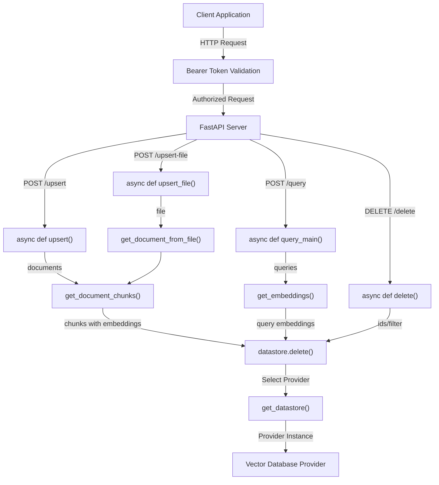
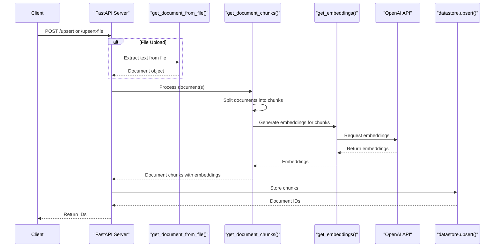
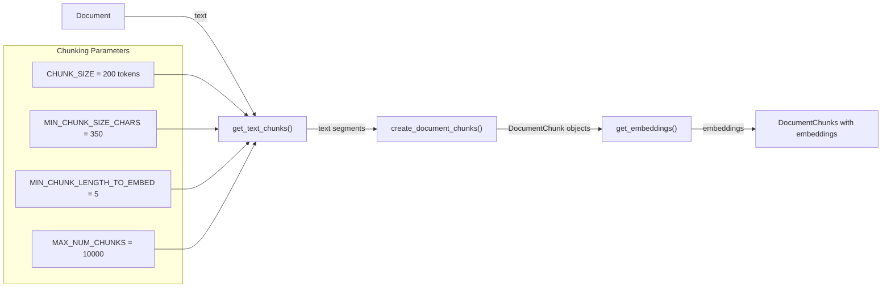
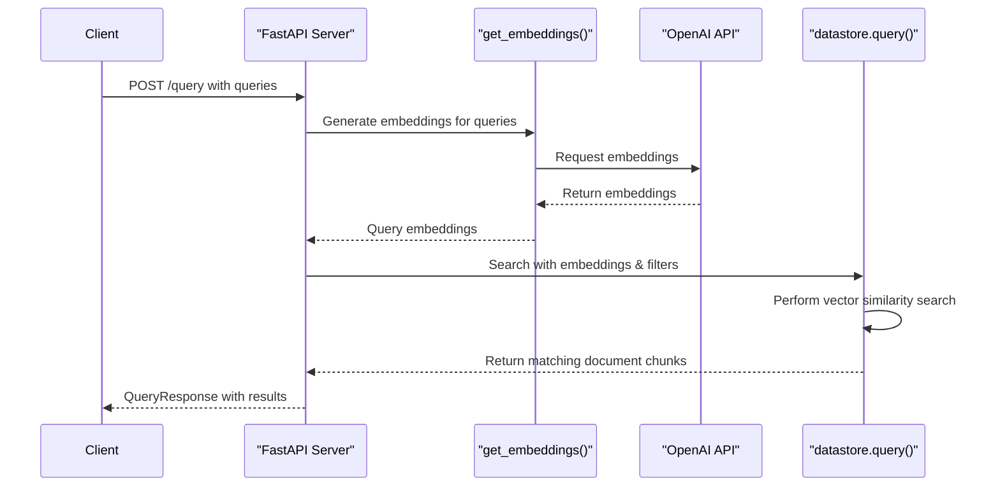

<!-- source: DeepWiki mcp.deepwiki.com · repo openai/chatgpt-retrieval-plugin · page 3 API Reference · fetched 2026-10-26 -->

# API Reference

<details>
<summary>Relevant source files</summary>

The following files were used as context for generating this wiki page:

- [README.md](README.md)
- [examples/memory/main.py](examples/memory/main.py)
- [local_server/ai-plugin.json](local_server/ai-plugin.json)
- [local_server/logo.png](local_server/logo.png)
- [local_server/main.py](local_server/main.py)
- [local_server/openapi.yaml](local_server/openapi.yaml)
- [server/main.py](server/main.py)
- [services/chunks.py](services/chunks.py)

</details>


This document provides a comprehensive reference for the API endpoints available in the ChatGPT Retrieval Plugin. The API allows for storing, querying, and managing documents in various vector databases for retrieval during conversations. For information about the underlying architecture, see [Architecture](#2), and for details on the DataStore system that handles vector database interactions, see [DataStore System](#4).

## Overview

The ChatGPT Retrieval Plugin API is a FastAPI-based service that provides endpoints for:

1. Uploading documents and their metadata to a vector database
2. Searching for relevant document chunks using natural language queries
3. Managing stored documents via deletion operations

All API endpoints require authentication using a bearer token.

## Authentication

The API uses HTTP Bearer token authentication. All requests must include the following header:

```
Authorization: Bearer YOUR_BEARER_TOKEN
```

The bearer token is configured through the `BEARER_TOKEN` environment variable when deploying the service.

Sources: [server/main.py:22-30]()

## Endpoint Overview

The following table summarizes the available API endpoints:

| Endpoint | Method | Description |
|----------|--------|-------------|
| `/upsert` | POST | Upload one or more documents to the vector database |
| `/upsert-file` | POST | Upload a single file (PDF, TXT, DOCX, etc.) to the vector database |
| `/query` | POST | Search documents using natural language queries |
| `/delete` | DELETE | Delete documents by ID, metadata filter, or all documents |

Sources: [server/main.py:47-146](), [local_server/main.py:63-138]()

## API Architecture



Sources: [server/main.py:32-156](), [examples/memory/main.py:25-183]()

## Document Processing Flow



Sources: [services/chunks.py:152-205](), [server/main.py:47-87]()

## Detailed Endpoint Documentation

### `/upsert` Endpoint

**Method**: POST

**Purpose**: Upload one or more documents to the vector database.

**Request Body**:
```json
{
  "documents": [
    {
      "id": "optional-id-1",
      "text": "Document text content",
      "metadata": {
        "source": "file",
        "source_id": "optional-source-id",
        "url": "optional-url",
        "created_at": "optional-timestamp",
        "author": "optional-author"
      }
    }
  ]
}
```

**Response**:
```json
{
  "ids": ["doc-id-1"]
}
```

The document text is chunked into segments of approximately 200 tokens, and each chunk is embedded using OpenAI's embedding model. The chunks and their embeddings are then stored in the vector database.

Sources: [server/main.py:74-87](), [examples/memory/main.py:79-92]()

### `/upsert-file` Endpoint

**Method**: POST

**Purpose**: Upload a single file to the vector database.

**Request Body** (multipart/form-data):
- `file`: The file to upload (PDF, TXT, DOCX, PPTX, or MD)
- `metadata` (optional): JSON string with document metadata

**Response**:
```json
{
  "ids": ["doc-id-1"]
}
```

This endpoint extracts text from the uploaded file, then processes it the same way as the `/upsert` endpoint.

Sources: [server/main.py:47-72](), [examples/memory/main.py:52-76]()

### `/query` Endpoint

**Method**: POST

**Purpose**: Search for relevant document chunks using natural language queries.

**Request Body**:
```json
{
  "queries": [
    {
      "query": "Natural language query",
      "filter": {
        "document_id": "optional-doc-id",
        "source": "optional-source",
        "source_id": "optional-source-id",
        "author": "optional-author",
        "start_date": "optional-start-date",
        "end_date": "optional-end-date"
      },
      "top_k": 3
    }
  ]
}
```

**Response**:
```json
{
  "results": [
    {
      "query": "Natural language query",
      "results": [
        {
          "id": "chunk-id-1",
          "text": "Matching chunk text",
          "metadata": {
            "source": "file",
            "source_id": "source-id",
            "url": "url",
            "created_at": "timestamp",
            "author": "author",
            "document_id": "doc-id-1"
          },
          "score": 0.8
        }
      ]
    }
  ]
}
```

The query text is converted to an embedding using the same model as document chunks, and a similarity search is performed in the vector database. The most similar chunks are returned, ordered by score.

Sources: [server/main.py:89-123](), [examples/memory/main.py:113-148]()

### `/delete` Endpoint

**Method**: DELETE

**Purpose**: Delete documents from the vector database.

**Request Body**:
```json
{
  "ids": ["doc-id-1"],  // Optional: List of document IDs to delete
  "filter": {  // Optional: Metadata filter
    "document_id": "optional-doc-id",
    "source": "optional-source",
    "source_id": "optional-source-id",
    "author": "optional-author",
    "start_date": "optional-start-date",
    "end_date": "optional-end-date"
  },
  "delete_all": false  // Optional: Delete all documents
}
```

**Response**:
```json
{
  "success": true
}
```

At least one of `ids`, `filter`, or `delete_all` must be provided.

Sources: [server/main.py:125-146](), [examples/memory/main.py:151-173]()

## Document Chunking Process

The plugin processes documents by chunking them into smaller segments before embedding and storage. This process is critical for efficient vector search and retrieval.



The chunking process follows these steps:

1. Split text into segments of approximately 200 tokens
2. Try to break at natural boundaries (periods, newlines)
3. Ensure chunks are at least 350 characters when possible
4. Discard chunks shorter than 5 characters
5. Limit total chunks to 10,000 per document
6. Generate embeddings for all chunks in batches
7. Assign each chunk a unique ID based on document ID

Sources: [services/chunks.py:1-206]()

## Query Processing Flow



Sources: [server/main.py:89-123](), [examples/memory/main.py:113-148]()

## Using the API with Custom GPTs or Function Calling

The API can be integrated with:

1. **Custom GPTs**: Through OpenAPI schema configuration in the GPT editor
2. **Function Calling**: Using the Chat Completions or Assistants API

For custom GPTs, you'll need to provide your API endpoint URL and the OpenAPI schema located at `/.well-known/openapi.yaml` on your deployed API.

For function calling, you'll implement functions that make requests to these API endpoints and pass the responses back to the model.

Sources: [README.md:217-254]()

## Error Handling

The API returns standard HTTP status codes:

| Status Code | Description |
|-------------|-------------|
| 400 | Bad Request - Missing required parameters |
| 401 | Unauthorized - Invalid bearer token |
| 422 | Validation Error - Invalid request format |
| 500 | Internal Server Error - Server-side error |

All errors return a JSON response with error details.

Sources: [server/main.py:22-30](), [server/main.py:74-87](), [server/main.py:125-146]()

## Memory Feature

The API can be configured to give ChatGPT "memory" by enabling access to the `/upsert` endpoint in the OpenAPI schema. This allows the model to save information from conversations for later retrieval.

To enable this feature:
1. Replace the main FastAPI server file with the memory-enabled version
2. Use the expanded OpenAPI schema that includes the `/upsert` endpoint
3. Configure your custom GPT to have access to this endpoint

Sources: [examples/memory/main.py:1-183](), [README.md:276-279]()

## OpenAPI Schema

The API's OpenAPI schema is exposed at `/.well-known/openapi.yaml` for the public-facing endpoints and at `/sub/openapi.json` for viewing all endpoints when running locally.

The schema defines all request and response models, examples, and validation rules. It can be used to generate client libraries or documentation in various languages.

Sources: [local_server/openapi.yaml:1-191](), [server/main.py:36-44]()

## Conclusion

The ChatGPT Retrieval Plugin API provides a flexible and powerful interface for semantic search and retrieval of personal or organizational documents. By following RESTful conventions and using JSON for data exchange, it can be easily integrated with a wide range of client applications, including ChatGPT custom GPTs and function calling implementations.

For information on setting up and deploying the API with different vector database providers, see the appropriate sections in the wiki.

---

