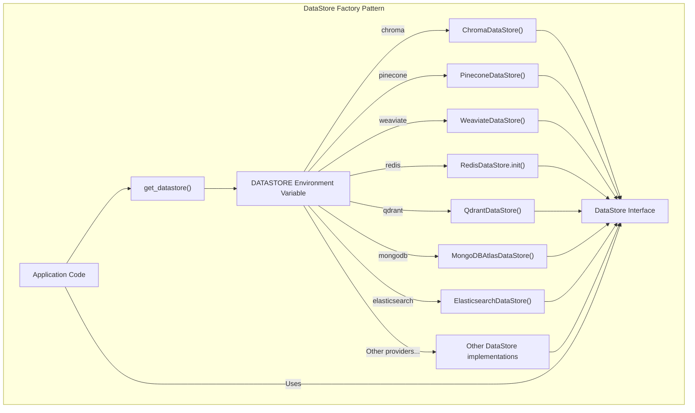
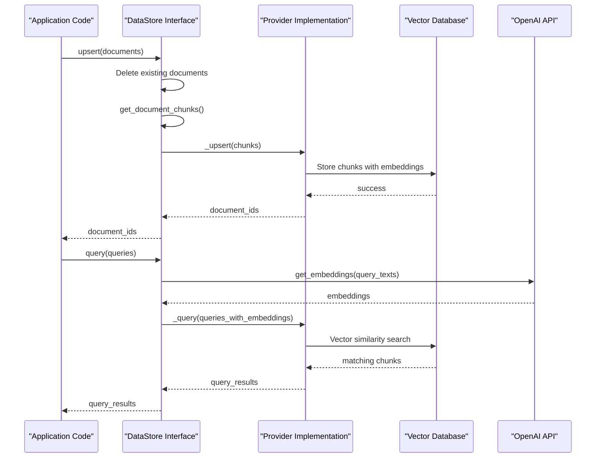
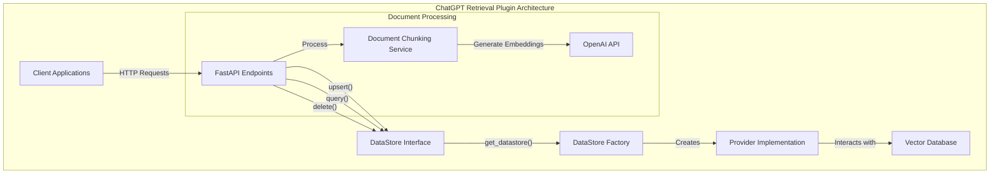

<!-- source: DeepWiki mcp.deepwiki.com · repo openai/chatgpt-retrieval-plugin · page 4 DataStore System · fetched 2026-10-26 -->

# DataStore System

Relevant source files

The following files were used as context for generating this wiki page:

- [datastore/datastore.py](datastore/datastore.py)
- [datastore/factory.py](datastore/factory.py)
- [tests/datastore/providers/mongodb_atlas/test_integration.py](tests/datastore/providers/mongodb_atlas/test_integration.py)
- [tests/datastore/providers/mongodb_atlas/test_mongodb_datastore.py](tests/datastore/providers/mongodb_atlas/test_mongodb_datastore.py)

## Purpose and Scope

The DataStore System is a foundational component of the ChatGPT Retrieval Plugin that abstracts and standardizes interactions with various vector databases. This document explains the architecture of the DataStore interface, its implementation using the factory pattern, and how it enables the plugin to work with multiple vector database providers. For specific details about individual vector database implementations, see [Vector Database Providers](#5).

## DataStore Interface Architecture

The DataStore system is built around an abstract base class that defines a common interface for all vector database interactions. This design follows the principle of "program to an interface, not an implementation" and enables seamless switching between different vector database providers.

```mermaid
classDiagram
    class DataStore {
        <<Abstract>>
        +upsert(documents, chunk_token_size) List[str]
        +query(queries) List[QueryResult]
        #_upsert(chunks) List[str]*
        #_query(queries_with_embeddings) List[QueryResult]*
        +delete(ids, filter, delete_all) bool*
    }
    
    class PineconeDataStore {
        #_upsert(chunks) List[str]
        #_query(queries_with_embeddings) List[QueryResult]
        +delete(ids, filter, delete_all) bool
    }
    
    class WeaviateDataStore {
        #_upsert(chunks) List[str]
        #_query(queries_with_embeddings) List[QueryResult]
        +delete(ids, filter, delete_all) bool
    }
    
    class RedisDataStore {
        +init() RedisDataStore
        #_upsert(chunks) List[str]
        #_query(queries_with_embeddings) List[QueryResult]
        +delete(ids, filter, delete_all) bool
    }
    
    DataStore <|-- PineconeDataStore
    DataStore <|-- WeaviateDataStore
    DataStore <|-- RedisDataStore
    DataStore <|-- QdrantDataStore
    DataStore <|-- ChromaDataStore
    DataStore <|-- ElasticsearchDataStore
    DataStore <|-- MongoDBAtlasDataStore
    
    class QdrantDataStore {
        #_upsert(chunks) List[str]
        #_query(queries_with_embeddings) List[QueryResult]
        +delete(ids, filter, delete_all) bool
    }
    
    class ChromaDataStore {
        #_upsert(chunks) List[str]
        #_query(queries_with_embeddings) List[QueryResult]
        +delete(ids, filter, delete_all) bool
    }
    
    class ElasticsearchDataStore {
        #_upsert(chunks) List[str]
        #_query(queries_with_embeddings) List[QueryResult]
        +delete(ids, filter, delete_all) bool
    }
    
    class MongoDBAtlasDataStore {
        #_upsert(chunks) List[str]
        #_query(queries_with_embeddings) List[QueryResult]
        +delete(ids, filter, delete_all) bool
    }
```

**Diagram: DataStore Class Hierarchy**

Sources: [datastore/datastore.py:17-86]()

The abstract `DataStore` class defines three core operations:

1. **Upsert**: Insert or update documents in the vector database
2. **Query**: Retrieve documents based on vector similarity to a query
3. **Delete**: Remove documents from the database based on criteria

### Core Methods

The `DataStore` class provides two public methods that handle common pre-processing tasks:

- **upsert()**: Takes full documents, deletes any existing documents with the same IDs, chunks the documents, and calls the provider-specific `_upsert()` method to store the chunks.

- **query()**: Takes a list of queries, generates embeddings for them using the OpenAI API, and calls the provider-specific `_query()` method to perform the similarity search.

### Abstract Methods

Each vector database provider must implement three abstract methods:

- **_upsert()**: Provider-specific implementation for inserting document chunks into the database.
- **_query()**: Provider-specific implementation for performing vector similarity search.
- **delete()**: Provider-specific implementation for removing documents from the database.

Sources: [datastore/datastore.py:44-86]()

## Factory Pattern Implementation

The DataStore system uses the factory pattern to dynamically create instances of the appropriate DataStore implementation based on configuration.

**Diagram: DataStore Factory Pattern Flow**

Sources: [datastore/factory.py:5-81]()

The factory function `get_datastore()` examines the `DATASTORE` environment variable and returns an instance of the appropriate DataStore implementation. This allows the system to work with different vector databases without modifying the core application code.

### Provider Selection Mechanism

The provider selection logic is straightforward:

1. Read the `DATASTORE` environment variable
2. Match the value to a supported provider
3. Import the corresponding DataStore implementation
4. Instantiate and return the DataStore object

If the specified provider is not supported, the factory throws a `ValueError` with a list of supported options.

Some providers, like Redis and Azure CosmosDB, require asynchronous initialization, which is handled by the factory function.

## Data Flow Through the DataStore System

The following diagram illustrates how data flows through the DataStore system during upsert and query operations:

**Diagram: DataStore System Data Flow**

Sources: [datastore/datastore.py:17-86]()

## Supported Vector Database Providers

The DataStore system supports multiple vector database providers. Each provider is implemented as a subclass of the `DataStore` abstract base class.

| Provider | Implementation Class | Environment Variable Value |
|----------|----------------------|----------------------------|
| Chroma | ChromaDataStore | chroma |
| Llama | LlamaDataStore | llama |
| Pinecone | PineconeDataStore | pinecone |
| Weaviate | WeaviateDataStore | weaviate |
| Milvus | MilvusDataStore | milvus |
| Zilliz | ZillizDataStore | zilliz |
| Redis | RedisDataStore | redis |
| Azure CosmosDB | AzureCosmosDBDataStore | azurecosmosdb |
| Qdrant | QdrantDataStore | qdrant |
| Azure Search | AzureSearchDataStore | azuresearch |
| Supabase | SupabaseDataStore | supabase |
| PostgreSQL | PostgresDataStore | postgres |
| AnalyticDB | AnalyticDBDataStore | analyticdb |
| Elasticsearch | ElasticsearchDataStore | elasticsearch |
| MongoDB Atlas | MongoDBAtlasDataStore | mongodb |

Sources: [datastore/factory.py:9-76]()

## Usage Examples

### Document Insertion

To insert documents into the vector database:

1. Call the factory function to get a DataStore instance
2. Call the `upsert()` method with a list of documents

The DataStore will:
- Delete any existing documents with the same IDs
- Chunk the documents into smaller pieces
- Generate embeddings for each chunk
- Store the chunks in the vector database

### Querying

To query for similar documents:

1. Call the factory function to get a DataStore instance
2. Call the `query()` method with a list of queries

The DataStore will:
- Generate embeddings for the queries
- Perform a vector similarity search in the database
- Return the matching document chunks with similarity scores

### Integration with the Rest of the System

The DataStore system is a critical component that connects the HTTP API layer with the underlying vector databases:

**Diagram: DataStore Integration in the ChatGPT Retrieval Plugin**

Sources: [datastore/factory.py:5-81](), [datastore/datastore.py:17-86]()

## Configuration

The DataStore system is configured through environment variables:

| Environment Variable | Description | Required |
|----------------------|-------------|----------|
| DATASTORE | The vector database provider to use | Yes |
| BEARER_TOKEN | Authentication token for API access | Yes |
| OPENAI_API_KEY | OpenAI API key for generating embeddings | Yes |
| EMBEDDING_MODEL | The OpenAI model to use for embeddings | Yes |
| EMBEDDING_DIMENSION | The dimension of the embedding vectors | Yes |
| Provider-specific variables | Configuration for the selected provider | Varies |

Sources: [tests/datastore/providers/mongodb_atlas/test_integration.py:103-129]()

## Summary

The DataStore system provides a flexible and extensible architecture for integrating with various vector databases. By using the abstract base class pattern and factory method, the system achieves high modularity and allows seamless switching between different vector database providers. This design makes the ChatGPT Retrieval Plugin adaptable to different deployment environments and user preferences.

The core functionality of document insertion, querying, and deletion is standardized across all providers, while provider-specific details are encapsulated in the implementation classes. This separation of concerns makes the system easier to maintain and extend with new vector database providers.

---

