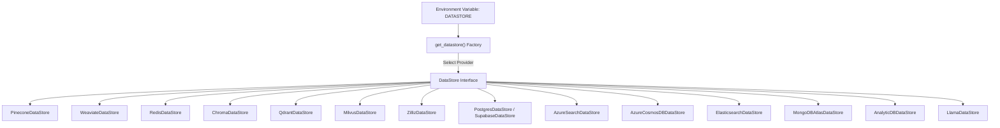
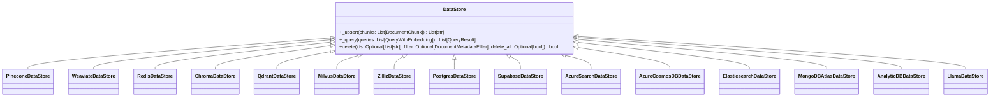
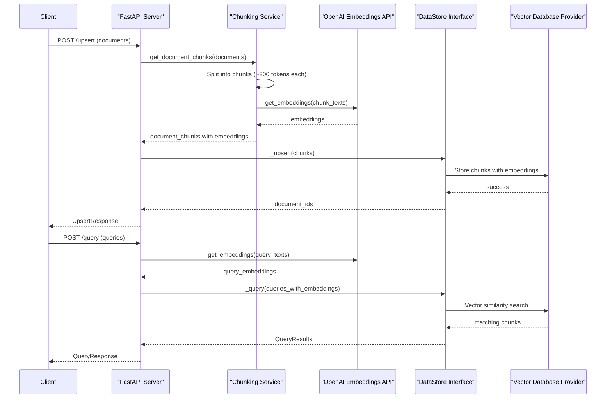
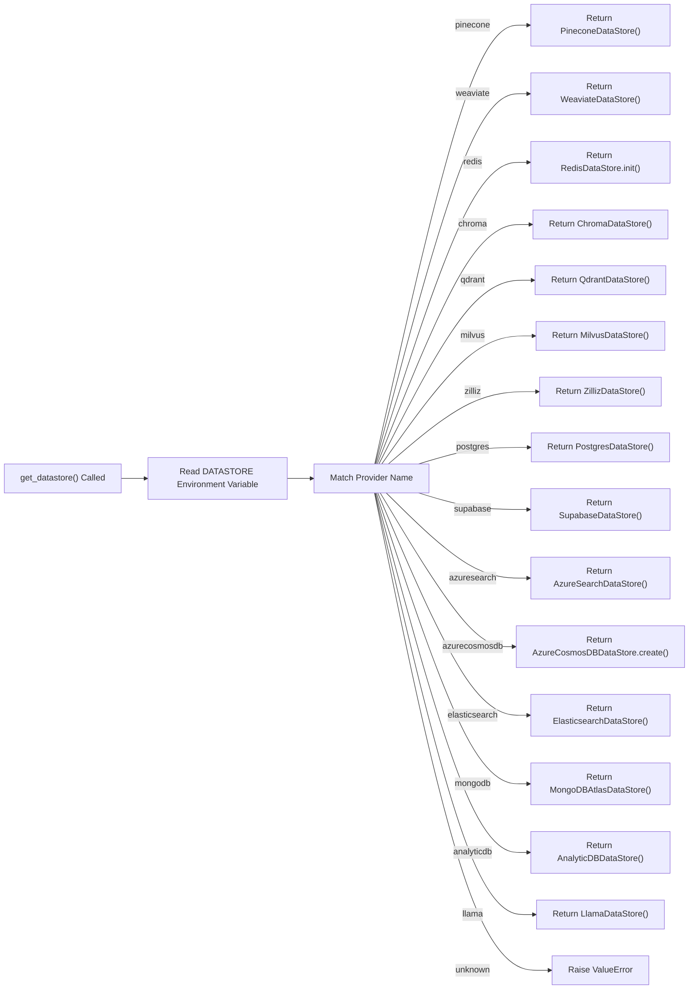

<!-- source: DeepWiki mcp.deepwiki.com · repo openai/chatgpt-retrieval-plugin · page 5 Vector Database Providers · fetched 2026-10-26 -->

# Vector Database Providers

<details>
<summary>Relevant source files</summary>

The following files were used as context for generating this wiki page:

- [README.md](README.md)
- [datastore/factory.py](datastore/factory.py)
- [services/chunks.py](services/chunks.py)

</details>


## Introduction and Purpose

This page provides an overview of the vector database providers supported by the ChatGPT Retrieval Plugin. Vector databases are essential for the system's semantic search functionality, efficiently storing and retrieving document embeddings. The plugin uses a modular architecture that allows it to work with multiple vector database backends.

For information about the overall DataStore system architecture, see [DataStore System](#4). For details about the document processing pipeline that creates embeddings, see [Document Processing Pipeline](#2.1).

## Provider Selection Architecture

The system uses a factory pattern to dynamically select and instantiate the appropriate vector database provider based on environment variables. This allows users to choose their preferred vector database without changing the core application logic.

### Vector Database Provider Selection Flow



Sources: [datastore/factory.py:5-81]()

## Common DataStore Interface

All vector database providers implement the same interface, ensuring consistent functionality across providers. The three primary operations supported by all providers are:



Sources: [datastore/factory.py:1-81](), [README.md:241-248]()

## Document and Query Workflow

The following sequence diagram illustrates how the vector database providers are used in the document upsert and query operations:



Sources: [services/chunks.py:1-205](), [README.md:241-271]()

## Supported Vector Database Providers

The plugin supports the following vector database providers, each with its own implementation and configuration requirements:

| Provider | Description | Key Features |
|----------|-------------|--------------|
| Pinecone | Managed vector database for speed and scale | Hybrid search, SPLADE sparse vectors |
| Weaviate | Open-source vector search engine | Hybrid search, scales to billions of objects |
| Redis | Real-time data platform | Low-latency vector engine |
| Chroma | AI-native embedding database | In-memory or client-server, easy setup |
| Qdrant | Vector database for documents and embeddings | Self-hosted or managed options |
| Milvus | Open-source, cloud-native vector database | Multiple indexing algorithms, scalar filtering |
| Zilliz | Managed version of Milvus | Cloud-native, billion-scale data |
| PostgreSQL/Supabase | Vector storage via pgvector extension | Integrated with PostgreSQL ecosystem |
| Azure Cognitive Search | Cloud retrieval service | Vector, text, and hybrid search |
| Azure CosmosDB | MongoDB-compatible database with vector search | Integration with Azure ecosystem |
| Elasticsearch | Search and analytics engine | Dense vector field type, ANN search |
| MongoDB Atlas | Managed MongoDB service | Vector search for embeddings |
| AnalyticDB | Distributed cloud-native vector database | PostgreSQL-compatible, managed by Alibaba |
| LlamaIndex | Interface for connecting LLMs with data | Multiple indexing strategies |

Sources: [README.md:42-57](), [README.md:388-447]()

## Configuration Requirements

Each vector database provider requires specific environment variables for configuration. The following table summarizes the key variables needed for each provider:

| Provider | Required Environment Variables |
|----------|--------------------------------|
| Pinecone | `PINECONE_API_KEY`, `PINECONE_ENVIRONMENT`, `PINECONE_INDEX` |
| Weaviate | `WEAVIATE_URL`, `WEAVIATE_API_KEY` (optional), `WEAVIATE_CLASS` (optional) |
| Redis | `REDIS_HOST`, `REDIS_PORT`, `REDIS_PASSWORD` (optional), `REDIS_INDEX_NAME` |
| Chroma | `CHROMA_COLLECTION`, `CHROMA_IN_MEMORY`, `CHROMA_PERSISTENCE_DIR` (if not in-memory) |
| Qdrant | `QDRANT_URL`, `QDRANT_PORT` (optional), `QDRANT_API_KEY` (optional), `QDRANT_COLLECTION` |
| Milvus | `MILVUS_COLLECTION`, `MILVUS_HOST`, `MILVUS_PORT`, `MILVUS_USER`, `MILVUS_PASSWORD` |
| Zilliz | `ZILLIZ_COLLECTION`, `ZILLIZ_URI`, `ZILLIZ_USER`, `ZILLIZ_PASSWORD` |
| PostgreSQL | `PG_HOST`, `PG_PORT`, `PG_USER`, `PG_PASSWORD`, `PG_DB` |
| Supabase | `SUPABASE_URL`, `SUPABASE_ANON_KEY` |
| Azure Cognitive Search | `AZURESEARCH_SERVICE`, `AZURESEARCH_INDEX`, `AZURESEARCH_API_KEY` (optional) |
| Azure CosmosDB | `AZCOSMOS_API`, `AZCOSMOS_CONNSTR`, `AZCOSMOS_DATABASE_NAME`, `AZCOSMOS_CONTAINER_NAME` |
| Elasticsearch | `ELASTICSEARCH_URL` or `ELASTICSEARCH_CLOUD_ID`, `ELASTICSEARCH_INDEX` |
| MongoDB Atlas | `MONGODB_URI`, `MONGODB_DATABASE`, `MONGODB_COLLECTION`, `MONGODB_INDEX` |
| AnalyticDB | `PG_HOST`, `PG_PORT`, `PG_USER`, `PG_PASSWORD`, `PG_DATABASE`, `PG_COLLECTION` |
| LlamaIndex | `LLAMA_INDEX_TYPE`, `LLAMA_INDEX_JSON_PATH` |

Sources: [README.md:100-199]()

## Provider Implementation Selection

The system selects the appropriate vector database provider implementation through the `get_datastore()` factory function, which returns an instance of the chosen `DataStore` implementation based on the `DATASTORE` environment variable:



Sources: [datastore/factory.py:5-81]()

## Configuring a Vector Database Provider

To use a specific vector database provider, follow these steps:

1. Set the `DATASTORE` environment variable to the provider name (e.g., `pinecone`, `weaviate`, etc.)
2. Set the required environment variables for your chosen provider
3. Ensure you have the necessary credentials and access to the vector database service

Example for configuring Pinecone:

```
export DATASTORE=pinecone
export PINECONE_API_KEY=your_api_key
export PINECONE_ENVIRONMENT=your_environment
export PINECONE_INDEX=your_index
```

Sources: [README.md:450-456]()

## Provider Performance Considerations

When choosing a vector database provider, consider these factors:

1. **Scalability**: How many vectors can the database efficiently store and query?
2. **Query Speed**: How quickly can the database return results for vector similarity searches?
3. **Hybrid Search**: Does the provider support combining vector similarity with keyword search?
4. **Hosting Options**: Is the database available as a managed service or self-hosted?
5. **Integration Complexity**: How easy is it to set up and maintain the database?
6. **Cost**: What are the pricing models and ongoing costs?

For detailed provider-specific setup instructions and performance characteristics, refer to the documentation in `/docs/providers/<datastore_name>/setup.md`.

Sources: [README.md:379-447]()

## Extending with New Providers

The modular architecture makes it straightforward to add support for new vector database providers. To add a new provider:

1. Create a new class that implements the `DataStore` interface
2. Implement the required methods: `_upsert`, `_query`, and `delete`
3. Add the provider to the `get_datastore()` factory function
4. Update documentation with configuration requirements

This extensibility allows the system to adapt to new vector database technologies as they emerge.

Sources: [datastore/factory.py:5-81](), [README.md:600-610]()

## Conclusion

The Vector Database Providers subsystem is a key component of the ChatGPT Retrieval Plugin, offering flexibility in choosing a backend for storing and querying document embeddings. By implementing a common interface across all providers, the system ensures consistent functionality while allowing users to leverage specific features of their preferred vector database.

---

