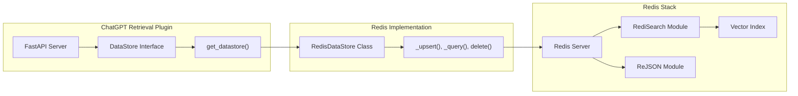
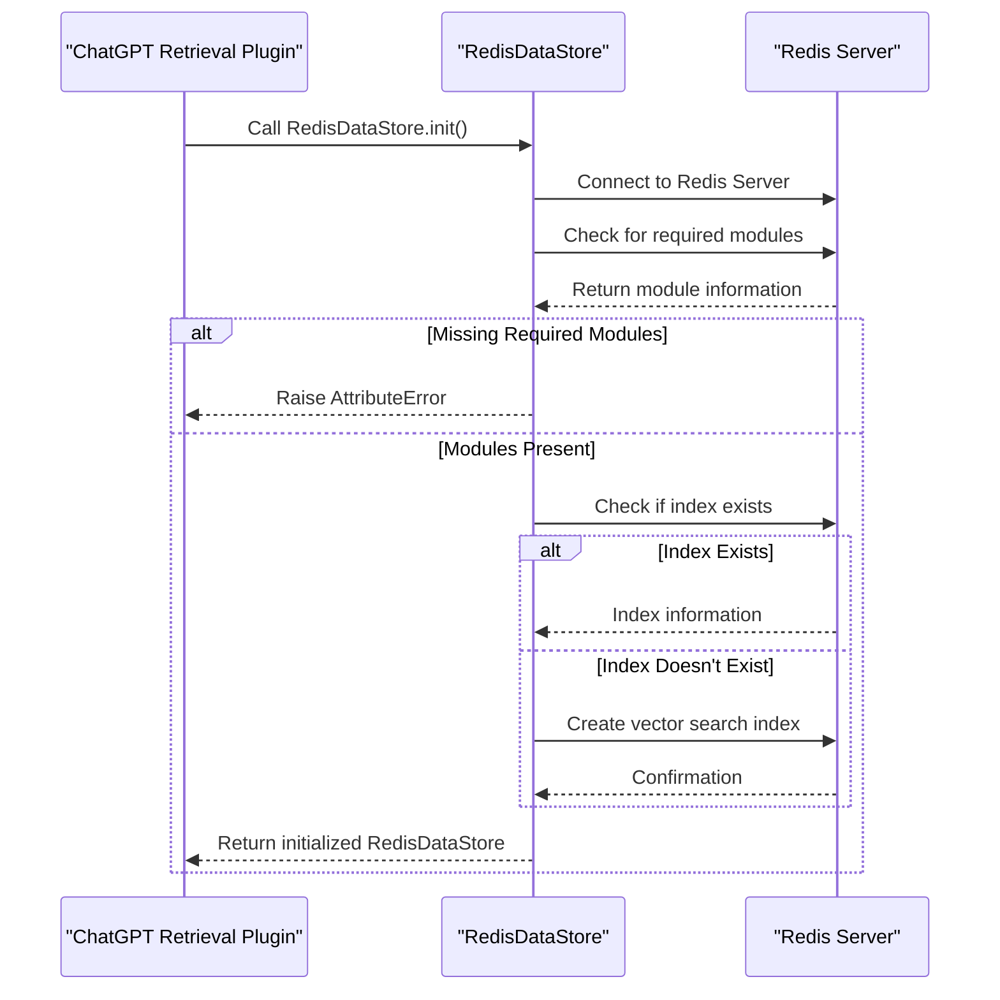
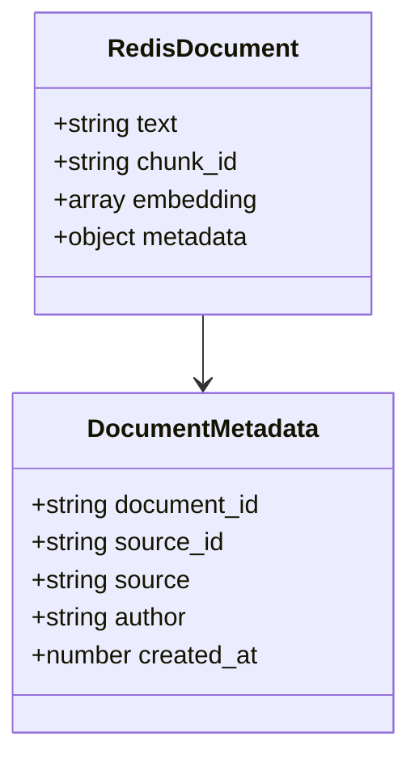
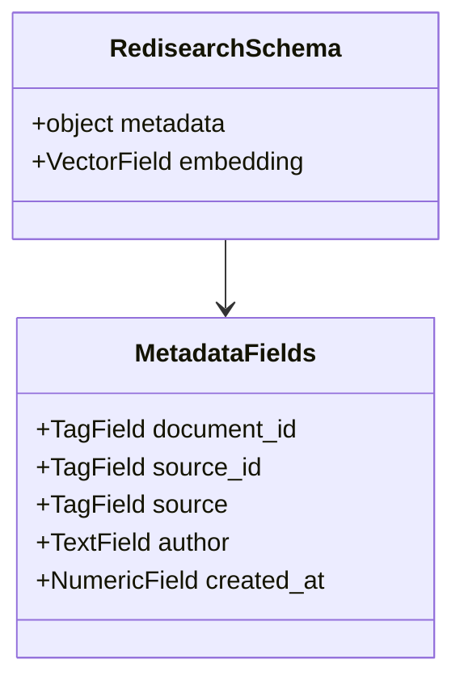
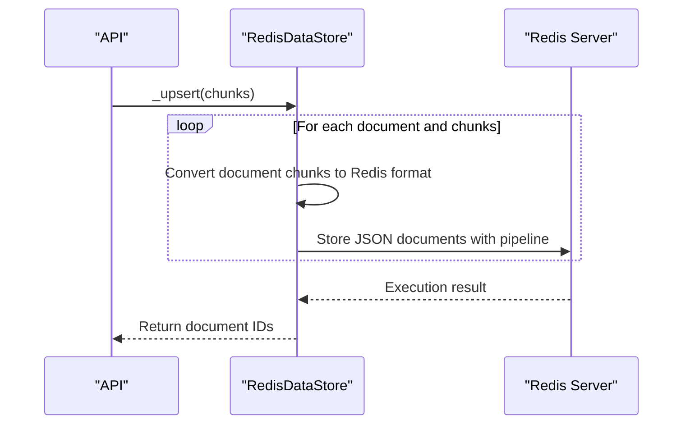
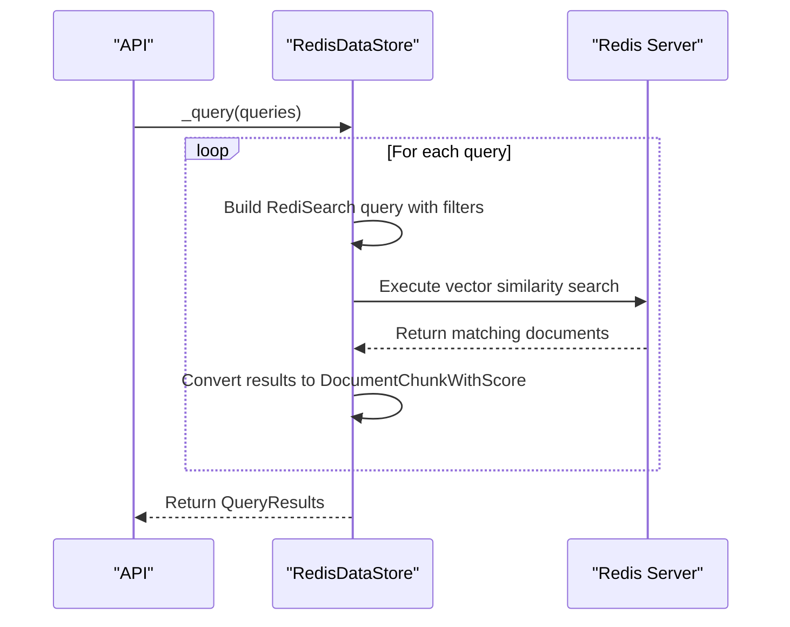
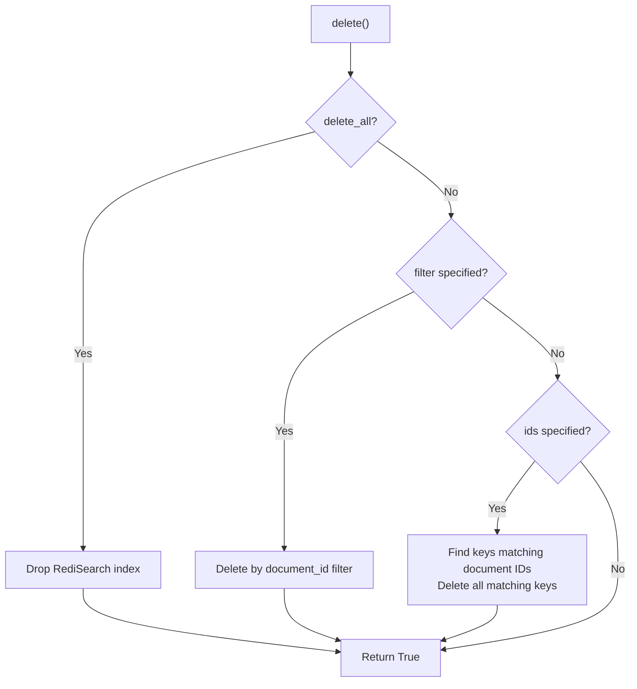

<!-- source: DeepWiki mcp.deepwiki.com · repo openai/chatgpt-retrieval-plugin · page 5.1 Redis · fetched 2026-10-26 -->

# Redis

<details>
<summary>Relevant source files</summary>

The following files were used as context for generating this wiki page:

- [datastore/providers/__init__.py](datastore/providers/__init__.py)
- [datastore/providers/redis_datastore.py](datastore/providers/redis_datastore.py)
- [examples/providers/redis/semantic-search-and-filter.ipynb](examples/providers/redis/semantic-search-and-filter.ipynb)
- [tests/datastore/providers/redis/test_redis_datastore.py](tests/datastore/providers/redis/test_redis_datastore.py)

</details>


This document describes the Redis vector database integration for the ChatGPT Retrieval Plugin. It covers the implementation of the `RedisDataStore` class, how to configure Redis for vector search, and the features available for storing and querying document embeddings with Redis.

For information about other vector database providers, see the [Vector Database Providers](#5) section.

## Overview

Redis integration in the ChatGPT Retrieval Plugin leverages [Redis Stack](https://redis.io/docs/stack/) with the RediSearch and ReJSON modules to provide vector similarity search capabilities. The implementation supports storing document chunks with embeddings, performing semantic searches, and filtering results based on metadata.



Sources: [datastore/providers/redis_datastore.py:76-401]()

## Requirements and Setup

### Redis Stack Requirements

The Redis provider requires:

1. Redis with the following modules:
   - RediSearch (≥ 2.6)
   - ReJSON (≥ 2.4)

The implementation validates these requirements during initialization:



Sources: [datastore/providers/redis_datastore.py:88-144](), [datastore/providers/redis_datastore.py:61-73]()

### Environment Variables

The Redis datastore is configured using the following environment variables:

| Variable | Description | Default |
|----------|-------------|---------|
| REDIS_HOST | Redis server hostname | localhost |
| REDIS_PORT | Redis server port | 6379 |
| REDIS_PASSWORD | Redis server password | None |
| REDIS_INDEX_NAME | Name of the RediSearch index | index |
| REDIS_DOC_PREFIX | Prefix for document keys | doc |
| REDIS_DISTANCE_METRIC | Vector similarity metric | COSINE |
| REDIS_INDEX_TYPE | Index type (FLAT or HNSW) | FLAT |
| EMBEDDING_DIMENSION | Dimension of embedding vectors | 256 |

Sources: [datastore/providers/redis_datastore.py:29-40]()

## Data Structure

### Document Schema

Documents in Redis are stored as JSON objects with the following structure:



The RediSearch index schema defines fields for vector search and filtering:



Sources: [datastore/providers/redis_datastore.py:106-128](), [datastore/providers/redis_datastore.py:178-204]()

## Implementation Details

### Redis Keys Structure

Document chunks in Redis are stored with keys in the format:

```
doc:{document_id}:chunk:{chunk_id}
```

This key structure enables efficient retrieval and deletion of related document chunks.

Sources: [datastore/providers/redis_datastore.py:146-158]()

### Document Upserting

When upserting documents, the following steps occur:

1. Documents are converted to Redis-compatible format
2. Default metadata values are applied if missing
3. Document chunks are stored as JSON objects
4. Embeddings are stored alongside text and metadata



Sources: [datastore/providers/redis_datastore.py:278-299]()

### Query Execution

When executing queries, the following steps occur:

1. Convert the query to a RediSearch query format
2. Apply metadata filters if specified
3. Perform vector similarity search (KNN)
4. Process and return matching document chunks with scores



Sources: [datastore/providers/redis_datastore.py:301-343](), [datastore/providers/redis_datastore.py:206-264]()

### Document Deletion

The Redis implementation supports three deletion methods:

1. Delete all documents (drop index)
2. Delete by document ID
3. Delete by metadata filter



Sources: [datastore/providers/redis_datastore.py:348-401]()

## Query Features

### Vector Similarity Search

The Redis implementation uses RediSearch's KNN query capabilities for vector similarity search:

1. Converts query embedding to the appropriate format
2. Uses KNN syntax with specified distance metric (COSINE by default)
3. Returns top-k results sorted by similarity score

Sources: [datastore/providers/redis_datastore.py:206-264]()

### Metadata Filtering

Redis supports various filter types for metadata fields:

| Field Type | Filter Capabilities | Examples |
|------------|---------------------|----------|
| TagField | Exact match, OR operator (`\|`), prefix wildcards (`*`) | `test:doc1\|test:doc2`, `test:*` |
| TextField | Full-text search, negation (`-`), wildcards | `author:Jordan`, `-Elvis`, `Elvis*` |
| NumericField | Range queries | `created_at:[1609372800 +inf]` |

Filter predicates are combined into a RediSearch query string and applied during vector search.

Sources: [datastore/providers/redis_datastore.py:206-264](), [examples/providers/redis/semantic-search-and-filter.ipynb:156-425]()

## Usage Example

The Redis datastore is selected by setting the `DATASTORE` environment variable to `redis`. Here's a simplified usage example:

```python
# Set up Redis datastore
datastore = await RedisDataStore.init(dim=1536)  # Initialize with embedding dimension

# Upsert documents
doc_ids = await datastore._upsert({
    "doc1": [DocumentChunk(
        id="chunk1",
        text="Sample text",
        embedding=[0.1, 0.2, ...],  # Vector of dimension 1536
        metadata=DocumentChunkMetadata(
            document_id="doc1",
            source="file",
            author="Author Name"
        )
    )]
})

# Query documents
query_results = await datastore._query([
    QueryWithEmbedding(
        query="Sample query",
        filter=DocumentMetadataFilter(author="Author Name"),
        top_k=5,
        embedding=[0.2, 0.3, ...]  # Query embedding vector
    )
])
```

Sources: [tests/datastore/providers/redis/test_redis_datastore.py:16-70](), [examples/providers/redis/semantic-search-and-filter.ipynb:142-231]()

## Redis Query Filter Syntax

Redis supports different query syntaxes depending on the field type:

1. **TagFields** (document_id, source_id, source):
   - Exact match: `field:{value}`
   - OR operator: `field:{value1|value2}`
   - Prefix wildcard: `field:{prefix*}`

2. **TextFields** (author):
   - Simple match: `field:value`
   - Negation: `field:-value`
   - Wildcards: `field:value*`
   - OR operator: `field:value1|value2`

3. **NumericFields** (created_at):
   - Range queries: `field:[min max]`
   - Open-ended ranges: `field:[min +inf]` or `field:[-inf max]`

These filters can be combined to create complex queries that narrow results by metadata while still performing vector similarity search.

Sources: [datastore/providers/redis_datastore.py:206-264](), [examples/providers/redis/semantic-search-and-filter.ipynb:167-482]()

---

