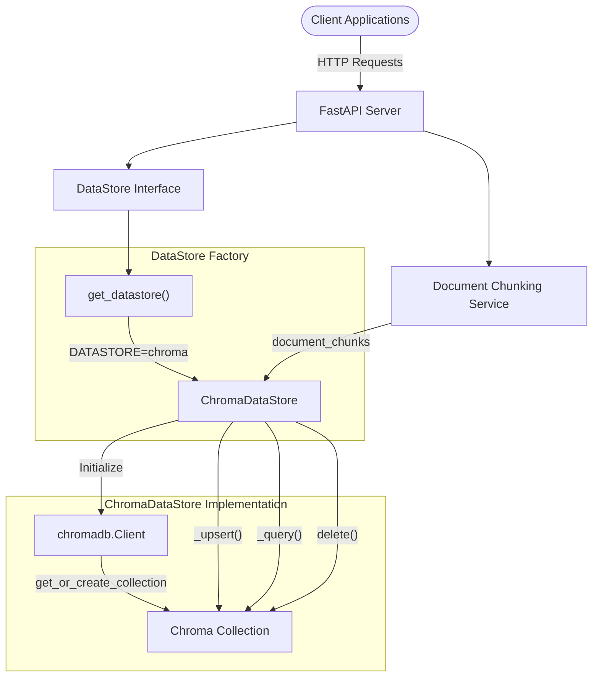
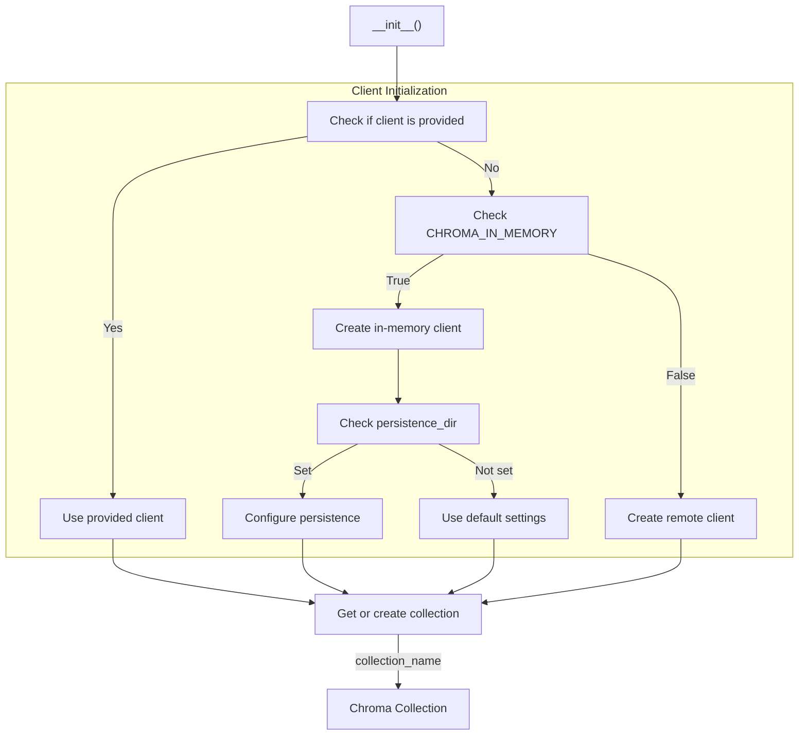
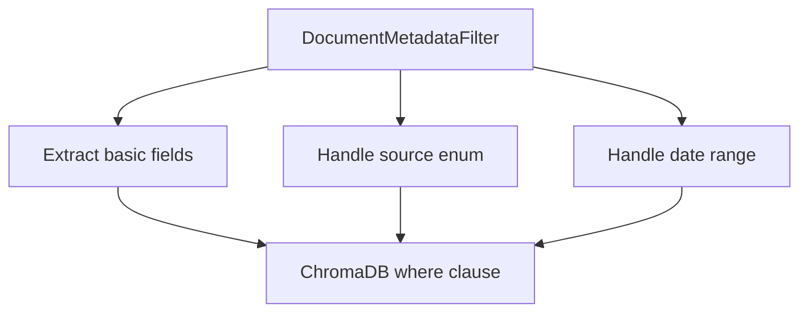
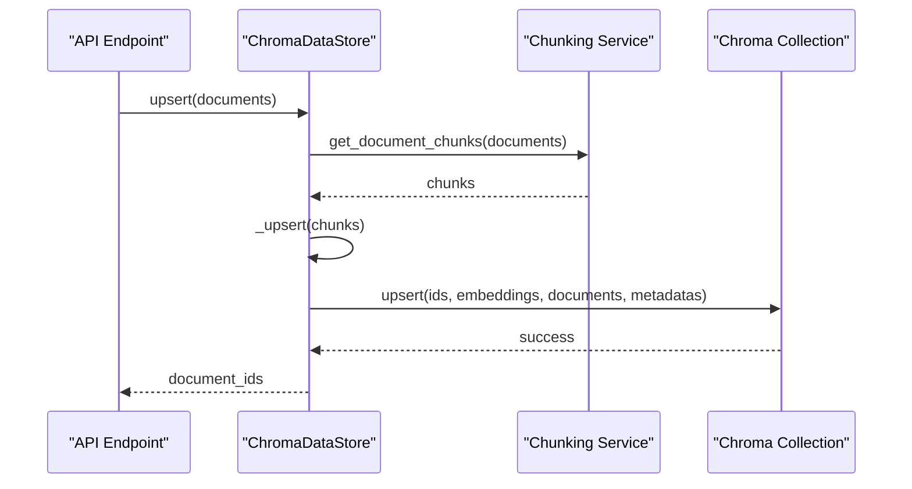
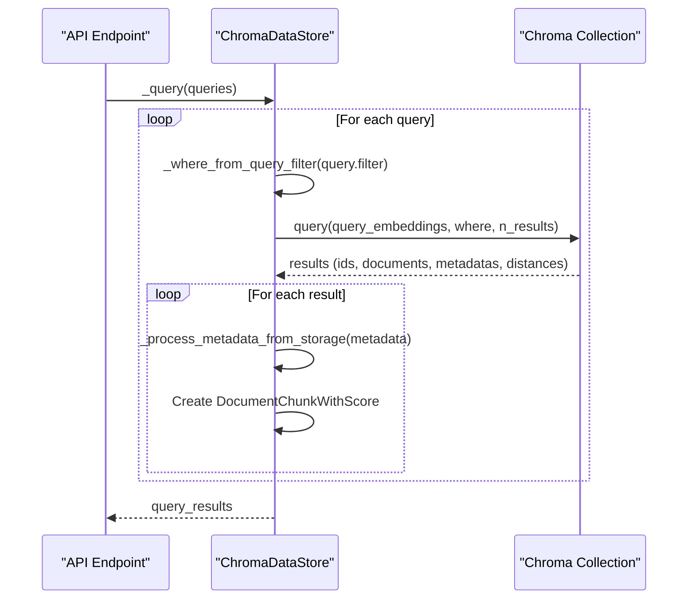

<!-- source: DeepWiki mcp.deepwiki.com · repo openai/chatgpt-retrieval-plugin · page 5.10 ChromaDB · fetched 2026-10-26 -->

# ChromaDB

<details>
<summary>Relevant source files</summary>

The following files were used as context for generating this wiki page:

- [datastore/providers/chroma_datastore.py](datastore/providers/chroma_datastore.py)
- [docs/providers/chroma/setup.md](docs/providers/chroma/setup.md)
- [tests/datastore/providers/chroma/test_chroma_datastore.py](tests/datastore/providers/chroma/test_chroma_datastore.py)

</details>


This page documents the ChromaDB integration in the ChatGPT Retrieval Plugin. ChromaDB is one of the vector database providers that can be used as a backend for storing and retrieving document embeddings. For information about other vector database providers, see the [Vector Database Providers](#5) page.

## Introduction

ChromaDB is an AI-native open-source embedding database designed to make it easy to work with embeddings. The ChatGPT Retrieval Plugin integrates with ChromaDB through the `ChromaDataStore` class, which implements the abstract `DataStore` interface and provides methods for storing, querying, and managing document chunks with their embeddings.

ChromaDB can be configured to run:
- In-memory (default)
- In-memory with local persistence
- In client-server mode (self-hosted)

Sources: [datastore/providers/chroma_datastore.py:1-9](), [docs/providers/chroma/setup.md:1-3]()

## Configuration

ChromaDB is configured through environment variables. The following table lists the available configuration options:

| Variable | Required | Description | Default |
|----------|----------|-------------|---------|
| `DATASTORE` | Yes | Must be set to `chroma` to use ChromaDB | |
| `BEARER_TOKEN` | Yes | Your secret token for API authentication | |
| `OPENAI_API_KEY` | Yes | OpenAI API key for generating embeddings | |
| `CHROMA_COLLECTION` | No | Collection name for storing embeddings | `openaiembeddings` |
| `CHROMA_IN_MEMORY` | No | Run in-memory (ignore host/port when `True`) | `True` |
| `CHROMA_PERSISTENCE_DIR` | No | Directory for persistence when in-memory | `openai` |
| `CHROMA_HOST` | No | Chroma instance host address (client-server mode) | `http://127.0.0.1` |
| `CHROMA_PORT` | No | Chroma port number (client-server mode) | `8000` |

Sources: [datastore/providers/chroma_datastore.py:29-33](), [docs/providers/chroma/setup.md:5-29]()

## Architecture

### ChromaDB in the Retrieval Plugin System



This diagram shows how ChromaDB fits into the ChatGPT Retrieval Plugin architecture. When the environment variable `DATASTORE` is set to `chroma`, the DataStore factory creates an instance of `ChromaDataStore`. This class interacts with ChromaDB through the `chromadb` Python client.

Sources: [datastore/providers/chroma_datastore.py:36-71]()

### ChromaDataStore Initialization Flow



This diagram illustrates the initialization flow of the `ChromaDataStore` class. Depending on the configuration, it can create different types of ChromaDB clients.

Sources: [datastore/providers/chroma_datastore.py:36-71]()

## Implementation Details

The `ChromaDataStore` class implements the abstract `DataStore` interface and provides methods for working with document chunks and their embeddings.

### Core Methods

1. **upsert**: Inserts or updates documents in the database
   - Takes a list of documents and optional chunk token size
   - Chunks the documents using the chunking service
   - Calls `_upsert` to store the chunks

2. **_upsert**: Low-level method to insert or update document chunks
   - Takes a dictionary of document chunks
   - Extracts ids, embeddings, texts, and metadata
   - Calls ChromaDB's upsert method

3. **_query**: Searches for similar document chunks
   - Takes a list of queries with embeddings
   - Translates filter criteria to ChromaDB query format
   - Returns query results with matching chunks and scores

4. **delete**: Removes vectors from the datastore
   - Can delete by ids, filter, or everything
   - Constructs appropriate where clauses for ChromaDB

Sources: [datastore/providers/chroma_datastore.py:73-250]()

### Metadata Handling

The `ChromaDataStore` class includes two helper methods for handling metadata:

1. **_process_metadata_for_storage**: Converts `DocumentChunkMetadata` to a dictionary for storage
   - Handles special cases like converting ISO date format to timestamp

2. **_process_metadata_from_storage**: Converts stored metadata dictionary back to `DocumentChunkMetadata`
   - Handles special cases like converting timestamp back to ISO format

Sources: [datastore/providers/chroma_datastore.py:146-175]()

### Query Filtering

The `_where_from_query_filter` method translates the `DocumentMetadataFilter` object to ChromaDB's query format:



ChromaDB supports complex query filters including:
- Basic field matching
- Enum value conversion
- Date range filtering using `$gte` and `$lte` operators
- Logical operators like `$and` and `$or`

Sources: [datastore/providers/chroma_datastore.py:110-144]()

## Usage Patterns

### Document Upsert Flow



This diagram shows the flow of document upsert operations from the API endpoint through the ChromaDataStore to the Chroma collection.

Sources: [datastore/providers/chroma_datastore.py:73-108]()

### Query Execution Flow



This diagram illustrates the query execution flow, showing how filters are processed and results are transformed.

Sources: [datastore/providers/chroma_datastore.py:177-218]()

## Performance Considerations

### In-Memory vs. Client-Server

- **In-Memory Mode**: Faster for development and testing, but limited by available RAM
- **In-Memory with Persistence**: Good for small to medium datasets with persistence between restarts
- **Client-Server Mode**: Better for production use cases, can handle larger datasets

Sources: [docs/providers/chroma/setup.md:11-29]()

## Example Configurations

### Basic In-Memory Setup

```
DATASTORE=chroma
CHROMA_IN_MEMORY=True
CHROMA_COLLECTION=my_embeddings
```

### Persistent In-Memory Setup

```
DATASTORE=chroma
CHROMA_IN_MEMORY=True
CHROMA_PERSISTENCE_DIR=/path/to/persistence
CHROMA_COLLECTION=my_embeddings
```

### Client-Server Setup

```
DATASTORE=chroma
CHROMA_IN_MEMORY=False
CHROMA_HOST=http://chroma-server
CHROMA_PORT=8000
CHROMA_COLLECTION=my_embeddings
```

Sources: [docs/providers/chroma/setup.md:5-29]()

## Testing

The ChromaDataStore implementation includes comprehensive tests for:

1. Adding and upserting document chunks
2. Querying with various filters
3. Deleting documents
4. Query accuracy with realistic embedding vectors

These tests cover both in-memory and persistent ChromaDB configurations.

Sources: [tests/datastore/providers/chroma_datastore.py:19-293]()

## Summary

ChromaDB provides a flexible and efficient vector database backend for the ChatGPT Retrieval Plugin. It supports different deployment modes (in-memory, persistent, client-server) and offers powerful querying capabilities with filtering options. The `ChromaDataStore` class implements the abstract `DataStore` interface and handles the complexities of working with document embeddings and metadata.

---

