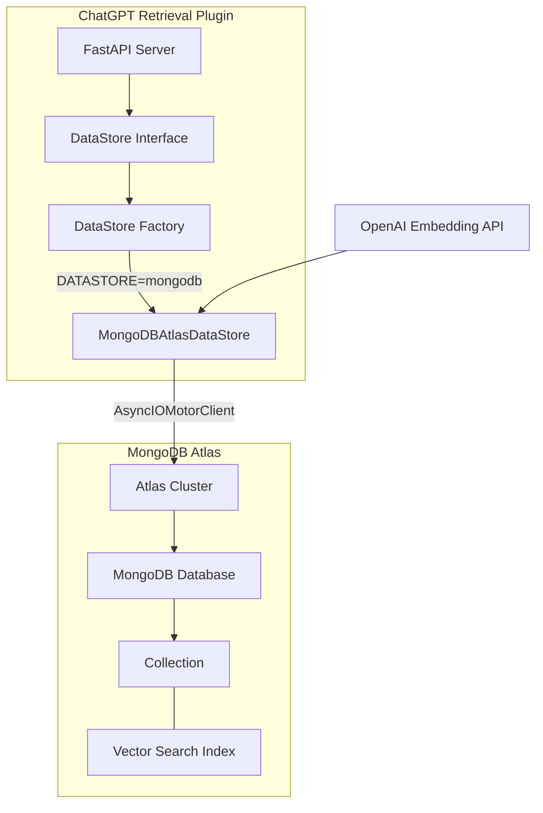
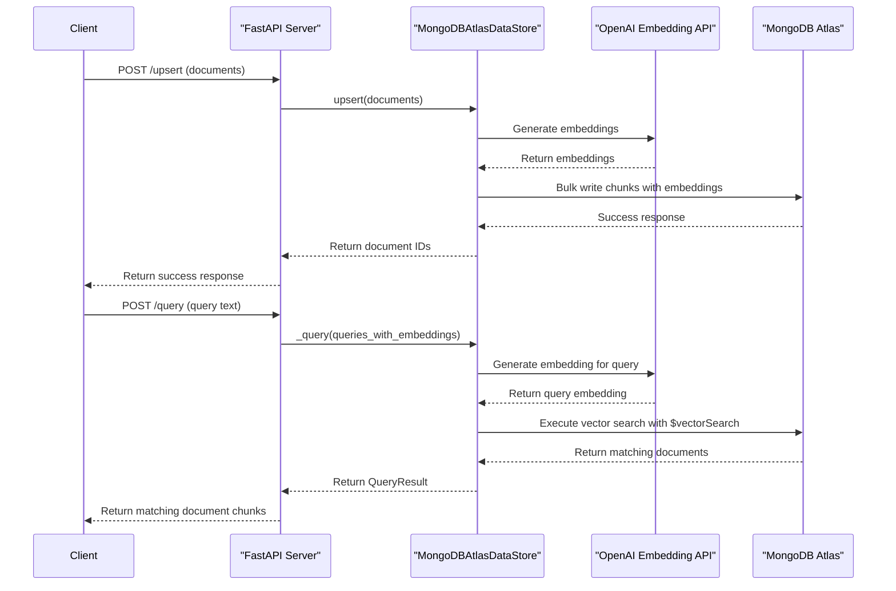
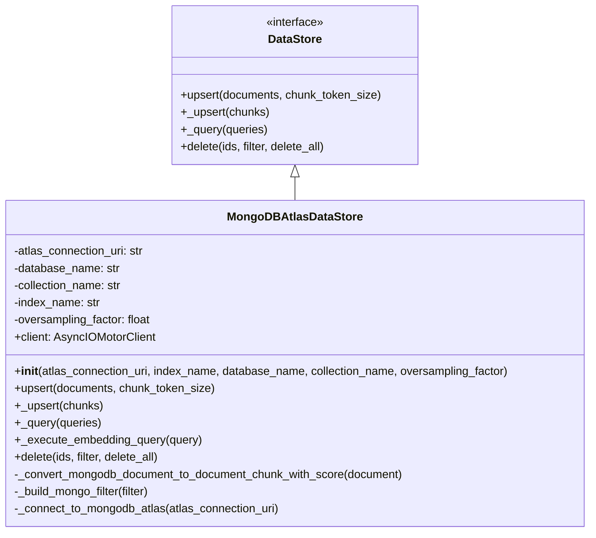

<!-- source: DeepWiki mcp.deepwiki.com · repo openai/chatgpt-retrieval-plugin · page 5.11 MongoDB Atlas · fetched 2026-10-26 -->

# MongoDB Atlas

<details>
<summary>Relevant source files</summary>

The following files were used as context for generating this wiki page:

- [datastore/providers/mongodb_atlas_datastore.py](datastore/providers/mongodb_atlas_datastore.py)
- [docs/providers/mongodb/setup.md](docs/providers/mongodb/setup.md)
- [examples/providers/mongodb/semantic-search.ipynb](examples/providers/mongodb/semantic-search.ipynb)

</details>


This document provides technical documentation for the MongoDB Atlas vector database integration in the ChatGPT Retrieval Plugin. MongoDB Atlas serves as one of the supported vector database providers, enabling storage and retrieval of document chunks with vector embeddings for semantic search capabilities.

For information about other vector database providers, see [Vector Database Providers](#5).

## Overview

MongoDB Atlas is a fully managed cloud database service developed by MongoDB, Inc. In the ChatGPT Retrieval Plugin, MongoDB Atlas uses its Vector Search feature to enable semantic search capabilities based on vector embeddings. The plugin integrates with MongoDB Atlas through the `MongoDBAtlasDataStore` class, which implements the core `DataStore` interface.

### Key Features

- **Vector Search Capabilities**: Uses Hierarchical Navigable Small World (HNSW) graphs for efficient vector similarity search
- **Document Storage**: Stores document chunks and their metadata alongside vector embeddings
- **Query Flexibility**: Supports semantic similarity queries with filtering capabilities
- **Fully Managed**: Leverages MongoDB Atlas's cloud infrastructure and management

Sources: [datastore/providers/mongodb_atlas_datastore.py:31-72](), [docs/providers/mongodb/setup.md:1-10]()

## Architecture

### MongoDB Atlas Integration



Sources: [datastore/providers/mongodb_atlas_datastore.py:31-78](), [docs/providers/mongodb/setup.md:11-25]()

### Data Flow for MongoDB Atlas



Sources: [datastore/providers/mongodb_atlas_datastore.py:79-158]()

## Setup and Configuration

### Prerequisites

1. MongoDB Atlas account
2. Atlas cluster running MongoDB v6.0.11, v7.0.2, or later
3. Database and collection created in Atlas
4. Vector search index configured

### Environment Variables

MongoDB Atlas integration requires several environment variables:

| Variable | Description | Example |
|----------|-------------|---------|
| `MONGODB_URI` | MongoDB connection string | `mongodb+srv://<username>:<password>@cluster.mongodb.net` |
| `MONGODB_DATABASE` | Database name | `default` |
| `MONGODB_COLLECTION` | Collection name | `default` |
| `MONGODB_INDEX` | Vector search index name | `default` |
| `DATASTORE` | Must be set to `mongodb` | `mongodb` |
| `EMBEDDING_DIMENSION` | Dimension of embeddings | `1536` |
| `EMBEDDING_MODEL` | OpenAI model for embeddings | `text-embedding-3-small` |

Sources: [datastore/providers/mongodb_atlas_datastore.py:23-26](), [docs/providers/mongodb/setup.md:78-102]()

### Vector Search Index Configuration

You must create a vector search index in MongoDB Atlas with a configuration similar to:

```json
{
  "fields": [
    {
      "numDimensions": 1536,
      "path": "embedding",
      "similarity": "cosine",
      "type": "vector"
    }
  ]
}
```

The `numDimensions` should match your `EMBEDDING_DIMENSION` environment variable.

Sources: [docs/providers/mongodb/setup.md:103-126]()

## Implementation Details

### MongoDBAtlasDataStore Class

The `MongoDBAtlasDataStore` class implements the `DataStore` interface and provides the core functionality for integrating with MongoDB Atlas.



Sources: [datastore/providers/mongodb_atlas_datastore.py:31-252]()

### Key Methods

#### Upsert

The `_upsert` method inserts or updates document chunks in the MongoDB collection:

1. Converts document chunks to MongoDB documents
2. Uses bulk write with `UpdateOne` operations for efficient insertion
3. Sets upsert=True to create documents if they don't exist

Sources: [datastore/providers/mongodb_atlas_datastore.py:89-106]()

#### Query

The `_query` and `_execute_embedding_query` methods perform vector search:

1. Constructs a MongoDB aggregation pipeline using `$vectorSearch`
2. Specifies the vector search index and embedding path
3. Projects required fields and includes the similarity score
4. Converts MongoDB documents to `DocumentChunkWithScore` objects

The query uses oversampling to improve search results quality, with a configurable `oversampling_factor` (default: 10).

Sources: [datastore/providers/mongodb_atlas_datastore.py:108-157]()

#### Delete

The `delete` method removes documents from the collection:

1. Supports deletion by document IDs
2. Supports deletion by metadata filter
3. Supports deletion of all documents

Sources: [datastore/providers/mongodb_atlas_datastore.py:159-198]()

## Vector Search Implementation

MongoDB Atlas uses its Vector Search capabilities to perform semantic similarity searches. The implementation uses:

1. **$vectorSearch aggregation stage**: Performs the vector similarity search
2. **numCandidates parameter**: Controls the number of candidates to consider (calculated based on top_k × oversampling_factor)
3. **Vector similarity score**: Accessed via `$meta: 'vectorSearchScore'`

This provides efficient semantic search capabilities with tunable precision-recall trade-offs.

Sources: [datastore/providers/mongodb_atlas_datastore.py:123-145]()

## Usage Example

The repository includes a Jupyter notebook demonstrating how to use MongoDB Atlas for semantic search with the ChatGPT Retrieval Plugin:

1. **Setup**: Configure environment variables and verify connections to MongoDB Atlas and OpenAI
2. **Data Preparation**: Process and prepare document data for insertion
3. **Upsert**: Insert documents through the plugin API, which embeds and stores them
4. **Query**: Perform semantic searches through the plugin API

The example uses the Stanford Question Answering Dataset (SQuAD) filtered to questions about Beyoncé.

Sources: [examples/providers/mongodb/semantic-search.ipynb:1-631]()

## Limitations and Considerations

- MongoDB Atlas Vector Search requires MongoDB v6.0.11, v7.0.2, or later
- The vector search index needs to be manually created in the Atlas UI (cannot be created via the driver as noted in code comment)
- The `numDimensions` in the vector search index must match the embedding dimension used by the OpenAI model
- There's an upper limit on the number of candidates (`MAX_CANDIDATES = 10_000`) that can be considered in a search

Sources: [datastore/providers/mongodb_atlas_datastore.py:27-28](), [datastore/providers/mongodb_atlas_datastore.py:70-71]()

## Related Resources

- For more detailed setup instructions, refer to the MongoDB Atlas setup documentation in the repository
- Integration tests are available in the test suite to verify the MongoDB Atlas integration

Sources: [docs/providers/mongodb/setup.md:127-139]()

---

