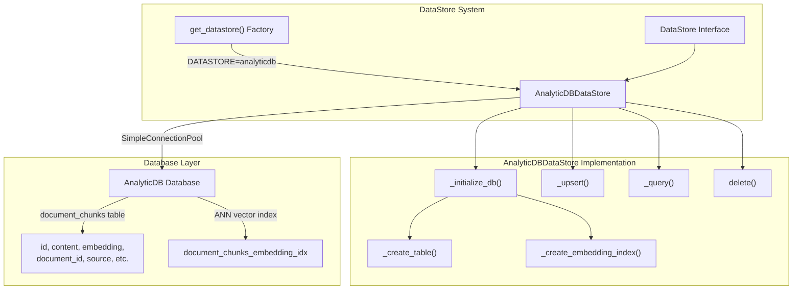
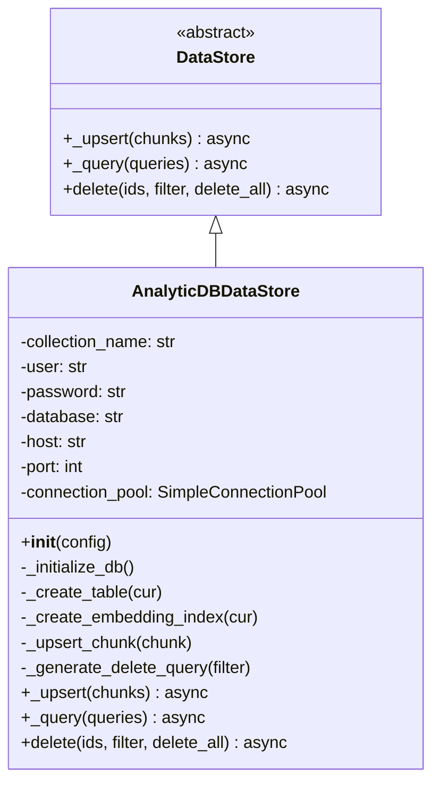
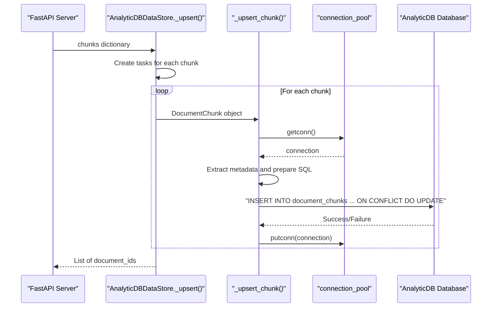
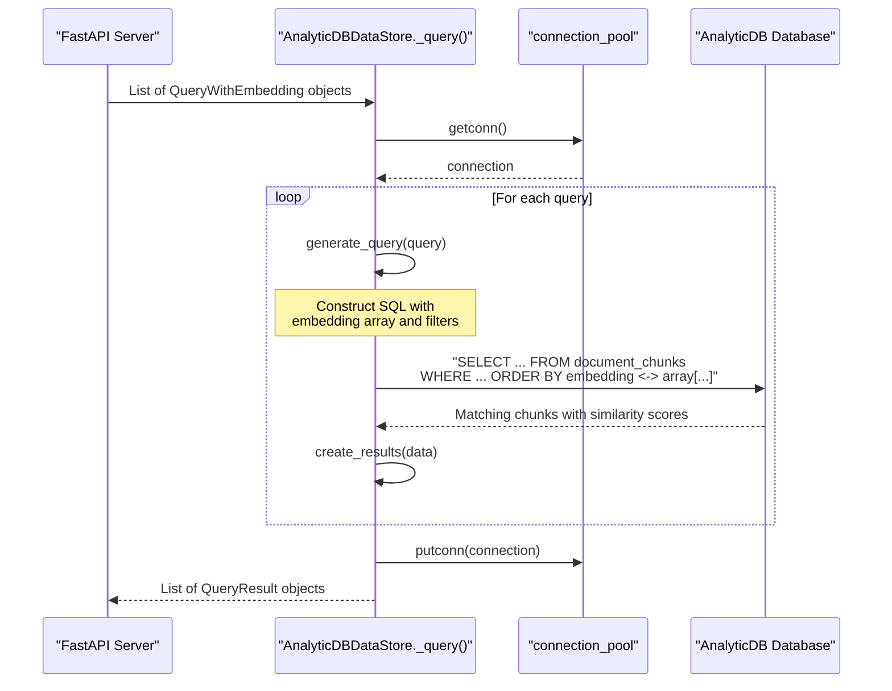
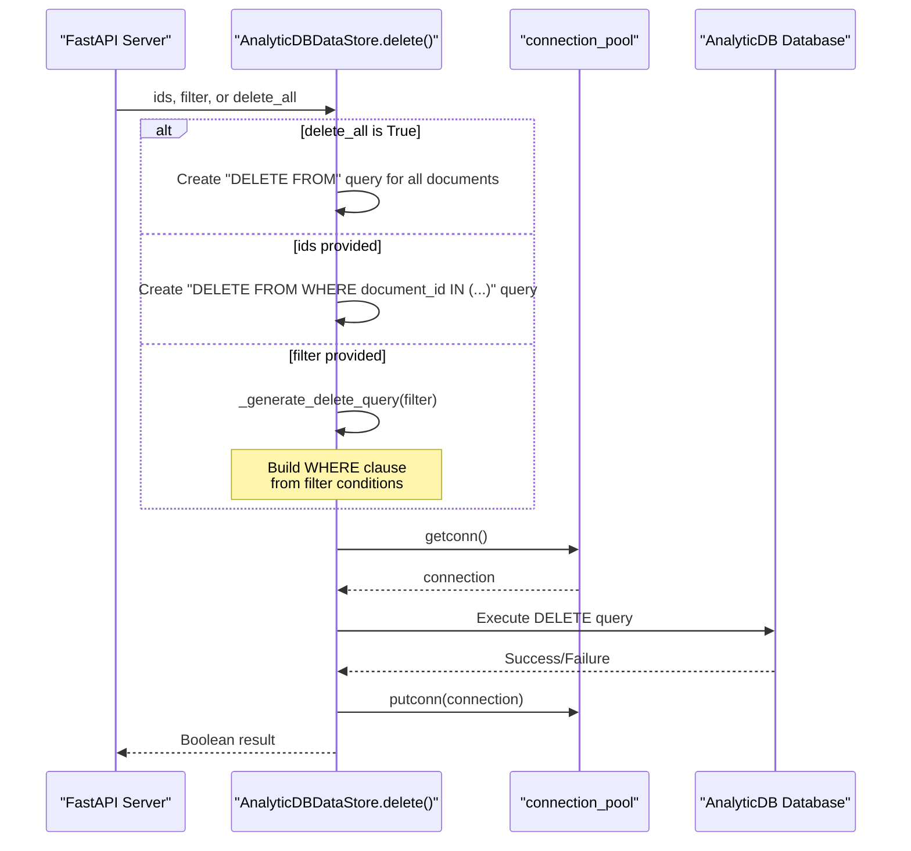

<!-- source: DeepWiki mcp.deepwiki.com · repo openai/chatgpt-retrieval-plugin · page 5.12 AnalyticDB · fetched 2026-10-26 -->

# AnalyticDB

<details>
<summary>Relevant source files</summary>

The following files were used as context for generating this wiki page:

- [datastore/providers/analyticdb_datastore.py](datastore/providers/analyticdb_datastore.py)
- [docs/providers/analyticdb/setup.md](docs/providers/analyticdb/setup.md)
- [tests/datastore/providers/analyticdb/test_analyticdb_datastore.py](tests/datastore/providers/analyticdb/test_analyticdb_datastore.py)

</details>


This document covers the AnalyticDB integration for the ChatGPT Retrieval Plugin, which serves as one of the vector database providers for storing and retrieving document embeddings. AnalyticDB is a distributed cloud-native vector database from Alibaba Cloud that provides PostgreSQL-compatible syntax with vector search capabilities.

## Purpose and Features

AnalyticDB in the ChatGPT Retrieval Plugin provides:

- PostgreSQL-compatible vector database storage
- ANN (Approximate Nearest Neighbor) vector search with L2 distance metric
- Connection pooling for efficient database operations
- Document metadata filtering capabilities
- Full CRUD operations for document chunks and their embeddings

## Architecture and Integration

AnalyticDB is implemented as a concrete provider of the DataStore interface, making it one of several vector database options available within the plugin architecture.



Sources: [datastore/providers/analyticdb_datastore.py:36-313](). [docs/providers/analyticdb/setup.md:1-83]()

## Implementation Details

The `AnalyticDBDataStore` class implements the abstract `DataStore` interface, providing concrete methods for storing, querying, and deleting document chunks with embeddings.



Sources: [datastore/providers/analyticdb_datastore.py:36-67]()

### Database Structure

The database schema is initialized with a table containing columns for document chunk data and metadata:

```sql
CREATE TABLE IF NOT EXISTS document_chunks (
    id TEXT PRIMARY KEY DEFAULT uuid_generate_v4()::TEXT,
    source TEXT,
    source_id TEXT,
    content TEXT,
    document_id TEXT,
    author TEXT,
    url TEXT,
    created_at TIMESTAMPTZ DEFAULT NOW(),
    embedding real[]
);
```

An ANN (Approximate Nearest Neighbor) index is created for efficient vector similarity search:

```sql
CREATE INDEX document_chunks_embedding_idx
ON document_chunks
USING ann(embedding)
WITH (
    distancemeasure=L2,
    dim=OUTPUT_DIM,
    pq_segments=64,
    hnsw_m=100,
    pq_centers=2048
);
```

Sources: [datastore/providers/analyticdb_datastore.py:67-108]()

## Core Operations

### Upsert Operation

The upsert operation stores document chunks and their embeddings in the AnalyticDB database:



Sources: [datastore/providers/analyticdb_datastore.py:110-167]()

### Query Operation

The query operation performs vector similarity search to find relevant document chunks:



Sources: [datastore/providers/analyticdb_datastore.py:169-260]()

### Delete Operation

The delete operation removes document chunks based on IDs or filters:



Sources: [datastore/providers/analyticdb_datastore.py:262-312]()

## Configuration and Setup

### Environment Variables

To use AnalyticDB as your vector store, configure the following environment variables:

| Name | Required | Description | Default |
| ---- | -------- | ----------- | ------- |
| `DATASTORE` | Yes | Datastore name, set to `analyticdb` | |
| `BEARER_TOKEN` | Yes | Secret token | |
| `OPENAI_API_KEY` | Yes | OpenAI API key | |
| `PG_HOST` | Yes | AnalyticDB instance URL | `localhost` |
| `PG_USER` | Yes | Database user | `user` |
| `PG_PASSWORD` | Yes | Database password | `password` |
| `PG_PORT` | Optional | Port for AnalyticDB communication | `5432` |
| `PG_DATABASE` | Optional | Database name | `postgres` |
| `PG_COLLECTION` | Optional | AnalyticDB relation name | `document_chunks` |

Sources: [docs/providers/analyticdb/setup.md:48-61]()

### Installation Requirements

Install the required PostgreSQL dependencies:

```bash
poetry install --extras "postgresql"
```

If you encounter the `pg_config executable not found` error, you'll need to install the PostgreSQL development package for your operating system as specified in the setup documentation.

Sources: [docs/providers/analyticdb/setup.md:5-46]()

### Cloud Deployment

For deploying with Alibaba Cloud's AnalyticDB service:

```bash
PG_HOST="https://YOUR-CLUSTER-URL.gpdb.rds.aliyuncs.com"
PG_USER="YOUR-USER-NAME"
PG_PASSWORD="YOUR-PASSWORD"
```

Sources: [docs/providers/analyticdb/setup.md:62-74]()

## Query Filtering

AnalyticDBDataStore supports filtering queries based on document metadata:

- `document_id`: Filter by specific document identifier
- `source`: Filter by source type (email, file, chat, etc.)
- `source_id`: Filter by source identifier
- `author`: Filter by document author
- `start_date` and `end_date`: Filter by document creation date range

The filtering is implemented in the SQL WHERE clause construction:

```python
# Example of filter usage in code
filter = DocumentMetadataFilter(
    document_id="doc123",
    source=Source.email,
    author="John Doe",
    start_date="2023-01-01T00:00:00Z",
    end_date="2023-12-31T23:59:59Z"
)
```

Sources: [datastore/providers/analyticdb_datastore.py:197-218](), [tests/datastore/providers/analyticdb/test_analyticdb_datastore.py:215-233]()

## Testing

The AnalyticDB integration includes comprehensive test cases that verify:

1. Document chunk insertion and retrieval
2. Query accuracy with embeddings
3. Query filtering with metadata
4. Document deletion with various filter options

Run the tests with:

```bash
pytest ./tests/datastore/providers/analyticdb/test_analyticdb_datastore.py
```

Sources: [docs/providers/analyticdb/setup.md:76-82](), [tests/datastore/providers/analyticdb/test_analyticdb_datastore.py:1-324]()

## Performance Considerations

AnalyticDB provides several performance-enhancing features:

1. **Connection Pooling**: Uses `SimpleConnectionPool` to efficiently manage database connections
2. **Optimized ANN Index**: Configured with optimized parameters for vector similarity search
3. **Parallelized Operations**: Uses `asyncio` to process document chunks in parallel during upsert
4. **SQL Optimizations**: Uses prepared statements to prevent SQL injection and improve performance

Sources: [datastore/providers/analyticdb_datastore.py:45-53](), [datastore/providers/analyticdb_datastore.py:95-108]()

---

