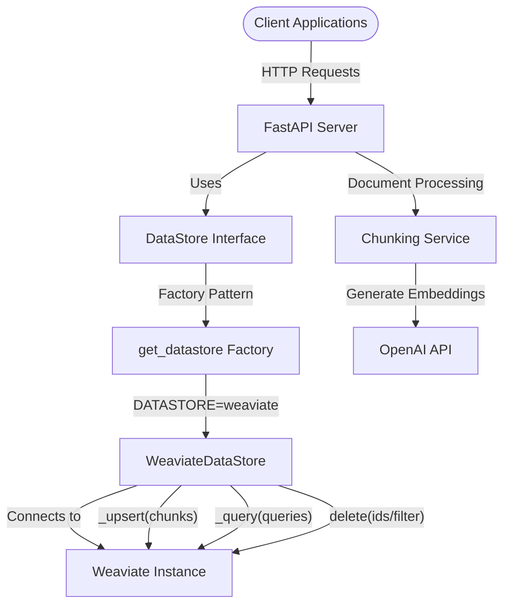
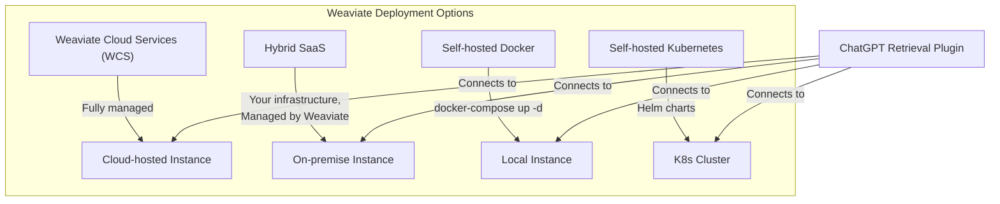
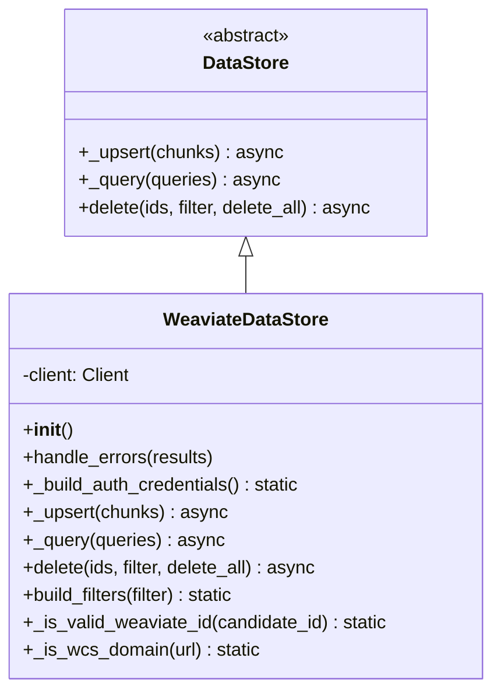
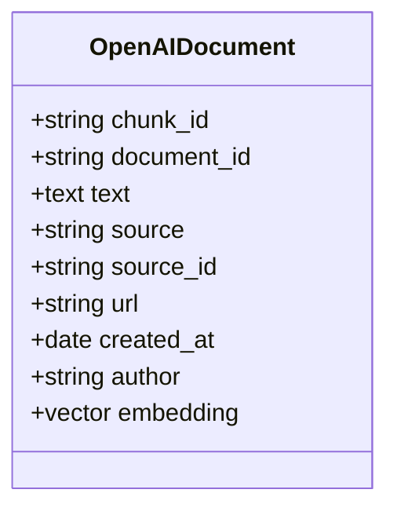
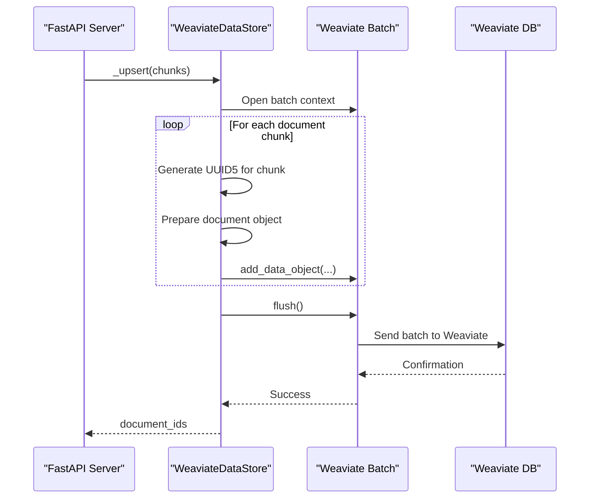
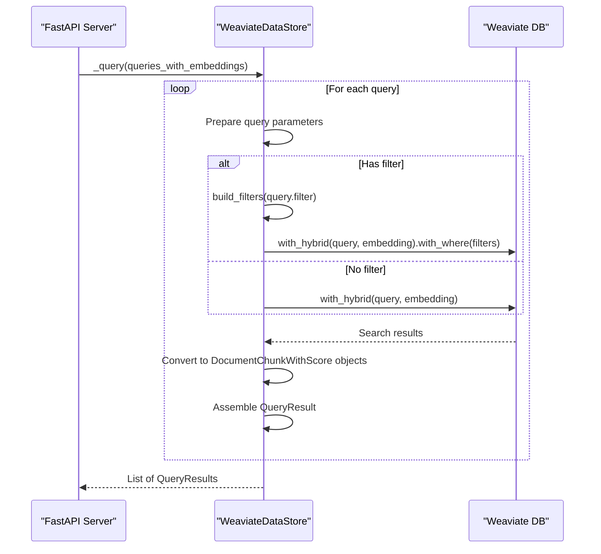
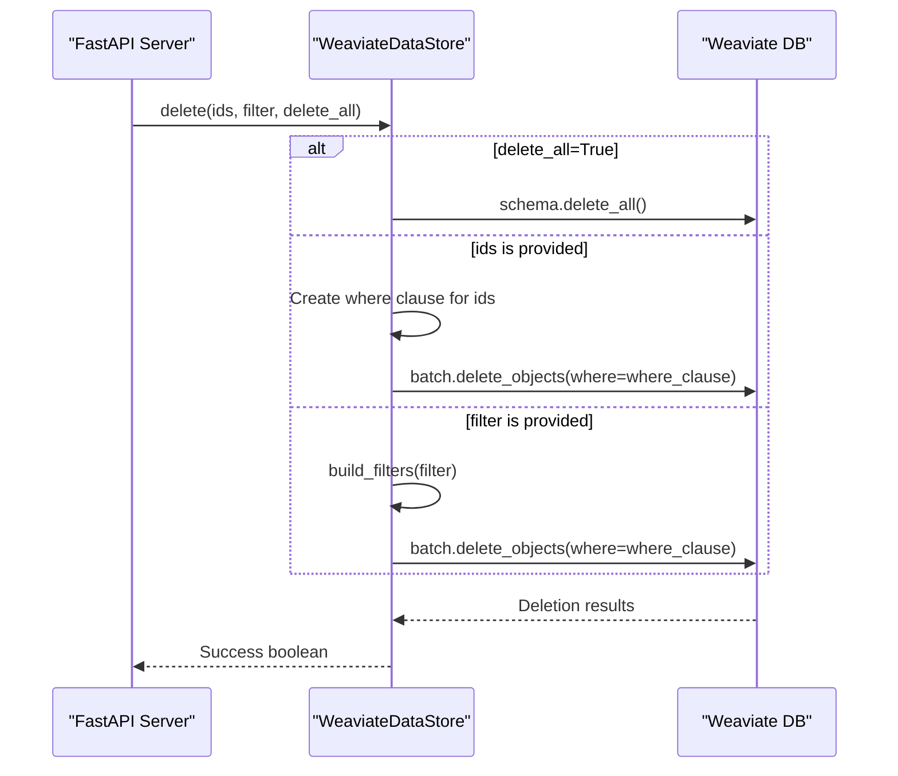
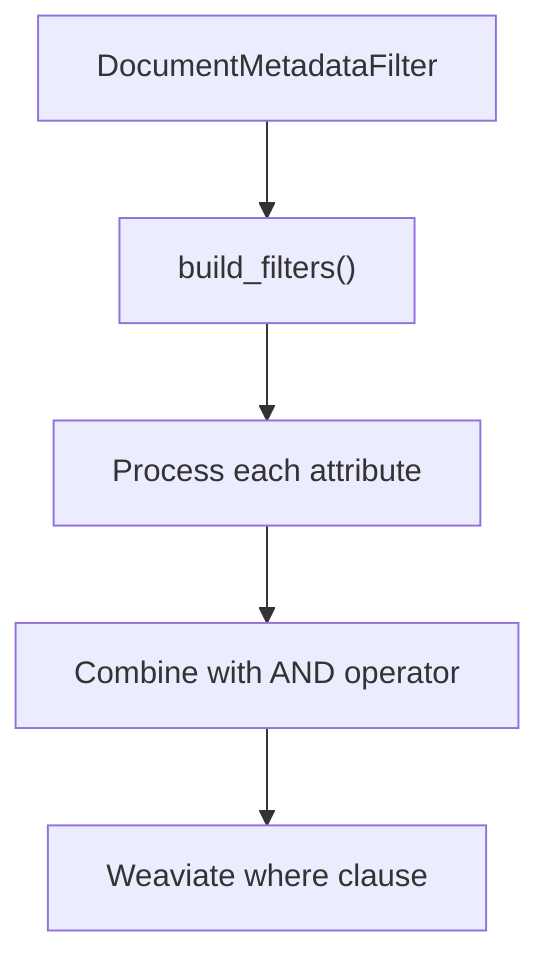
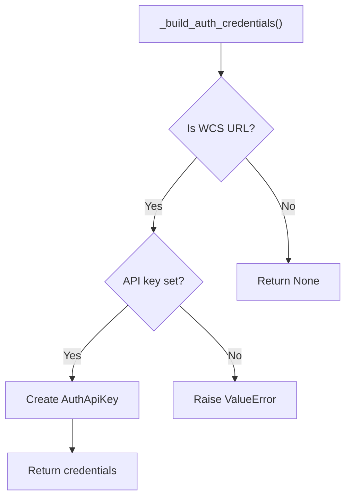

<!-- source: DeepWiki mcp.deepwiki.com · repo openai/chatgpt-retrieval-plugin · page 5.2 Weaviate · fetched 2026-10-26 -->

# Weaviate

Relevant source files

The following files were used as context for generating this wiki page:

- [datastore/providers/weaviate_datastore.py](datastore/providers/weaviate_datastore.py)
- [docs/providers/weaviate/setup.md](docs/providers/weaviate/setup.md)
- [tests/datastore/providers/weaviate/test_weaviate_datastore.py](tests/datastore/providers/weaviate/test_weaviate_datastore.py)

This page documents the Weaviate vector database integration in the ChatGPT Retrieval Plugin. Weaviate is an open-source vector search engine designed to scale seamlessly into billions of data objects, providing hybrid search capabilities that combine semantic similarity with keyword matching.

## Overview

Weaviate functions as one of the supported vector database providers in the ChatGPT Retrieval Plugin. It stores document chunks along with their vector embeddings to enable semantic search capabilities. The integration is implemented through the `WeaviateDataStore` class, which extends the abstract `DataStore` interface.

### Weaviate in the Plugin Architecture

Sources: [datastore/providers/weaviate_datastore.py:1-385]()

## Setup and Configuration

### Deployment Options

Weaviate can be deployed in four main ways:

Sources: [docs/providers/weaviate/setup.md:3-51]()

### Environment Variables

To configure the Weaviate integration, you need to set the following environment variables:

**Core Variables:**

| Name | Required | Description | Default |
|------|----------|-------------|---------|
| `DATASTORE` | Yes | Set to `weaviate` to use this provider | N/A |
| `WEAVIATE_URL` | Optional | URL of your Weaviate instance | `http://localhost:8080` |
| `WEAVIATE_CLASS` | Optional | Class name for document storage | `OpenAIDocument` |

**Authentication Variables:**

| Name | Required | Description |
|------|----------|-------------|
| `WEAVIATE_API_KEY` | For WCS instances | Your WCS API key |

**Batch Configuration Variables:**

| Name | Required | Description | Default |
|------|----------|-------------|---------|
| `WEAVIATE_BATCH_SIZE` | Optional | Objects per batch | 20 |
| `WEAVIATE_BATCH_DYNAMIC` | Optional | Dynamic batching | `False` |
| `WEAVIATE_TIMEOUT_RETRIES` | Optional | Retries on timeout | 3 |
| `WEAVIATE_BATCH_NUM_WORKERS` | Optional | Number of batch workers | 1 |

Sources: [datastore/providers/weaviate_datastore.py:23-29](), [docs/providers/weaviate/setup.md:52-78]()

## Implementation Details

### WeaviateDataStore Class

The `WeaviateDataStore` class implements the abstract `DataStore` interface to provide vector storage and retrieval capabilities using Weaviate.

Sources: [datastore/providers/weaviate_datastore.py:85-104](), [datastore/providers/weaviate_datastore.py:136-385]()

### Document Schema

Weaviate stores documents using the following schema:

Sources: [datastore/providers/weaviate_datastore.py:31-76]()

The schema is defined as a constant `SCHEMA` in the code, with properties for document identification, content, and metadata. The property definitions include data types and descriptions for each field.

## Core Operations

### Initialization

When the `WeaviateDataStore` is initialized, it:

1. Builds authentication credentials if needed (for WCS instances)
2. Connects to the Weaviate instance
3. Configures batch operations
4. Creates the schema if it doesn't exist, or reuses the existing schema

Sources: [datastore/providers/weaviate_datastore.py:104-134]()

### Upserting Documents

The `_upsert` method adds or updates documents in the Weaviate database:

Key implementation details:
- Uses Weaviate's batch operation for efficient upserts
- Generates UUIDs for each chunk using Weaviate's `generate_uuid5`
- Converts `DocumentChunk` objects to the format expected by Weaviate
- Handles metadata fields correctly

Sources: [datastore/providers/weaviate_datastore.py:149-186]()

### Querying Documents

The `_query` method searches for documents matching a query:

Key implementation details:
- Uses Weaviate's hybrid search, combining vector similarity with text-based search
- Supports filtering by metadata attributes
- Processes multiple queries concurrently using `asyncio.gather`
- Returns results as `QueryResult` objects with properly formatted document chunks

Sources: [datastore/providers/weaviate_datastore.py:188-262]()

### Deleting Documents

The `delete` method removes documents from Weaviate:

Key implementation details:
- Supports three deletion methods:
  - Delete by document IDs
  - Delete by metadata filter
  - Delete all documents
- Handles error reporting through logging

Sources: [datastore/providers/weaviate_datastore.py:264-313]()

## Helper Functions

### Filter Building

The `build_filters` static method constructs Weaviate-compatible filter objects from `DocumentMetadataFilter` instances:

This method handles:
- Source filtering
- Date range filtering (start_date and end_date)
- Other metadata attributes

Sources: [datastore/providers/weaviate_datastore.py:316-351]()

### Authentication

The `_build_auth_credentials` method creates appropriate authentication credentials based on the Weaviate instance type:

Sources: [datastore/providers/weaviate_datastore.py:136-147](), [datastore/providers/weaviate_datastore.py:373-385]()

## Conclusion

The Weaviate integration provides a robust vector database backend for the ChatGPT Retrieval Plugin. It supports all the core operations required for semantic document search, with specialized features like hybrid search that combine the best of vector and keyword search capabilities.

For information about other vector database providers, see the [Vector Database Providers](#5) overview page.

---

