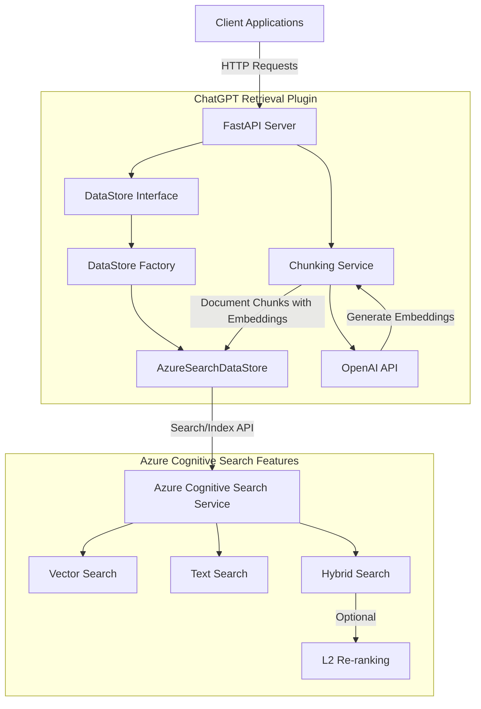
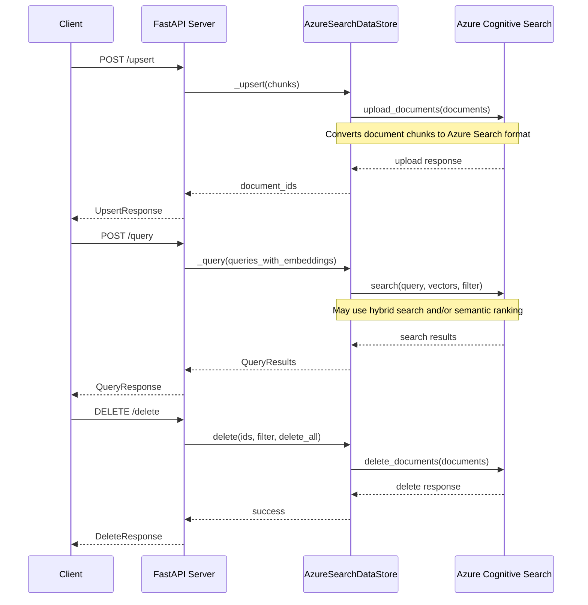
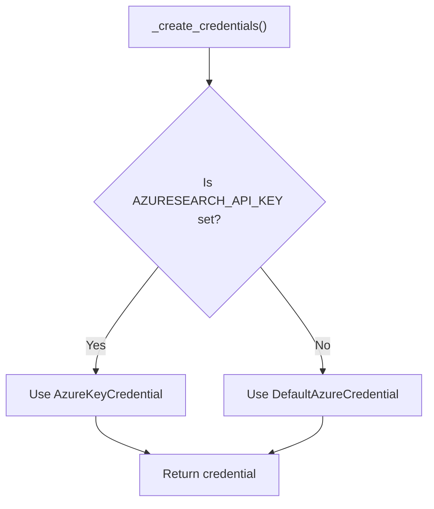
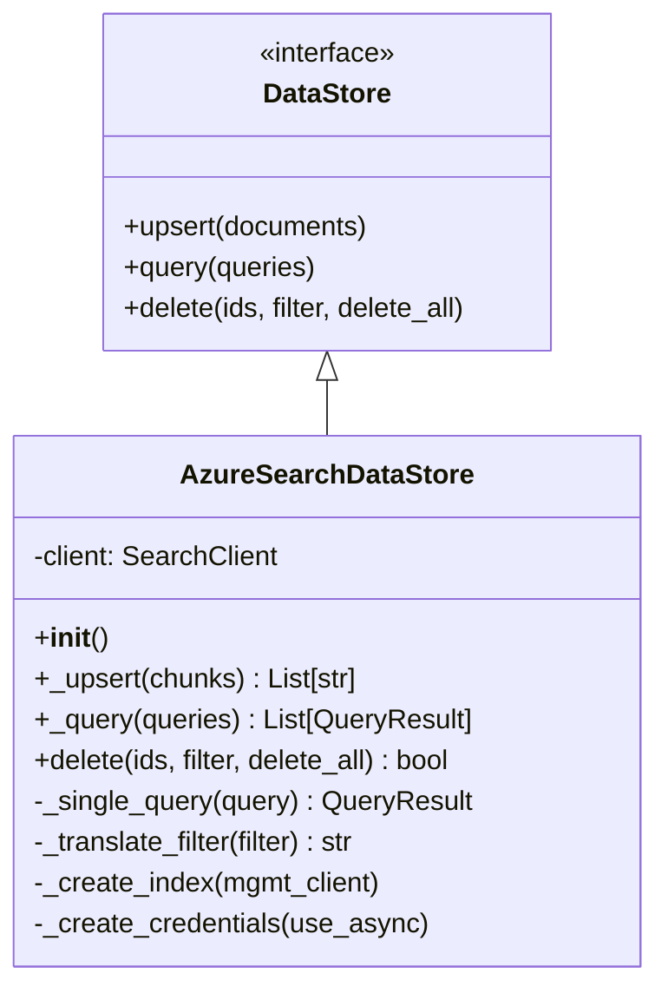

<!-- source: DeepWiki mcp.deepwiki.com · repo openai/chatgpt-retrieval-plugin · page 5.3 Azure Cognitive Search · fetched 2026-10-26 -->

# Azure Cognitive Search

<details>
<summary>Relevant source files</summary>

The following files were used as context for generating this wiki page:

- [datastore/providers/azuresearch_datastore.py](datastore/providers/azuresearch_datastore.py)
- [docs/providers/azuresearch/setup.md](docs/providers/azuresearch/setup.md)
- [tests/datastore/providers/azuresearch/test_azuresearch_datastore.py](tests/datastore/providers/azuresearch/test_azuresearch_datastore.py)

</details>


## Introduction

This document provides a technical overview of the Azure Cognitive Search integration for the ChatGPT Retrieval Plugin. Azure Cognitive Search is a cloud-based vector database provider that supports vector search, text search, and hybrid (combined vector and text) search capabilities, with optional semantic re-ranking.

This integration allows the retrieval plugin to store and retrieve document chunks using Azure Cognitive Search as the backend datastore. For information about other vector database providers, see the parent [Vector Database Providers](#5) page.

Sources: [docs/providers/azuresearch/setup.md:1-3]()

## Architecture

The Azure Cognitive Search integration follows the same pattern as other datastore providers in the ChatGPT Retrieval Plugin. It implements the common DataStore interface, providing specific functionality for Azure Cognitive Search.

### High-Level Architecture



Sources: [datastore/providers/azuresearch_datastore.py:17-26](), [datastore/providers/azuresearch_datastore.py:55-74]()

### Data Flow for Document Operations



Sources: [datastore/providers/azuresearch_datastore.py:76-113](), [datastore/providers/azuresearch_datastore.py:164-222](), [datastore/providers/azuresearch_datastore.py:116-162]()

## Configuration

### Environment Variables

The Azure Cognitive Search integration requires several environment variables for configuration:

| Name | Required | Description | Default |
|------|----------|-------------|---------|
| `DATASTORE` | Yes | Set to `azuresearch` to use Azure Cognitive Search | |
| `AZURESEARCH_SERVICE` | Yes | Name of your Azure Search service | |
| `AZURESEARCH_INDEX` | Yes | Name of your search index | |
| `AZURESEARCH_API_KEY` | No | API key for authentication | Uses managed identity if not provided |
| `AZURESEARCH_SEMANTIC_CONFIG` | No | Configuration name for L2 re-ranking | L2 not enabled if not provided |
| `AZURESEARCH_LANGUAGE` | No | Language for semantic search | `en-us` |
| `AZURESEARCH_DIMENSIONS` | No | Vector size for embeddings | `256` |
| `AZURESEARCH_DISABLE_HYBRID` | No | Set to disable hybrid search | Uses hybrid search if not provided |

Sources: [datastore/providers/azuresearch_datastore.py:28-36](), [docs/providers/azuresearch/setup.md:12-24]()

### Authentication Options

Azure Cognitive Search supports two authentication methods:

1. **API Key**: Default method using `AZURESEARCH_API_KEY` environment variable
2. **Managed Identity**: Used automatically if no API key is provided, leveraging Azure's identity management

The authentication method is determined by the `_create_credentials` method:



Sources: [datastore/providers/azuresearch_datastore.py:357-371](), [docs/providers/azuresearch/setup.md:26-30]()

### Field Mappings for Existing Indexes

If you have an existing Azure Cognitive Search index, you can map your field names to the ones expected by the retrieval plugin:

| Plugin Field | Environment Variable for Custom Name |
|--------------|--------------------------------------|
| id | `AZURESEARCH_FIELDS_ID` |
| text | `AZURESEARCH_FIELDS_TEXT` |
| embedding | `AZURESEARCH_FIELDS_EMBEDDING` |
| document_id | `AZURESEARCH_FIELDS_DOCUMENT_ID` |
| source | `AZURESEARCH_FIELDS_SOURCE` |
| source_id | `AZURESEARCH_FIELDS_SOURCE_ID` |
| url | `AZURESEARCH_FIELDS_URL` |
| created_at | `AZURESEARCH_FIELDS_CREATED_AT` |
| author | `AZURESEARCH_FIELDS_AUTHOR` |

Sources: [datastore/providers/azuresearch_datastore.py:40-49](), [docs/providers/azuresearch/setup.md:36-49]()

## Implementation Details

### AzureSearchDataStore Class Structure



Sources: [datastore/providers/azuresearch_datastore.py:55-56]()

### Initialization and Index Creation

When an `AzureSearchDataStore` instance is created, it:

1. Initializes a SearchClient with the configured endpoint and credentials
2. Checks if the specified index exists
3. Creates the index if it doesn't exist, with fields for storing document chunks and their metadata

The index creation process configures fields for:
- Document ID (base64-encoded to ensure valid characters)
- Document text content
- Vector embeddings with the specified dimensions
- Metadata fields like source, author, created date, etc.

The index also includes vector search configuration (using HNSW algorithm with cosine similarity) and optional semantic settings for L2 re-ranking.

Sources: [datastore/providers/azuresearch_datastore.py:56-74](), [datastore/providers/azuresearch_datastore.py:262-355]()

### Document Operations

#### Upserting Documents

The `_upsert` method:

1. Converts document chunks to the format expected by Azure Cognitive Search
2. Base64-encodes the chunk IDs to ensure they're valid Azure Search keys
3. Uploads documents in batches (maximum 1000 per batch)
4. Returns the list of document IDs that were upserted

Sources: [datastore/providers/azuresearch_datastore.py:76-114]()

#### Querying Documents

The `_query` method:

1. Processes each query in parallel using `_single_query`
2. Translates query filters to Azure Search filter syntax
3. Performs the search using vector similarity, text search, or both (hybrid)
4. Applies semantic re-ranking if configured
5. Converts results back to the plugin's document format

The search process can be tuned to:
- Use pure vector search by setting `AZURESEARCH_DISABLE_HYBRID`
- Apply semantic re-ranking by setting `AZURESEARCH_SEMANTIC_CONFIG`
- Adjust the number of results based on filters

Sources: [datastore/providers/azuresearch_datastore.py:164-222]()

#### Deleting Documents

The `delete` method supports:

1. Deleting specific document IDs
2. Deleting documents matching a filter
3. Deleting all documents in the index

For bulk operations, it retrieves documents in batches and deletes them to avoid overloading the service.

Sources: [datastore/providers/azuresearch_datastore.py:116-162]()

### Filter Translation

Filters from the plugin's `DocumentMetadataFilter` format are translated to Azure Search's OData filter syntax using the `_translate_filter` method. This handles:

- Exact matching for fields like document_id, source, author
- Date range filtering with start_date and end_date
- Proper escaping of special characters

For example, a filter for document_id "test123" and source "file" would be translated to:
```
document_id eq 'test123' and source eq 'file'
```

Sources: [datastore/providers/azuresearch_datastore.py:224-260](), [tests/datastore/providers/azuresearch/test_azuresearch_datastore.py:34-84]()

## Features

### Search Capabilities

Azure Cognitive Search offers three search methods, all supported by this integration:

1. **Vector Search**: Uses the embedding vectors to find semantically similar content
2. **Text Search**: Traditional keyword-based search
3. **Hybrid Search**: Combines vector and text search for better results

By default, the integration uses hybrid search, but you can disable it by setting `AZURESEARCH_DISABLE_HYBRID`.

Sources: [docs/providers/azuresearch/setup.md:3]()

### Semantic Re-ranking

For improved results quality, Azure Cognitive Search offers L2 re-ranking. When enabled:

1. The initial search retrieves more candidates than required
2. The L2 re-ranker processes these candidates to improve relevance
3. The top results after re-ranking are returned

To enable this feature:
1. Enable semantic search in your Azure Cognitive Search service
2. Create a semantic configuration in your index
3. Set `AZURESEARCH_SEMANTIC_CONFIG` to your configuration name

Sources: [datastore/providers/azuresearch_datastore.py:185-196](), [docs/providers/azuresearch/setup.md:32-34]()

## Usage Example

Based on the test file, here's how to use Azure Cognitive Search with the plugin:

```python
# Initialize the datastore
store = AzureSearchDataStore()

# Upsert documents
await store.upsert([
    Document(
        id="doc1",
        text="sample document text",
        metadata=DocumentMetadata(
            source=Source.file,
            source_id="source1",
            author="author1",
            created_at="2023-01-01T00:00:00Z",
            url="http://example.com/doc1"
        )
    )
])

# Query documents
results = await store.query([
    Query(
        query="sample",
        filter=DocumentMetadataFilter(source_id="source1")
    )
])

# Delete documents
await store.delete(["doc1"])
```

Sources: [tests/datastore/providers/azuresearch/test_azuresearch_datastore.py:119-143](), [tests/datastore/providers/azuresearch/test_azuresearch_datastore.py:149-161]()

---

