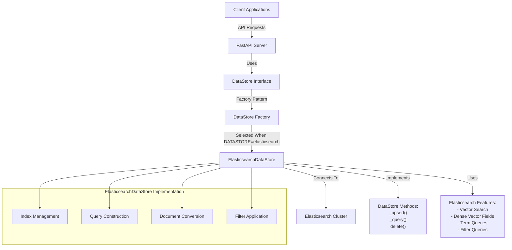
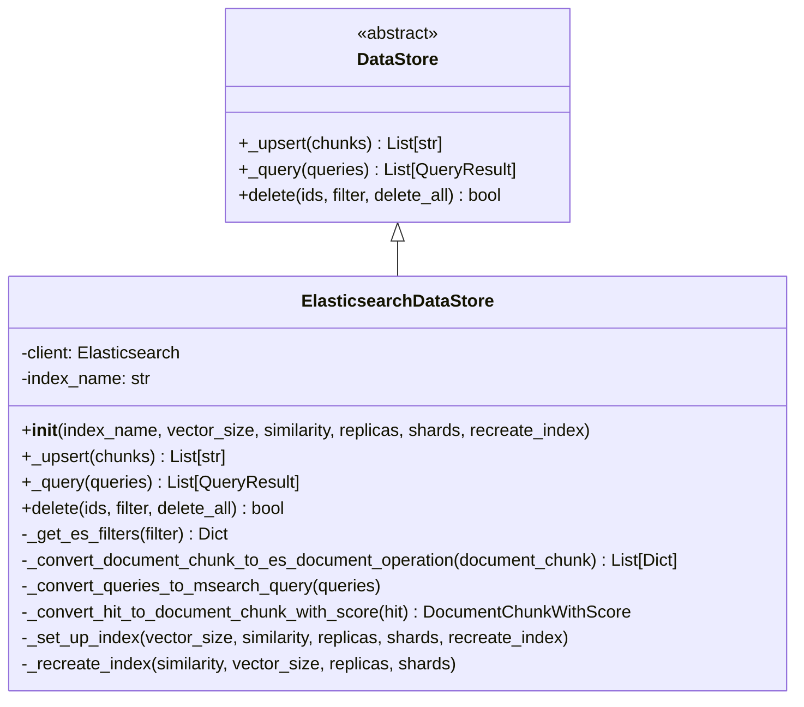
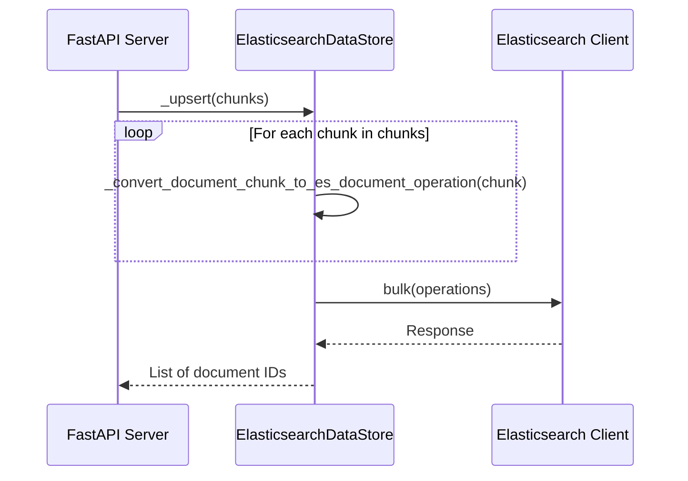
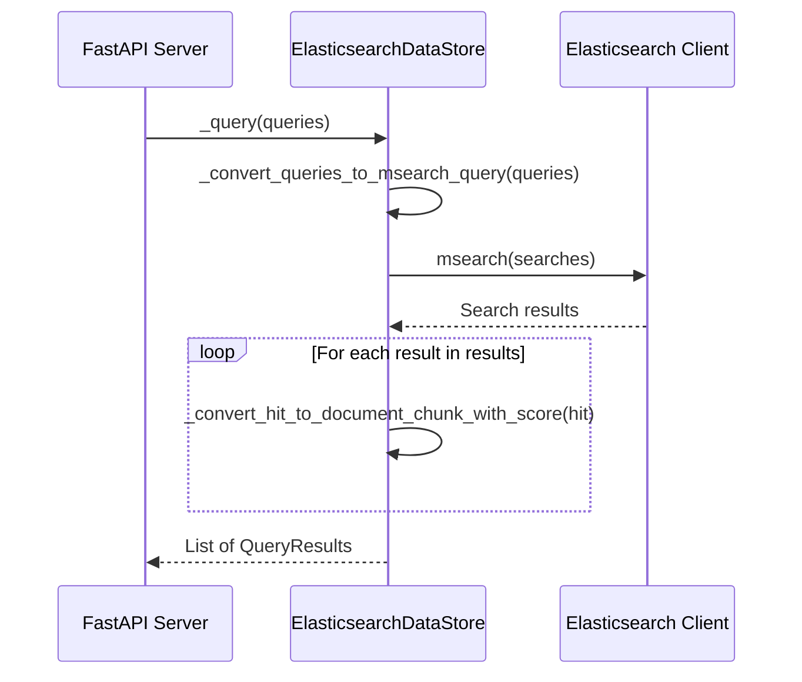

<!-- source: DeepWiki mcp.deepwiki.com · repo openai/chatgpt-retrieval-plugin · page 5.4 Elasticsearch · fetched 2026-10-26 -->

# Elasticsearch

<details>
<summary>Relevant source files</summary>

The following files were used as context for generating this wiki page:

- [datastore/providers/elasticsearch_datastore.py](datastore/providers/elasticsearch_datastore.py)
- [docs/providers/elasticsearch/setup.md](docs/providers/elasticsearch/setup.md)
- [examples/docker/elasticsearch/README.md](examples/docker/elasticsearch/README.md)
- [examples/docker/elasticsearch/docker-compose.yaml](examples/docker/elasticsearch/docker-compose.yaml)
- [examples/providers/elasticsearch/search.ipynb](examples/providers/elasticsearch/search.ipynb)
- [tests/datastore/providers/elasticsearch/test_elasticsearch_datastore.py](tests/datastore/providers/elasticsearch/test_elasticsearch_datastore.py)

</details>


This page documents the Elasticsearch integration in the ChatGPT Retrieval Plugin. Elasticsearch serves as one of the vector database providers that can be used to store and query document embeddings. This integration allows users to leverage Elasticsearch's vector search capabilities to perform semantic search on document chunks.

## Overview

Elasticsearch is a search engine based on the Lucene library that provides distributed, full-text search along with vector search capabilities. The ChatGPT Retrieval Plugin integrates with Elasticsearch through the `ElasticsearchDataStore` class, which implements the abstract `DataStore` interface.

### Architecture Integration



Sources: [datastore/providers/elasticsearch_datastore.py:33-345](). [docs/providers/elasticsearch/setup.md:1-38]()

## Implementation Details

The `ElasticsearchDataStore` class handles all interactions with Elasticsearch, including connection management, index creation, document conversion, and query construction.

### Class Structure



Sources: [datastore/providers/elasticsearch_datastore.py:33-284]()

### Key Components

1. **Initialization and Connection**:
   - The class establishes a connection to Elasticsearch using either URL or Cloud ID
   - Supports both API key authentication and username/password authentication
   - Creates or validates the index with proper mapping for vector search

2. **Index Configuration**:
   - Uses Elasticsearch's `dense_vector` field type for storing embeddings
   - Supports different similarity metrics: `cosine`, `l2_norm`, `dot_product`
   - Configurable number of shards and replicas

3. **Document Operations**:
   - Document upserting with embedding vectors
   - Vector similarity search for queries
   - Deletion with filtering capabilities

### Data Flow: Document Upsert



Sources: [datastore/providers/elasticsearch_datastore.py:77-91]()

### Data Flow: Query Execution



Sources: [datastore/providers/elasticsearch_datastore.py:93-111]()

## Configuration

### Environment Variables

The Elasticsearch integration uses the following environment variables:

| Variable | Required | Description |
|----------|----------|-------------|
| `DATASTORE` | Yes | Must be set to `elasticsearch` to use this provider |
| `ELASTICSEARCH_INDEX` | Yes | Name of the Elasticsearch index to use |
| `ELASTICSEARCH_URL` | Yes* | URL to connect to Elasticsearch (if not using Cloud ID) |
| `ELASTICSEARCH_CLOUD_ID` | Yes* | Elastic Cloud deployment ID (if not using URL) |
| `ELASTICSEARCH_USERNAME` | Yes** | Username for authentication (if not using API key) |
| `ELASTICSEARCH_PASSWORD` | Yes** | Password for authentication (if not using API key) |
| `ELASTICSEARCH_API_KEY` | Yes** | API key for authentication (if not using username/password) |
| `ELASTICSEARCH_REPLICAS` | No | Number of replica shards (default: 1) |
| `ELASTICSEARCH_SHARDS` | No | Number of primary shards (default: 1) |
| `EMBEDDING_DIMENSION` | No | Dimension of embedding vectors (default: 256) |

\* Either `ELASTICSEARCH_URL` or `ELASTICSEARCH_CLOUD_ID` must be provided.  
\** Either `ELASTICSEARCH_API_KEY` or both `ELASTICSEARCH_USERNAME` and `ELASTICSEARCH_PASSWORD` must be provided.

Sources: [datastore/providers/elasticsearch_datastore.py:1-32]() [docs/providers/elasticsearch/setup.md:7-27]()

### Index Structure

The Elasticsearch index is configured with the following mapping for storing document chunks and embeddings:

```
{
  "properties": {
    "embedding": {
      "type": "dense_vector",
      "dims": [vector_size],
      "index": true,
      "similarity": [similarity]
    }
  }
}
```

Where:
- `vector_size` is determined by `EMBEDDING_DIMENSION` (default: 256)
- `similarity` can be one of: `cosine`, `l2_norm`, or `dot_product`

Sources: [datastore/providers/elasticsearch_datastore.py:288-311]()

## Implementation Details

### Document Storage

When documents are upserted, they are converted to a format suitable for Elasticsearch:

1. Each document chunk is converted to an Elasticsearch document
2. The document contains:
   - `id`: The unique ID of the chunk
   - `text`: The text content of the chunk
   - `metadata`: Any metadata associated with the chunk
   - `created_at`: Timestamp of when the chunk was created
   - `embedding`: The vector embedding of the chunk

Source: [datastore/providers/elasticsearch_datastore.py:196-220]()

### Vector Search

For querying, the integration uses Elasticsearch's KNN search capabilities:

```json
{
  "_source": true,
  "knn": {
    "field": "embedding",
    "query_vector": [query_embedding],
    "k": [top_k],
    "num_candidates": [top_k]
  },
  "size": [top_k]
}
```

The search returns the most similar document chunks based on vector similarity.

Sources: [datastore/providers/elasticsearch_datastore.py:222-240]()

### Filtering

The integration supports filtering documents by metadata when querying or deleting:

- Document ID
- Source type
- Author
- Created date range
- Custom metadata fields

Filters are converted to Elasticsearch boolean queries.

Sources: [datastore/providers/elasticsearch_datastore.py:164-194]()

## Usage Example

### Setup and Configuration

To use Elasticsearch as the vector database provider:

1. Set up an Elasticsearch instance (self-hosted or cloud)
2. Configure environment variables:
   ```
   DATASTORE=elasticsearch
   ELASTICSEARCH_URL=http://localhost:9200
   ELASTICSEARCH_INDEX=my-documents
   ```
3. Start the ChatGPT Retrieval Plugin

### Local Development with Docker

For local development, you can use the provided Docker setup:

```bash
cd examples/docker/elasticsearch
docker-compose up -d
```

This will start an Elasticsearch instance on http://localhost:9200 with security disabled for development purposes.

Sources: [examples/docker/elasticsearch/README.md:1-7](), [examples/docker/elasticsearch/docker-compose.yaml:1-28]()

### Integration Testing

To run the Elasticsearch integration tests:

```bash
pytest ./tests/datastore/providers/elasticsearch/test_elasticsearch_datastore.py
```

This will test the basic functionality of the Elasticsearch integration.

Sources: [docs/providers/elasticsearch/setup.md:29-37]()

## Performance Considerations

When using Elasticsearch as the vector database provider, consider the following:

1. **Index Configuration**:
   - Adjust the number of shards and replicas based on your data volume and performance requirements
   - For larger deployments, consider using a multi-node Elasticsearch cluster

2. **Vector Search Parameters**:
   - The `num_candidates` parameter in KNN search affects the accuracy and performance of similarity search
   - Higher values provide more accurate results but may impact performance

3. **Batch Operations**:
   - The system uses bulk operations for upserting documents in batches
   - Default batch size is 100 documents per request

Sources: [datastore/providers/elasticsearch_datastore.py:30-31](), [datastore/providers/elasticsearch_datastore.py:222-240]()

## Error Handling

The Elasticsearch integration includes error handling for:

1. Connection issues
2. Index creation failures
3. Incompatible index configurations
4. Query and document processing errors

Errors are logged and propagated to the calling code.

Sources: [datastore/providers/elasticsearch_datastore.py:258-283](), [datastore/providers/elasticsearch_datastore.py:345-351]()

---

