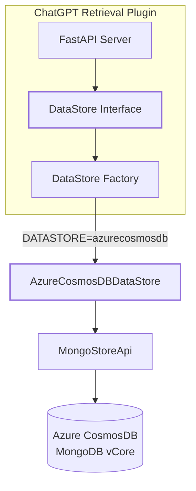
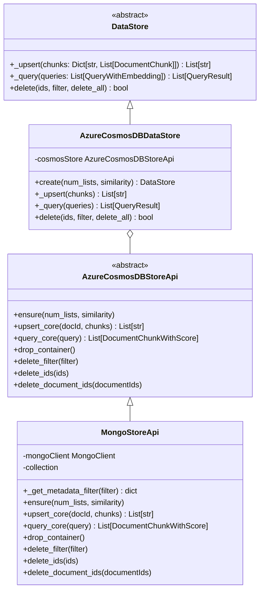
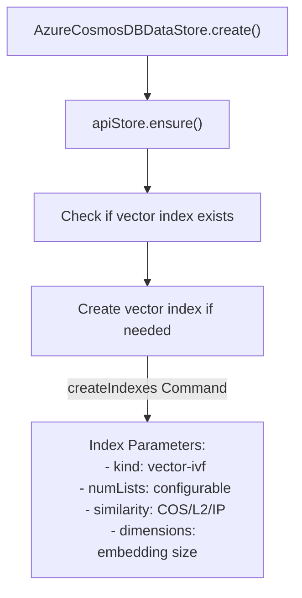
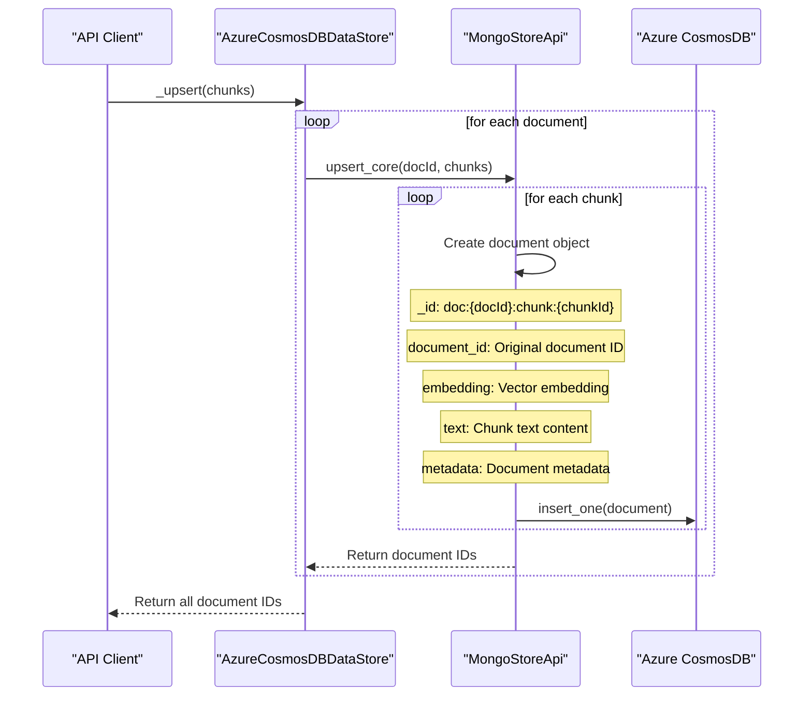
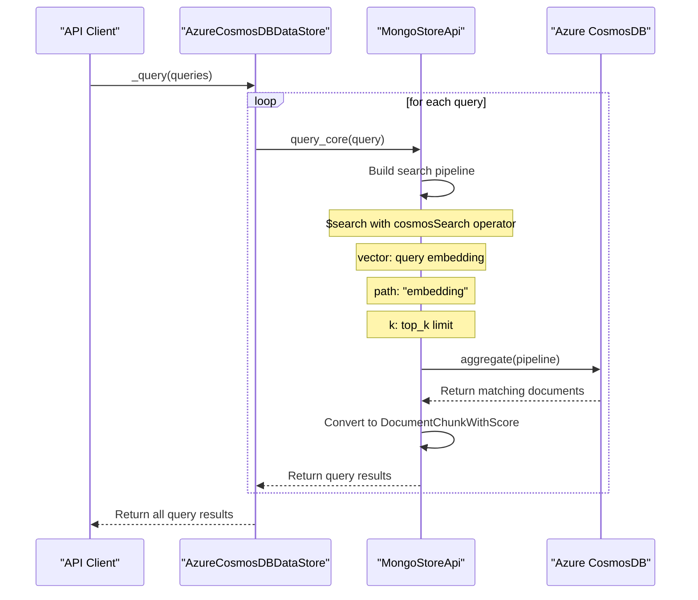

<!-- source: DeepWiki mcp.deepwiki.com · repo openai/chatgpt-retrieval-plugin · page 5.5 Azure CosmosDB · fetched 2026-10-26 -->

# Azure CosmosDB

<details>
<summary>Relevant source files</summary>

The following files were used as context for generating this wiki page:

- [datastore/providers/azurecosmosdb_datastore.py](datastore/providers/azurecosmosdb_datastore.py)
- [docs/providers/azurecosmosdb/setup.md](docs/providers/azurecosmosdb/setup.md)
- [examples/providers/azurecosmosdb/semantic-search.ipynb](examples/providers/azurecosmosdb/semantic-search.ipynb)
- [tests/datastore/providers/azurecosmosdb/test_azurecosmosdb_datastore.py](tests/datastore/providers/azurecosmosdb/test_azurecosmosdb_datastore.py)

</details>


This document covers the Azure CosmosDB vector database integration for the ChatGPT Retrieval Plugin. It explains how to configure and use Azure CosmosDB for MongoDB vCore as a vector store for document embeddings and semantic search capabilities.

## Overview

Azure CosmosDB is a fully managed NoSQL and relational database service that can store vector embeddings in documents and perform vector similarity searches. The implementation in this project specifically uses Azure CosmosDB for MongoDB vCore, which provides vector search capabilities through a MongoDB-compatible interface.

The integration sits within the DataStore provider system, implementing the common interface used by all vector database providers in the ChatGPT Retrieval Plugin.



Sources: [datastore/providers/azurecosmosdb_datastore.py:202-234]()

## Implementation Architecture

The Azure CosmosDB implementation follows a layered architecture with abstract interfaces to allow for potential future expansion to other Azure CosmosDB APIs beyond MongoDB vCore.



Sources: [datastore/providers/azurecosmosdb_datastore.py:40-203]()

Key classes:

1. **AzureCosmosDBDataStore** - Implements the common DataStore interface for Azure CosmosDB
2. **AzureCosmosDBStoreApi** - Abstract interface for different CosmosDB APIs
3. **MongoStoreApi** - Implementation for MongoDB vCore API

## Configuration

The Azure CosmosDB integration requires the following environment variables:

| Variable | Required | Description | Default |
|----------|----------|-------------|---------|
| `DATASTORE` | Yes | Set to `azurecosmosdb` | |
| `AZCOSMOS_API` | Yes | Currently only supports `mongo-vcore` | |
| `AZCOSMOS_CONNSTR` | Yes | Connection string to your Azure CosmosDB account | |
| `AZCOSMOS_DATABASE_NAME` | Yes | Database name where data is stored | |
| `AZCOSMOS_CONTAINER_NAME` | Yes | Container name where data is stored | |
| `EMBEDDING_DIMENSION` | No | Dimension of embeddings | 256 |

Sources: [datastore/providers/azurecosmosdb_datastore.py:25-36](), [docs/providers/azurecosmosdb/setup.md:9-17]()

## Vector Indexing

On first use, the datastore automatically creates a vector index on the `embedding` field. The implementation uses the IVF (Inverted File) index type with configurable parameters:



Sources: [datastore/providers/azurecosmosdb_datastore.py:97-120]()

Key indexing parameters:

1. **numLists**: The number of clusters that the IVF index uses to group vector data
   - Recommended for up to 1M documents: `documentCount/1000`
   - Recommended for >1M documents: `sqrt(documentCount)`

2. **similarity**: The similarity metric to use
   - `COS`: Cosine distance
   - `L2`: Euclidean distance 
   - `IP`: Inner product

Sources: [datastore/providers/azurecosmosdb_datastore.py:206-216]()

## Data Operations

### Document Upserting

When documents are upserted, each document chunk is stored as a separate document in the MongoDB collection:



Sources: [datastore/providers/azurecosmosdb_datastore.py:122-140](), [datastore/providers/azurecosmosdb_datastore.py:236-247]()

### Vector Search Queries

Vector similarity searches use MongoDB's aggregation pipeline with the `$search` operator:



Sources: [datastore/providers/azurecosmosdb_datastore.py:142-180](), [datastore/providers/azurecosmosdb_datastore.py:249-268]()

### Deletion Operations

The implementation supports three types of deletion operations:

1. **Delete by IDs**: Removes specific document chunks by their IDs
2. **Delete by Filter**: Removes documents matching metadata criteria
3. **Delete All**: Drops the entire collection

Sources: [datastore/providers/azurecosmosdb_datastore.py:183-193](), [datastore/providers/azurecosmosdb_datastore.py:270-294]()

## Usage Example

The following example shows how to use Azure CosmosDB for semantic search:

```python
# 1. Upsert documents
documents = [
    {
        "id": "Siberian Husky",
        "text": "Siberian Huskies are strikingly beautiful and energetic Arctic breed dogs known for their captivating blue eyes and remarkable endurance in cold climates."
    },
    {
        "id": "Alaskan Malamute",
        "text": "The Alaskan Malamute is a powerful and friendly Arctic sled dog breed known for its strength, endurance, and affectionate nature."
    }
]

response = requests.post(
    "http://localhost:8000/upsert",
    headers={"Authorization": f"Bearer {TOKEN}"},
    json={"documents": documents}
)

# 2. Query documents
queries = [
    {
        "query": "I want dog breeds from Siberia.",
        "top_k": 2
    }
]

response = requests.post(
    "http://localhost:8000/query",
    headers={"Authorization": f"Bearer {TOKEN}"},
    json={"queries": queries}
)
```

Sources: [examples/providers/azurecosmosdb/semantic-search.ipynb:49-154]()

## Limitations

- Currently only supports MongoDB vCore API
- Hybrid search (combining vector and text search) is not yet supported
- Filter constraints in queries are not fully implemented

Sources: [datastore/providers/azurecosmosdb_datastore.py:164](), [docs/providers/azurecosmosdb/setup.md:20]()

## Related Vector Database Providers

For information about other vector database providers supported by the ChatGPT Retrieval Plugin, see:
- [Azure Cognitive Search](#5.3)
- [Pinecone](#5.7)
- [Weaviate](#5.2)
- [Redis](#5.1)
- [MongoDB Atlas](#5.11)

---

