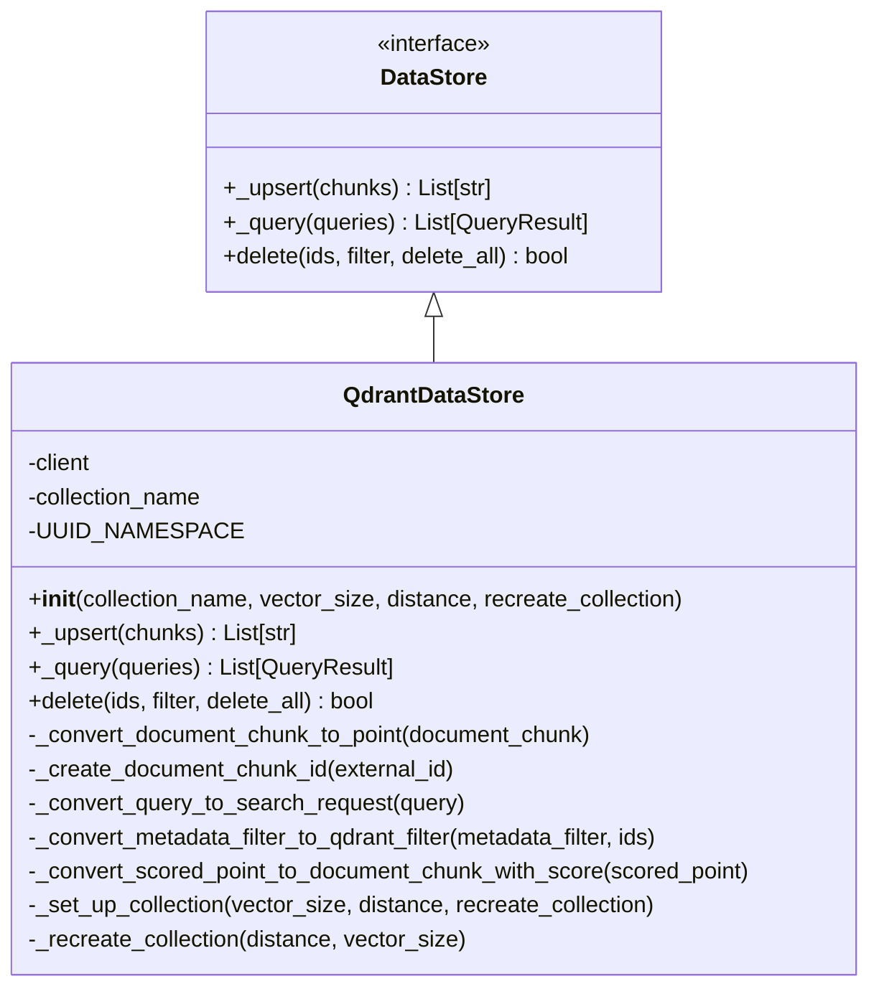
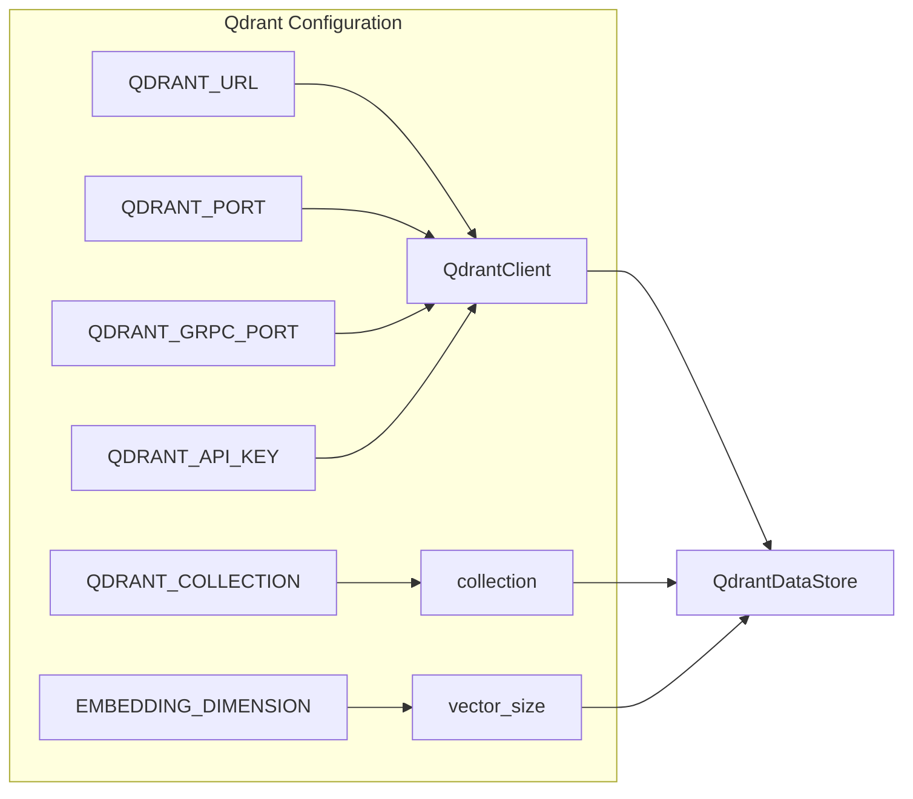
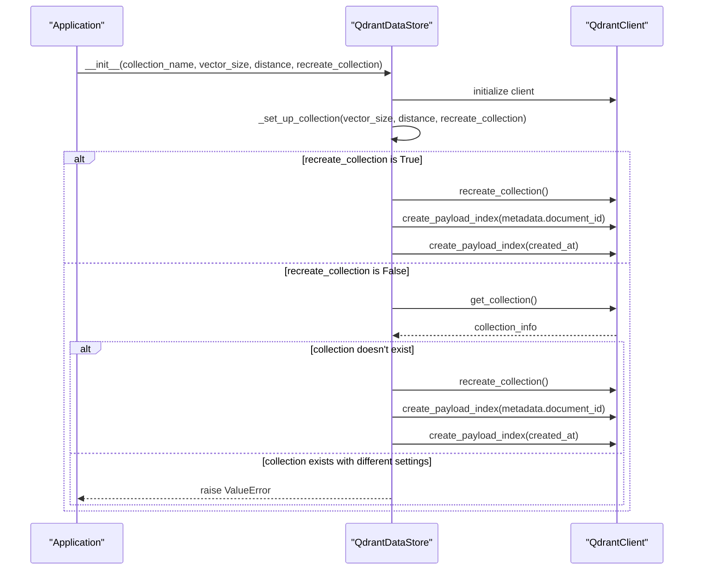
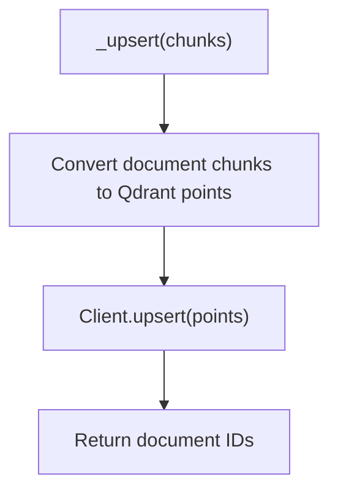
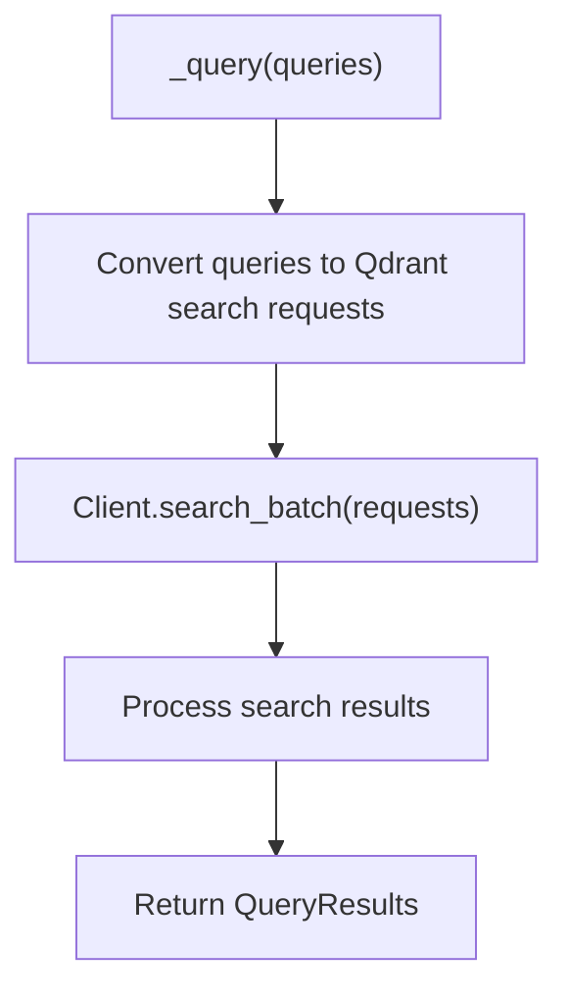
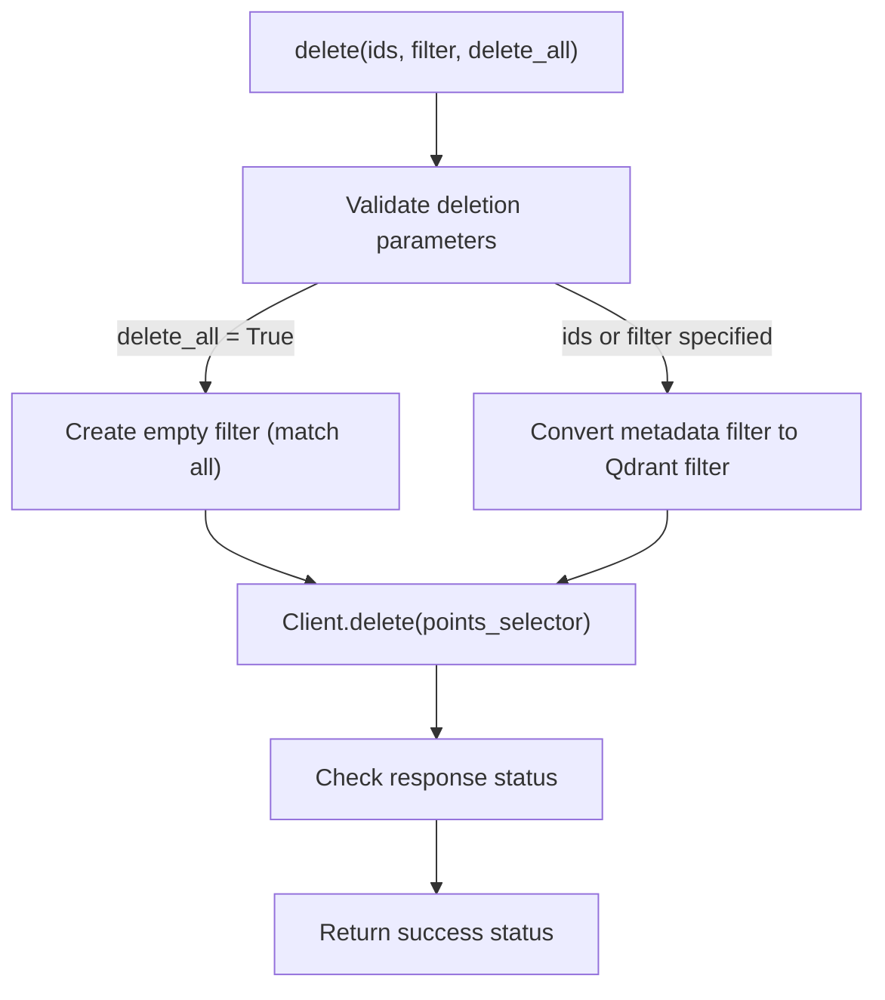
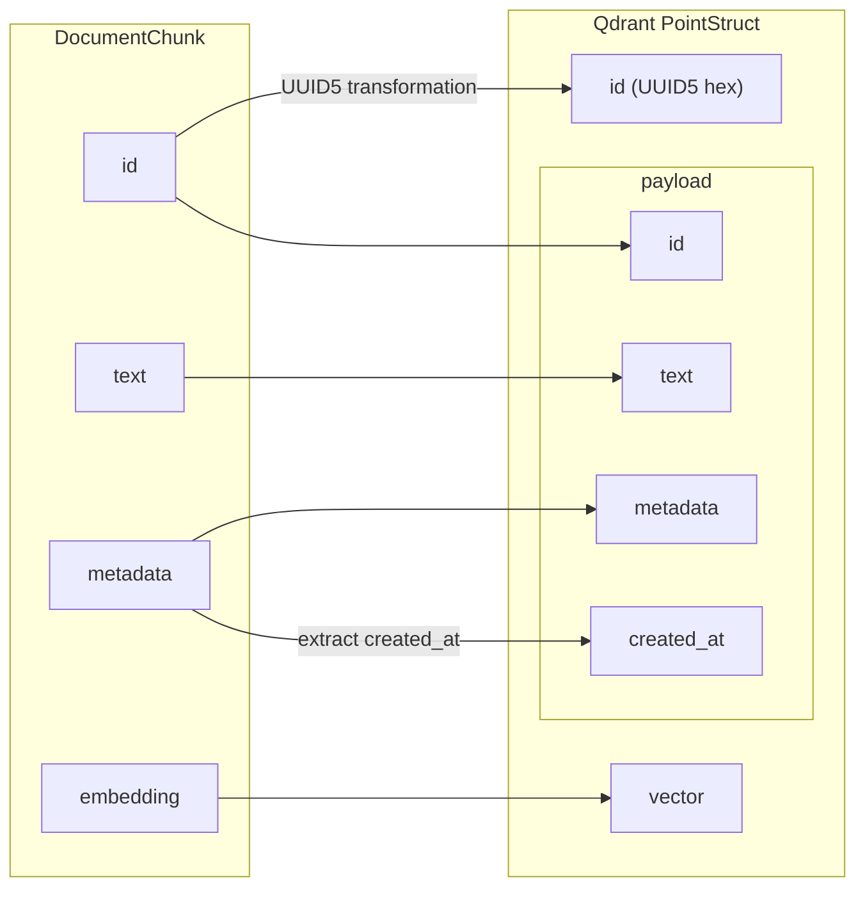
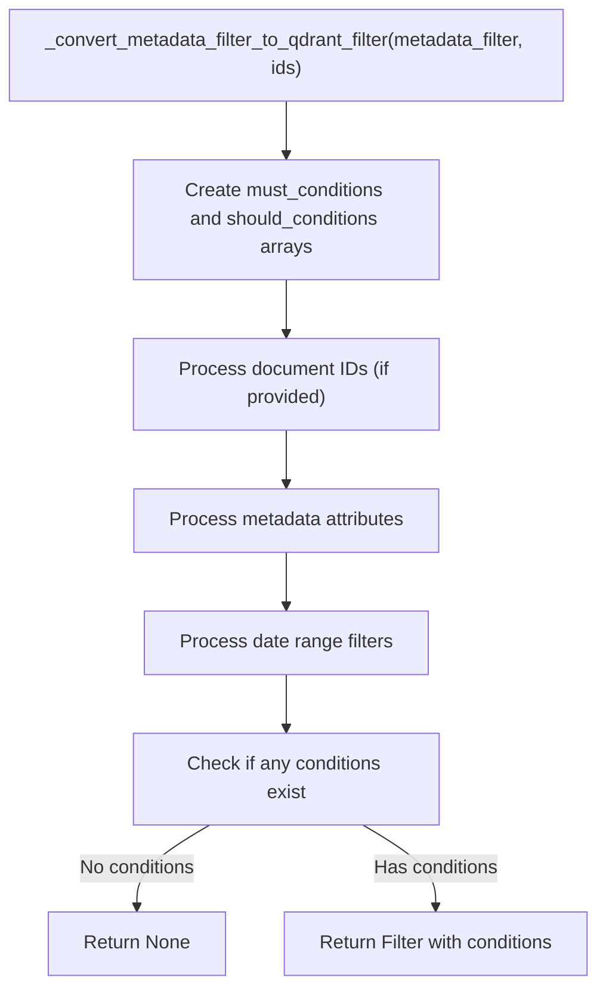
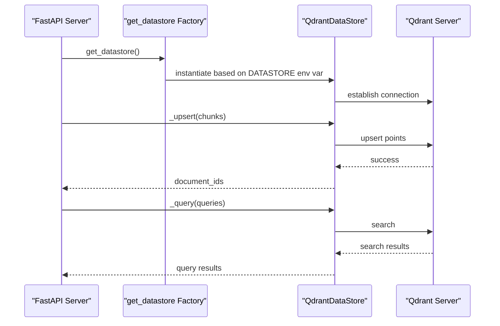

<!-- source: DeepWiki mcp.deepwiki.com · repo openai/chatgpt-retrieval-plugin · page 5.6 Qdrant · fetched 2026-10-26 -->

# Qdrant

<details>
<summary>Relevant source files</summary>

The following files were used as context for generating this wiki page:

- [.dockerignore](.dockerignore)
- [.gitignore](.gitignore)
- [.well-known/openapi.yaml](.well-known/openapi.yaml)
- [datastore/providers/qdrant_datastore.py](datastore/providers/qdrant_datastore.py)
- [examples/memory/README.md](examples/memory/README.md)

</details>


This page documents the Qdrant vector database integration within the ChatGPT Retrieval Plugin. It covers the implementation of the `QdrantDataStore` class, which provides connectivity to Qdrant for storing, retrieving, and managing document embeddings. For information about other vector database providers, see the main [Vector Database Providers](#5) page.

## Overview

Qdrant is a vector similarity search engine that provides storage for vector embeddings and associated metadata. In the ChatGPT Retrieval Plugin, the Qdrant integration enables:

1. Storage of document chunks with their vector embeddings
2. Similarity search using vector embeddings
3. Filtering based on document metadata
4. Efficient document management operations

The implementation is contained in the `QdrantDataStore` class, which implements the `DataStore` interface.

## Architecture

Qdrant integration follows the same architectural pattern as other vector database providers in the system. It implements the common `DataStore` interface, allowing the plugin to interact with Qdrant through a standardized API.



Sources: [datastore/providers/qdrant_datastore.py:9-32]()

## Configuration

The Qdrant datastore is configured through environment variables that specify connection details and collection settings:



### Environment Variables

| Variable | Default Value | Description |
|----------|---------------|-------------|
| `QDRANT_URL` | "http://localhost" | URL of the Qdrant server |
| `QDRANT_PORT` | "6333" | HTTP port for Qdrant server |
| `QDRANT_GRPC_PORT` | "6334" | gRPC port for Qdrant server |
| `QDRANT_API_KEY` | None | API key for authentication (optional) |
| `QDRANT_COLLECTION` | "document_chunks" | Name of the collection to use |
| `EMBEDDING_DIMENSION` | 256 | Dimension of the embedding vectors |

Sources: [datastore/providers/qdrant_datastore.py:23-29]()

## Initialization and Collection Setup

The `QdrantDataStore` initializes a connection to the Qdrant server and ensures the required collection exists with the correct configuration:



The initialization process:
1. Creates a Qdrant client with the configured connection details
2. Sets up the collection with the specified vector size and distance metric
3. Creates payload indices for efficient filtering on `metadata.document_id` and `created_at` fields

Sources: [datastore/providers/qdrant_datastore.py:35-61](), [datastore/providers/qdrant_datastore.py:245-299]()

## Core Operations

### Document Upserting

The `_upsert` method inserts or updates document chunks in the Qdrant collection:



The method:
1. Converts each `DocumentChunk` to a Qdrant `PointStruct`
2. Upserts the points into the Qdrant collection
3. Returns the list of document IDs

Sources: [datastore/providers/qdrant_datastore.py:63-78]()

### Query Execution

The `_query` method searches for documents similar to the provided query embeddings:



The process involves:
1. Converting each `QueryWithEmbedding` to a Qdrant `SearchRequest`
2. Executing a batch search in the Qdrant collection
3. Converting the search results back to `DocumentChunkWithScore` objects
4. Returning `QueryResult` objects containing the matches

Sources: [datastore/providers/qdrant_datastore.py:80-103]()

### Document Deletion

The `delete` method removes documents from the Qdrant collection:



Deletion can be performed:
- By document IDs
- By metadata filter conditions
- For all documents in the collection

Sources: [datastore/providers/qdrant_datastore.py:105-131]()

## Data Conversion

### DocumentChunk to Qdrant Point

The `_convert_document_chunk_to_point` method transforms a `DocumentChunk` into a Qdrant `PointStruct`:



Sources: [datastore/providers/qdrant_datastore.py:133-152]()

### Metadata Filter to Qdrant Filter

The `_convert_metadata_filter_to_qdrant_filter` method converts a `DocumentMetadataFilter` to a Qdrant `Filter`:



The method handles:
- Document ID filtering (OR condition)
- Metadata attribute matching (AND condition)
- Date range filtering

Sources: [datastore/providers/qdrant_datastore.py:168-231]()

## Integration with the System

The `QdrantDataStore` integrates with the ChatGPT Retrieval Plugin system through the factory pattern. When the `DATASTORE` environment variable is set to `"qdrant"`, the plugin instantiates and uses the `QdrantDataStore` for all vector operations.



Sources: [datastore/providers/qdrant_datastore.py:32-62]()

## Performance Considerations

### Payload Indices

The `QdrantDataStore` creates payload indices for:
- `metadata.document_id`: To make document lookups more efficient
- `created_at`: To optimize date range filtering

These indices significantly improve the performance of filter operations, especially for collections with large numbers of documents.

Sources: [datastore/providers/qdrant_datastore.py:285-299]()

### gRPC Protocol

The `QdrantDataStore` uses gRPC for communication with the Qdrant server when available, which provides better performance than the HTTP API:

```
self.client = qdrant_client.QdrantClient(
    url=QDRANT_URL,
    port=int(QDRANT_PORT),
    grpc_port=int(QDRANT_GRPC_PORT),
    api_key=QDRANT_API_KEY,
    prefer_grpc=True,
    timeout=10,
)
```

Sources: [datastore/providers/qdrant_datastore.py:50-57]()

## Error Handling

The `QdrantDataStore` includes error handling for several situations:

1. Collection validation errors - raises `ValueError` if collection exists with incompatible settings
2. Missing parameters errors - raises `ValueError` if no deletion parameters are provided
3. Connection errors - catches `UnexpectedResponse` and `_InactiveRpcError` when checking collection existence

Sources: [datastore/providers/qdrant_datastore.py:115-118](), [datastore/providers/qdrant_datastore.py:258-272](), [datastore/providers/qdrant_datastore.py:273-274]()

## Summary

The Qdrant integration in the ChatGPT Retrieval Plugin provides a robust implementation for storing and retrieving document embeddings. It leverages Qdrant's vector similarity search capabilities and provides efficient filtering options through the standardized `DataStore` interface.

The implementation covers all the core operations needed for the retrieval plugin, including document upserting, querying with embeddings and filters, and document deletion, making Qdrant a fully supported vector database option for the system.

---

