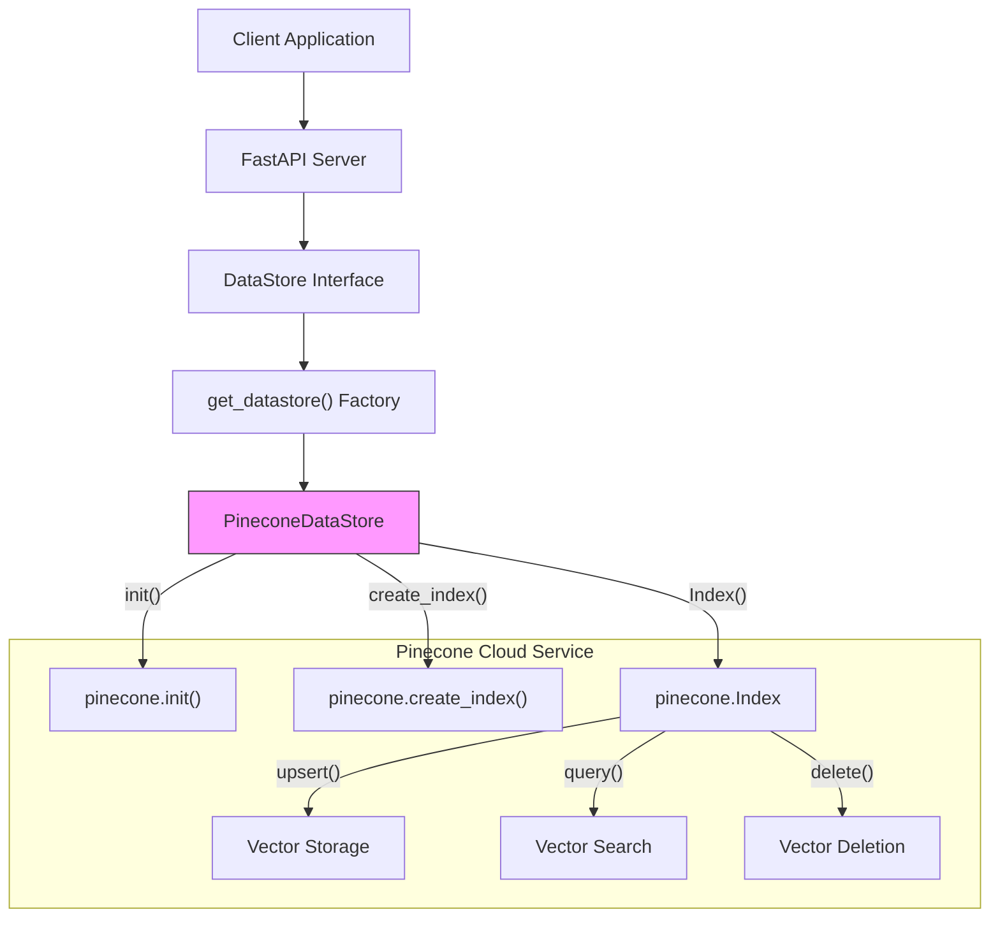
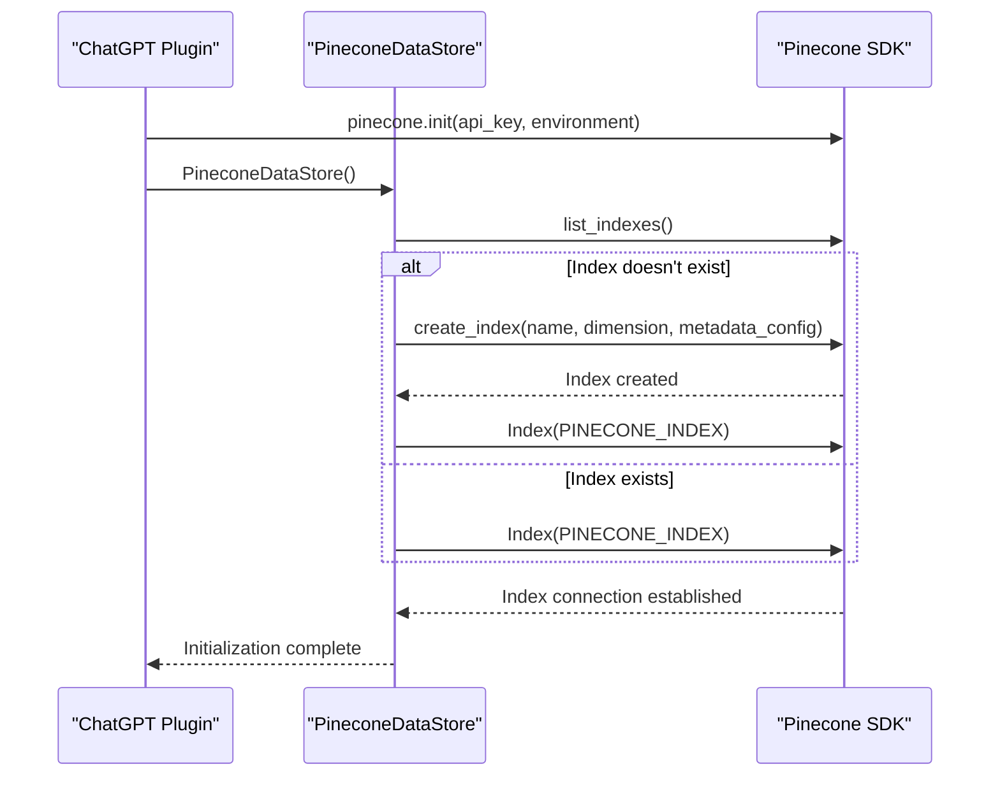
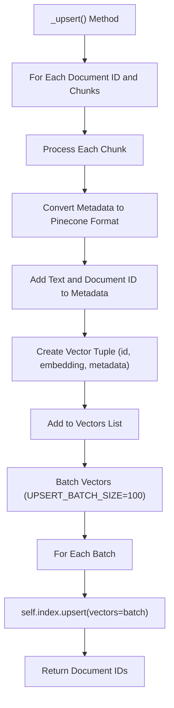
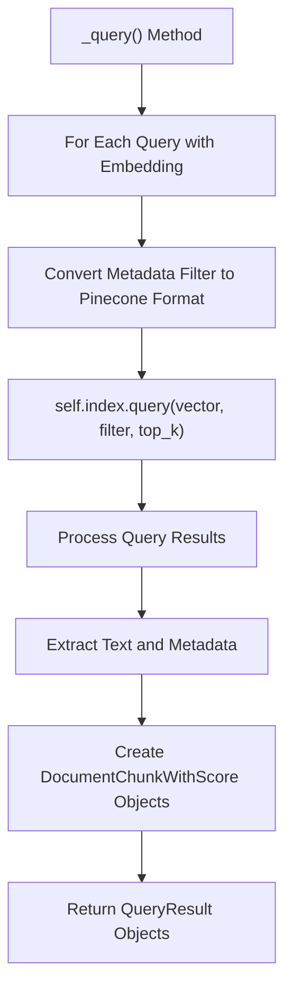
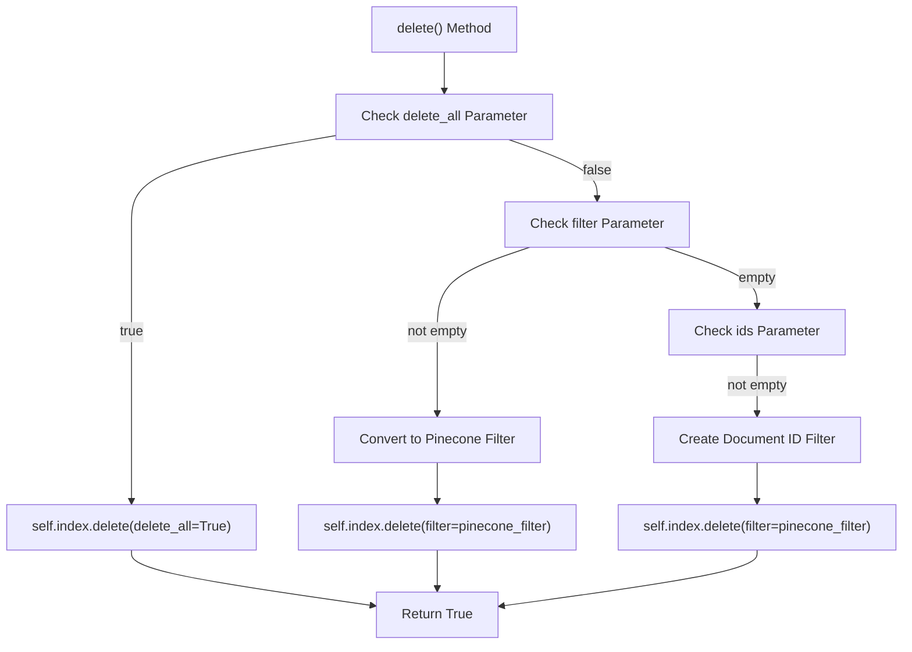
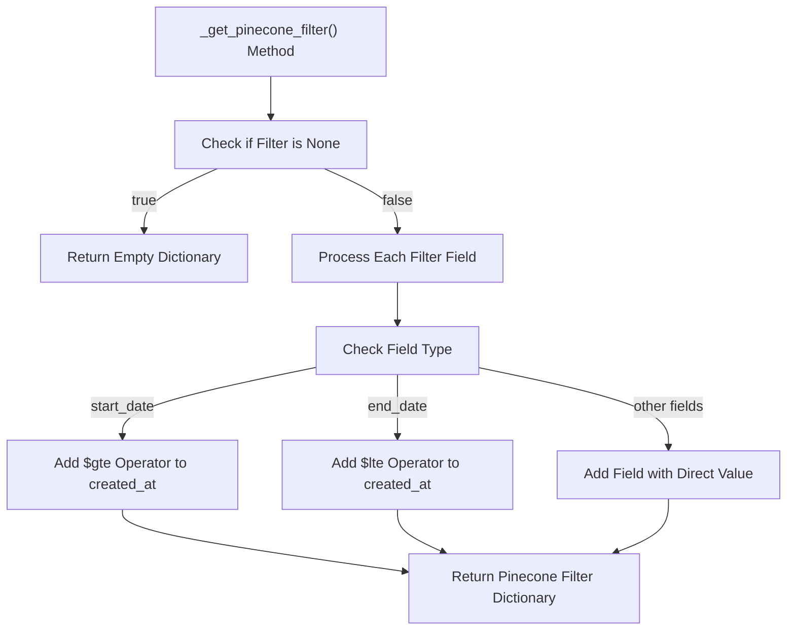
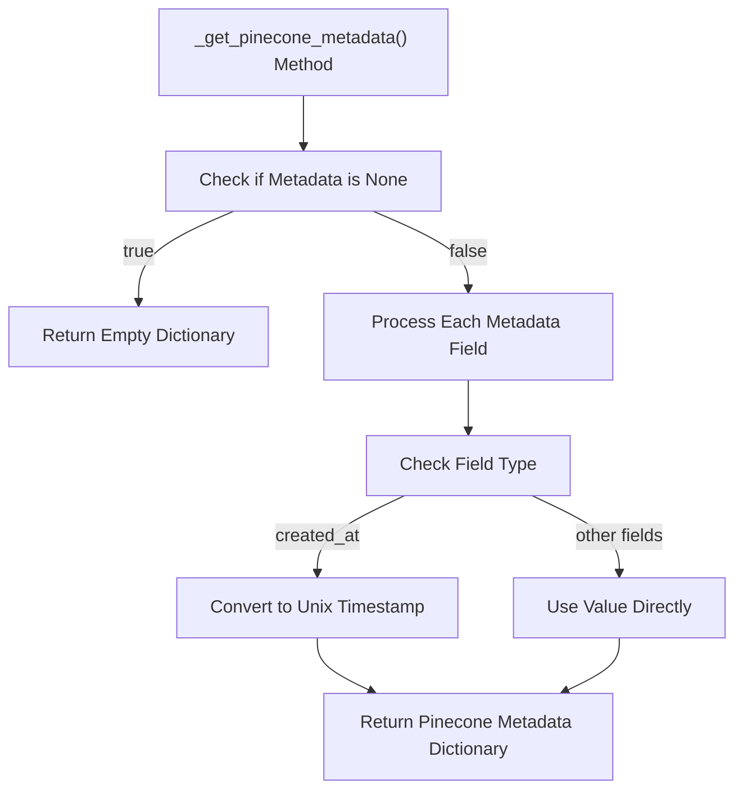

<!-- source: DeepWiki mcp.deepwiki.com · repo openai/chatgpt-retrieval-plugin · page 5.7 Pinecone · fetched 2026-10-26 -->

# Pinecone

<details>
<summary>Relevant source files</summary>

The following files were used as context for generating this wiki page:

- [datastore/providers/pinecone_datastore.py](datastore/providers/pinecone_datastore.py)

</details>


## Introduction

The Pinecone integration in the ChatGPT Retrieval Plugin provides a vector database backend for storing and querying document embeddings. Pinecone is a managed vector database service optimized for similarity search operations, making it an effective choice for semantic retrieval tasks. This page documents how the plugin integrates with Pinecone through the `PineconeDataStore` implementation.

Sources: [datastore/providers/pinecone_datastore.py:1-270]()

## Configuration

Pinecone requires specific environment variables to be set for proper operation:

| Environment Variable | Description | Required |
|----------------------|-------------|----------|
| `PINECONE_API_KEY` | Authentication key for Pinecone API | Yes |
| `PINECONE_ENVIRONMENT` | Pinecone environment region | Yes |
| `PINECONE_INDEX` | Name of the Pinecone index to use | Yes |
| `EMBEDDING_DIMENSION` | Dimension of embedding vectors (default: 256) | No |

The plugin validates these required environment variables during initialization:

```python
PINECONE_API_KEY = os.environ.get("PINECONE_API_KEY")
PINECONE_ENVIRONMENT = os.environ.get("PINECONE_ENVIRONMENT")
PINECONE_INDEX = os.environ.get("PINECONE_INDEX")
assert PINECONE_API_KEY is not None
assert PINECONE_ENVIRONMENT is not None
assert PINECONE_INDEX is not None
```

Sources: [datastore/providers/pinecone_datastore.py:20-26]()

## Integration Architecture

The following diagram illustrates how Pinecone fits into the overall ChatGPT Retrieval Plugin architecture:



Sources: [datastore/providers/pinecone_datastore.py:28-67]()

## PineconeDataStore Implementation

The `PineconeDataStore` class implements the abstract `DataStore` interface, providing Pinecone-specific functionality for the plugin.

### Initialization

During initialization, the class:
1. Checks if the specified index exists in Pinecone
2. Creates the index with appropriate configuration if it doesn't exist
3. Connects to the existing index if it does exist



Sources: [datastore/providers/pinecone_datastore.py:37-67]()

### Key Operations

The `PineconeDataStore` provides three primary operations:

1. **Upsert**: Adds document chunks to the Pinecone index
2. **Query**: Searches for similar document chunks in the index
3. **Delete**: Removes document chunks from the index based on IDs or filters

All operations use a retry mechanism for resilience against transient failures:

```python
@retry(wait=wait_random_exponential(min=1, max=20), stop=stop_after_attempt(3))
```

Sources: [datastore/providers/pinecone_datastore.py:69-222]()

### Document Upsert Flow

The following diagram illustrates how documents are upserted into the Pinecone index:



Key features of the upsert process:

- Processes document chunks in batches of 100 for efficiency
- Preserves document metadata in the Pinecone vectors
- Stores the document text and ID in the vector metadata
- Converts date fields to Unix timestamps for proper indexing

Sources: [datastore/providers/pinecone_datastore.py:69-109]()

### Query Flow

The following diagram shows the query process:



Query features:

- Concurrent processing of multiple queries using `asyncio.gather`
- Conversion of metadata filters to Pinecone filter expressions
- Extraction of text and metadata from query results
- Creation of standardized response objects

Sources: [datastore/providers/pinecone_datastore.py:111-176]()

### Deletion Operations

The `delete` method provides three ways to remove data from the Pinecone index:

1. **Delete All**: Removes all vectors from the index
2. **Delete by Filter**: Removes vectors matching a metadata filter
3. **Delete by Document IDs**: Removes vectors with specific document IDs



Sources: [datastore/providers/pinecone_datastore.py:178-222]()

## Helper Methods

The PineconeDataStore implements two helper methods for handling metadata:

### Pinecone Filter Generation

The `_get_pinecone_filter` method converts `DocumentMetadataFilter` objects to Pinecone filter expressions:



Sources: [datastore/providers/pinecone_datastore.py:224-250]()

### Pinecone Metadata Generation

The `_get_pinecone_metadata` method converts `DocumentChunkMetadata` objects to Pinecone metadata format:



Sources: [datastore/providers/pinecone_datastore.py:252-269]()

## Usage Considerations

When using Pinecone with the ChatGPT Retrieval Plugin, keep the following in mind:

1. **Index Creation**: The plugin will automatically create a Pinecone index if it doesn't exist
2. **Metadata Indexing**: All fields from `DocumentChunkMetadata` are set as indexed fields
3. **Batching**: Document chunks are upserted in batches of 100 for optimal performance
4. **Error Handling**: Retry logic is implemented for resilience against transient failures
5. **Date Handling**: Date fields are converted to Unix timestamps for proper indexing and filtering

Sources: [datastore/providers/pinecone_datastore.py:37-67](), [datastore/providers/pinecone_datastore.py:69-109]()

## Integration with the DataStore System

The `PineconeDataStore` is part of the plugin's DataStore provider ecosystem. It implements the abstract `DataStore` interface, making it interchangeable with other vector database providers. For more information about the overall DataStore system, see [DataStore System](#4).

Sources: [datastore/providers/pinecone_datastore.py:8-17]()

---

