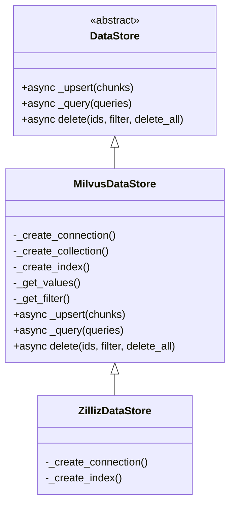
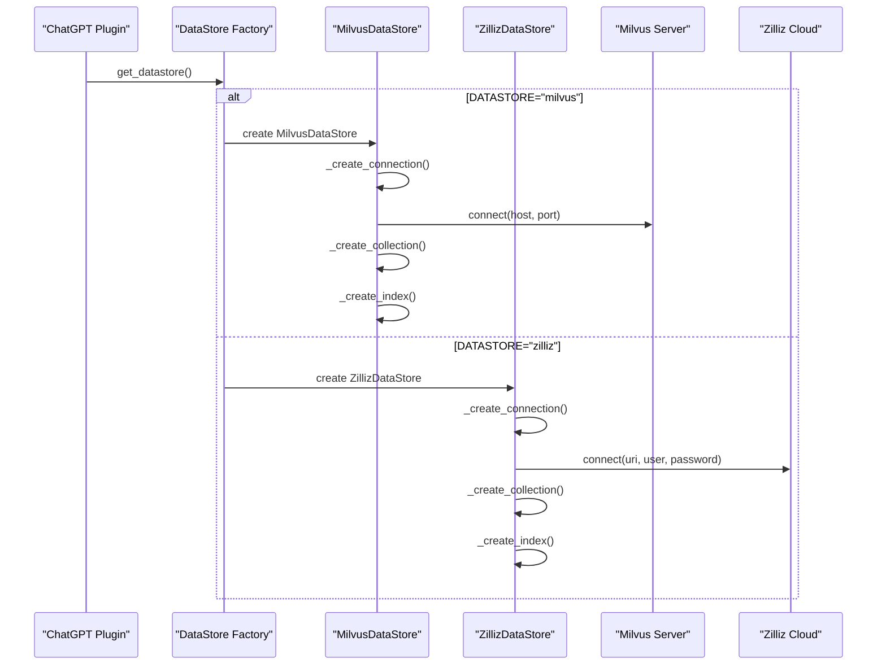
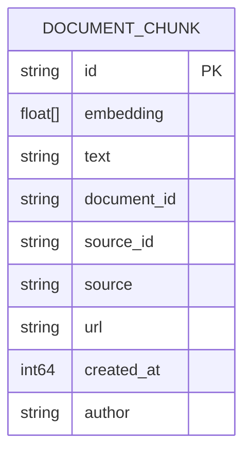
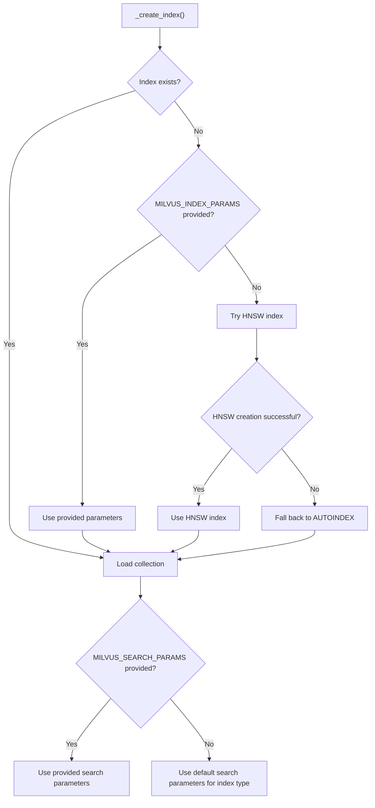
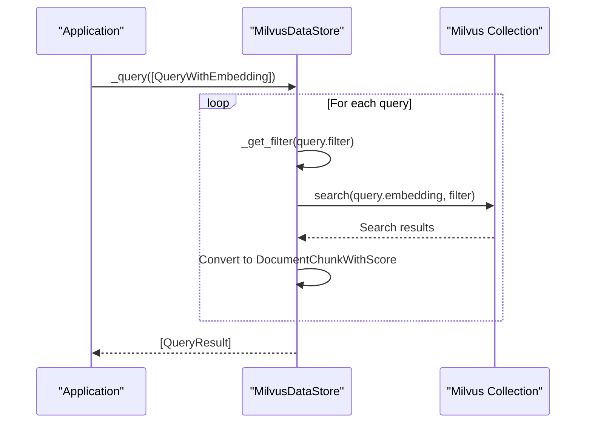
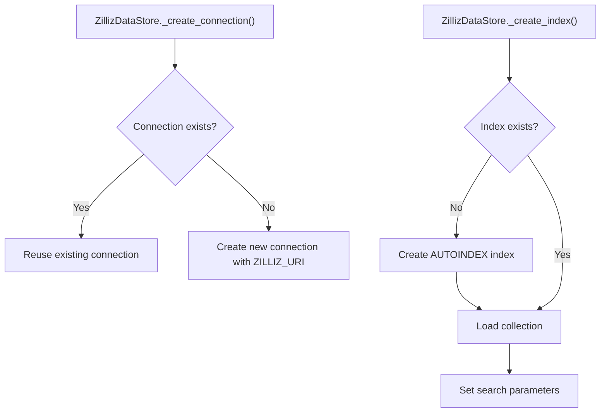
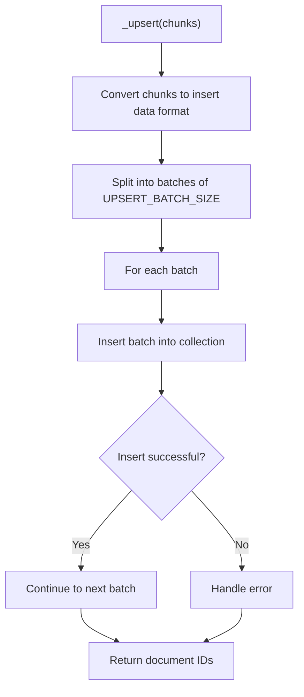
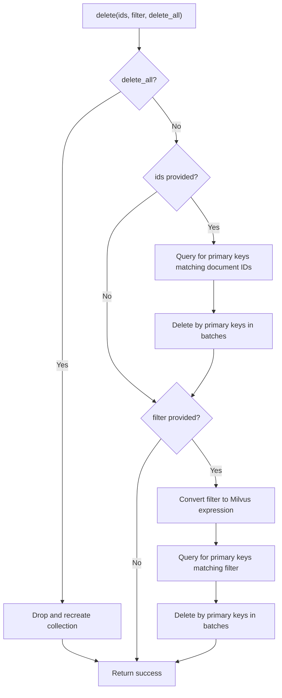

<!-- source: DeepWiki mcp.deepwiki.com · repo openai/chatgpt-retrieval-plugin · page 5.8 Milvus and Zilliz · fetched 2026-10-26 -->

# Milvus and Zilliz

Relevant source files

The following files were used as context for generating this wiki page:

- [datastore/providers/milvus_datastore.py](datastore/providers/milvus_datastore.py)
- [datastore/providers/zilliz_datastore.py](datastore/providers/zilliz_datastore.py)
- [examples/providers/pinecone/semantic-search.ipynb](examples/providers/pinecone/semantic-search.ipynb)
- [tests/datastore/providers/milvus/test_milvus_datastore.py](tests/datastore/providers/milvus/test_milvus_datastore.py)
- [tests/datastore/providers/zilliz/test_zilliz_datastore.py](tests/datastore/providers/zilliz/test_zilliz_datastore.py)

## Overview

This page documents the Milvus and Zilliz vector database integrations in the ChatGPT Retrieval Plugin. These integrations allow the plugin to store and retrieve document embeddings using either a self-hosted Milvus instance or the Zilliz Cloud service (which is built on Milvus technology). Both implementations provide high-performance vector similarity search capabilities essential for semantic retrieval of documents.

## Architecture

Milvus and Zilliz are implemented through the `MilvusDataStore` and `ZillizDataStore` classes, which adhere to the common `DataStore` interface (described in section [DataStore System](#4)). The Zilliz implementation extends the Milvus implementation with cloud-specific configurations.

Sources: [datastore/providers/milvus_datastore.py:106-605](), [datastore/providers/zilliz_datastore.py:24-68]()

## Connection Flow

The following diagram illustrates how the Milvus and Zilliz datastores connect to their respective services:

Sources: [datastore/providers/milvus_datastore.py:132-172](), [datastore/providers/zilliz_datastore.py:40-52]()

## Milvus Implementation

### Configuration

The Milvus integration uses the following environment variables for configuration:

| Environment Variable | Description | Default |
| --- | --- | --- |
| `MILVUS_COLLECTION` | Collection name in Milvus | Random UUID with "c" prefix |
| `MILVUS_HOST` | Milvus server hostname | "localhost" |
| `MILVUS_PORT` | Milvus server port | 19530 |
| `MILVUS_USER` | Username for authentication | None |
| `MILVUS_PASSWORD` | Password for authentication | None |
| `MILVUS_INDEX_PARAMS` | JSON string of index parameters | Auto-selected based on available indexes |
| `MILVUS_SEARCH_PARAMS` | JSON string of search parameters | Auto-selected based on index type |
| `MILVUS_CONSISTENCY_LEVEL` | Consistency level for queries | "Bounded" |

Sources: [datastore/providers/milvus_datastore.py:31-40]()

### Schema

Milvus uses a schema-based approach for storing document chunks. The ChatGPT Retrieval Plugin defines two schema versions:

1. **Schema V1**: Uses an auto-incrementing primary key field named "pk"
2. **Schema V2**: Uses the "id" field as the primary key

The schema includes fields for the document text, embedding vector, and various metadata fields.

Sources: [datastore/providers/milvus_datastore.py:51-103]()

### Index Creation

The Milvus implementation attempts to create an index on the embedding field for efficient vector similarity search. It follows this strategy:

1. If `MILVUS_INDEX_PARAMS` is provided, use those parameters
2. Otherwise, try to create an HNSW (Hierarchical Navigable Small World) index
3. If that fails (e.g., on Zilliz Cloud), fall back to an AUTOINDEX

Sources: [datastore/providers/milvus_datastore.py:222-307]()

### Query Processing

The `_query` method performs vector similarity search against the Milvus collection:

1. For each query, extract the embedding and filter
2. Convert any document metadata filters to Milvus expressions
3. Execute the search with appropriate parameters
4. Transform the results into the expected `DocumentChunkWithScore` format

Sources: [datastore/providers/milvus_datastore.py:405-477]()

## Zilliz Implementation

The `ZillizDataStore` class extends `MilvusDataStore` to provide integration with Zilliz Cloud, a managed service built on Milvus technology.

### Configuration

Zilliz uses its own set of environment variables:

| Environment Variable | Description | Default |
| --- | --- | --- |
| `ZILLIZ_COLLECTION` | Collection name in Zilliz | Random UUID with "c" prefix |
| `ZILLIZ_URI` | Zilliz Cloud URI | None (required) |
| `ZILLIZ_USER` | Username for authentication | None |
| `ZILLIZ_PASSWORD` | Password for authentication | None |
| `ZILLIZ_CONSISTENCY_LEVEL` | Consistency level for queries | "Bounded" |

Sources: [datastore/providers/zilliz_datastore.py:15-21]()

### Implementation Differences

The `ZillizDataStore` only overrides two methods from `MilvusDataStore`:

1. `_create_connection()`: Uses Zilliz-specific connection parameters (URI instead of host/port)
2. `_create_index()`: Always uses AUTOINDEX type, which is recommended for Zilliz Cloud

Sources: [datastore/providers/zilliz_datastore.py:40-68]()

## Data Operations

### Upserting Documents

The implementation handles document upserts by:

1. Converting document chunks to the appropriate schema format
2. Batching documents to avoid overwhelming the server
3. Managing errors and retries

Sources: [datastore/providers/milvus_datastore.py:311-366]()

### Deleting Documents

The implementation supports three deletion modes:

1. Delete specific documents by ID
2. Delete documents matching a filter
3. Delete all documents (by dropping and recreating the collection)

Sources: [datastore/providers/milvus_datastore.py:479-571]()

## Usage Considerations

### When to Use Milvus vs. Zilliz

- **Milvus**: Use for self-hosted deployments when you need full control over your vector database infrastructure
- **Zilliz**: Use for cloud-based deployments when you prefer a managed service without infrastructure management overhead

### Performance Optimization

The implementation includes several performance optimizations:

1. **Connection Reuse**: The system attempts to reuse existing connections
2. **Batch Processing**: Documents are processed in batches of 100 by default
3. **Index Selection**: The system automatically selects appropriate index and search parameters
4. **Consistency Level**: Default is "Bounded" for better performance, can be changed to "Strong" for testing

Sources: [datastore/providers/milvus_datastore.py:42-44](), [datastore/providers/milvus_datastore.py:122-127]()

## Summary

The Milvus and Zilliz integrations provide robust vector database capabilities for the ChatGPT Retrieval Plugin. They support the core operations required for document storage and retrieval with semantic search:

1. **Document Upsert**: Store document chunks with embeddings
2. **Vector Search**: Find semantically similar documents via embedding vectors
3. **Filtering**: Apply metadata filters to search results
4. **Deletion**: Remove documents by ID or metadata criteria

The primary difference between the two implementations is that ZillizDataStore targets the cloud-based Zilliz service, while MilvusDataStore targets self-hosted Milvus instances.

---

