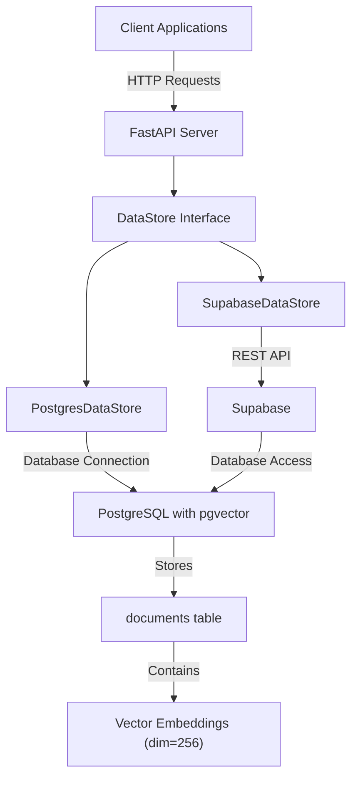
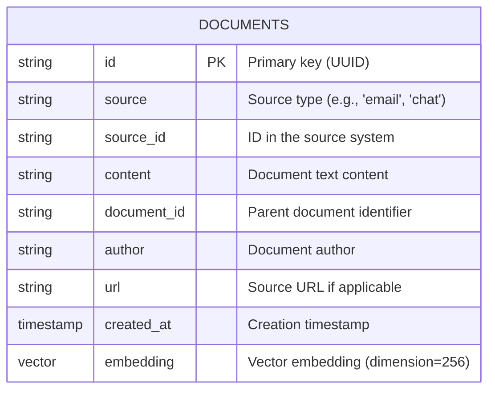
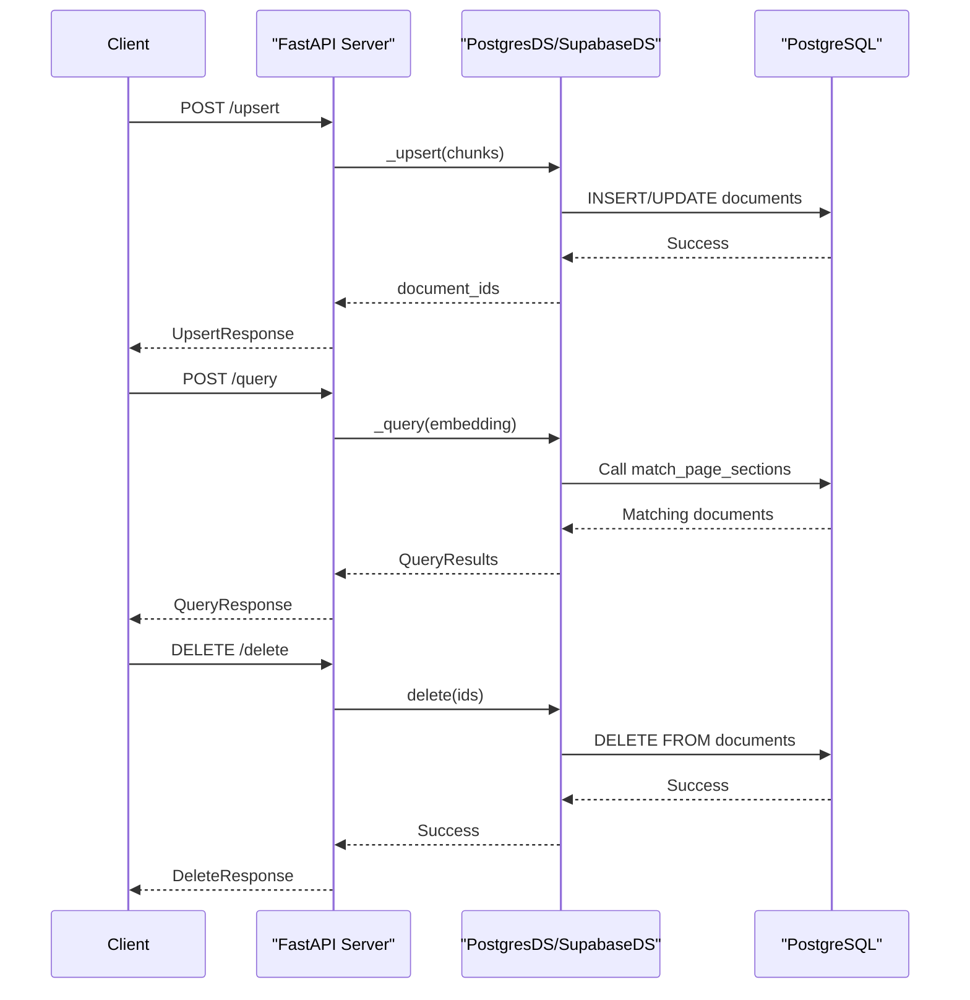

<!-- source: DeepWiki mcp.deepwiki.com · repo openai/chatgpt-retrieval-plugin · page 5.9 PostgreSQL and Supabase · fetched 2026-10-26 -->

# PostgreSQL and Supabase

<details>
<summary>Relevant source files</summary>

The following files were used as context for generating this wiki page:

- [docs/providers/postgres/setup.md](docs/providers/postgres/setup.md)
- [docs/providers/supabase/setup.md](docs/providers/supabase/setup.md)
- [examples/providers/supabase/.gitignore](examples/providers/supabase/.gitignore)
- [examples/providers/supabase/config.toml](examples/providers/supabase/config.toml)
- [examples/providers/supabase/migrations/20230414142107_init_pg_vector.sql](examples/providers/supabase/migrations/20230414142107_init_pg_vector.sql)
- [tests/datastore/providers/postgres/test_postgres_datastore.py](tests/datastore/providers/postgres/test_postgres_datastore.py)
- [tests/datastore/providers/supabase/test_supabase_datastore.py](tests/datastore/providers/supabase/test_supabase_datastore.py)

</details>


This document describes the PostgreSQL and Supabase vector database integrations for the ChatGPT Retrieval Plugin. Both integrations leverage the pgvector extension to enable efficient storage and retrieval of vector embeddings for semantic search capabilities.

## Technical Overview

Both PostgreSQL and Supabase (which is built on PostgreSQL) are used as vector database providers in the ChatGPT Retrieval Plugin through the `pgvector` extension. This extension allows storing and querying embedding vectors efficiently, enabling semantic search through similarity calculations.

### Integration Architecture



Sources: docs/providers/postgres/setup.md, docs/providers/supabase/setup.md

The key components in this architecture:

1. **PostgresDataStore**: Implements the DataStore interface for direct PostgreSQL connections
2. **SupabaseDataStore**: Implements the DataStore interface for Supabase, which provides a REST API on top of PostgreSQL
3. **pgvector extension**: Enables vector operations in PostgreSQL database

## Database Schema

Both PostgreSQL and Supabase implementations use the same database schema created by a migration script:



Sources: examples/providers/supabase/migrations/20230414142107_init_pg_vector.sql:3-14

The database includes several B-tree indexes for efficient filtering:
- `ix_documents_document_id`
- `ix_documents_source`
- `ix_documents_source_id`
- `ix_documents_author`
- `ix_documents_created_at` (BRIN index)

Sources: examples/providers/supabase/migrations/20230414142107_init_pg_vector.sql:15-19

## Core Operations

The PostgreSQL and Supabase datastores implement the three core operations required by the DataStore interface:



Sources: 
- tests/datastore/providers/postgres/test_postgres_datastore.py:60-104
- tests/datastore/providers/supabase/test_supabase_datastore.py:60-104

### Vector Similarity Search Implementation

Both implementations use a stored procedure called `match_page_sections` that performs vector similarity search using the inner product operator (`<#>`). This function accepts the query embedding vector and various filtering parameters:

```sql
create or replace function match_page_sections(
    in_embedding vector(256),
    in_match_count int default 3,
    in_document_id text default '%%',
    in_source_id text default '%%',
    in_source text default '%%',
    in_author text default '%%',
    in_start_date timestamptz default '-infinity',
    in_end_date timestamptz default 'infinity'
)
-- Function body includes filtering and ordering by embedding similarity
```

Sources: examples/providers/supabase/migrations/20230414142107_init_pg_vector.sql:23-69

## PostgreSQL Integration

### Requirements and Setup

To use PostgreSQL as a vector database provider:

1. A PostgreSQL database with pgvector extension enabled
2. Applied database migrations to create the necessary tables and functions
3. Configured environment variables for database connection

### Environment Variables

| Name          | Required | Description       | Default    |
|---------------|----------|-------------------|------------|
| `DATASTORE`   | Yes      | Set to `postgres` |            |
| `PG_HOST`     | Optional | PostgreSQL host   | localhost  |
| `PG_PORT`     | Optional | PostgreSQL port   | 5432       |
| `PG_PASSWORD` | Optional | PostgreSQL password | postgres |
| `PG_USER`     | Optional | PostgreSQL username | postgres |
| `PG_DB`       | Optional | PostgreSQL database | postgres |

Sources: docs/providers/postgres/setup.md:8-24

### Local Development and Testing

For local PostgreSQL development:

1. Run PostgreSQL with pgvector using Docker:
```bash
docker pull ankane/pgvector
docker run --name pgvector -e POSTGRES_PASSWORD=mysecretpassword -d postgres
```

2. Apply the required migrations:
```bash
psql -h localhost -p 5432 -U postgres -d postgres -f examples/providers/supabase/migrations/20230414142107_init_pg_vector.sql
```

3. Configure environment variables and run tests:
```bash
export PG_HOST=localhost
export PG_PORT=5432
export PG_PASSWORD=mysecretpassword
poetry run pytest -s ./tests/datastore/providers/postgres/test_postgres_datastore.py
```

Sources: docs/providers/postgres/setup.md:26-63

## Supabase Integration

### Requirements and Setup

Supabase is a development platform built on PostgreSQL that provides additional features like authentication, storage, and APIs. For the ChatGPT Retrieval Plugin, it uses the same pgvector backend but accessed through Supabase's API.

### Environment Variables

| Name                        | Required | Description                                                   | Default |
|-----------------------------|----------|---------------------------------------------------------------|---------|
| `DATASTORE`                 | Yes      | Set to `supabase`                                             |         |
| `SUPABASE_URL`              | Yes      | Supabase Project URL                                          |         |
| `SUPABASE_ANON_KEY`         | Optional | Supabase Project API anon key                                 |         |
| `SUPABASE_SERVICE_ROLE_KEY` | Optional | Supabase Project API service key (used instead of anon key if provided) |         |

Sources: docs/providers/supabase/setup.md:9-23

### Local Development and Testing

For local Supabase development:

1. Install Supabase CLI and Docker
2. Run Supabase locally:
```bash
cd examples/providers
supabase start
```

3. Configure environment variables with the provided credentials and run tests:
```bash
export SUPABASE_URL=http://localhost:54321
export SUPABASE_SERVICE_ROLE_KEY='eyJhbGciOiJIUzI1NiIsInR5cCI6IkpXVCJ9...'
poetry run pytest -s ./tests/datastore/providers/supabase/test_supabase_datastore.py
```

Sources: 
- docs/providers/supabase/setup.md:25-69
- examples/providers/supabase/config.toml

## Performance Optimization

Both PostgreSQL and Supabase implementations can benefit from proper indexing to improve vector search performance, especially with large datasets.

### Indexing for Vector Search

By default, pgvector performs exact nearest neighbor search, which can be slow with large datasets. For production use with significant data volumes, you should add an index to the `embedding` column:

```sql
create index on documents using ivfflat (embedding vector_ip_ops) with (lists = 100);
```

Guidelines for choosing the `lists` parameter:
- For up to 1M records: records / 1000
- For over 1M records: sqrt(records)

Only add this index after you have inserted a few thousand records.

Sources: 
- docs/providers/postgres/setup.md:69-81
- docs/providers/supabase/setup.md:75-87

### Row-Level Security Considerations

Both integrations can leverage PostgreSQL's Row-Level Security (RLS) for multi-tenant applications:

- For PostgreSQL: RLS is enabled by default in the migration script (`alter table documents enable row level security;`). You may remove this if not needed.
- For Supabase: If using client-side access, consider adding appropriate RLS policies to secure your data.

Sources: 
- docs/providers/postgres/setup.md:67
- docs/providers/supabase/setup.md:73
- examples/providers/supabase/migrations/20230414142107_init_pg_vector.sql:21

---

