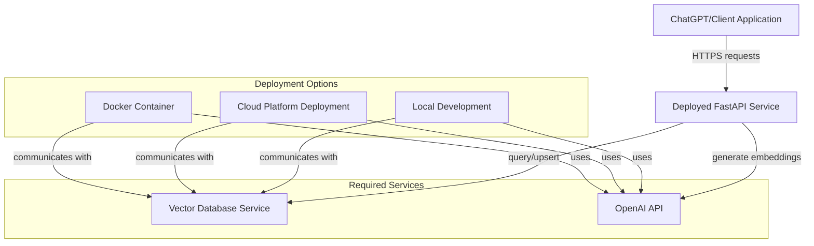
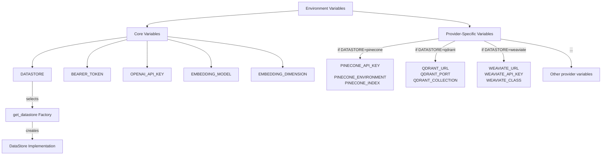
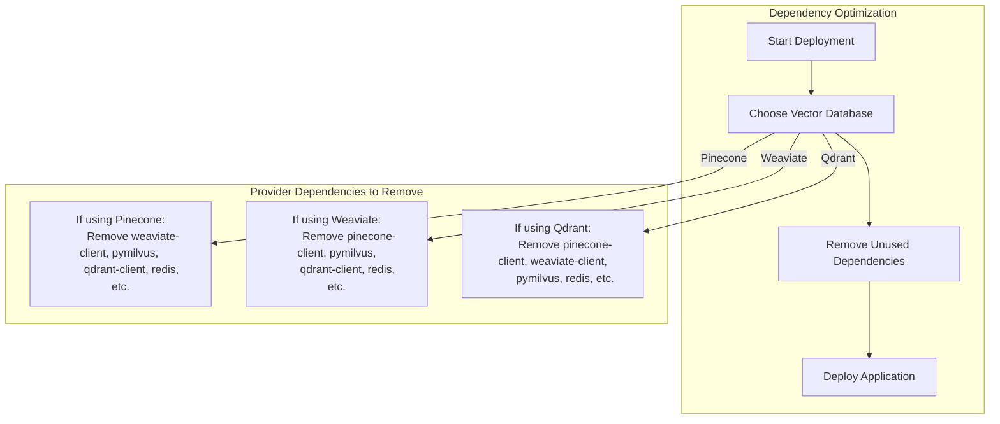
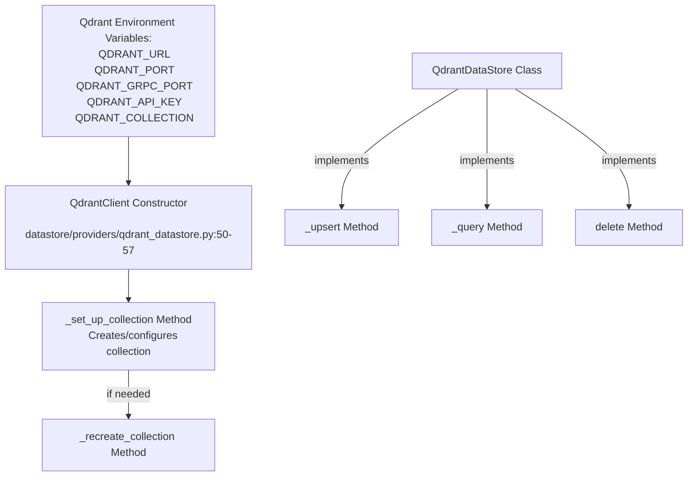
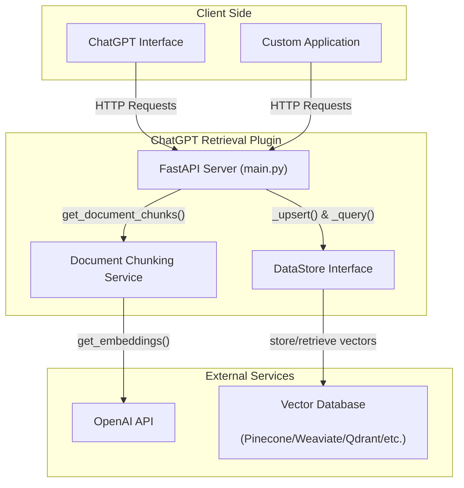
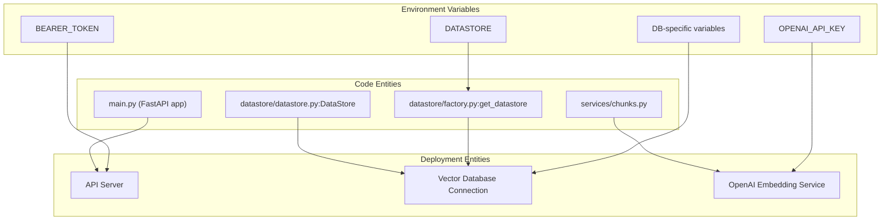

<!-- source: DeepWiki mcp.deepwiki.com · repo openai/chatgpt-retrieval-plugin · page 6 Deployment · fetched 2026-10-26 -->

# Deployment

<details>
<summary>Relevant source files</summary>

The following files were used as context for generating this wiki page:

- [.dockerignore](.dockerignore)
- [.gitignore](.gitignore)
- [.well-known/openapi.yaml](.well-known/openapi.yaml)
- [datastore/providers/qdrant_datastore.py](datastore/providers/qdrant_datastore.py)
- [docs/deployment/removing-unused-dependencies.md](docs/deployment/removing-unused-dependencies.md)
- [examples/memory/README.md](examples/memory/README.md)

</details>


This document provides comprehensive guidance on deploying the ChatGPT Retrieval Plugin. It covers configuration requirements, deployment options, and optimization techniques to ensure a successful deployment.

## Overview of Deployment Options

The ChatGPT Retrieval Plugin can be deployed in several ways, with Docker being the recommended approach for most production environments. The deployment process involves setting up environment variables, configuring a vector database, and making the API accessible for ChatGPT.



Sources: [.dockerignore](), [datastore/providers/qdrant_datastore.py:50-57]()

## Prerequisites

Before deploying the ChatGPT Retrieval Plugin, ensure you have:

1. An OpenAI API key with access to embeddings
2. A vector database instance (Pinecone, Weaviate, Qdrant, etc.)
3. Docker (for containerized deployment)
4. A publicly accessible HTTPS endpoint (for ChatGPT integration)

## Environment Configuration

The plugin uses environment variables for configuration. Below are the essential variables required:

| Environment Variable | Description | Example Value |
|----------------------|-------------|---------------|
| `DATASTORE` | Vector database provider | `pinecone`, `weaviate`, `qdrant`, etc. |
| `BEARER_TOKEN` | Authentication token for API security | `your-secret-token` |
| `OPENAI_API_KEY` | API key for OpenAI services | `sk-...` |
| `EMBEDDING_MODEL` | OpenAI embedding model | `text-embedding-ada-002` |
| `EMBEDDING_DIMENSION` | Dimension of embeddings | `1536` |

Additionally, each vector database provider requires specific environment variables:



Sources: [datastore/providers/qdrant_datastore.py:23-29]()

## Docker Deployment

Docker is the recommended deployment method for production environments:

1. **Build the Docker image**:
   ```bash
   docker build -t chatgpt-retrieval-plugin .
   ```

2. **Run the container with environment variables**:
   ```bash
   docker run -p 8000:8000 --env-file .env chatgpt-retrieval-plugin
   ```

The `.dockerignore` file ensures that unnecessary files are excluded from the Docker image to keep it lightweight.

Sources: [.dockerignore]()

## Optimizing Dependencies

Before deployment, you can optimize the application by removing unused vector database dependencies based on your chosen provider:



Sources: [docs/deployment/removing-unused-dependencies.md:3-20]()

For example, if using Pinecone, you can remove these dependencies from `pyproject.toml`:
- weaviate-client
- pymilvus
- qdrant-client
- redis
- chromadb
- llama-index
- azure-identity
- azure-search-documents
- supabase
- psycopg2+pgvector
- psycopg2cffi

After removing these dependencies, the Dockerfile will handle the installation of the remaining required packages.

Sources: [docs/deployment/removing-unused-dependencies.md:7]()

## Connecting to Vector Databases

The `DataStore` implementation is selected based on the `DATASTORE` environment variable. Each implementation requires specific configuration:

### Qdrant Example



Sources: [datastore/providers/qdrant_datastore.py:32-62](), [datastore/providers/qdrant_datastore.py:245-299]()

## OpenAPI Configuration

The plugin requires proper OpenAPI configuration for integration with ChatGPT:

1. Update the `servers.url` field in `.well-known/openapi.yaml` to your deployment URL
2. Ensure the BEARER_TOKEN is properly set for authentication

```yaml
# Example from .well-known/openapi.yaml
servers:
  - url: https://your-app-url.com
```

Sources: [.well-known/openapi.yaml:6-8]()

## Deployment Architecture

The complete deployment architecture connects all components as follows:



Sources: [datastore/providers/qdrant_datastore.py](), [.well-known/openapi.yaml]()

## Code to Deployment Mapping

The following diagram maps key code entities to deployment components:



## Memory Support Integration

To enable ChatGPT to save information from conversations (memory):

1. Deploy the plugin with both query and upsert endpoints available
2. Configure the custom GPT to access both endpoints
3. Copy the OpenAPI specification from examples/memory/openapi.yaml to your custom GPT configuration

Sources: [examples/memory/README.md:1-14]()

## Troubleshooting Deployment Issues

Common deployment issues include:

1. **Connection issues to vector databases**: Verify environment variables and network connectivity
2. **Authentication failures**: Check `BEARER_TOKEN` and `OPENAI_API_KEY` validity
3. **Missing dependencies**: Ensure correct dependencies are installed for your chosen vector database
4. **OpenAPI configuration errors**: Verify the OpenAPI specification and server URL

## Security Considerations

When deploying the plugin, consider these security measures:

1. Use a strong, randomly generated `BEARER_TOKEN`
2. Never expose sensitive environment variables in client-side code
3. Implement proper rate limiting and monitoring
4. Use HTTPS for all communication

---

