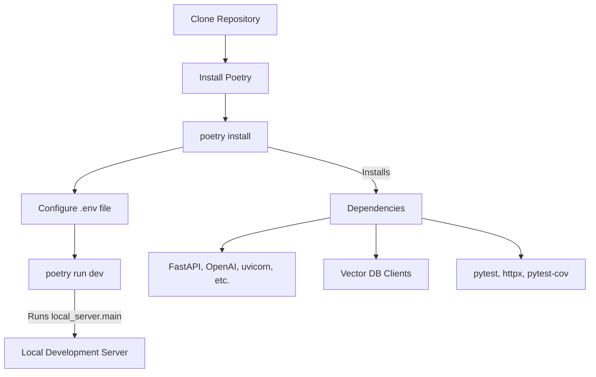
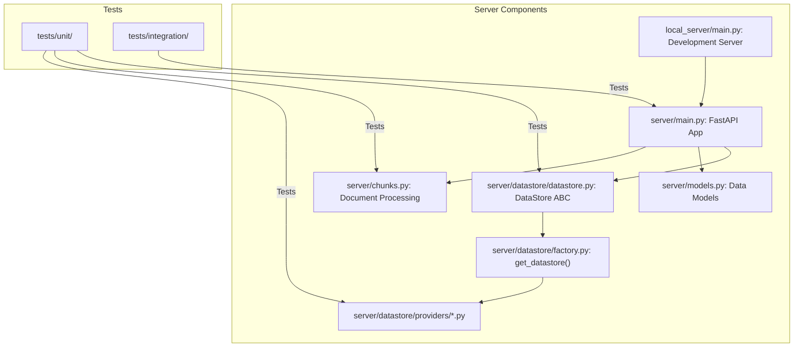
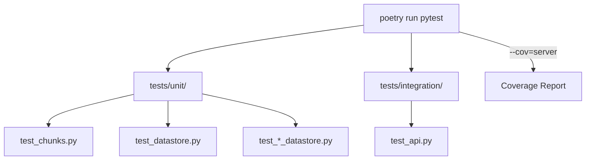
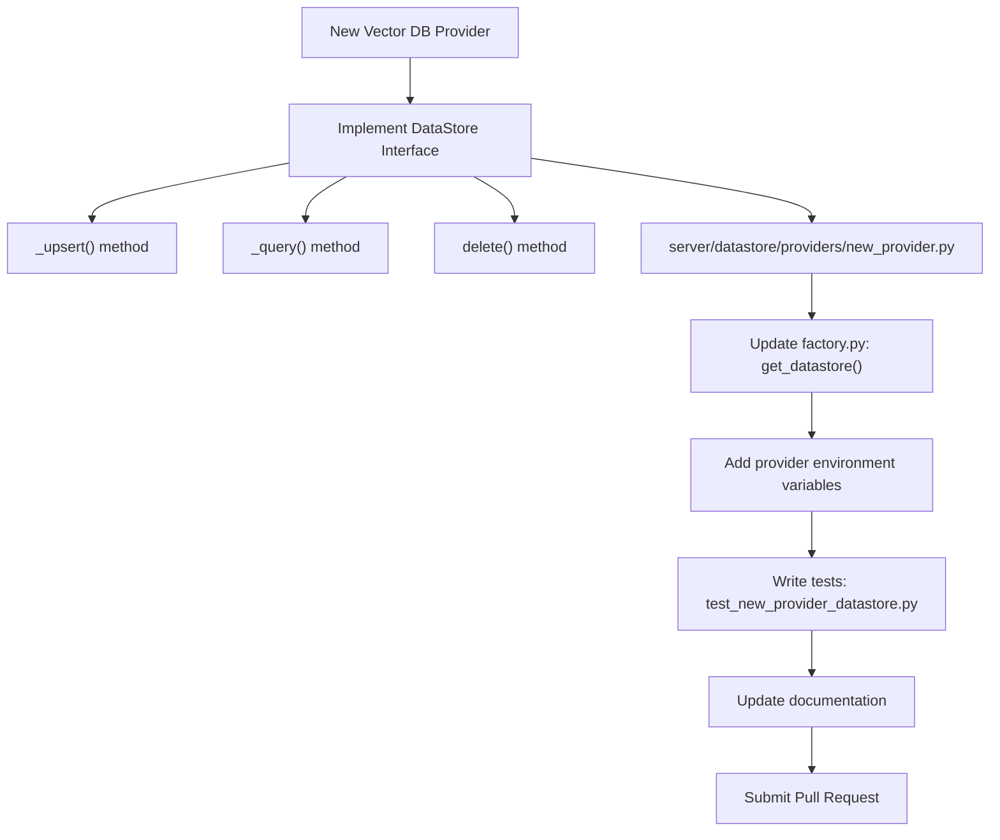
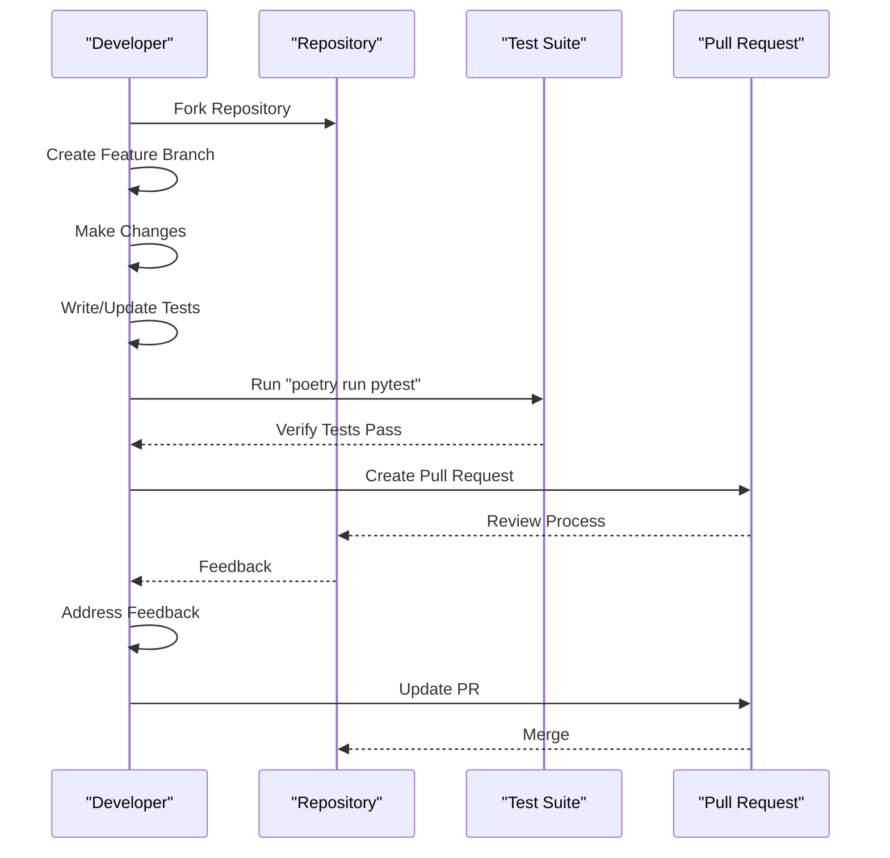

<!-- source: DeepWiki mcp.deepwiki.com · repo openai/chatgpt-retrieval-plugin · page 7 Development and Contributing · fetched 2026-10-26 -->

# Development and Contributing

<details>
<summary>Relevant source files</summary>

The following files were used as context for generating this wiki page:

- [poetry.lock](poetry.lock)
- [pyproject.toml](pyproject.toml)

</details>


This document provides guidance for developers who want to contribute to the ChatGPT Retrieval Plugin project. It covers environment setup, testing practices, and contribution guidelines. For information about deploying the plugin, see [Deployment](#6).

## Setting Up the Development Environment

The project uses Poetry for dependency management and Python 3.10+ for development.



### Prerequisites

- Python 3.10+
- Poetry package manager

### Installation Steps

1. **Clone the repository**:
   ```bash
   git clone https://github.com/openai/chatgpt-retrieval-plugin.git
   cd chatgpt-retrieval-plugin
   ```

2. **Install dependencies**:
   ```bash
   poetry install
   ```

3. **Configure environment variables**:
   Create a `.env` file with the necessary configuration:
   ```
   DATASTORE=pinecone  # Or another supported provider
   BEARER_TOKEN=your_bearer_token
   OPENAI_API_KEY=your_openai_api_key
   # Provider-specific variables
   ```

4. **Run the development server**:
   ```bash
   poetry run dev
   ```

Sources: [pyproject.toml:9-45]()

## Project Structure

The project follows a modular architecture with clear separation of concerns:



### Key Files for Contributors

| Component | File Path | Purpose |
|-----------|-----------|---------|
| API Server | `server/main.py` | FastAPI application with endpoints |
| Data Models | `server/models.py` | Pydantic models for request/response |
| Document Processing | `server/chunks.py` | Text chunking and embedding |
| DataStore Interface | `server/datastore/datastore.py` | Abstract base class for providers |
| Provider Factory | `server/datastore/factory.py` | Selects provider implementation |
| Provider Implementations | `server/datastore/providers/*.py` | Vector DB integrations |
| Development Server | `local_server/main.py` | Local development entrypoint |

Sources: Repository structure based on architecture diagrams

## Testing

The project uses pytest for testing with separate unit and integration test suites.



### Running Tests

```bash
# Run all tests
poetry run pytest

# Run with coverage report
poetry run pytest --cov=server

# Run specific test file
poetry run pytest tests/unit/test_chunks.py
```

The test configuration is defined in the pyproject.toml file, which sets up the Python path and configures asyncio mode for testing async components.

Sources: [pyproject.toml:49-63]()

## Contributing a New Vector Database Provider

A common contribution is adding support for a new vector database. This involves implementing the `DataStore` abstract base class:



### Implementation Steps

1. Create a new file in `server/datastore/providers/` (e.g., `new_provider.py`)
2. Implement a class that extends the `DataStore` abstract base class
3. Implement the required methods:
   - `_upsert()`: Store document chunks with embeddings
   - `_query()`: Perform vector similarity search
   - `delete()`: Remove documents from storage
4. Update `server/datastore/factory.py` to include your provider in the selection logic
5. Add provider-specific environment variables
6. Write tests in `tests/unit/`
7. Update documentation to include setup instructions for your provider

For example implementations, review existing providers like PineconeDataStore or WeaviateDataStore in the providers directory.

Sources: Repository architecture and [DataStore System](#4)

## Contribution Workflow



### Pull Request Process

1. **Fork the repository** and create a feature branch
2. **Make your changes** following the code conventions
3. **Add tests** for new functionality
4. **Ensure all tests pass** locally
5. **Submit a pull request** with a clear description of changes
6. **Address feedback** from reviewers promptly

## Dependency Management

The project uses Poetry for dependency management. Dependencies are defined in `pyproject.toml`:

```bash
# Add a runtime dependency
poetry add package-name

# Add a development dependency
poetry add --group dev package-name
```

### Core Dependencies

The project depends on several key libraries:

| Category | Key Dependencies |
|------------|---------|
| Web Framework | FastAPI, uvicorn, python-multipart |
| AI/ML | openai, tiktoken, numpy |
| Document Processing | PyPDF2, docx2txt, python-pptx |
| Vector Databases | pinecone-client, weaviate-client, chromadb, redis, etc. |
| Development | pytest, pytest-cov, pytest-asyncio, httpx |

Sources: [pyproject.toml:9-41](), [pyproject.toml:49-53]()

## Code Conventions

The project follows these conventions:

1. **Type Annotations**: Use Python type hints for function parameters and return values
2. **Docstrings**: Document classes and functions with clear, descriptive docstrings
3. **Error Handling**: Use appropriate exception handling with meaningful error messages
4. **Testing**: Maintain high test coverage for new and modified code
5. **Environment Variables**: Use environment variables for configuration

## Development Scripts

The project defines several useful scripts in `pyproject.toml`:

| Script | Command | Purpose |
|--------|---------|---------|
| Start production server | `poetry run start` | Runs `server.main:start` |
| Start development server | `poetry run dev` | Runs `local_server.main:start` |

Sources: [pyproject.toml:42-44]()