# Page: Overview

# Overview

<details>
<summary>Relevant source files</summary>

The following files were used as context for generating this wiki page:

- [README.md](README.md)
- [services/chunks.py](services/chunks.py)

</details>


The ChatGPT Retrieval Plugin is a standalone retrieval backend that enables ChatGPT to search and retrieve information from personal or organizational documents. It serves as a flexible solution for semantic search using natural language queries, allowing models to access user-provided documents and generate responses informed by this context.

For detailed information about system architecture and components, see [Architecture](#2). For specifics about how documents are processed, see [Document Processing Pipeline](#2.1).

## System Architecture

The ChatGPT Retrieval Plugin employs a modular architecture that separates concerns between document processing, embedding generation, and vector storage.

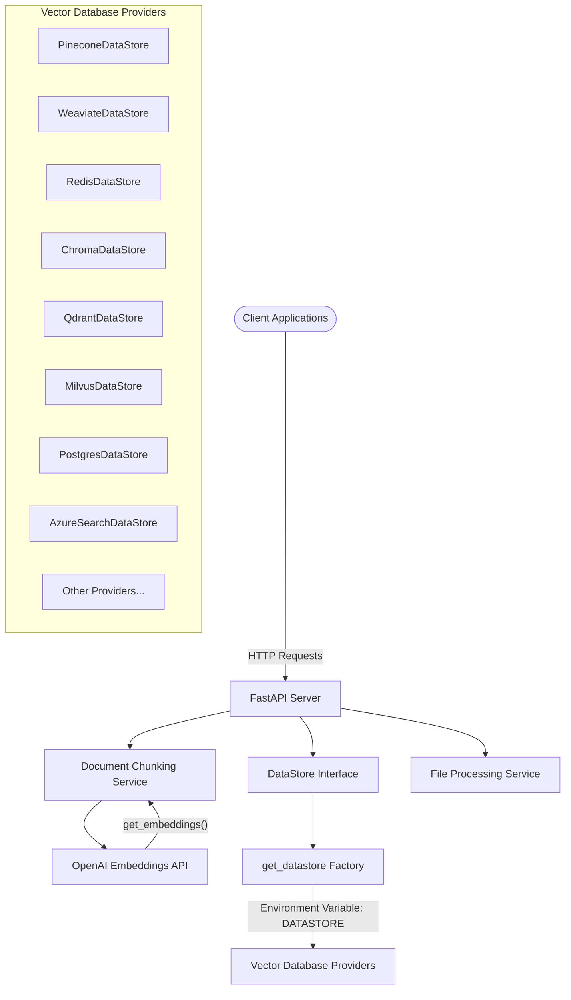

The system consists of three primary components:

1. **FastAPI Server**: Handles HTTP requests and exposes API endpoints for document management and queries
2. **Document Chunking Service**: Processes documents by splitting them into manageable chunks and generating embeddings
3. **DataStore Interface**: Provides a unified way to interact with various vector database providers

Sources: [README.md:6-13](), [server/main.py]()

## Core Workflows

The plugin supports two primary workflows: document ingestion (upsert) and semantic search (query).

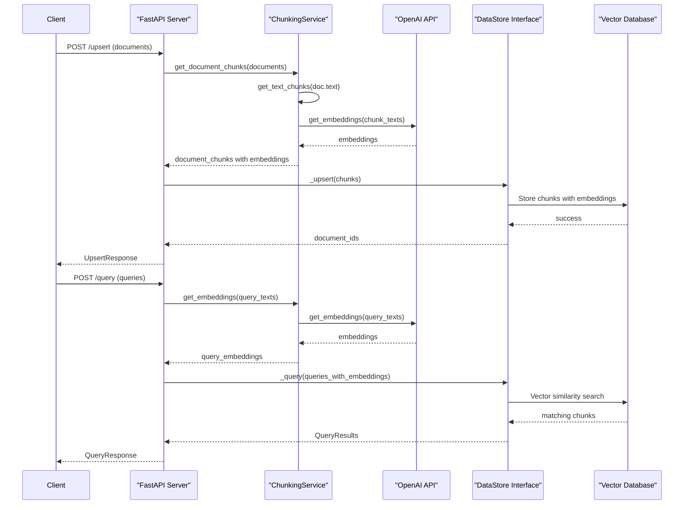

### Document Upsert Process
1. Client submits documents through the `/upsert` endpoint
2. Documents are split into chunks of approximately 200 tokens
3. OpenAI's embedding model generates vector representations for each chunk
4. Chunks with embeddings are stored in the selected vector database

### Query Process
1. Client submits natural language queries through the `/query` endpoint
2. Queries are converted to embeddings using the same model
3. Vector similarity search identifies the most relevant document chunks
4. Results are returned to the client, optionally filtered by metadata

Sources: [services/chunks.py:152-205](), [README.md:257-272]()

## Document Processing Pipeline

The document processing pipeline transforms raw text into searchable vector representations:

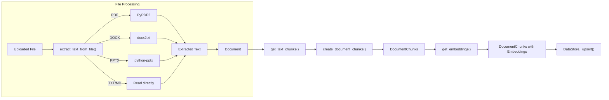

Key components of the chunking process:
- `get_text_chunks()`: Splits documents into chunks of ~200 tokens based on natural breakpoints like periods
- `create_document_chunks()`: Assigns unique IDs and metadata to each chunk
- `get_document_chunks()`: Orchestrates the entire process for multiple documents and handles embedding generation

Sources: [services/chunks.py:25-99](), [services/chunks.py:102-149]()

## Data Store System

The plugin employs a provider pattern through the DataStore interface to support multiple vector databases:

```mermaid
graph TD
    DSI["DataStore Interface"] --> Pinecone["PineconeDataStore"]
    DSI --> Weaviate["WeaviateDataStore"]
    DSI --> Redis["RedisDataStore"]
    DSI --> Chroma["ChromaDataStore"]
    DSI --> Qdrant["QdrantDataStore"]
    DSI --> Milvus["MilvusDataStore"]
    DSI --> Postgres["PostgresDataStore"]
    DSI --> AzureSearch["AzureSearchDataStore"]
    DSI --> Others["Other DataStores..."]
    
    Factory["get_datastore() Factory"] --> |"DATASTORE env var"| DSI
    
    subgraph "Common Interface Methods"
        Upsert["_upsert()"]
        Query["_query()"]
        Delete["delete()"]
    end
    
    DSI --- "Common Interface Methods"
```

All datastore implementations share a common interface with methods:
- `_upsert()`: Store document chunks with embeddings
- `_query()`: Search for similar documents using vector similarity
- `delete()`: Remove documents from the database

The active datastore is selected through the `DATASTORE` environment variable.

Sources: [README.md:362-365](), [datastore/datastore.py]()

## API Endpoints

The plugin exposes several REST endpoints through its FastAPI server:

| Endpoint | Method | Purpose | Description |
|----------|--------|---------|-------------|
| `/upsert` | POST | Add documents | Upload text documents to the vector database |
| `/upsert-file` | POST | Add files | Upload files (PDF, DOCX, TXT, etc.) to the vector database |
| `/query` | POST | Search documents | Find relevant document chunks using natural language |
| `/delete` | DELETE | Remove documents | Delete documents by ID or metadata filter |

Each endpoint expects JSON payloads and returns JSON responses, with proper authentication required.

Sources: [README.md:257-272](), [server/main.py]()

## Configuration System

The plugin is configured through environment variables:

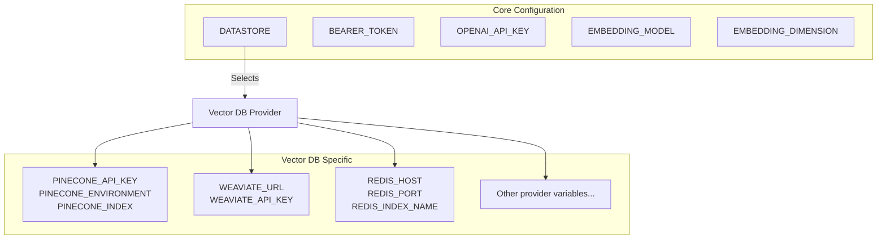

Key configuration variables:
- `DATASTORE`: Specifies which vector database provider to use
- `BEARER_TOKEN`: Authentication token for securing API access
- `OPENAI_API_KEY`: Required for generating embeddings
- `EMBEDDING_MODEL`: The OpenAI model used for embeddings (default: text-embedding-3-large)
- `EMBEDDING_DIMENSION`: Embedding size (default: 256 dimensions)

Additional provider-specific variables configure connection to the selected database.

Sources: [README.md:362-365](), [README.md:80-200]()

## Integration Options

The Retrieval Plugin can be integrated with ChatGPT in several ways:

1. **Custom GPTs**: Create a GPT that uses the plugin for retrieval via the OpenAPI schema
2. **Function Calling**: Use the plugin endpoints as functions in the Chat Completions or Assistants API
3. **Plugins Model (deprecated)**: Use with the older ChatGPT plugins model

The plugin provides a flexible backend for retrieval augmented generation (RAG) patterns, offering more control over embedding dimensions, chunking strategy, and vector database selection than native ChatGPT retrieval.

Sources: [README.md:207-254]()

## Authentication and Security

The plugin supports three authentication methods:

1. **No Authentication**: Open access (suitable only for public documents)
2. **HTTP Bearer Token**: Token-based authentication at user or service level
3. **OAuth**: Third-party authentication flow for higher security

Since the plugin provides access to document content, careful consideration should be given to data privacy and authorization.

Sources: [README.md:281-283](), [README.md:482-495]()

## Embeddings Models

The plugin uses OpenAI's embedding models to generate vector representations:

| Model | Default Dimensions | Adjustable To | Relative Performance |
|-------|-------------------|---------------|---------------------|
| text-embedding-3-large | 3072 | 256-3072 | Highest accuracy |
| text-embedding-3-small | 1536 | 512-1536 | Good balance of cost/accuracy |
| text-embedding-ada-002 | 1536 | 1536 | Legacy model |

The default configuration uses `text-embedding-3-large` with 256 dimensions, which provides a good balance of performance and cost.

Sources: [README.md:284-315]()

---

The ChatGPT Retrieval Plugin bridges the gap between large language models and private document repositories, enabling context-aware responses informed by user-specific content. Its modular architecture and extensive configuration options make it adaptable to a wide range of use cases and deployment scenarios.

---

# Page: Architecture

# Architecture

<details>
<summary>Relevant source files</summary>

The following files were used as context for generating this wiki page:

- [README.md](README.md)
- [poetry.lock](poetry.lock)
- [pyproject.toml](pyproject.toml)
- [services/chunks.py](services/chunks.py)

</details>


This document provides a detailed explanation of the ChatGPT Retrieval Plugin's architecture, components, and data flow. It covers how the system is organized, the relationships between components, and how data moves through the system from ingestion to retrieval. For details about the document processing pipeline specifically, see [Document Processing Pipeline](#2.1).

## System Overview

The ChatGPT Retrieval Plugin is a standalone retrieval backend designed to provide ChatGPT with access to personal or organizational documents through a vector search mechanism. The architecture follows a modular design with clear separation of concerns between API handling, document processing, embedding generation, and vector storage.

### High-Level Architecture Diagram

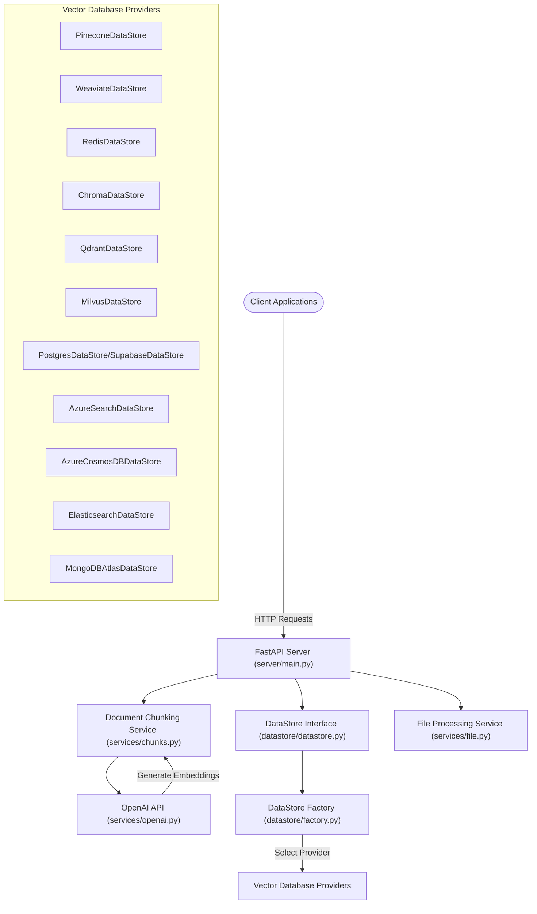

Sources:
- [README.md:10-24]()
- [pyproject.toml:1-64]()

## Core Components

The system architecture consists of these key components:

1. **FastAPI Server**: Entry point for client applications, exposing RESTful endpoints in `server/main.py`.
2. **DataStore Interface**: Abstract interface in `datastore/datastore.py` that provides unified access to different vector databases.
3. **Document Chunking Service**: Implementation in `services/chunks.py` that handles splitting documents into smaller chunks for embedding.
4. **File Processing Service**: Extracts text from various file formats using `services/file.py`.
5. **OpenAI Service**: Interfaces with OpenAI's API to generate embeddings via `services/openai.py`.
6. **DataStore Factory**: Factory pattern implementation in `datastore/factory.py` that selects the appropriate vector database provider.
7. **Vector Database Providers**: Multiple implementations for storing and querying vector embeddings.

## API Endpoints and Data Flow

The system exposes several API endpoints to interact with documents and the vector database.

### API Endpoints

| Endpoint | Method | Description |
|----------|--------|-------------|
| `/upsert` | POST | Add documents to the vector database |
| `/upsert-file` | POST | Upload a file and add its content to the vector database |
| `/query` | POST | Search the vector database for document chunks matching a query |
| `/delete` | DELETE | Remove documents from the vector database |

### Core Data Flow Diagram

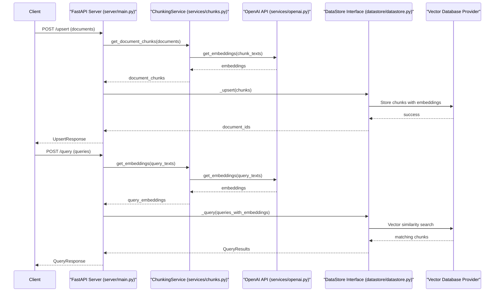

Sources:
- [README.md:256-272]()
- [services/chunks.py:152-205]()

### Document Flow Processes

#### Upsert Flow
1. Client sends documents to the `/upsert` endpoint
2. Server processes documents through the chunking service
3. OpenAI API generates embeddings for each chunk
4. DataStore stores chunks with embeddings in the vector database

#### Query Flow
1. Client sends query to the `/query` endpoint
2. Server gets embeddings for the query from OpenAI
3. DataStore queries the vector database for similar documents
4. Server returns matching document chunks to the client

## DataStore System Architecture

The DataStore system provides a unified interface for interacting with various vector database providers using the adapter pattern.

### DataStore Provider Ecosystem

```mermaid
graph TD
    DSI["DataStore Interface (datastore/datastore.py)"] --> Pinecone["PineconeDataStore"]
    DSI --> Weaviate["WeaviateDataStore"]
    DSI --> Redis["RedisDataStore"]
    DSI --> Chroma["ChromaDataStore"]
    DSI --> Qdrant["QdrantDataStore"]
    DSI --> Milvus["MilvusDataStore"]
    DSI --> Zilliz["ZillizDataStore"]
    DSI --> Postgres["PostgresDataStore"]
    DSI --> Supabase["SupabaseDataStore"]
    DSI --> Azure1["AzureSearchDataStore"]
    DSI --> Azure2["AzureCosmosDBDataStore"]
    DSI --> Elastic["ElasticsearchDataStore"]
    DSI --> MongoDB["MongoDBAtlasDataStore"]
    DSI --> AnalyticDB["AnalyticDBDataStore"]
    
    Factory["get_datastore() (datastore/factory.py)"] --> |"DATASTORE env var"| DSI
    
    subgraph "Common Interface Methods"
        Upsert["_upsert()"]
        Query["_query()"]
        Delete["delete()"]
    end
    
    DSI --- "Common Interface Methods"
```

Sources:
- [README.md:362-447]()
- [pyproject.toml:24-41]()

### DataStore Interface Contract

The `DataStore` abstract base class defines these core methods that all implementations must provide:

```
_upsert(chunks: List[DocumentChunk]) -> List[str]
_query(queries: List[QueryWithEmbedding]) -> List[QueryResult]
delete(filter: Optional[DocumentMetadataFilter] = None, ids: Optional[List[str]] = None) -> bool
```

The `get_datastore()` factory function in `datastore/factory.py` selects the appropriate DataStore implementation based on the `DATASTORE` environment variable, allowing for easy switching between different vector database providers.

## Document Processing

The document processing pipeline is responsible for converting raw documents into embeddings that can be stored and queried efficiently.

### Document Processing Pipeline

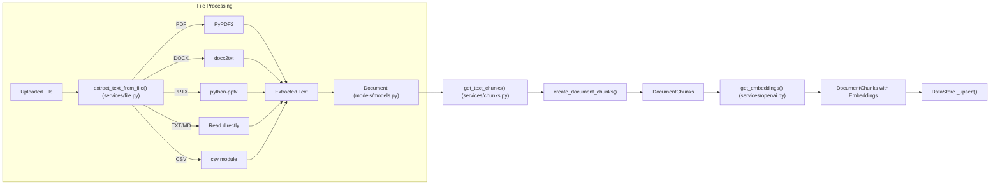

Sources:
- [services/chunks.py:25-205]()
- [README.md:538-545]()

The document processing pipeline consists of these key steps:

1. **Text Extraction**: Convert files of various formats to plain text
2. **Text Chunking**: Split documents into manageable chunks using `get_text_chunks()`
3. **Chunk Creation**: Create `DocumentChunk` objects with metadata using `create_document_chunks()`
4. **Embedding Generation**: Generate vector embeddings for each chunk using OpenAI's API
5. **Storage**: Store chunks with their embeddings in the selected vector database

### Chunking Configuration

The chunking process is configured with these parameters in `services/chunks.py`:

```python
CHUNK_SIZE = 200  # Target size of each text chunk in tokens
MIN_CHUNK_SIZE_CHARS = 350  # Minimum size of each text chunk in characters
MIN_CHUNK_LENGTH_TO_EMBED = 5  # Discard chunks shorter than this
EMBEDDINGS_BATCH_SIZE = int(os.environ.get("OPENAI_EMBEDDING_BATCH_SIZE", 128))
```

The chunking algorithm in `get_text_chunks()` attempts to split text at natural boundaries like periods and line breaks while maintaining semantic coherence.

Sources:
- [services/chunks.py:10-23]()

## Configuration and Environment Variables

The plugin is configured through environment variables, with core settings controlling overall behavior and provider-specific variables configuring the connection to different vector databases.

### Configuration Hierarchy

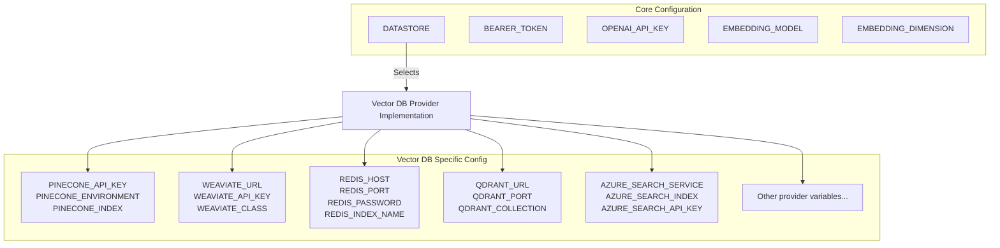

Sources:
- [README.md:82-200]()
- [README.md:362-366]()

### Essential Environment Variables

| Variable | Purpose | Default |
|----------|---------|---------|
| `DATASTORE` | Selects vector database provider | Required |
| `BEARER_TOKEN` | Authentication token for API requests | Required |
| `OPENAI_API_KEY` | API key for OpenAI services | Required |
| `EMBEDDING_MODEL` | Model for embeddings | "text-embedding-3-large" |
| `EMBEDDING_DIMENSION` | Dimension of embeddings | 256 |

Each vector database provider requires its own set of environment variables. The complete list can be found in [README.md:82-200]().

## Authentication Methods

The plugin supports multiple authentication methods:

1. **No Authentication**: Open access without credentials
2. **HTTP Bearer Token**: Authentication using a secret token
   - **User Level (default)**: Each user provides their own token
   - **Service Level**: A single token for all users
3. **OAuth**: Authentication via third-party OAuth provider

The default implementation uses User Level HTTP Bearer Token authentication, where the token is specified in the `BEARER_TOKEN` environment variable.

Sources:
- [README.md:482-497]()

## Summary

The ChatGPT Retrieval Plugin architecture provides a flexible and extensible system for semantic search and retrieval of personal or organizational documents. The key architectural patterns employed include:

1. **Adapter Pattern**: The DataStore interface provides a unified way to interact with various vector database implementations
2. **Factory Pattern**: The get_datastore function selects the appropriate DataStore implementation
3. **Service Layer**: Separate services handle document chunking, embedding, and file processing
4. **RESTful API**: A FastAPI server exposes endpoints for document management and querying

This modular design allows the system to be easily extended with new vector database providers and ensures a clean separation of concerns between the different components.

---

# Page: Document Processing Pipeline

# Document Processing Pipeline

<details>
<summary>Relevant source files</summary>

The following files were used as context for generating this wiki page:

- [README.md](README.md)
- [services/chunks.py](services/chunks.py)
- [services/file.py](services/file.py)

</details>


The Document Processing Pipeline is a core component of the ChatGPT Retrieval Plugin that handles the ingestion, processing, and vectorization of documents. This pipeline transforms raw document data from various formats into semantically searchable vector representations stored in a vector database. This page explains the pipeline's architecture, components, and the flow of data through the system.

For information about storing these processed documents in various vector databases, see [DataStore System](#4).

## Pipeline Overview

The Document Processing Pipeline consists of several key stages that work together to process documents for semantic search:

1. **File Processing** - Extracting text from various file formats (PDF, DOCX, etc.)
2. **Document Chunking** - Splitting documents into manageable chunks for embedding
3. **Embedding Generation** - Generating vector embeddings for each chunk
4. **Vector Storage** - Storing the chunks with their embeddings in a vector database

### Document Processing Pipeline Flow

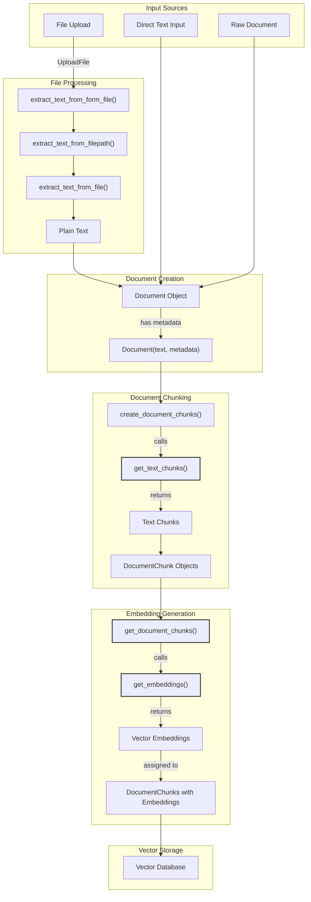

Sources: [services/chunks.py:25-99](), [services/chunks.py:102-149](), [services/chunks.py:152-205](), [services/file.py:15-118]()

## File Processing

The first stage of the pipeline handles the extraction of text content from various file formats. This process converts structured files into plain text that can be further processed for embedding.

### Supported File Formats

The system supports multiple file formats through dedicated extraction methods:

| File Format | MIME Type | Extraction Method |
|-------------|-----------|-------------------|
| PDF | application/pdf | PyPDF2 |
| Plain Text | text/plain | Direct reading |
| Markdown | text/markdown | Direct reading |
| Word Document (DOCX) | application/vnd.openxmlformats-officedocument.wordprocessingml.document | docx2txt |
| CSV | text/csv | csv module |
| PowerPoint (PPTX) | application/vnd.openxmlformats-officedocument.presentationml.presentation | python-pptx |

### File Processing Flow

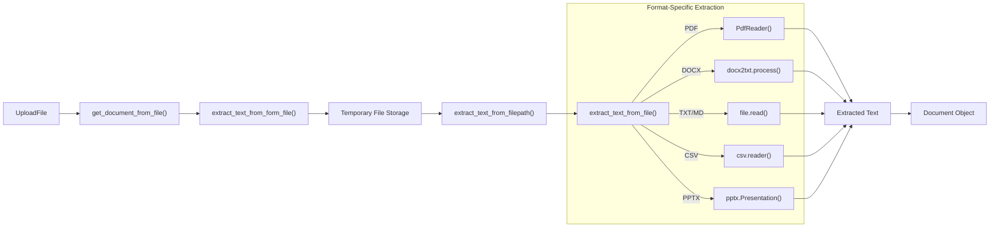

Sources: [services/file.py:15-22](), [services/file.py:25-45](), [services/file.py:48-87](), [services/file.py:91-117]()

The file processing system employs a multi-step approach:

1. For uploaded files, the `get_document_from_file()` function processes the upload
2. The file content is read and temporarily stored
3. Based on the MIME type, the appropriate extraction method is selected
4. Text is extracted and returned as a string
5. A `Document` object is created with the extracted text and provided metadata

This approach provides a unified interface for text extraction across multiple file formats.

## Document Chunking

After extracting text from documents, the pipeline splits the text into smaller chunks for more effective processing and retrieval. This chunking process is crucial for managing large documents and optimizing vector search performance.

### Chunking Constants and Configuration

The chunking system is governed by several constants:

| Constant | Default Value | Description |
|----------|---------------|-------------|
| `CHUNK_SIZE` | 200 | Target size of each text chunk in tokens |
| `MIN_CHUNK_SIZE_CHARS` | 350 | Minimum size of each chunk in characters |
| `MIN_CHUNK_LENGTH_TO_EMBED` | 5 | Minimum length for a chunk to be embedded |
| `EMBEDDINGS_BATCH_SIZE` | 128 | Number of embeddings to request at once |
| `MAX_NUM_CHUNKS` | 10000 | Maximum number of chunks per document |

Sources: [services/chunks.py:10-22]()

### Chunking Strategy

The chunking process uses a sophisticated strategy to create semantically meaningful chunks:

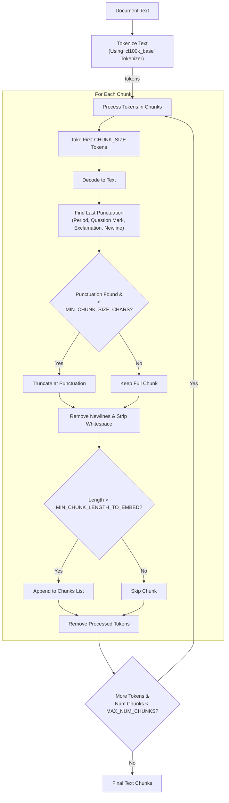

Sources: [services/chunks.py:25-99]()

The chunking strategy:
1. Tokenizes the text using the `cl100k_base` tokenizer
2. Processes tokens in chunks of the target size (`CHUNK_SIZE`)
3. Attempts to break chunks at natural boundaries (periods, question marks, etc.)
4. Ensures chunks meet minimum size requirements
5. Formats chunks by removing newlines and whitespace
6. Continues until all text is processed or the maximum number of chunks is reached

This approach ensures that chunks align with natural language boundaries where possible, improving the quality of subsequent embedding and retrieval.

## Document Chunk Creation

After text chunking, the pipeline creates structured `DocumentChunk` objects that include both text and metadata:

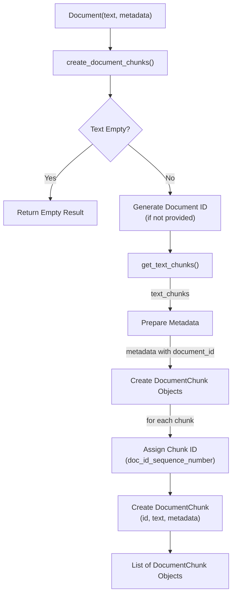

Sources: [services/chunks.py:102-149]()

The `create_document_chunks()` function:
1. Handles empty documents
2. Generates a document ID if not provided
3. Splits text into chunks using `get_text_chunks()`
4. Prepares metadata, ensuring the document ID is included
5. Creates `DocumentChunk` objects for each text chunk
6. Assigns unique IDs to each chunk (combining document ID and sequence number)

The resulting list of `DocumentChunk` objects contains all the text chunks with their associated metadata.

## Embedding Generation

The final processing step is generating vector embeddings for each document chunk. This is handled by the `get_document_chunks()` function, which:

1. Processes a list of documents into document chunks
2. Generates embeddings for all chunks
3. Associates embeddings with their respective chunks

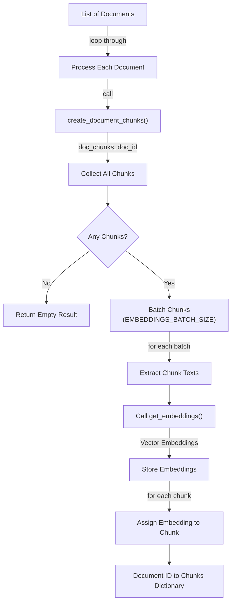

Sources: [services/chunks.py:152-205]()

### Embedding Process Details

The embedding generation process:

1. Collects all document chunks across all documents
2. Processes chunks in batches (determined by `EMBEDDINGS_BATCH_SIZE`)
3. Extracts the text from each chunk in the batch
4. Calls the OpenAI API via `get_embeddings()` to generate vector embeddings
5. Assigns each embedding to its corresponding chunk
6. Returns a dictionary mapping document IDs to their chunks with embeddings

By default, the system uses OpenAI's embedding models to generate embeddings. The specific model and embedding dimension are configurable through environment variables:

```
EMBEDDING_DIMENSION=256  # Default dimension for text-embedding-3-large
EMBEDDING_MODEL="text-embedding-3-large"  # Default embedding model
```

## Integration with DataStore System

Once documents are processed and embedded, the resulting chunks are stored in a vector database through the DataStore system. The choice of vector database is configurable, with multiple providers supported.

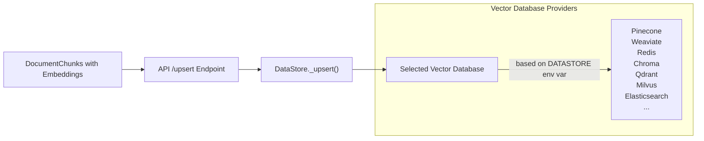

Sources: [README.md:257-272]()

The processed document chunks are passed to the DataStore system, which handles storage in the selected vector database. For details on the DataStore system and supported providers, see [DataStore System](#4) and [Vector Database Providers](#5).

## Query Flow

When a query is received, the system processes it using a similar pipeline to generate embeddings for the query text:

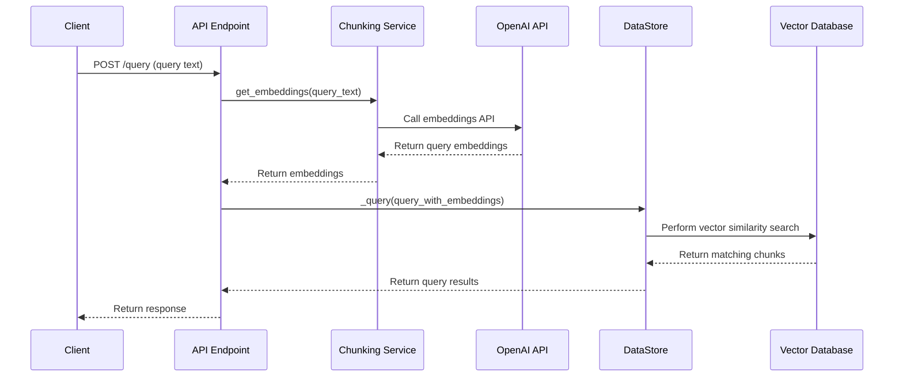

Sources: [README.md:257-272]()

This flow enables semantic search by comparing the embeddings of the query with the stored embeddings of document chunks, returning the most relevant chunks based on vector similarity.

## Summary

The Document Processing Pipeline transforms raw documents into searchable vector representations through a series of steps:

1. **File Processing**: Extracts plain text from various file formats
2. **Document Chunking**: Splits text into semantically meaningful chunks
3. **Embedding Generation**: Converts text chunks into vector embeddings
4. **Vector Storage**: Stores chunks and embeddings in a vector database

This pipeline is a key component of the ChatGPT Retrieval Plugin, enabling efficient semantic search and retrieval of personal or organizational documents.

---

# Page: API Reference

# API Reference

<details>
<summary>Relevant source files</summary>

The following files were used as context for generating this wiki page:

- [README.md](README.md)
- [examples/memory/main.py](examples/memory/main.py)
- [local_server/ai-plugin.json](local_server/ai-plugin.json)
- [local_server/logo.png](local_server/logo.png)
- [local_server/main.py](local_server/main.py)
- [local_server/openapi.yaml](local_server/openapi.yaml)
- [server/main.py](server/main.py)
- [services/chunks.py](services/chunks.py)

</details>


This document provides a comprehensive reference for the API endpoints available in the ChatGPT Retrieval Plugin. The API allows for storing, querying, and managing documents in various vector databases for retrieval during conversations. For information about the underlying architecture, see [Architecture](#2), and for details on the DataStore system that handles vector database interactions, see [DataStore System](#4).

## Overview

The ChatGPT Retrieval Plugin API is a FastAPI-based service that provides endpoints for:

1. Uploading documents and their metadata to a vector database
2. Searching for relevant document chunks using natural language queries
3. Managing stored documents via deletion operations

All API endpoints require authentication using a bearer token.

## Authentication

The API uses HTTP Bearer token authentication. All requests must include the following header:

```
Authorization: Bearer YOUR_BEARER_TOKEN
```

The bearer token is configured through the `BEARER_TOKEN` environment variable when deploying the service.

Sources: [server/main.py:22-30]()

## Endpoint Overview

The following table summarizes the available API endpoints:

| Endpoint | Method | Description |
|----------|--------|-------------|
| `/upsert` | POST | Upload one or more documents to the vector database |
| `/upsert-file` | POST | Upload a single file (PDF, TXT, DOCX, etc.) to the vector database |
| `/query` | POST | Search documents using natural language queries |
| `/delete` | DELETE | Delete documents by ID, metadata filter, or all documents |

Sources: [server/main.py:47-146](), [local_server/main.py:63-138]()

## API Architecture

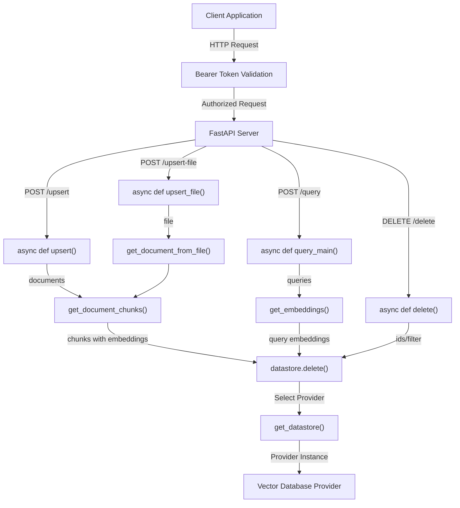

Sources: [server/main.py:32-156](), [examples/memory/main.py:25-183]()

## Document Processing Flow

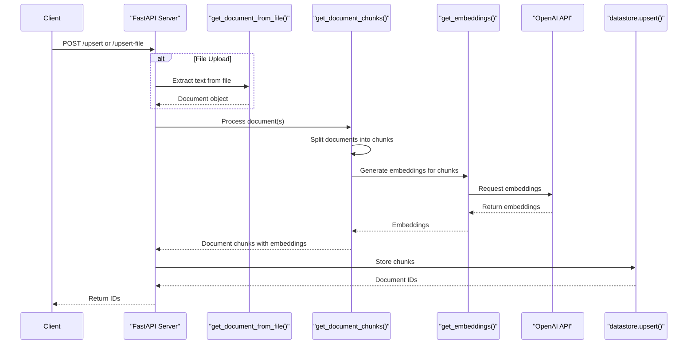

Sources: [services/chunks.py:152-205](), [server/main.py:47-87]()

## Detailed Endpoint Documentation

### `/upsert` Endpoint

**Method**: POST

**Purpose**: Upload one or more documents to the vector database.

**Request Body**:
```json
{
  "documents": [
    {
      "id": "optional-id-1",
      "text": "Document text content",
      "metadata": {
        "source": "file",
        "source_id": "optional-source-id",
        "url": "optional-url",
        "created_at": "optional-timestamp",
        "author": "optional-author"
      }
    }
  ]
}
```

**Response**:
```json
{
  "ids": ["doc-id-1"]
}
```

The document text is chunked into segments of approximately 200 tokens, and each chunk is embedded using OpenAI's embedding model. The chunks and their embeddings are then stored in the vector database.

Sources: [server/main.py:74-87](), [examples/memory/main.py:79-92]()

### `/upsert-file` Endpoint

**Method**: POST

**Purpose**: Upload a single file to the vector database.

**Request Body** (multipart/form-data):
- `file`: The file to upload (PDF, TXT, DOCX, PPTX, or MD)
- `metadata` (optional): JSON string with document metadata

**Response**:
```json
{
  "ids": ["doc-id-1"]
}
```

This endpoint extracts text from the uploaded file, then processes it the same way as the `/upsert` endpoint.

Sources: [server/main.py:47-72](), [examples/memory/main.py:52-76]()

### `/query` Endpoint

**Method**: POST

**Purpose**: Search for relevant document chunks using natural language queries.

**Request Body**:
```json
{
  "queries": [
    {
      "query": "Natural language query",
      "filter": {
        "document_id": "optional-doc-id",
        "source": "optional-source",
        "source_id": "optional-source-id",
        "author": "optional-author",
        "start_date": "optional-start-date",
        "end_date": "optional-end-date"
      },
      "top_k": 3
    }
  ]
}
```

**Response**:
```json
{
  "results": [
    {
      "query": "Natural language query",
      "results": [
        {
          "id": "chunk-id-1",
          "text": "Matching chunk text",
          "metadata": {
            "source": "file",
            "source_id": "source-id",
            "url": "url",
            "created_at": "timestamp",
            "author": "author",
            "document_id": "doc-id-1"
          },
          "score": 0.8
        }
      ]
    }
  ]
}
```

The query text is converted to an embedding using the same model as document chunks, and a similarity search is performed in the vector database. The most similar chunks are returned, ordered by score.

Sources: [server/main.py:89-123](), [examples/memory/main.py:113-148]()

### `/delete` Endpoint

**Method**: DELETE

**Purpose**: Delete documents from the vector database.

**Request Body**:
```json
{
  "ids": ["doc-id-1"],  // Optional: List of document IDs to delete
  "filter": {  // Optional: Metadata filter
    "document_id": "optional-doc-id",
    "source": "optional-source",
    "source_id": "optional-source-id",
    "author": "optional-author",
    "start_date": "optional-start-date",
    "end_date": "optional-end-date"
  },
  "delete_all": false  // Optional: Delete all documents
}
```

**Response**:
```json
{
  "success": true
}
```

At least one of `ids`, `filter`, or `delete_all` must be provided.

Sources: [server/main.py:125-146](), [examples/memory/main.py:151-173]()

## Document Chunking Process

The plugin processes documents by chunking them into smaller segments before embedding and storage. This process is critical for efficient vector search and retrieval.

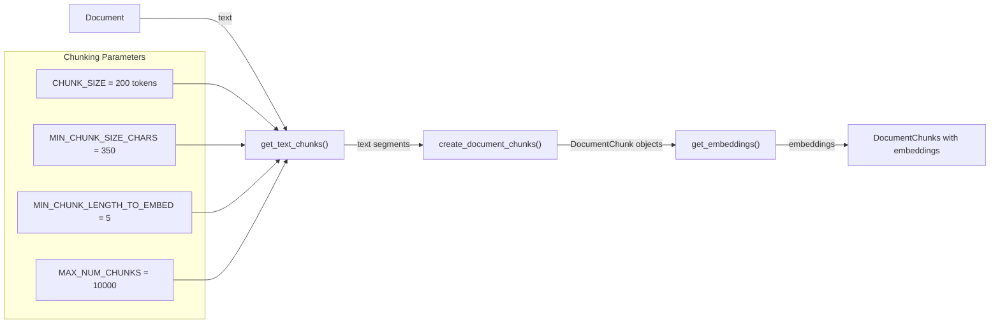

The chunking process follows these steps:

1. Split text into segments of approximately 200 tokens
2. Try to break at natural boundaries (periods, newlines)
3. Ensure chunks are at least 350 characters when possible
4. Discard chunks shorter than 5 characters
5. Limit total chunks to 10,000 per document
6. Generate embeddings for all chunks in batches
7. Assign each chunk a unique ID based on document ID

Sources: [services/chunks.py:1-206]()

## Query Processing Flow

```mermaid
sequenceDiagram
    participant Client
    participant API as "FastAPI Server"
    participant Embed as "get_embeddings()"
    participant OpenAI as "OpenAI API"
    participant DataStore as "datastore.query()"
    
    Client->>API: POST /query with queries
    API->>Embed: Generate embeddings for queries
    Embed->>OpenAI: Request embeddings
    OpenAI-->>Embed: Return embeddings
    Embed-->>API: Query embeddings
    API->>DataStore: Search with embeddings & filters
    DataStore->>DataStore: Perform vector similarity search
    DataStore-->>API: Return matching document chunks
    API-->>Client: QueryResponse with results
```

Sources: [server/main.py:89-123](), [examples/memory/main.py:113-148]()

## Using the API with Custom GPTs or Function Calling

The API can be integrated with:

1. **Custom GPTs**: Through OpenAPI schema configuration in the GPT editor
2. **Function Calling**: Using the Chat Completions or Assistants API

For custom GPTs, you'll need to provide your API endpoint URL and the OpenAPI schema located at `/.well-known/openapi.yaml` on your deployed API.

For function calling, you'll implement functions that make requests to these API endpoints and pass the responses back to the model.

Sources: [README.md:217-254]()

## Error Handling

The API returns standard HTTP status codes:

| Status Code | Description |
|-------------|-------------|
| 400 | Bad Request - Missing required parameters |
| 401 | Unauthorized - Invalid bearer token |
| 422 | Validation Error - Invalid request format |
| 500 | Internal Server Error - Server-side error |

All errors return a JSON response with error details.

Sources: [server/main.py:22-30](), [server/main.py:74-87](), [server/main.py:125-146]()

## Memory Feature

The API can be configured to give ChatGPT "memory" by enabling access to the `/upsert` endpoint in the OpenAPI schema. This allows the model to save information from conversations for later retrieval.

To enable this feature:
1. Replace the main FastAPI server file with the memory-enabled version
2. Use the expanded OpenAPI schema that includes the `/upsert` endpoint
3. Configure your custom GPT to have access to this endpoint

Sources: [examples/memory/main.py:1-183](), [README.md:276-279]()

## OpenAPI Schema

The API's OpenAPI schema is exposed at `/.well-known/openapi.yaml` for the public-facing endpoints and at `/sub/openapi.json` for viewing all endpoints when running locally.

The schema defines all request and response models, examples, and validation rules. It can be used to generate client libraries or documentation in various languages.

Sources: [local_server/openapi.yaml:1-191](), [server/main.py:36-44]()

## Conclusion

The ChatGPT Retrieval Plugin API provides a flexible and powerful interface for semantic search and retrieval of personal or organizational documents. By following RESTful conventions and using JSON for data exchange, it can be easily integrated with a wide range of client applications, including ChatGPT custom GPTs and function calling implementations.

For information on setting up and deploying the API with different vector database providers, see the appropriate sections in the wiki.

---

# Page: DataStore System

# DataStore System

<details>
<summary>Relevant source files</summary>

The following files were used as context for generating this wiki page:

- [datastore/datastore.py](datastore/datastore.py)
- [datastore/factory.py](datastore/factory.py)
- [tests/datastore/providers/mongodb_atlas/test_integration.py](tests/datastore/providers/mongodb_atlas/test_integration.py)
- [tests/datastore/providers/mongodb_atlas/test_mongodb_datastore.py](tests/datastore/providers/mongodb_atlas/test_mongodb_datastore.py)

</details>


## Purpose and Scope

The DataStore System is a foundational component of the ChatGPT Retrieval Plugin that abstracts and standardizes interactions with various vector databases. This document explains the architecture of the DataStore interface, its implementation using the factory pattern, and how it enables the plugin to work with multiple vector database providers. For specific details about individual vector database implementations, see [Vector Database Providers](#5).

## DataStore Interface Architecture

The DataStore system is built around an abstract base class that defines a common interface for all vector database interactions. This design follows the principle of "program to an interface, not an implementation" and enables seamless switching between different vector database providers.

```mermaid
classDiagram
    class DataStore {
        <<Abstract>>
        +upsert(documents, chunk_token_size) List[str]
        +query(queries) List[QueryResult]
        #_upsert(chunks) List[str]*
        #_query(queries_with_embeddings) List[QueryResult]*
        +delete(ids, filter, delete_all) bool*
    }
    
    class PineconeDataStore {
        #_upsert(chunks) List[str]
        #_query(queries_with_embeddings) List[QueryResult]
        +delete(ids, filter, delete_all) bool
    }
    
    class WeaviateDataStore {
        #_upsert(chunks) List[str]
        #_query(queries_with_embeddings) List[QueryResult]
        +delete(ids, filter, delete_all) bool
    }
    
    class RedisDataStore {
        +init() RedisDataStore
        #_upsert(chunks) List[str]
        #_query(queries_with_embeddings) List[QueryResult]
        +delete(ids, filter, delete_all) bool
    }
    
    DataStore <|-- PineconeDataStore
    DataStore <|-- WeaviateDataStore
    DataStore <|-- RedisDataStore
    DataStore <|-- QdrantDataStore
    DataStore <|-- ChromaDataStore
    DataStore <|-- ElasticsearchDataStore
    DataStore <|-- MongoDBAtlasDataStore
    
    class QdrantDataStore {
        #_upsert(chunks) List[str]
        #_query(queries_with_embeddings) List[QueryResult]
        +delete(ids, filter, delete_all) bool
    }
    
    class ChromaDataStore {
        #_upsert(chunks) List[str]
        #_query(queries_with_embeddings) List[QueryResult]
        +delete(ids, filter, delete_all) bool
    }
    
    class ElasticsearchDataStore {
        #_upsert(chunks) List[str]
        #_query(queries_with_embeddings) List[QueryResult]
        +delete(ids, filter, delete_all) bool
    }
    
    class MongoDBAtlasDataStore {
        #_upsert(chunks) List[str]
        #_query(queries_with_embeddings) List[QueryResult]
        +delete(ids, filter, delete_all) bool
    }
```

**Diagram: DataStore Class Hierarchy**

Sources: [datastore/datastore.py:17-86]()

The abstract `DataStore` class defines three core operations:

1. **Upsert**: Insert or update documents in the vector database
2. **Query**: Retrieve documents based on vector similarity to a query
3. **Delete**: Remove documents from the database based on criteria

### Core Methods

The `DataStore` class provides two public methods that handle common pre-processing tasks:

- **upsert()**: Takes full documents, deletes any existing documents with the same IDs, chunks the documents, and calls the provider-specific `_upsert()` method to store the chunks.

- **query()**: Takes a list of queries, generates embeddings for them using the OpenAI API, and calls the provider-specific `_query()` method to perform the similarity search.

### Abstract Methods

Each vector database provider must implement three abstract methods:

- **_upsert()**: Provider-specific implementation for inserting document chunks into the database.
- **_query()**: Provider-specific implementation for performing vector similarity search.
- **delete()**: Provider-specific implementation for removing documents from the database.

Sources: [datastore/datastore.py:44-86]()

## Factory Pattern Implementation

The DataStore system uses the factory pattern to dynamically create instances of the appropriate DataStore implementation based on configuration.

```mermaid
flowchart TB
    subgraph "DataStore Factory Pattern"
        Client["Application Code"] --> Factory["get_datastore()"]
        Factory --> DATASTORE_ENV["DATASTORE Environment Variable"]
        DATASTORE_ENV --> |"chroma"| ChromaDS["ChromaDataStore()"]
        DATASTORE_ENV --> |"pinecone"| PineconeDS["PineconeDataStore()"]
        DATASTORE_ENV --> |"weaviate"| WeaviateDS["WeaviateDataStore()"]
        DATASTORE_ENV --> |"redis"| RedisDS["RedisDataStore.init()"]
        DATASTORE_ENV --> |"qdrant"| QdrantDS["QdrantDataStore()"]
        DATASTORE_ENV --> |"mongodb"| MongoDBDS["MongoDBAtlasDataStore()"]
        DATASTORE_ENV --> |"elasticsearch"| ElasticDS["ElasticsearchDataStore()"]
        DATASTORE_ENV --> |"Other providers..."| OtherDS["Other DataStore implementations"]
        
        ChromaDS & PineconeDS & WeaviateDS & RedisDS & QdrantDS & MongoDBDS & ElasticDS & OtherDS --> DataStoreInterface["DataStore Interface"]
        
        Client -->|"Uses"| DataStoreInterface
    end
```

**Diagram: DataStore Factory Pattern Flow**

Sources: [datastore/factory.py:5-81]()

The factory function `get_datastore()` examines the `DATASTORE` environment variable and returns an instance of the appropriate DataStore implementation. This allows the system to work with different vector databases without modifying the core application code.

### Provider Selection Mechanism

The provider selection logic is straightforward:

1. Read the `DATASTORE` environment variable
2. Match the value to a supported provider
3. Import the corresponding DataStore implementation
4. Instantiate and return the DataStore object

If the specified provider is not supported, the factory throws a `ValueError` with a list of supported options.

Some providers, like Redis and Azure CosmosDB, require asynchronous initialization, which is handled by the factory function.

## Data Flow Through the DataStore System

The following diagram illustrates how data flows through the DataStore system during upsert and query operations:

```mermaid
sequenceDiagram
    participant App as "Application Code"
    participant DSI as "DataStore Interface"
    participant Provider as "Provider Implementation"
    participant VDB as "Vector Database"
    participant OpenAI as "OpenAI API"
    
    %% Upsert Flow
    App->>DSI: upsert(documents)
    DSI->>DSI: Delete existing documents
    DSI->>DSI: get_document_chunks()
    DSI->>Provider: _upsert(chunks)
    Provider->>VDB: Store chunks with embeddings
    VDB-->>Provider: success
    Provider-->>DSI: document_ids
    DSI-->>App: document_ids
    
    %% Query Flow
    App->>DSI: query(queries)
    DSI->>OpenAI: get_embeddings(query_texts)
    OpenAI-->>DSI: embeddings
    DSI->>Provider: _query(queries_with_embeddings)
    Provider->>VDB: Vector similarity search
    VDB-->>Provider: matching chunks
    Provider-->>DSI: query_results
    DSI-->>App: query_results
```

**Diagram: DataStore System Data Flow**

Sources: [datastore/datastore.py:17-86]()

## Supported Vector Database Providers

The DataStore system supports multiple vector database providers. Each provider is implemented as a subclass of the `DataStore` abstract base class.

| Provider | Implementation Class | Environment Variable Value |
|----------|----------------------|----------------------------|
| Chroma | ChromaDataStore | chroma |
| Llama | LlamaDataStore | llama |
| Pinecone | PineconeDataStore | pinecone |
| Weaviate | WeaviateDataStore | weaviate |
| Milvus | MilvusDataStore | milvus |
| Zilliz | ZillizDataStore | zilliz |
| Redis | RedisDataStore | redis |
| Azure CosmosDB | AzureCosmosDBDataStore | azurecosmosdb |
| Qdrant | QdrantDataStore | qdrant |
| Azure Search | AzureSearchDataStore | azuresearch |
| Supabase | SupabaseDataStore | supabase |
| PostgreSQL | PostgresDataStore | postgres |
| AnalyticDB | AnalyticDBDataStore | analyticdb |
| Elasticsearch | ElasticsearchDataStore | elasticsearch |
| MongoDB Atlas | MongoDBAtlasDataStore | mongodb |

Sources: [datastore/factory.py:9-76]()

## Usage Examples

### Document Insertion

To insert documents into the vector database:

1. Call the factory function to get a DataStore instance
2. Call the `upsert()` method with a list of documents

The DataStore will:
- Delete any existing documents with the same IDs
- Chunk the documents into smaller pieces
- Generate embeddings for each chunk
- Store the chunks in the vector database

### Querying

To query for similar documents:

1. Call the factory function to get a DataStore instance
2. Call the `query()` method with a list of queries

The DataStore will:
- Generate embeddings for the queries
- Perform a vector similarity search in the database
- Return the matching document chunks with similarity scores

### Integration with the Rest of the System

The DataStore system is a critical component that connects the HTTP API layer with the underlying vector databases:

```mermaid
flowchart TB
    subgraph "ChatGPT Retrieval Plugin Architecture"
        Client["Client Applications"] -->|"HTTP Requests"| API["FastAPI Endpoints"]
        API -->|"upsert()"| DSI["DataStore Interface"]
        API -->|"query()"| DSI
        API -->|"delete()"| DSI
        
        DSI -->|"get_datastore()"| Factory["DataStore Factory"]
        Factory -->|"Creates"| Provider["Provider Implementation"]
        
        Provider -->|"Interacts with"| VDB["Vector Database"]
        
        subgraph "Document Processing"
            API -->|"Process"| Chunking["Document Chunking Service"]
            Chunking -->|"Generate Embeddings"| OpenAI["OpenAI API"]
        end
    end
```

**Diagram: DataStore Integration in the ChatGPT Retrieval Plugin**

Sources: [datastore/factory.py:5-81](), [datastore/datastore.py:17-86]()

## Configuration

The DataStore system is configured through environment variables:

| Environment Variable | Description | Required |
|----------------------|-------------|----------|
| DATASTORE | The vector database provider to use | Yes |
| BEARER_TOKEN | Authentication token for API access | Yes |
| OPENAI_API_KEY | OpenAI API key for generating embeddings | Yes |
| EMBEDDING_MODEL | The OpenAI model to use for embeddings | Yes |
| EMBEDDING_DIMENSION | The dimension of the embedding vectors | Yes |
| Provider-specific variables | Configuration for the selected provider | Varies |

Sources: [tests/datastore/providers/mongodb_atlas/test_integration.py:103-129]()

## Summary

The DataStore system provides a flexible and extensible architecture for integrating with various vector databases. By using the abstract base class pattern and factory method, the system achieves high modularity and allows seamless switching between different vector database providers. This design makes the ChatGPT Retrieval Plugin adaptable to different deployment environments and user preferences.

The core functionality of document insertion, querying, and deletion is standardized across all providers, while provider-specific details are encapsulated in the implementation classes. This separation of concerns makes the system easier to maintain and extend with new vector database providers.

---

# Page: Vector Database Providers

# Vector Database Providers

<details>
<summary>Relevant source files</summary>

The following files were used as context for generating this wiki page:

- [README.md](README.md)
- [datastore/factory.py](datastore/factory.py)
- [services/chunks.py](services/chunks.py)

</details>


## Introduction and Purpose

This page provides an overview of the vector database providers supported by the ChatGPT Retrieval Plugin. Vector databases are essential for the system's semantic search functionality, efficiently storing and retrieving document embeddings. The plugin uses a modular architecture that allows it to work with multiple vector database backends.

For information about the overall DataStore system architecture, see [DataStore System](#4). For details about the document processing pipeline that creates embeddings, see [Document Processing Pipeline](#2.1).

## Provider Selection Architecture

The system uses a factory pattern to dynamically select and instantiate the appropriate vector database provider based on environment variables. This allows users to choose their preferred vector database without changing the core application logic.

### Vector Database Provider Selection Flow

```mermaid
flowchart TD
    ENV["Environment Variable: DATASTORE"] --> Factory["get_datastore() Factory"]
    Factory --> |"Select Provider"| DataStore["DataStore Interface"]
    
    DataStore --> Pinecone["PineconeDataStore"]
    DataStore --> Weaviate["WeaviateDataStore"]
    DataStore --> Redis["RedisDataStore"]
    DataStore --> Chroma["ChromaDataStore"]
    DataStore --> Qdrant["QdrantDataStore"]
    DataStore --> Milvus["MilvusDataStore"]
    DataStore --> Zilliz["ZillizDataStore"]
    DataStore --> PGVector["PostgresDataStore / SupabaseDataStore"]
    DataStore --> AzureSearch["AzureSearchDataStore"]
    DataStore --> AzureCosmosDB["AzureCosmosDBDataStore"]
    DataStore --> Elasticsearch["ElasticsearchDataStore"]
    DataStore --> MongoDB["MongoDBAtlasDataStore"]
    DataStore --> AnalyticDB["AnalyticDBDataStore"]
    DataStore --> Llama["LlamaDataStore"]
```

Sources: [datastore/factory.py:5-81]()

## Common DataStore Interface

All vector database providers implement the same interface, ensuring consistent functionality across providers. The three primary operations supported by all providers are:

```mermaid
classDiagram
    class DataStore {
        +_upsert(chunks: List[DocumentChunk]) List[str]
        +_query(queries: List[QueryWithEmbedding]) List[QueryResult]
        +delete(ids: Optional[List[str]], filter: Optional[DocumentMetadataFilter], delete_all: Optional[bool]) bool
    }
    
    DataStore <|-- PineconeDataStore
    DataStore <|-- WeaviateDataStore
    DataStore <|-- RedisDataStore
    DataStore <|-- ChromaDataStore
    DataStore <|-- QdrantDataStore
    DataStore <|-- MilvusDataStore
    DataStore <|-- ZillizDataStore
    DataStore <|-- PostgresDataStore
    DataStore <|-- SupabaseDataStore
    DataStore <|-- AzureSearchDataStore
    DataStore <|-- AzureCosmosDBDataStore
    DataStore <|-- ElasticsearchDataStore
    DataStore <|-- MongoDBAtlasDataStore
    DataStore <|-- AnalyticDBDataStore
    DataStore <|-- LlamaDataStore
```

Sources: [datastore/factory.py:1-81](), [README.md:241-248]()

## Document and Query Workflow

The following sequence diagram illustrates how the vector database providers are used in the document upsert and query operations:

```mermaid
sequenceDiagram
    participant Client
    participant API as "FastAPI Server"
    participant Chunks as "Chunking Service"
    participant OpenAI as "OpenAI Embeddings API"
    participant DSI as "DataStore Interface"
    participant VDB as "Vector Database Provider"
    
    %% Upsert Flow
    Client->>API: POST /upsert (documents)
    API->>Chunks: get_document_chunks(documents)
    Chunks->>Chunks: Split into chunks (~200 tokens each)
    Chunks->>OpenAI: get_embeddings(chunk_texts)
    OpenAI-->>Chunks: embeddings
    Chunks-->>API: document_chunks with embeddings
    API->>DSI: _upsert(chunks)
    DSI->>VDB: Store chunks with embeddings
    VDB-->>DSI: success
    DSI-->>API: document_ids
    API-->>Client: UpsertResponse
    
    %% Query Flow
    Client->>API: POST /query (queries)
    API->>OpenAI: get_embeddings(query_texts)
    OpenAI-->>API: query_embeddings
    API->>DSI: _query(queries_with_embeddings)
    DSI->>VDB: Vector similarity search
    VDB-->>DSI: matching chunks
    DSI-->>API: QueryResults
    API-->>Client: QueryResponse
```

Sources: [services/chunks.py:1-205](), [README.md:241-271]()

## Supported Vector Database Providers

The plugin supports the following vector database providers, each with its own implementation and configuration requirements:

| Provider | Description | Key Features |
|----------|-------------|--------------|
| Pinecone | Managed vector database for speed and scale | Hybrid search, SPLADE sparse vectors |
| Weaviate | Open-source vector search engine | Hybrid search, scales to billions of objects |
| Redis | Real-time data platform | Low-latency vector engine |
| Chroma | AI-native embedding database | In-memory or client-server, easy setup |
| Qdrant | Vector database for documents and embeddings | Self-hosted or managed options |
| Milvus | Open-source, cloud-native vector database | Multiple indexing algorithms, scalar filtering |
| Zilliz | Managed version of Milvus | Cloud-native, billion-scale data |
| PostgreSQL/Supabase | Vector storage via pgvector extension | Integrated with PostgreSQL ecosystem |
| Azure Cognitive Search | Cloud retrieval service | Vector, text, and hybrid search |
| Azure CosmosDB | MongoDB-compatible database with vector search | Integration with Azure ecosystem |
| Elasticsearch | Search and analytics engine | Dense vector field type, ANN search |
| MongoDB Atlas | Managed MongoDB service | Vector search for embeddings |
| AnalyticDB | Distributed cloud-native vector database | PostgreSQL-compatible, managed by Alibaba |
| LlamaIndex | Interface for connecting LLMs with data | Multiple indexing strategies |

Sources: [README.md:42-57](), [README.md:388-447]()

## Configuration Requirements

Each vector database provider requires specific environment variables for configuration. The following table summarizes the key variables needed for each provider:

| Provider | Required Environment Variables |
|----------|--------------------------------|
| Pinecone | `PINECONE_API_KEY`, `PINECONE_ENVIRONMENT`, `PINECONE_INDEX` |
| Weaviate | `WEAVIATE_URL`, `WEAVIATE_API_KEY` (optional), `WEAVIATE_CLASS` (optional) |
| Redis | `REDIS_HOST`, `REDIS_PORT`, `REDIS_PASSWORD` (optional), `REDIS_INDEX_NAME` |
| Chroma | `CHROMA_COLLECTION`, `CHROMA_IN_MEMORY`, `CHROMA_PERSISTENCE_DIR` (if not in-memory) |
| Qdrant | `QDRANT_URL`, `QDRANT_PORT` (optional), `QDRANT_API_KEY` (optional), `QDRANT_COLLECTION` |
| Milvus | `MILVUS_COLLECTION`, `MILVUS_HOST`, `MILVUS_PORT`, `MILVUS_USER`, `MILVUS_PASSWORD` |
| Zilliz | `ZILLIZ_COLLECTION`, `ZILLIZ_URI`, `ZILLIZ_USER`, `ZILLIZ_PASSWORD` |
| PostgreSQL | `PG_HOST`, `PG_PORT`, `PG_USER`, `PG_PASSWORD`, `PG_DB` |
| Supabase | `SUPABASE_URL`, `SUPABASE_ANON_KEY` |
| Azure Cognitive Search | `AZURESEARCH_SERVICE`, `AZURESEARCH_INDEX`, `AZURESEARCH_API_KEY` (optional) |
| Azure CosmosDB | `AZCOSMOS_API`, `AZCOSMOS_CONNSTR`, `AZCOSMOS_DATABASE_NAME`, `AZCOSMOS_CONTAINER_NAME` |
| Elasticsearch | `ELASTICSEARCH_URL` or `ELASTICSEARCH_CLOUD_ID`, `ELASTICSEARCH_INDEX` |
| MongoDB Atlas | `MONGODB_URI`, `MONGODB_DATABASE`, `MONGODB_COLLECTION`, `MONGODB_INDEX` |
| AnalyticDB | `PG_HOST`, `PG_PORT`, `PG_USER`, `PG_PASSWORD`, `PG_DATABASE`, `PG_COLLECTION` |
| LlamaIndex | `LLAMA_INDEX_TYPE`, `LLAMA_INDEX_JSON_PATH` |

Sources: [README.md:100-199]()

## Provider Implementation Selection

The system selects the appropriate vector database provider implementation through the `get_datastore()` factory function, which returns an instance of the chosen `DataStore` implementation based on the `DATASTORE` environment variable:

```mermaid
flowchart LR
    Start["get_datastore() Called"] --> ReadEnv["Read DATASTORE Environment Variable"]
    ReadEnv --> Switch["Match Provider Name"]
    
    Switch -->|"pinecone"| Pinecone["Return PineconeDataStore()"]
    Switch -->|"weaviate"| Weaviate["Return WeaviateDataStore()"]
    Switch -->|"redis"| Redis["Return RedisDataStore.init()"]
    Switch -->|"chroma"| Chroma["Return ChromaDataStore()"]
    Switch -->|"qdrant"| Qdrant["Return QdrantDataStore()"]
    Switch -->|"milvus"| Milvus["Return MilvusDataStore()"]
    Switch -->|"zilliz"| Zilliz["Return ZillizDataStore()"]
    Switch -->|"postgres"| Postgres["Return PostgresDataStore()"]
    Switch -->|"supabase"| Supabase["Return SupabaseDataStore()"]
    Switch -->|"azuresearch"| AzureSearch["Return AzureSearchDataStore()"]
    Switch -->|"azurecosmosdb"| AzureCosmosDB["Return AzureCosmosDBDataStore.create()"]
    Switch -->|"elasticsearch"| Elastic["Return ElasticsearchDataStore()"]
    Switch -->|"mongodb"| MongoDB["Return MongoDBAtlasDataStore()"]
    Switch -->|"analyticdb"| AnalyticDB["Return AnalyticDBDataStore()"]
    Switch -->|"llama"| Llama["Return LlamaDataStore()"]
    Switch -->|"unknown"| Error["Raise ValueError"]
```

Sources: [datastore/factory.py:5-81]()

## Configuring a Vector Database Provider

To use a specific vector database provider, follow these steps:

1. Set the `DATASTORE` environment variable to the provider name (e.g., `pinecone`, `weaviate`, etc.)
2. Set the required environment variables for your chosen provider
3. Ensure you have the necessary credentials and access to the vector database service

Example for configuring Pinecone:

```
export DATASTORE=pinecone
export PINECONE_API_KEY=your_api_key
export PINECONE_ENVIRONMENT=your_environment
export PINECONE_INDEX=your_index
```

Sources: [README.md:450-456]()

## Provider Performance Considerations

When choosing a vector database provider, consider these factors:

1. **Scalability**: How many vectors can the database efficiently store and query?
2. **Query Speed**: How quickly can the database return results for vector similarity searches?
3. **Hybrid Search**: Does the provider support combining vector similarity with keyword search?
4. **Hosting Options**: Is the database available as a managed service or self-hosted?
5. **Integration Complexity**: How easy is it to set up and maintain the database?
6. **Cost**: What are the pricing models and ongoing costs?

For detailed provider-specific setup instructions and performance characteristics, refer to the documentation in `/docs/providers/<datastore_name>/setup.md`.

Sources: [README.md:379-447]()

## Extending with New Providers

The modular architecture makes it straightforward to add support for new vector database providers. To add a new provider:

1. Create a new class that implements the `DataStore` interface
2. Implement the required methods: `_upsert`, `_query`, and `delete`
3. Add the provider to the `get_datastore()` factory function
4. Update documentation with configuration requirements

This extensibility allows the system to adapt to new vector database technologies as they emerge.

Sources: [datastore/factory.py:5-81](), [README.md:600-610]()

## Conclusion

The Vector Database Providers subsystem is a key component of the ChatGPT Retrieval Plugin, offering flexibility in choosing a backend for storing and querying document embeddings. By implementing a common interface across all providers, the system ensures consistent functionality while allowing users to leverage specific features of their preferred vector database.

---

# Page: Redis

# Redis

<details>
<summary>Relevant source files</summary>

The following files were used as context for generating this wiki page:

- [datastore/providers/__init__.py](datastore/providers/__init__.py)
- [datastore/providers/redis_datastore.py](datastore/providers/redis_datastore.py)
- [examples/providers/redis/semantic-search-and-filter.ipynb](examples/providers/redis/semantic-search-and-filter.ipynb)
- [tests/datastore/providers/redis/test_redis_datastore.py](tests/datastore/providers/redis/test_redis_datastore.py)

</details>


This document describes the Redis vector database integration for the ChatGPT Retrieval Plugin. It covers the implementation of the `RedisDataStore` class, how to configure Redis for vector search, and the features available for storing and querying document embeddings with Redis.

For information about other vector database providers, see the [Vector Database Providers](#5) section.

## Overview

Redis integration in the ChatGPT Retrieval Plugin leverages [Redis Stack](https://redis.io/docs/stack/) with the RediSearch and ReJSON modules to provide vector similarity search capabilities. The implementation supports storing document chunks with embeddings, performing semantic searches, and filtering results based on metadata.

```mermaid
flowchart LR
    subgraph "ChatGPT Retrieval Plugin"
        API["FastAPI Server"]
        DSI["DataStore Interface"]
        Factory["get_datastore()"]
    end
    
    subgraph "Redis Implementation"
        RDS["RedisDataStore Class"]
        Methods["_upsert(), _query(), delete()"]
    end
    
    subgraph "Redis Stack"
        Redis["Redis Server"]
        RediSearch["RediSearch Module"]
        ReJSON["ReJSON Module"]
        VectorIndex["Vector Index"]
    end
    
    API --> DSI
    DSI --> Factory
    Factory --> RDS
    RDS --> Methods
    Methods --> Redis
    Redis --> RediSearch
    Redis --> ReJSON
    RediSearch --> VectorIndex
```

Sources: [datastore/providers/redis_datastore.py:76-401]()

## Requirements and Setup

### Redis Stack Requirements

The Redis provider requires:

1. Redis with the following modules:
   - RediSearch (≥ 2.6)
   - ReJSON (≥ 2.4)

The implementation validates these requirements during initialization:

```mermaid
sequenceDiagram
    participant App as "ChatGPT Retrieval Plugin"
    participant RDS as "RedisDataStore"
    participant Redis as "Redis Server"
    
    App->>RDS: Call RedisDataStore.init()
    RDS->>Redis: Connect to Redis Server
    RDS->>Redis: Check for required modules
    Redis-->>RDS: Return module information
    
    alt Missing Required Modules
        RDS-->>App: Raise AttributeError
    else Modules Present
        RDS->>Redis: Check if index exists
        
        alt Index Exists
            Redis-->>RDS: Index information
        else Index Doesn't Exist
            RDS->>Redis: Create vector search index
            Redis-->>RDS: Confirmation
        end
        
        RDS-->>App: Return initialized RedisDataStore
    end
```

Sources: [datastore/providers/redis_datastore.py:88-144](), [datastore/providers/redis_datastore.py:61-73]()

### Environment Variables

The Redis datastore is configured using the following environment variables:

| Variable | Description | Default |
|----------|-------------|---------|
| REDIS_HOST | Redis server hostname | localhost |
| REDIS_PORT | Redis server port | 6379 |
| REDIS_PASSWORD | Redis server password | None |
| REDIS_INDEX_NAME | Name of the RediSearch index | index |
| REDIS_DOC_PREFIX | Prefix for document keys | doc |
| REDIS_DISTANCE_METRIC | Vector similarity metric | COSINE |
| REDIS_INDEX_TYPE | Index type (FLAT or HNSW) | FLAT |
| EMBEDDING_DIMENSION | Dimension of embedding vectors | 256 |

Sources: [datastore/providers/redis_datastore.py:29-40]()

## Data Structure

### Document Schema

Documents in Redis are stored as JSON objects with the following structure:

```mermaid
classDiagram
    class RedisDocument {
        +string text
        +string chunk_id
        +array embedding
        +object metadata
    }
    
    class DocumentMetadata {
        +string document_id
        +string source_id
        +string source
        +string author
        +number created_at
    }
    
    RedisDocument --> DocumentMetadata
```

The RediSearch index schema defines fields for vector search and filtering:

```mermaid
classDiagram
    class RedisearchSchema {
        +object metadata
        +VectorField embedding
    }
    
    class MetadataFields {
        +TagField document_id
        +TagField source_id
        +TagField source
        +TextField author
        +NumericField created_at
    }
    
    RedisearchSchema --> MetadataFields
```

Sources: [datastore/providers/redis_datastore.py:106-128](), [datastore/providers/redis_datastore.py:178-204]()

## Implementation Details

### Redis Keys Structure

Document chunks in Redis are stored with keys in the format:

```
doc:{document_id}:chunk:{chunk_id}
```

This key structure enables efficient retrieval and deletion of related document chunks.

Sources: [datastore/providers/redis_datastore.py:146-158]()

### Document Upserting

When upserting documents, the following steps occur:

1. Documents are converted to Redis-compatible format
2. Default metadata values are applied if missing
3. Document chunks are stored as JSON objects
4. Embeddings are stored alongside text and metadata

```mermaid
sequenceDiagram
    participant API as "API"
    participant RDS as "RedisDataStore"
    participant Redis as "Redis Server"
    
    API->>RDS: _upsert(chunks)
    
    loop For each document and chunks
        RDS->>RDS: Convert document chunks to Redis format
        RDS->>Redis: Store JSON documents with pipeline
    end
    
    Redis-->>RDS: Execution result
    RDS-->>API: Return document IDs
```

Sources: [datastore/providers/redis_datastore.py:278-299]()

### Query Execution

When executing queries, the following steps occur:

1. Convert the query to a RediSearch query format
2. Apply metadata filters if specified
3. Perform vector similarity search (KNN)
4. Process and return matching document chunks with scores

```mermaid
sequenceDiagram
    participant API as "API"
    participant RDS as "RedisDataStore"
    participant Redis as "Redis Server"
    
    API->>RDS: _query(queries)
    
    loop For each query
        RDS->>RDS: Build RediSearch query with filters
        RDS->>Redis: Execute vector similarity search
        Redis-->>RDS: Return matching documents
        RDS->>RDS: Convert results to DocumentChunkWithScore
    end
    
    RDS-->>API: Return QueryResults
```

Sources: [datastore/providers/redis_datastore.py:301-343](), [datastore/providers/redis_datastore.py:206-264]()

### Document Deletion

The Redis implementation supports three deletion methods:

1. Delete all documents (drop index)
2. Delete by document ID
3. Delete by metadata filter

```mermaid
flowchart TD
    Start["delete()"] --> CheckDeleteAll{"delete_all?"}
    
    CheckDeleteAll -->|"Yes"| DropIndex["Drop RediSearch index"]
    CheckDeleteAll -->|"No"| CheckFilter{"filter specified?"}
    
    CheckFilter -->|"Yes"| FilterDelete["Delete by document_id filter"]
    CheckFilter -->|"No"| CheckIds{"ids specified?"}
    
    CheckIds -->|"Yes"| IdsDelete["Find keys matching document IDs<br>Delete all matching keys"]
    CheckIds -->|"No"| End["Return True"]
    
    DropIndex --> End
    FilterDelete --> End
    IdsDelete --> End
```

Sources: [datastore/providers/redis_datastore.py:348-401]()

## Query Features

### Vector Similarity Search

The Redis implementation uses RediSearch's KNN query capabilities for vector similarity search:

1. Converts query embedding to the appropriate format
2. Uses KNN syntax with specified distance metric (COSINE by default)
3. Returns top-k results sorted by similarity score

Sources: [datastore/providers/redis_datastore.py:206-264]()

### Metadata Filtering

Redis supports various filter types for metadata fields:

| Field Type | Filter Capabilities | Examples |
|------------|---------------------|----------|
| TagField | Exact match, OR operator (`\|`), prefix wildcards (`*`) | `test:doc1\|test:doc2`, `test:*` |
| TextField | Full-text search, negation (`-`), wildcards | `author:Jordan`, `-Elvis`, `Elvis*` |
| NumericField | Range queries | `created_at:[1609372800 +inf]` |

Filter predicates are combined into a RediSearch query string and applied during vector search.

Sources: [datastore/providers/redis_datastore.py:206-264](), [examples/providers/redis/semantic-search-and-filter.ipynb:156-425]()

## Usage Example

The Redis datastore is selected by setting the `DATASTORE` environment variable to `redis`. Here's a simplified usage example:

```python
# Set up Redis datastore
datastore = await RedisDataStore.init(dim=1536)  # Initialize with embedding dimension

# Upsert documents
doc_ids = await datastore._upsert({
    "doc1": [DocumentChunk(
        id="chunk1",
        text="Sample text",
        embedding=[0.1, 0.2, ...],  # Vector of dimension 1536
        metadata=DocumentChunkMetadata(
            document_id="doc1",
            source="file",
            author="Author Name"
        )
    )]
})

# Query documents
query_results = await datastore._query([
    QueryWithEmbedding(
        query="Sample query",
        filter=DocumentMetadataFilter(author="Author Name"),
        top_k=5,
        embedding=[0.2, 0.3, ...]  # Query embedding vector
    )
])
```

Sources: [tests/datastore/providers/redis/test_redis_datastore.py:16-70](), [examples/providers/redis/semantic-search-and-filter.ipynb:142-231]()

## Redis Query Filter Syntax

Redis supports different query syntaxes depending on the field type:

1. **TagFields** (document_id, source_id, source):
   - Exact match: `field:{value}`
   - OR operator: `field:{value1|value2}`
   - Prefix wildcard: `field:{prefix*}`

2. **TextFields** (author):
   - Simple match: `field:value`
   - Negation: `field:-value`
   - Wildcards: `field:value*`
   - OR operator: `field:value1|value2`

3. **NumericFields** (created_at):
   - Range queries: `field:[min max]`
   - Open-ended ranges: `field:[min +inf]` or `field:[-inf max]`

These filters can be combined to create complex queries that narrow results by metadata while still performing vector similarity search.

Sources: [datastore/providers/redis_datastore.py:206-264](), [examples/providers/redis/semantic-search-and-filter.ipynb:167-482]()

---

# Page: Weaviate

# Weaviate

<details>
<summary>Relevant source files</summary>

The following files were used as context for generating this wiki page:

- [datastore/providers/weaviate_datastore.py](datastore/providers/weaviate_datastore.py)
- [docs/providers/weaviate/setup.md](docs/providers/weaviate/setup.md)
- [tests/datastore/providers/weaviate/test_weaviate_datastore.py](tests/datastore/providers/weaviate/test_weaviate_datastore.py)

</details>


This page documents the Weaviate vector database integration in the ChatGPT Retrieval Plugin. Weaviate is an open-source vector search engine designed to scale seamlessly into billions of data objects, providing hybrid search capabilities that combine semantic similarity with keyword matching.

## Overview

Weaviate functions as one of the supported vector database providers in the ChatGPT Retrieval Plugin. It stores document chunks along with their vector embeddings to enable semantic search capabilities. The integration is implemented through the `WeaviateDataStore` class, which extends the abstract `DataStore` interface.

### Weaviate in the Plugin Architecture

```mermaid
graph TD
    Client(["Client Applications"]) -->|"HTTP Requests"| API["FastAPI Server"]
    API -->|"Uses"| DSI["DataStore Interface"]
    DSI -->|"Factory Pattern"| DSF["get_datastore Factory"]
    DSF -->|"DATASTORE=weaviate"| WDS["WeaviateDataStore"]
    WDS -->|"Connects to"| WV["Weaviate Instance"]
    
    API -->|"Document Processing"| Chunking["Chunking Service"]
    Chunking -->|"Generate Embeddings"| OpenAI["OpenAI API"]
    
    WDS -->|"_upsert(chunks)"| WV
    WDS -->|"_query(queries)"| WV
    WDS -->|"delete(ids/filter)"| WV
```

Sources: [datastore/providers/weaviate_datastore.py:1-385]()

## Setup and Configuration

### Deployment Options

Weaviate can be deployed in four main ways:

```mermaid
flowchart TD
    subgraph "Weaviate Deployment Options"
        WCS["Weaviate Cloud Services (WCS)"] -->|"Fully managed"| Cloud["Cloud-hosted Instance"]
        Hybrid["Hybrid SaaS"] -->|"Your infrastructure,\nManaged by Weaviate"| OnPrem["On-premise Instance"]
        Docker["Self-hosted Docker"] -->|"docker-compose up -d"| Local["Local Instance"]
        K8s["Self-hosted Kubernetes"] -->|"Helm charts"| Cluster["K8s Cluster"]
    end
    
    Plugin["ChatGPT Retrieval Plugin"] -->|"Connects to"| Cloud
    Plugin -->|"Connects to"| OnPrem
    Plugin -->|"Connects to"| Local
    Plugin -->|"Connects to"| Cluster
```

Sources: [docs/providers/weaviate/setup.md:3-51]()

### Environment Variables

To configure the Weaviate integration, you need to set the following environment variables:

**Core Variables:**

| Name | Required | Description | Default |
|------|----------|-------------|---------|
| `DATASTORE` | Yes | Set to `weaviate` to use this provider | N/A |
| `WEAVIATE_URL` | Optional | URL of your Weaviate instance | `http://localhost:8080` |
| `WEAVIATE_CLASS` | Optional | Class name for document storage | `OpenAIDocument` |

**Authentication Variables:**

| Name | Required | Description |
|------|----------|-------------|
| `WEAVIATE_API_KEY` | For WCS instances | Your WCS API key |

**Batch Configuration Variables:**

| Name | Required | Description | Default |
|------|----------|-------------|---------|
| `WEAVIATE_BATCH_SIZE` | Optional | Objects per batch | 20 |
| `WEAVIATE_BATCH_DYNAMIC` | Optional | Dynamic batching | `False` |
| `WEAVIATE_TIMEOUT_RETRIES` | Optional | Retries on timeout | 3 |
| `WEAVIATE_BATCH_NUM_WORKERS` | Optional | Number of batch workers | 1 |

Sources: [datastore/providers/weaviate_datastore.py:23-29](), [docs/providers/weaviate/setup.md:52-78]()

## Implementation Details

### WeaviateDataStore Class

The `WeaviateDataStore` class implements the abstract `DataStore` interface to provide vector storage and retrieval capabilities using Weaviate.

```mermaid
classDiagram
    class DataStore {
        <<abstract>>
        +_upsert(chunks) async
        +_query(queries) async
        +delete(ids, filter, delete_all) async
    }
    
    class WeaviateDataStore {
        -client: Client
        +__init__()
        +handle_errors(results)
        +_build_auth_credentials() static
        +_upsert(chunks) async
        +_query(queries) async
        +delete(ids, filter, delete_all) async
        +build_filters(filter) static
        +_is_valid_weaviate_id(candidate_id) static
        +_is_wcs_domain(url) static
    }
    
    DataStore <|-- WeaviateDataStore
```

Sources: [datastore/providers/weaviate_datastore.py:85-104](), [datastore/providers/weaviate_datastore.py:136-385]()

### Document Schema

Weaviate stores documents using the following schema:

```mermaid
classDiagram
    class OpenAIDocument {
        +string chunk_id
        +string document_id
        +text text
        +string source
        +string source_id
        +string url
        +date created_at
        +string author
        +vector embedding
    }
```

Sources: [datastore/providers/weaviate_datastore.py:31-76]()

The schema is defined as a constant `SCHEMA` in the code, with properties for document identification, content, and metadata. The property definitions include data types and descriptions for each field.

## Core Operations

### Initialization

When the `WeaviateDataStore` is initialized, it:

1. Builds authentication credentials if needed (for WCS instances)
2. Connects to the Weaviate instance
3. Configures batch operations
4. Creates the schema if it doesn't exist, or reuses the existing schema

Sources: [datastore/providers/weaviate_datastore.py:104-134]()

### Upserting Documents

The `_upsert` method adds or updates documents in the Weaviate database:

```mermaid
sequenceDiagram
    participant API as "FastAPI Server" 
    participant WDS as "WeaviateDataStore"
    participant Batch as "Weaviate Batch"
    participant WV as "Weaviate DB"
    
    API->>WDS: _upsert(chunks)
    WDS->>Batch: Open batch context
    loop For each document chunk
        WDS->>WDS: Generate UUID5 for chunk
        WDS->>WDS: Prepare document object
        WDS->>Batch: add_data_object(...)
    end
    WDS->>Batch: flush()
    Batch->>WV: Send batch to Weaviate
    WV-->>Batch: Confirmation
    Batch-->>WDS: Success
    WDS-->>API: document_ids
```

Key implementation details:
- Uses Weaviate's batch operation for efficient upserts
- Generates UUIDs for each chunk using Weaviate's `generate_uuid5`
- Converts `DocumentChunk` objects to the format expected by Weaviate
- Handles metadata fields correctly

Sources: [datastore/providers/weaviate_datastore.py:149-186]()

### Querying Documents

The `_query` method searches for documents matching a query:

```mermaid
sequenceDiagram
    participant API as "FastAPI Server"
    participant WDS as "WeaviateDataStore"
    participant WV as "Weaviate DB"
    
    API->>WDS: _query(queries_with_embeddings)
    loop For each query
        WDS->>WDS: Prepare query parameters
        
        alt Has filter
            WDS->>WDS: build_filters(query.filter)
            WDS->>WV: with_hybrid(query, embedding).with_where(filters)
        else No filter
            WDS->>WV: with_hybrid(query, embedding)
        end
        
        WV-->>WDS: Search results
        WDS->>WDS: Convert to DocumentChunkWithScore objects
        WDS->>WDS: Assemble QueryResult
    end
    WDS-->>API: List of QueryResults
```

Key implementation details:
- Uses Weaviate's hybrid search, combining vector similarity with text-based search
- Supports filtering by metadata attributes
- Processes multiple queries concurrently using `asyncio.gather`
- Returns results as `QueryResult` objects with properly formatted document chunks

Sources: [datastore/providers/weaviate_datastore.py:188-262]()

### Deleting Documents

The `delete` method removes documents from Weaviate:

```mermaid
sequenceDiagram
    participant API as "FastAPI Server"
    participant WDS as "WeaviateDataStore"
    participant WV as "Weaviate DB"
    
    API->>WDS: delete(ids, filter, delete_all)
    
    alt delete_all=True
        WDS->>WV: schema.delete_all()
    else ids is provided
        WDS->>WDS: Create where clause for ids
        WDS->>WV: batch.delete_objects(where=where_clause)
    else filter is provided
        WDS->>WDS: build_filters(filter)
        WDS->>WV: batch.delete_objects(where=where_clause)
    end
    
    WV-->>WDS: Deletion results
    WDS-->>API: Success boolean
```

Key implementation details:
- Supports three deletion methods:
  - Delete by document IDs
  - Delete by metadata filter
  - Delete all documents
- Handles error reporting through logging

Sources: [datastore/providers/weaviate_datastore.py:264-313]()

## Helper Functions

### Filter Building

The `build_filters` static method constructs Weaviate-compatible filter objects from `DocumentMetadataFilter` instances:

```mermaid
flowchart TD
    Filter["DocumentMetadataFilter"] --> BuildFilters["build_filters()"]
    BuildFilters --> Process["Process each attribute"]
    Process --> Combine["Combine with AND operator"]
    Combine --> WhereClause["Weaviate where clause"]
```

This method handles:
- Source filtering
- Date range filtering (start_date and end_date)
- Other metadata attributes

Sources: [datastore/providers/weaviate_datastore.py:316-351]()

### Authentication

The `_build_auth_credentials` method creates appropriate authentication credentials based on the Weaviate instance type:

```mermaid
flowchart TD
    Start["_build_auth_credentials()"] --> CheckURL{"Is WCS URL?"}
    CheckURL -->|Yes| CheckKey{"API key set?"}
    CheckURL -->|No| ReturnNone["Return None"]
    CheckKey -->|Yes| CreateAuth["Create AuthApiKey"]
    CheckKey -->|No| RaiseError["Raise ValueError"]
    CreateAuth --> Return["Return credentials"]
```

Sources: [datastore/providers/weaviate_datastore.py:136-147](), [datastore/providers/weaviate_datastore.py:373-385]()

## Conclusion

The Weaviate integration provides a robust vector database backend for the ChatGPT Retrieval Plugin. It supports all the core operations required for semantic document search, with specialized features like hybrid search that combine the best of vector and keyword search capabilities.

For information about other vector database providers, see the [Vector Database Providers](#5) overview page.

---

# Page: Azure Cognitive Search

# Azure Cognitive Search

<details>
<summary>Relevant source files</summary>

The following files were used as context for generating this wiki page:

- [datastore/providers/azuresearch_datastore.py](datastore/providers/azuresearch_datastore.py)
- [docs/providers/azuresearch/setup.md](docs/providers/azuresearch/setup.md)
- [tests/datastore/providers/azuresearch/test_azuresearch_datastore.py](tests/datastore/providers/azuresearch/test_azuresearch_datastore.py)

</details>


## Introduction

This document provides a technical overview of the Azure Cognitive Search integration for the ChatGPT Retrieval Plugin. Azure Cognitive Search is a cloud-based vector database provider that supports vector search, text search, and hybrid (combined vector and text) search capabilities, with optional semantic re-ranking.

This integration allows the retrieval plugin to store and retrieve document chunks using Azure Cognitive Search as the backend datastore. For information about other vector database providers, see the parent [Vector Database Providers](#5) page.

Sources: [docs/providers/azuresearch/setup.md:1-3]()

## Architecture

The Azure Cognitive Search integration follows the same pattern as other datastore providers in the ChatGPT Retrieval Plugin. It implements the common DataStore interface, providing specific functionality for Azure Cognitive Search.

### High-Level Architecture

```mermaid
graph TD
    subgraph "ChatGPT Retrieval Plugin"
        API["FastAPI Server"] --> DSI["DataStore Interface"]
        DSI --> DSF["DataStore Factory"]
        DSF --> AZDS["AzureSearchDataStore"]
        API --> CS["Chunking Service"]
        CS --> OAIAPI["OpenAI API"]
        OAIAPI --> |"Generate Embeddings"| CS
        CS --> |"Document Chunks with Embeddings"| AZDS
    end
    
    AZDS --> |"Search/Index API"| ACS["Azure Cognitive Search Service"]
    
    subgraph "Azure Cognitive Search Features"
        ACS --> VS["Vector Search"]
        ACS --> TS["Text Search"]
        ACS --> HS["Hybrid Search"]
        HS --> |"Optional"| L2["L2 Re-ranking"]
    end
    
    Client["Client Applications"] --> |"HTTP Requests"| API
```

Sources: [datastore/providers/azuresearch_datastore.py:17-26](), [datastore/providers/azuresearch_datastore.py:55-74]()

### Data Flow for Document Operations

```mermaid
sequenceDiagram
    participant Client
    participant API as FastAPI Server
    participant DS as AzureSearchDataStore
    participant ACS as Azure Cognitive Search
    
    %% Upsert Flow
    Client->>API: POST /upsert
    API->>DS: _upsert(chunks)
    DS->>ACS: upload_documents(documents)
    Note over DS,ACS: Converts document chunks to Azure Search format
    ACS-->>DS: upload response
    DS-->>API: document_ids
    API-->>Client: UpsertResponse
    
    %% Query Flow
    Client->>API: POST /query
    API->>DS: _query(queries_with_embeddings)
    DS->>ACS: search(query, vectors, filter)
    Note over DS,ACS: May use hybrid search and/or semantic ranking
    ACS-->>DS: search results
    DS-->>API: QueryResults
    API-->>Client: QueryResponse
    
    %% Delete Flow
    Client->>API: DELETE /delete
    API->>DS: delete(ids, filter, delete_all)
    DS->>ACS: delete_documents(documents)
    ACS-->>DS: delete response
    DS-->>API: success
    API-->>Client: DeleteResponse
```

Sources: [datastore/providers/azuresearch_datastore.py:76-113](), [datastore/providers/azuresearch_datastore.py:164-222](), [datastore/providers/azuresearch_datastore.py:116-162]()

## Configuration

### Environment Variables

The Azure Cognitive Search integration requires several environment variables for configuration:

| Name | Required | Description | Default |
|------|----------|-------------|---------|
| `DATASTORE` | Yes | Set to `azuresearch` to use Azure Cognitive Search | |
| `AZURESEARCH_SERVICE` | Yes | Name of your Azure Search service | |
| `AZURESEARCH_INDEX` | Yes | Name of your search index | |
| `AZURESEARCH_API_KEY` | No | API key for authentication | Uses managed identity if not provided |
| `AZURESEARCH_SEMANTIC_CONFIG` | No | Configuration name for L2 re-ranking | L2 not enabled if not provided |
| `AZURESEARCH_LANGUAGE` | No | Language for semantic search | `en-us` |
| `AZURESEARCH_DIMENSIONS` | No | Vector size for embeddings | `256` |
| `AZURESEARCH_DISABLE_HYBRID` | No | Set to disable hybrid search | Uses hybrid search if not provided |

Sources: [datastore/providers/azuresearch_datastore.py:28-36](), [docs/providers/azuresearch/setup.md:12-24]()

### Authentication Options

Azure Cognitive Search supports two authentication methods:

1. **API Key**: Default method using `AZURESEARCH_API_KEY` environment variable
2. **Managed Identity**: Used automatically if no API key is provided, leveraging Azure's identity management

The authentication method is determined by the `_create_credentials` method:

```mermaid
flowchart TD
    start["_create_credentials()"] --> check{"Is AZURESEARCH_API_KEY set?"}
    check -->|"Yes"| key["Use AzureKeyCredential"]
    check -->|"No"| managed["Use DefaultAzureCredential"]
    key --> result["Return credential"]
    managed --> result
```

Sources: [datastore/providers/azuresearch_datastore.py:357-371](), [docs/providers/azuresearch/setup.md:26-30]()

### Field Mappings for Existing Indexes

If you have an existing Azure Cognitive Search index, you can map your field names to the ones expected by the retrieval plugin:

| Plugin Field | Environment Variable for Custom Name |
|--------------|--------------------------------------|
| id | `AZURESEARCH_FIELDS_ID` |
| text | `AZURESEARCH_FIELDS_TEXT` |
| embedding | `AZURESEARCH_FIELDS_EMBEDDING` |
| document_id | `AZURESEARCH_FIELDS_DOCUMENT_ID` |
| source | `AZURESEARCH_FIELDS_SOURCE` |
| source_id | `AZURESEARCH_FIELDS_SOURCE_ID` |
| url | `AZURESEARCH_FIELDS_URL` |
| created_at | `AZURESEARCH_FIELDS_CREATED_AT` |
| author | `AZURESEARCH_FIELDS_AUTHOR` |

Sources: [datastore/providers/azuresearch_datastore.py:40-49](), [docs/providers/azuresearch/setup.md:36-49]()

## Implementation Details

### AzureSearchDataStore Class Structure

```mermaid
classDiagram
    class DataStore {
        <<interface>>
        +upsert(documents)
        +query(queries)
        +delete(ids, filter, delete_all)
    }
    
    class AzureSearchDataStore {
        -client: SearchClient
        +__init__()
        +_upsert(chunks) List[str]
        +_query(queries) List[QueryResult]
        +delete(ids, filter, delete_all) bool
        -_single_query(query) QueryResult
        -_translate_filter(filter) str
        -_create_index(mgmt_client)
        -_create_credentials(use_async)
    }
    
    DataStore <|-- AzureSearchDataStore
```

Sources: [datastore/providers/azuresearch_datastore.py:55-56]()

### Initialization and Index Creation

When an `AzureSearchDataStore` instance is created, it:

1. Initializes a SearchClient with the configured endpoint and credentials
2. Checks if the specified index exists
3. Creates the index if it doesn't exist, with fields for storing document chunks and their metadata

The index creation process configures fields for:
- Document ID (base64-encoded to ensure valid characters)
- Document text content
- Vector embeddings with the specified dimensions
- Metadata fields like source, author, created date, etc.

The index also includes vector search configuration (using HNSW algorithm with cosine similarity) and optional semantic settings for L2 re-ranking.

Sources: [datastore/providers/azuresearch_datastore.py:56-74](), [datastore/providers/azuresearch_datastore.py:262-355]()

### Document Operations

#### Upserting Documents

The `_upsert` method:

1. Converts document chunks to the format expected by Azure Cognitive Search
2. Base64-encodes the chunk IDs to ensure they're valid Azure Search keys
3. Uploads documents in batches (maximum 1000 per batch)
4. Returns the list of document IDs that were upserted

Sources: [datastore/providers/azuresearch_datastore.py:76-114]()

#### Querying Documents

The `_query` method:

1. Processes each query in parallel using `_single_query`
2. Translates query filters to Azure Search filter syntax
3. Performs the search using vector similarity, text search, or both (hybrid)
4. Applies semantic re-ranking if configured
5. Converts results back to the plugin's document format

The search process can be tuned to:
- Use pure vector search by setting `AZURESEARCH_DISABLE_HYBRID`
- Apply semantic re-ranking by setting `AZURESEARCH_SEMANTIC_CONFIG`
- Adjust the number of results based on filters

Sources: [datastore/providers/azuresearch_datastore.py:164-222]()

#### Deleting Documents

The `delete` method supports:

1. Deleting specific document IDs
2. Deleting documents matching a filter
3. Deleting all documents in the index

For bulk operations, it retrieves documents in batches and deletes them to avoid overloading the service.

Sources: [datastore/providers/azuresearch_datastore.py:116-162]()

### Filter Translation

Filters from the plugin's `DocumentMetadataFilter` format are translated to Azure Search's OData filter syntax using the `_translate_filter` method. This handles:

- Exact matching for fields like document_id, source, author
- Date range filtering with start_date and end_date
- Proper escaping of special characters

For example, a filter for document_id "test123" and source "file" would be translated to:
```
document_id eq 'test123' and source eq 'file'
```

Sources: [datastore/providers/azuresearch_datastore.py:224-260](), [tests/datastore/providers/azuresearch/test_azuresearch_datastore.py:34-84]()

## Features

### Search Capabilities

Azure Cognitive Search offers three search methods, all supported by this integration:

1. **Vector Search**: Uses the embedding vectors to find semantically similar content
2. **Text Search**: Traditional keyword-based search
3. **Hybrid Search**: Combines vector and text search for better results

By default, the integration uses hybrid search, but you can disable it by setting `AZURESEARCH_DISABLE_HYBRID`.

Sources: [docs/providers/azuresearch/setup.md:3]()

### Semantic Re-ranking

For improved results quality, Azure Cognitive Search offers L2 re-ranking. When enabled:

1. The initial search retrieves more candidates than required
2. The L2 re-ranker processes these candidates to improve relevance
3. The top results after re-ranking are returned

To enable this feature:
1. Enable semantic search in your Azure Cognitive Search service
2. Create a semantic configuration in your index
3. Set `AZURESEARCH_SEMANTIC_CONFIG` to your configuration name

Sources: [datastore/providers/azuresearch_datastore.py:185-196](), [docs/providers/azuresearch/setup.md:32-34]()

## Usage Example

Based on the test file, here's how to use Azure Cognitive Search with the plugin:

```python
# Initialize the datastore
store = AzureSearchDataStore()

# Upsert documents
await store.upsert([
    Document(
        id="doc1",
        text="sample document text",
        metadata=DocumentMetadata(
            source=Source.file,
            source_id="source1",
            author="author1",
            created_at="2023-01-01T00:00:00Z",
            url="http://example.com/doc1"
        )
    )
])

# Query documents
results = await store.query([
    Query(
        query="sample",
        filter=DocumentMetadataFilter(source_id="source1")
    )
])

# Delete documents
await store.delete(["doc1"])
```

Sources: [tests/datastore/providers/azuresearch/test_azuresearch_datastore.py:119-143](), [tests/datastore/providers/azuresearch/test_azuresearch_datastore.py:149-161]()

---

# Page: Elasticsearch

# Elasticsearch

<details>
<summary>Relevant source files</summary>

The following files were used as context for generating this wiki page:

- [datastore/providers/elasticsearch_datastore.py](datastore/providers/elasticsearch_datastore.py)
- [docs/providers/elasticsearch/setup.md](docs/providers/elasticsearch/setup.md)
- [examples/docker/elasticsearch/README.md](examples/docker/elasticsearch/README.md)
- [examples/docker/elasticsearch/docker-compose.yaml](examples/docker/elasticsearch/docker-compose.yaml)
- [examples/providers/elasticsearch/search.ipynb](examples/providers/elasticsearch/search.ipynb)
- [tests/datastore/providers/elasticsearch/test_elasticsearch_datastore.py](tests/datastore/providers/elasticsearch/test_elasticsearch_datastore.py)

</details>


This page documents the Elasticsearch integration in the ChatGPT Retrieval Plugin. Elasticsearch serves as one of the vector database providers that can be used to store and query document embeddings. This integration allows users to leverage Elasticsearch's vector search capabilities to perform semantic search on document chunks.

## Overview

Elasticsearch is a search engine based on the Lucene library that provides distributed, full-text search along with vector search capabilities. The ChatGPT Retrieval Plugin integrates with Elasticsearch through the `ElasticsearchDataStore` class, which implements the abstract `DataStore` interface.

### Architecture Integration

```mermaid
flowchart TD
    Client[Client Applications] --> |API Requests| FastAPI[FastAPI Server]
    FastAPI --> |Uses| DSI[DataStore Interface]
    DSI --> |Factory Pattern| DSF[DataStore Factory]
    DSF --> |Selected When DATASTORE=elasticsearch| ES[ElasticsearchDataStore]
    ES --> |Connects To| ESC[Elasticsearch Cluster]
    
    ES --> |Implements| Methods["DataStore Methods:<br/>_upsert()<br/>_query()<br/>delete()"]
    ES --> |Uses| ESES["Elasticsearch Features:<br/>- Vector Search<br/>- Dense Vector Fields<br/>- Term Queries<br/>- Filter Queries"]
    
    subgraph "ElasticsearchDataStore Implementation"
        IM[Index Management]
        QC[Query Construction]
        DC[Document Conversion]
        FA[Filter Application]
    end
    
    ES --> IM & QC & DC & FA
```

Sources: [datastore/providers/elasticsearch_datastore.py:33-345](). [docs/providers/elasticsearch/setup.md:1-38]()

## Implementation Details

The `ElasticsearchDataStore` class handles all interactions with Elasticsearch, including connection management, index creation, document conversion, and query construction.

### Class Structure

```mermaid
classDiagram
    class DataStore {
        <<abstract>>
        +_upsert(chunks) List[str]
        +_query(queries) List[QueryResult]
        +delete(ids, filter, delete_all) bool
    }
    
    class ElasticsearchDataStore {
        -client: Elasticsearch
        -index_name: str
        +__init__(index_name, vector_size, similarity, replicas, shards, recreate_index)
        +_upsert(chunks) List[str]
        +_query(queries) List[QueryResult]
        +delete(ids, filter, delete_all) bool
        -_get_es_filters(filter) Dict
        -_convert_document_chunk_to_es_document_operation(document_chunk) List[Dict]
        -_convert_queries_to_msearch_query(queries)
        -_convert_hit_to_document_chunk_with_score(hit) DocumentChunkWithScore
        -_set_up_index(vector_size, similarity, replicas, shards, recreate_index)
        -_recreate_index(similarity, vector_size, replicas, shards)
    }
    
    DataStore <|-- ElasticsearchDataStore
```

Sources: [datastore/providers/elasticsearch_datastore.py:33-284]()

### Key Components

1. **Initialization and Connection**:
   - The class establishes a connection to Elasticsearch using either URL or Cloud ID
   - Supports both API key authentication and username/password authentication
   - Creates or validates the index with proper mapping for vector search

2. **Index Configuration**:
   - Uses Elasticsearch's `dense_vector` field type for storing embeddings
   - Supports different similarity metrics: `cosine`, `l2_norm`, `dot_product`
   - Configurable number of shards and replicas

3. **Document Operations**:
   - Document upserting with embedding vectors
   - Vector similarity search for queries
   - Deletion with filtering capabilities

### Data Flow: Document Upsert

```mermaid
sequenceDiagram
    participant API as FastAPI Server
    participant ES as ElasticsearchDataStore
    participant Client as Elasticsearch Client
    
    API->>ES: _upsert(chunks)
    loop For each chunk in chunks
        ES->>ES: _convert_document_chunk_to_es_document_operation(chunk)
    end
    ES->>Client: bulk(operations)
    Client-->>ES: Response
    ES-->>API: List of document IDs
```

Sources: [datastore/providers/elasticsearch_datastore.py:77-91]()

### Data Flow: Query Execution

```mermaid
sequenceDiagram
    participant API as FastAPI Server
    participant ES as ElasticsearchDataStore
    participant Client as Elasticsearch Client
    
    API->>ES: _query(queries)
    ES->>ES: _convert_queries_to_msearch_query(queries)
    ES->>Client: msearch(searches)
    Client-->>ES: Search results
    loop For each result in results
        ES->>ES: _convert_hit_to_document_chunk_with_score(hit)
    end
    ES-->>API: List of QueryResults
```

Sources: [datastore/providers/elasticsearch_datastore.py:93-111]()

## Configuration

### Environment Variables

The Elasticsearch integration uses the following environment variables:

| Variable | Required | Description |
|----------|----------|-------------|
| `DATASTORE` | Yes | Must be set to `elasticsearch` to use this provider |
| `ELASTICSEARCH_INDEX` | Yes | Name of the Elasticsearch index to use |
| `ELASTICSEARCH_URL` | Yes* | URL to connect to Elasticsearch (if not using Cloud ID) |
| `ELASTICSEARCH_CLOUD_ID` | Yes* | Elastic Cloud deployment ID (if not using URL) |
| `ELASTICSEARCH_USERNAME` | Yes** | Username for authentication (if not using API key) |
| `ELASTICSEARCH_PASSWORD` | Yes** | Password for authentication (if not using API key) |
| `ELASTICSEARCH_API_KEY` | Yes** | API key for authentication (if not using username/password) |
| `ELASTICSEARCH_REPLICAS` | No | Number of replica shards (default: 1) |
| `ELASTICSEARCH_SHARDS` | No | Number of primary shards (default: 1) |
| `EMBEDDING_DIMENSION` | No | Dimension of embedding vectors (default: 256) |

\* Either `ELASTICSEARCH_URL` or `ELASTICSEARCH_CLOUD_ID` must be provided.  
\** Either `ELASTICSEARCH_API_KEY` or both `ELASTICSEARCH_USERNAME` and `ELASTICSEARCH_PASSWORD` must be provided.

Sources: [datastore/providers/elasticsearch_datastore.py:1-32]() [docs/providers/elasticsearch/setup.md:7-27]()

### Index Structure

The Elasticsearch index is configured with the following mapping for storing document chunks and embeddings:

```
{
  "properties": {
    "embedding": {
      "type": "dense_vector",
      "dims": [vector_size],
      "index": true,
      "similarity": [similarity]
    }
  }
}
```

Where:
- `vector_size` is determined by `EMBEDDING_DIMENSION` (default: 256)
- `similarity` can be one of: `cosine`, `l2_norm`, or `dot_product`

Sources: [datastore/providers/elasticsearch_datastore.py:288-311]()

## Implementation Details

### Document Storage

When documents are upserted, they are converted to a format suitable for Elasticsearch:

1. Each document chunk is converted to an Elasticsearch document
2. The document contains:
   - `id`: The unique ID of the chunk
   - `text`: The text content of the chunk
   - `metadata`: Any metadata associated with the chunk
   - `created_at`: Timestamp of when the chunk was created
   - `embedding`: The vector embedding of the chunk

Source: [datastore/providers/elasticsearch_datastore.py:196-220]()

### Vector Search

For querying, the integration uses Elasticsearch's KNN search capabilities:

```json
{
  "_source": true,
  "knn": {
    "field": "embedding",
    "query_vector": [query_embedding],
    "k": [top_k],
    "num_candidates": [top_k]
  },
  "size": [top_k]
}
```

The search returns the most similar document chunks based on vector similarity.

Sources: [datastore/providers/elasticsearch_datastore.py:222-240]()

### Filtering

The integration supports filtering documents by metadata when querying or deleting:

- Document ID
- Source type
- Author
- Created date range
- Custom metadata fields

Filters are converted to Elasticsearch boolean queries.

Sources: [datastore/providers/elasticsearch_datastore.py:164-194]()

## Usage Example

### Setup and Configuration

To use Elasticsearch as the vector database provider:

1. Set up an Elasticsearch instance (self-hosted or cloud)
2. Configure environment variables:
   ```
   DATASTORE=elasticsearch
   ELASTICSEARCH_URL=http://localhost:9200
   ELASTICSEARCH_INDEX=my-documents
   ```
3. Start the ChatGPT Retrieval Plugin

### Local Development with Docker

For local development, you can use the provided Docker setup:

```bash
cd examples/docker/elasticsearch
docker-compose up -d
```

This will start an Elasticsearch instance on http://localhost:9200 with security disabled for development purposes.

Sources: [examples/docker/elasticsearch/README.md:1-7](), [examples/docker/elasticsearch/docker-compose.yaml:1-28]()

### Integration Testing

To run the Elasticsearch integration tests:

```bash
pytest ./tests/datastore/providers/elasticsearch/test_elasticsearch_datastore.py
```

This will test the basic functionality of the Elasticsearch integration.

Sources: [docs/providers/elasticsearch/setup.md:29-37]()

## Performance Considerations

When using Elasticsearch as the vector database provider, consider the following:

1. **Index Configuration**:
   - Adjust the number of shards and replicas based on your data volume and performance requirements
   - For larger deployments, consider using a multi-node Elasticsearch cluster

2. **Vector Search Parameters**:
   - The `num_candidates` parameter in KNN search affects the accuracy and performance of similarity search
   - Higher values provide more accurate results but may impact performance

3. **Batch Operations**:
   - The system uses bulk operations for upserting documents in batches
   - Default batch size is 100 documents per request

Sources: [datastore/providers/elasticsearch_datastore.py:30-31](), [datastore/providers/elasticsearch_datastore.py:222-240]()

## Error Handling

The Elasticsearch integration includes error handling for:

1. Connection issues
2. Index creation failures
3. Incompatible index configurations
4. Query and document processing errors

Errors are logged and propagated to the calling code.

Sources: [datastore/providers/elasticsearch_datastore.py:258-283](), [datastore/providers/elasticsearch_datastore.py:345-351]()

---

# Page: Azure CosmosDB

# Azure CosmosDB

<details>
<summary>Relevant source files</summary>

The following files were used as context for generating this wiki page:

- [datastore/providers/azurecosmosdb_datastore.py](datastore/providers/azurecosmosdb_datastore.py)
- [docs/providers/azurecosmosdb/setup.md](docs/providers/azurecosmosdb/setup.md)
- [examples/providers/azurecosmosdb/semantic-search.ipynb](examples/providers/azurecosmosdb/semantic-search.ipynb)
- [tests/datastore/providers/azurecosmosdb/test_azurecosmosdb_datastore.py](tests/datastore/providers/azurecosmosdb/test_azurecosmosdb_datastore.py)

</details>


This document covers the Azure CosmosDB vector database integration for the ChatGPT Retrieval Plugin. It explains how to configure and use Azure CosmosDB for MongoDB vCore as a vector store for document embeddings and semantic search capabilities.

## Overview

Azure CosmosDB is a fully managed NoSQL and relational database service that can store vector embeddings in documents and perform vector similarity searches. The implementation in this project specifically uses Azure CosmosDB for MongoDB vCore, which provides vector search capabilities through a MongoDB-compatible interface.

The integration sits within the DataStore provider system, implementing the common interface used by all vector database providers in the ChatGPT Retrieval Plugin.

```mermaid
flowchart TD
    subgraph "ChatGPT Retrieval Plugin"
        API["FastAPI Server"]
        DSI["DataStore Interface"]
        DSF["DataStore Factory"]
        
        API --> DSI
        DSI --> DSF
    end
    
    DSF --> |"DATASTORE=azurecosmosdb"| AzureCosmosDB["AzureCosmosDBDataStore"]
    
    AzureCosmosDB --> MongoStore["MongoStoreApi"]
    MongoStore --> AzureCloud[("Azure CosmosDB\nMongoDB vCore")]
    
    style DSI stroke-width:2px
    style AzureCosmosDB stroke-width:2px
```

Sources: [datastore/providers/azurecosmosdb_datastore.py:202-234]()

## Implementation Architecture

The Azure CosmosDB implementation follows a layered architecture with abstract interfaces to allow for potential future expansion to other Azure CosmosDB APIs beyond MongoDB vCore.

```mermaid
classDiagram
    class DataStore {
        <<abstract>>
        +_upsert(chunks: Dict[str, List[DocumentChunk]]) List[str]
        +_query(queries: List[QueryWithEmbedding]) List[QueryResult]
        +delete(ids, filter, delete_all) bool
    }
    
    class AzureCosmosDBDataStore {
        -cosmosStore AzureCosmosDBStoreApi
        +create(num_lists, similarity) DataStore
        +_upsert(chunks) List[str]
        +_query(queries) List[QueryResult]
        +delete(ids, filter, delete_all) bool
    }
    
    class AzureCosmosDBStoreApi {
        <<abstract>>
        +ensure(num_lists, similarity)
        +upsert_core(docId, chunks) List[str]
        +query_core(query) List[DocumentChunkWithScore]
        +drop_container()
        +delete_filter(filter)
        +delete_ids(ids)
        +delete_document_ids(documentIds)
    }
    
    class MongoStoreApi {
        -mongoClient MongoClient
        -collection
        +_get_metadata_filter(filter) dict
        +ensure(num_lists, similarity)
        +upsert_core(docId, chunks) List[str]
        +query_core(query) List[DocumentChunkWithScore]
        +drop_container()
        +delete_filter(filter)
        +delete_ids(ids)
        +delete_document_ids(documentIds)
    }
    
    DataStore <|-- AzureCosmosDBDataStore
    AzureCosmosDBStoreApi <|-- MongoStoreApi
    AzureCosmosDBDataStore o-- AzureCosmosDBStoreApi
```

Sources: [datastore/providers/azurecosmosdb_datastore.py:40-203]()

Key classes:

1. **AzureCosmosDBDataStore** - Implements the common DataStore interface for Azure CosmosDB
2. **AzureCosmosDBStoreApi** - Abstract interface for different CosmosDB APIs
3. **MongoStoreApi** - Implementation for MongoDB vCore API

## Configuration

The Azure CosmosDB integration requires the following environment variables:

| Variable | Required | Description | Default |
|----------|----------|-------------|---------|
| `DATASTORE` | Yes | Set to `azurecosmosdb` | |
| `AZCOSMOS_API` | Yes | Currently only supports `mongo-vcore` | |
| `AZCOSMOS_CONNSTR` | Yes | Connection string to your Azure CosmosDB account | |
| `AZCOSMOS_DATABASE_NAME` | Yes | Database name where data is stored | |
| `AZCOSMOS_CONTAINER_NAME` | Yes | Container name where data is stored | |
| `EMBEDDING_DIMENSION` | No | Dimension of embeddings | 256 |

Sources: [datastore/providers/azurecosmosdb_datastore.py:25-36](), [docs/providers/azurecosmosdb/setup.md:9-17]()

## Vector Indexing

On first use, the datastore automatically creates a vector index on the `embedding` field. The implementation uses the IVF (Inverted File) index type with configurable parameters:

```mermaid
flowchart TD
    Initialization["AzureCosmosDBDataStore.create()"] --> EnsureCall["apiStore.ensure()"]
    EnsureCall --> CheckIndex["Check if vector index exists"]
    CheckIndex --> CreateIndex["Create vector index if needed"]
    CreateIndex --> |"createIndexes Command"| IndexParams["Index Parameters:
    - kind: vector-ivf
    - numLists: configurable
    - similarity: COS/L2/IP
    - dimensions: embedding size"]
```

Sources: [datastore/providers/azurecosmosdb_datastore.py:97-120]()

Key indexing parameters:

1. **numLists**: The number of clusters that the IVF index uses to group vector data
   - Recommended for up to 1M documents: `documentCount/1000`
   - Recommended for >1M documents: `sqrt(documentCount)`

2. **similarity**: The similarity metric to use
   - `COS`: Cosine distance
   - `L2`: Euclidean distance 
   - `IP`: Inner product

Sources: [datastore/providers/azurecosmosdb_datastore.py:206-216]()

## Data Operations

### Document Upserting

When documents are upserted, each document chunk is stored as a separate document in the MongoDB collection:

```mermaid
sequenceDiagram
    participant Client as "API Client"
    participant DataStore as "AzureCosmosDBDataStore"
    participant MongoAPI as "MongoStoreApi"
    participant CosmosDB as "Azure CosmosDB"
    
    Client->>DataStore: _upsert(chunks)
    loop for each document
        DataStore->>MongoAPI: upsert_core(docId, chunks)
        loop for each chunk
            MongoAPI->>MongoAPI: Create document object
            Note over MongoAPI: _id: doc:{docId}:chunk:{chunkId}
            Note over MongoAPI: document_id: Original document ID
            Note over MongoAPI: embedding: Vector embedding
            Note over MongoAPI: text: Chunk text content
            Note over MongoAPI: metadata: Document metadata
            MongoAPI->>CosmosDB: insert_one(document)
        end
        MongoAPI-->>DataStore: Return document IDs
    end
    DataStore-->>Client: Return all document IDs
```

Sources: [datastore/providers/azurecosmosdb_datastore.py:122-140](), [datastore/providers/azurecosmosdb_datastore.py:236-247]()

### Vector Search Queries

Vector similarity searches use MongoDB's aggregation pipeline with the `$search` operator:

```mermaid
sequenceDiagram
    participant Client as "API Client"
    participant DataStore as "AzureCosmosDBDataStore"
    participant MongoAPI as "MongoStoreApi"
    participant CosmosDB as "Azure CosmosDB"
    
    Client->>DataStore: _query(queries)
    loop for each query
        DataStore->>MongoAPI: query_core(query)
        MongoAPI->>MongoAPI: Build search pipeline
        Note over MongoAPI: $search with cosmosSearch operator
        Note over MongoAPI: vector: query embedding
        Note over MongoAPI: path: "embedding"
        Note over MongoAPI: k: top_k limit
        MongoAPI->>CosmosDB: aggregate(pipeline)
        CosmosDB-->>MongoAPI: Return matching documents
        MongoAPI->>MongoAPI: Convert to DocumentChunkWithScore
        MongoAPI-->>DataStore: Return query results
    end
    DataStore-->>Client: Return all query results
```

Sources: [datastore/providers/azurecosmosdb_datastore.py:142-180](), [datastore/providers/azurecosmosdb_datastore.py:249-268]()

### Deletion Operations

The implementation supports three types of deletion operations:

1. **Delete by IDs**: Removes specific document chunks by their IDs
2. **Delete by Filter**: Removes documents matching metadata criteria
3. **Delete All**: Drops the entire collection

Sources: [datastore/providers/azurecosmosdb_datastore.py:183-193](), [datastore/providers/azurecosmosdb_datastore.py:270-294]()

## Usage Example

The following example shows how to use Azure CosmosDB for semantic search:

```python
# 1. Upsert documents
documents = [
    {
        "id": "Siberian Husky",
        "text": "Siberian Huskies are strikingly beautiful and energetic Arctic breed dogs known for their captivating blue eyes and remarkable endurance in cold climates."
    },
    {
        "id": "Alaskan Malamute",
        "text": "The Alaskan Malamute is a powerful and friendly Arctic sled dog breed known for its strength, endurance, and affectionate nature."
    }
]

response = requests.post(
    "http://localhost:8000/upsert",
    headers={"Authorization": f"Bearer {TOKEN}"},
    json={"documents": documents}
)

# 2. Query documents
queries = [
    {
        "query": "I want dog breeds from Siberia.",
        "top_k": 2
    }
]

response = requests.post(
    "http://localhost:8000/query",
    headers={"Authorization": f"Bearer {TOKEN}"},
    json={"queries": queries}
)
```

Sources: [examples/providers/azurecosmosdb/semantic-search.ipynb:49-154]()

## Limitations

- Currently only supports MongoDB vCore API
- Hybrid search (combining vector and text search) is not yet supported
- Filter constraints in queries are not fully implemented

Sources: [datastore/providers/azurecosmosdb_datastore.py:164](), [docs/providers/azurecosmosdb/setup.md:20]()

## Related Vector Database Providers

For information about other vector database providers supported by the ChatGPT Retrieval Plugin, see:
- [Azure Cognitive Search](#5.3)
- [Pinecone](#5.7)
- [Weaviate](#5.2)
- [Redis](#5.1)
- [MongoDB Atlas](#5.11)

---

# Page: Qdrant

# Qdrant

<details>
<summary>Relevant source files</summary>

The following files were used as context for generating this wiki page:

- [.dockerignore](.dockerignore)
- [.gitignore](.gitignore)
- [.well-known/openapi.yaml](.well-known/openapi.yaml)
- [datastore/providers/qdrant_datastore.py](datastore/providers/qdrant_datastore.py)
- [examples/memory/README.md](examples/memory/README.md)

</details>


This page documents the Qdrant vector database integration within the ChatGPT Retrieval Plugin. It covers the implementation of the `QdrantDataStore` class, which provides connectivity to Qdrant for storing, retrieving, and managing document embeddings. For information about other vector database providers, see the main [Vector Database Providers](#5) page.

## Overview

Qdrant is a vector similarity search engine that provides storage for vector embeddings and associated metadata. In the ChatGPT Retrieval Plugin, the Qdrant integration enables:

1. Storage of document chunks with their vector embeddings
2. Similarity search using vector embeddings
3. Filtering based on document metadata
4. Efficient document management operations

The implementation is contained in the `QdrantDataStore` class, which implements the `DataStore` interface.

## Architecture

Qdrant integration follows the same architectural pattern as other vector database providers in the system. It implements the common `DataStore` interface, allowing the plugin to interact with Qdrant through a standardized API.

```mermaid
classDiagram
    class DataStore {
        <<interface>>
        +_upsert(chunks) List[str]
        +_query(queries) List[QueryResult]
        +delete(ids, filter, delete_all) bool
    }
    
    class QdrantDataStore {
        -client
        -collection_name
        -UUID_NAMESPACE
        +__init__(collection_name, vector_size, distance, recreate_collection)
        +_upsert(chunks) List[str]
        +_query(queries) List[QueryResult]
        +delete(ids, filter, delete_all) bool
        -_convert_document_chunk_to_point(document_chunk)
        -_create_document_chunk_id(external_id)
        -_convert_query_to_search_request(query)
        -_convert_metadata_filter_to_qdrant_filter(metadata_filter, ids)
        -_convert_scored_point_to_document_chunk_with_score(scored_point)
        -_set_up_collection(vector_size, distance, recreate_collection)
        -_recreate_collection(distance, vector_size)
    }
    
    DataStore <|-- QdrantDataStore
```

Sources: [datastore/providers/qdrant_datastore.py:9-32]()

## Configuration

The Qdrant datastore is configured through environment variables that specify connection details and collection settings:

```mermaid
graph LR
    subgraph "Qdrant Configuration"
        env1["QDRANT_URL"] --> QdrantClient
        env2["QDRANT_PORT"] --> QdrantClient
        env3["QDRANT_GRPC_PORT"] --> QdrantClient
        env4["QDRANT_API_KEY"] --> QdrantClient
        env5["QDRANT_COLLECTION"] --> collection
        env6["EMBEDDING_DIMENSION"] --> vector_size
    end
    
    QdrantClient --> QdrantDataStore
    collection --> QdrantDataStore
    vector_size --> QdrantDataStore
```

### Environment Variables

| Variable | Default Value | Description |
|----------|---------------|-------------|
| `QDRANT_URL` | "http://localhost" | URL of the Qdrant server |
| `QDRANT_PORT` | "6333" | HTTP port for Qdrant server |
| `QDRANT_GRPC_PORT` | "6334" | gRPC port for Qdrant server |
| `QDRANT_API_KEY` | None | API key for authentication (optional) |
| `QDRANT_COLLECTION` | "document_chunks" | Name of the collection to use |
| `EMBEDDING_DIMENSION` | 256 | Dimension of the embedding vectors |

Sources: [datastore/providers/qdrant_datastore.py:23-29]()

## Initialization and Collection Setup

The `QdrantDataStore` initializes a connection to the Qdrant server and ensures the required collection exists with the correct configuration:

```mermaid
sequenceDiagram
    participant App as "Application"
    participant QDS as "QdrantDataStore"
    participant QC as "QdrantClient"
    
    App->>QDS: __init__(collection_name, vector_size, distance, recreate_collection)
    QDS->>QC: initialize client
    QDS->>QDS: _set_up_collection(vector_size, distance, recreate_collection)
    
    alt recreate_collection is True
        QDS->>QC: recreate_collection()
        QDS->>QC: create_payload_index(metadata.document_id)
        QDS->>QC: create_payload_index(created_at)
    else recreate_collection is False
        QDS->>QC: get_collection()
        QC-->>QDS: collection_info
        
        alt collection doesn't exist
            QDS->>QC: recreate_collection()
            QDS->>QC: create_payload_index(metadata.document_id)
            QDS->>QC: create_payload_index(created_at)
        else collection exists with different settings
            QDS-->>App: raise ValueError
        end
    end
```

The initialization process:
1. Creates a Qdrant client with the configured connection details
2. Sets up the collection with the specified vector size and distance metric
3. Creates payload indices for efficient filtering on `metadata.document_id` and `created_at` fields

Sources: [datastore/providers/qdrant_datastore.py:35-61](), [datastore/providers/qdrant_datastore.py:245-299]()

## Core Operations

### Document Upserting

The `_upsert` method inserts or updates document chunks in the Qdrant collection:

```mermaid
flowchart TD
    start["_upsert(chunks)"] --> convert["Convert document chunks to Qdrant points"]
    convert --> upsert["Client.upsert(points)"]
    upsert --> return["Return document IDs"]
```

The method:
1. Converts each `DocumentChunk` to a Qdrant `PointStruct`
2. Upserts the points into the Qdrant collection
3. Returns the list of document IDs

Sources: [datastore/providers/qdrant_datastore.py:63-78]()

### Query Execution

The `_query` method searches for documents similar to the provided query embeddings:

```mermaid
flowchart TD
    start["_query(queries)"] --> convert["Convert queries to Qdrant search requests"]
    convert --> search["Client.search_batch(requests)"]
    search --> process["Process search results"]
    process --> return["Return QueryResults"]
```

The process involves:
1. Converting each `QueryWithEmbedding` to a Qdrant `SearchRequest`
2. Executing a batch search in the Qdrant collection
3. Converting the search results back to `DocumentChunkWithScore` objects
4. Returning `QueryResult` objects containing the matches

Sources: [datastore/providers/qdrant_datastore.py:80-103]()

### Document Deletion

The `delete` method removes documents from the Qdrant collection:

```mermaid
flowchart TD
    start["delete(ids, filter, delete_all)"] --> validate["Validate deletion parameters"]
    
    validate -->|"delete_all = True"| all["Create empty filter (match all)"]
    validate -->|"ids or filter specified"| specific["Convert metadata filter to Qdrant filter"]
    
    all --> delete["Client.delete(points_selector)"]
    specific --> delete
    
    delete --> check["Check response status"]
    check --> return["Return success status"]
```

Deletion can be performed:
- By document IDs
- By metadata filter conditions
- For all documents in the collection

Sources: [datastore/providers/qdrant_datastore.py:105-131]()

## Data Conversion

### DocumentChunk to Qdrant Point

The `_convert_document_chunk_to_point` method transforms a `DocumentChunk` into a Qdrant `PointStruct`:

```mermaid
flowchart LR
    subgraph "DocumentChunk"
        dc_id["id"]
        dc_text["text"]
        dc_metadata["metadata"]
        dc_embedding["embedding"]
    end
    
    subgraph "Qdrant PointStruct"
        ps_id["id (UUID5 hex)"]
        ps_vector["vector"]
        subgraph "payload"
            p_id["id"]
            p_text["text"]
            p_metadata["metadata"]
            p_created_at["created_at"]
        end
    end
    
    dc_id --> |"UUID5 transformation"| ps_id
    dc_id --> p_id
    dc_text --> p_text
    dc_metadata --> p_metadata
    dc_metadata -->|"extract created_at"| p_created_at
    dc_embedding --> ps_vector
```

Sources: [datastore/providers/qdrant_datastore.py:133-152]()

### Metadata Filter to Qdrant Filter

The `_convert_metadata_filter_to_qdrant_filter` method converts a `DocumentMetadataFilter` to a Qdrant `Filter`:

```mermaid
flowchart TD
    start["_convert_metadata_filter_to_qdrant_filter(metadata_filter, ids)"] --> conditions["Create must_conditions and should_conditions arrays"]
    
    conditions --> process_ids["Process document IDs (if provided)"]
    process_ids --> process_meta["Process metadata attributes"]
    process_meta --> process_dates["Process date range filters"]
    
    process_dates --> check["Check if any conditions exist"]
    check -->|"No conditions"| return_none["Return None"]
    check -->|"Has conditions"| return_filter["Return Filter with conditions"]
```

The method handles:
- Document ID filtering (OR condition)
- Metadata attribute matching (AND condition)
- Date range filtering

Sources: [datastore/providers/qdrant_datastore.py:168-231]()

## Integration with the System

The `QdrantDataStore` integrates with the ChatGPT Retrieval Plugin system through the factory pattern. When the `DATASTORE` environment variable is set to `"qdrant"`, the plugin instantiates and uses the `QdrantDataStore` for all vector operations.

```mermaid
sequenceDiagram
    participant API as "FastAPI Server"
    participant Factory as "get_datastore Factory"
    participant QDS as "QdrantDataStore"
    participant Qdrant as "Qdrant Server"
    
    API->>Factory: get_datastore()
    Factory->>QDS: instantiate based on DATASTORE env var
    QDS->>Qdrant: establish connection
    
    API->>QDS: _upsert(chunks)
    QDS->>Qdrant: upsert points
    Qdrant-->>QDS: success
    QDS-->>API: document_ids
    
    API->>QDS: _query(queries)
    QDS->>Qdrant: search
    Qdrant-->>QDS: search results
    QDS-->>API: query results
```

Sources: [datastore/providers/qdrant_datastore.py:32-62]()

## Performance Considerations

### Payload Indices

The `QdrantDataStore` creates payload indices for:
- `metadata.document_id`: To make document lookups more efficient
- `created_at`: To optimize date range filtering

These indices significantly improve the performance of filter operations, especially for collections with large numbers of documents.

Sources: [datastore/providers/qdrant_datastore.py:285-299]()

### gRPC Protocol

The `QdrantDataStore` uses gRPC for communication with the Qdrant server when available, which provides better performance than the HTTP API:

```
self.client = qdrant_client.QdrantClient(
    url=QDRANT_URL,
    port=int(QDRANT_PORT),
    grpc_port=int(QDRANT_GRPC_PORT),
    api_key=QDRANT_API_KEY,
    prefer_grpc=True,
    timeout=10,
)
```

Sources: [datastore/providers/qdrant_datastore.py:50-57]()

## Error Handling

The `QdrantDataStore` includes error handling for several situations:

1. Collection validation errors - raises `ValueError` if collection exists with incompatible settings
2. Missing parameters errors - raises `ValueError` if no deletion parameters are provided
3. Connection errors - catches `UnexpectedResponse` and `_InactiveRpcError` when checking collection existence

Sources: [datastore/providers/qdrant_datastore.py:115-118](), [datastore/providers/qdrant_datastore.py:258-272](), [datastore/providers/qdrant_datastore.py:273-274]()

## Summary

The Qdrant integration in the ChatGPT Retrieval Plugin provides a robust implementation for storing and retrieving document embeddings. It leverages Qdrant's vector similarity search capabilities and provides efficient filtering options through the standardized `DataStore` interface.

The implementation covers all the core operations needed for the retrieval plugin, including document upserting, querying with embeddings and filters, and document deletion, making Qdrant a fully supported vector database option for the system.

---

# Page: Pinecone

# Pinecone

<details>
<summary>Relevant source files</summary>

The following files were used as context for generating this wiki page:

- [datastore/providers/pinecone_datastore.py](datastore/providers/pinecone_datastore.py)

</details>


## Introduction

The Pinecone integration in the ChatGPT Retrieval Plugin provides a vector database backend for storing and querying document embeddings. Pinecone is a managed vector database service optimized for similarity search operations, making it an effective choice for semantic retrieval tasks. This page documents how the plugin integrates with Pinecone through the `PineconeDataStore` implementation.

Sources: [datastore/providers/pinecone_datastore.py:1-270]()

## Configuration

Pinecone requires specific environment variables to be set for proper operation:

| Environment Variable | Description | Required |
|----------------------|-------------|----------|
| `PINECONE_API_KEY` | Authentication key for Pinecone API | Yes |
| `PINECONE_ENVIRONMENT` | Pinecone environment region | Yes |
| `PINECONE_INDEX` | Name of the Pinecone index to use | Yes |
| `EMBEDDING_DIMENSION` | Dimension of embedding vectors (default: 256) | No |

The plugin validates these required environment variables during initialization:

```python
PINECONE_API_KEY = os.environ.get("PINECONE_API_KEY")
PINECONE_ENVIRONMENT = os.environ.get("PINECONE_ENVIRONMENT")
PINECONE_INDEX = os.environ.get("PINECONE_INDEX")
assert PINECONE_API_KEY is not None
assert PINECONE_ENVIRONMENT is not None
assert PINECONE_INDEX is not None
```

Sources: [datastore/providers/pinecone_datastore.py:20-26]()

## Integration Architecture

The following diagram illustrates how Pinecone fits into the overall ChatGPT Retrieval Plugin architecture:

```mermaid
flowchart TD
    Client["Client Application"] --> API["FastAPI Server"]
    API --> DSI["DataStore Interface"]
    DSI --> DSF["get_datastore() Factory"]
    DSF --> PCDS["PineconeDataStore"]
    
    PCDS --> |"init()"|PC["pinecone.init()"]
    PCDS --> |"create_index()"|PCI["pinecone.create_index()"]
    PCDS --> |"Index()"|PCIndex["pinecone.Index"]
    
    PCIndex --> |"upsert()"|PCUpsert["Vector Storage"]
    PCIndex --> |"query()"|PCQuery["Vector Search"]
    PCIndex --> |"delete()"|PCDelete["Vector Deletion"]
    
    subgraph "Pinecone Cloud Service"
        PC
        PCI
        PCIndex
        PCUpsert
        PCQuery
        PCDelete
    end

    classDef highlighted fill:#f9f,stroke:#333,stroke-width:1px;
    class PCDS highlighted
```

Sources: [datastore/providers/pinecone_datastore.py:28-67]()

## PineconeDataStore Implementation

The `PineconeDataStore` class implements the abstract `DataStore` interface, providing Pinecone-specific functionality for the plugin.

### Initialization

During initialization, the class:
1. Checks if the specified index exists in Pinecone
2. Creates the index with appropriate configuration if it doesn't exist
3. Connects to the existing index if it does exist

```mermaid
sequenceDiagram
    participant App as "ChatGPT Plugin"
    participant PCDS as "PineconeDataStore"
    participant PC as "Pinecone SDK"
    
    App->>PC: pinecone.init(api_key, environment)
    App->>PCDS: PineconeDataStore()
    PCDS->>PC: list_indexes()
    
    alt Index doesn't exist
        PCDS->>PC: create_index(name, dimension, metadata_config)
        PC-->>PCDS: Index created
        PCDS->>PC: Index(PINECONE_INDEX)
    else Index exists
        PCDS->>PC: Index(PINECONE_INDEX)
    end
    
    PC-->>PCDS: Index connection established
    PCDS-->>App: Initialization complete
```

Sources: [datastore/providers/pinecone_datastore.py:37-67]()

### Key Operations

The `PineconeDataStore` provides three primary operations:

1. **Upsert**: Adds document chunks to the Pinecone index
2. **Query**: Searches for similar document chunks in the index
3. **Delete**: Removes document chunks from the index based on IDs or filters

All operations use a retry mechanism for resilience against transient failures:

```python
@retry(wait=wait_random_exponential(min=1, max=20), stop=stop_after_attempt(3))
```

Sources: [datastore/providers/pinecone_datastore.py:69-222]()

### Document Upsert Flow

The following diagram illustrates how documents are upserted into the Pinecone index:

```mermaid
flowchart TD
    Start["_upsert() Method"] --> ForEach["For Each Document ID and Chunks"]
    ForEach --> Process["Process Each Chunk"]
    Process --> Convert["Convert Metadata to Pinecone Format"]
    Convert --> AddText["Add Text and Document ID to Metadata"]
    AddText --> CreateVector["Create Vector Tuple (id, embedding, metadata)"]
    CreateVector --> AddToList["Add to Vectors List"]
    
    AddToList --> BatchVectors["Batch Vectors (UPSERT_BATCH_SIZE=100)"]
    BatchVectors --> ForEachBatch["For Each Batch"]
    ForEachBatch --> UpsertBatch["self.index.upsert(vectors=batch)"]
    UpsertBatch --> ReturnIDs["Return Document IDs"]
```

Key features of the upsert process:

- Processes document chunks in batches of 100 for efficiency
- Preserves document metadata in the Pinecone vectors
- Stores the document text and ID in the vector metadata
- Converts date fields to Unix timestamps for proper indexing

Sources: [datastore/providers/pinecone_datastore.py:69-109]()

### Query Flow

The following diagram shows the query process:

```mermaid
flowchart TD
    Start["_query() Method"] --> ForEach["For Each Query with Embedding"]
    ForEach --> ConvertFilter["Convert Metadata Filter to Pinecone Format"]
    ConvertFilter --> QueryIndex["self.index.query(vector, filter, top_k)"]
    QueryIndex --> ProcessResults["Process Query Results"]
    ProcessResults --> ExtractData["Extract Text and Metadata"]
    ExtractData --> CreateResult["Create DocumentChunkWithScore Objects"]
    CreateResult --> ReturnResults["Return QueryResult Objects"]
```

Query features:

- Concurrent processing of multiple queries using `asyncio.gather`
- Conversion of metadata filters to Pinecone filter expressions
- Extraction of text and metadata from query results
- Creation of standardized response objects

Sources: [datastore/providers/pinecone_datastore.py:111-176]()

### Deletion Operations

The `delete` method provides three ways to remove data from the Pinecone index:

1. **Delete All**: Removes all vectors from the index
2. **Delete by Filter**: Removes vectors matching a metadata filter
3. **Delete by Document IDs**: Removes vectors with specific document IDs

```mermaid
flowchart TD
    Start["delete() Method"] --> CheckDeleteAll["Check delete_all Parameter"]
    
    CheckDeleteAll -->|"true"| DeleteAll["self.index.delete(delete_all=True)"]
    CheckDeleteAll -->|"false"| CheckFilter["Check filter Parameter"]
    
    CheckFilter -->|"not empty"| ConvertFilter["Convert to Pinecone Filter"]
    ConvertFilter --> DeleteFilter["self.index.delete(filter=pinecone_filter)"]
    
    CheckFilter -->|"empty"| CheckIDs["Check ids Parameter"]
    CheckIDs -->|"not empty"| CreateIDFilter["Create Document ID Filter"]
    CreateIDFilter --> DeleteIDs["self.index.delete(filter=pinecone_filter)"]
    
    DeleteAll & DeleteFilter & DeleteIDs --> Return["Return True"]
```

Sources: [datastore/providers/pinecone_datastore.py:178-222]()

## Helper Methods

The PineconeDataStore implements two helper methods for handling metadata:

### Pinecone Filter Generation

The `_get_pinecone_filter` method converts `DocumentMetadataFilter` objects to Pinecone filter expressions:

```mermaid
flowchart TD
    Start["_get_pinecone_filter() Method"] --> CheckFilter["Check if Filter is None"]
    CheckFilter -->|"true"| ReturnEmpty["Return Empty Dictionary"]
    CheckFilter -->|"false"| Process["Process Each Filter Field"]
    
    Process --> CheckField["Check Field Type"]
    CheckField -->|"start_date"| AddGTE["Add $gte Operator to created_at"]
    CheckField -->|"end_date"| AddLTE["Add $lte Operator to created_at"]
    CheckField -->|"other fields"| AddEQ["Add Field with Direct Value"]
    
    AddGTE & AddLTE & AddEQ --> ReturnFilter["Return Pinecone Filter Dictionary"]
```

Sources: [datastore/providers/pinecone_datastore.py:224-250]()

### Pinecone Metadata Generation

The `_get_pinecone_metadata` method converts `DocumentChunkMetadata` objects to Pinecone metadata format:

```mermaid
flowchart TD
    Start["_get_pinecone_metadata() Method"] --> CheckMetadata["Check if Metadata is None"]
    CheckMetadata -->|"true"| ReturnEmpty["Return Empty Dictionary"]
    CheckMetadata -->|"false"| Process["Process Each Metadata Field"]
    
    Process --> CheckField["Check Field Type"]
    CheckField -->|"created_at"| ConvertDate["Convert to Unix Timestamp"]
    CheckField -->|"other fields"| UseDirectly["Use Value Directly"]
    
    ConvertDate & UseDirectly --> ReturnMetadata["Return Pinecone Metadata Dictionary"]
```

Sources: [datastore/providers/pinecone_datastore.py:252-269]()

## Usage Considerations

When using Pinecone with the ChatGPT Retrieval Plugin, keep the following in mind:

1. **Index Creation**: The plugin will automatically create a Pinecone index if it doesn't exist
2. **Metadata Indexing**: All fields from `DocumentChunkMetadata` are set as indexed fields
3. **Batching**: Document chunks are upserted in batches of 100 for optimal performance
4. **Error Handling**: Retry logic is implemented for resilience against transient failures
5. **Date Handling**: Date fields are converted to Unix timestamps for proper indexing and filtering

Sources: [datastore/providers/pinecone_datastore.py:37-67](), [datastore/providers/pinecone_datastore.py:69-109]()

## Integration with the DataStore System

The `PineconeDataStore` is part of the plugin's DataStore provider ecosystem. It implements the abstract `DataStore` interface, making it interchangeable with other vector database providers. For more information about the overall DataStore system, see [DataStore System](#4).

Sources: [datastore/providers/pinecone_datastore.py:8-17]()

---

# Page: Milvus and Zilliz

# Milvus and Zilliz

<details>
<summary>Relevant source files</summary>

The following files were used as context for generating this wiki page:

- [datastore/providers/milvus_datastore.py](datastore/providers/milvus_datastore.py)
- [datastore/providers/zilliz_datastore.py](datastore/providers/zilliz_datastore.py)
- [examples/providers/pinecone/semantic-search.ipynb](examples/providers/pinecone/semantic-search.ipynb)
- [tests/datastore/providers/milvus/test_milvus_datastore.py](tests/datastore/providers/milvus/test_milvus_datastore.py)
- [tests/datastore/providers/zilliz/test_zilliz_datastore.py](tests/datastore/providers/zilliz/test_zilliz_datastore.py)

</details>


## Overview

This page documents the Milvus and Zilliz vector database integrations in the ChatGPT Retrieval Plugin. These integrations allow the plugin to store and retrieve document embeddings using either a self-hosted Milvus instance or the Zilliz Cloud service (which is built on Milvus technology). Both implementations provide high-performance vector similarity search capabilities essential for semantic retrieval of documents.

## Architecture

Milvus and Zilliz are implemented through the `MilvusDataStore` and `ZillizDataStore` classes, which adhere to the common `DataStore` interface (described in section [DataStore System](#4)). The Zilliz implementation extends the Milvus implementation with cloud-specific configurations.

```mermaid
classDiagram
    DataStore <|-- MilvusDataStore
    MilvusDataStore <|-- ZillizDataStore

    class DataStore {
        <<abstract>>
        +async _upsert(chunks)
        +async _query(queries)
        +async delete(ids, filter, delete_all)
    }

    class MilvusDataStore {
        -_create_connection()
        -_create_collection()
        -_create_index()
        -_get_values()
        -_get_filter()
        +async _upsert(chunks)
        +async _query(queries)
        +async delete(ids, filter, delete_all)
    }

    class ZillizDataStore {
        -_create_connection()
        -_create_index()
    }
```

Sources: [datastore/providers/milvus_datastore.py:106-605](), [datastore/providers/zilliz_datastore.py:24-68]()

## Connection Flow

The following diagram illustrates how the Milvus and Zilliz datastores connect to their respective services:

```mermaid
sequenceDiagram
    participant App as "ChatGPT Plugin"
    participant Factory as "DataStore Factory"
    participant MDS as "MilvusDataStore"
    participant ZDS as "ZillizDataStore"
    participant Milvus as "Milvus Server"
    participant Zilliz as "Zilliz Cloud"
    
    App->>Factory: get_datastore()
    alt DATASTORE="milvus"
        Factory->>MDS: create MilvusDataStore
        MDS->>MDS: _create_connection()
        MDS->>Milvus: connect(host, port)
        MDS->>MDS: _create_collection()
        MDS->>MDS: _create_index()
    else DATASTORE="zilliz"
        Factory->>ZDS: create ZillizDataStore
        ZDS->>ZDS: _create_connection()
        ZDS->>Zilliz: connect(uri, user, password)
        ZDS->>ZDS: _create_collection()
        ZDS->>ZDS: _create_index()
    end
```

Sources: [datastore/providers/milvus_datastore.py:132-172](), [datastore/providers/zilliz_datastore.py:40-52]()

## Milvus Implementation

### Configuration

The Milvus integration uses the following environment variables for configuration:

| Environment Variable | Description | Default |
| --- | --- | --- |
| `MILVUS_COLLECTION` | Collection name in Milvus | Random UUID with "c" prefix |
| `MILVUS_HOST` | Milvus server hostname | "localhost" |
| `MILVUS_PORT` | Milvus server port | 19530 |
| `MILVUS_USER` | Username for authentication | None |
| `MILVUS_PASSWORD` | Password for authentication | None |
| `MILVUS_INDEX_PARAMS` | JSON string of index parameters | Auto-selected based on available indexes |
| `MILVUS_SEARCH_PARAMS` | JSON string of search parameters | Auto-selected based on index type |
| `MILVUS_CONSISTENCY_LEVEL` | Consistency level for queries | "Bounded" |

Sources: [datastore/providers/milvus_datastore.py:31-40]()

### Schema

Milvus uses a schema-based approach for storing document chunks. The ChatGPT Retrieval Plugin defines two schema versions:

1. **Schema V1**: Uses an auto-incrementing primary key field named "pk"
2. **Schema V2**: Uses the "id" field as the primary key

The schema includes fields for the document text, embedding vector, and various metadata fields.

```mermaid
erDiagram
    DOCUMENT_CHUNK {
        string id PK
        float[] embedding
        string text
        string document_id
        string source_id
        string source
        string url
        int64 created_at
        string author
    }
```

Sources: [datastore/providers/milvus_datastore.py:51-103]()

### Index Creation

The Milvus implementation attempts to create an index on the embedding field for efficient vector similarity search. It follows this strategy:

1. If `MILVUS_INDEX_PARAMS` is provided, use those parameters
2. Otherwise, try to create an HNSW (Hierarchical Navigable Small World) index
3. If that fails (e.g., on Zilliz Cloud), fall back to an AUTOINDEX

```mermaid
flowchart TD
    A["_create_index()"]
    B{"Index exists?"}
    C{"MILVUS_INDEX_PARAMS provided?"}
    D["Use provided parameters"]
    E["Try HNSW index"]
    F{"HNSW creation successful?"}
    G["Use HNSW index"]
    H["Fall back to AUTOINDEX"]
    I["Load collection"]
    J{"MILVUS_SEARCH_PARAMS provided?"}
    K["Use provided search parameters"]
    L["Use default search parameters for index type"]

    A --> B
    B -->|No| C
    B -->|Yes| I
    C -->|Yes| D
    C -->|No| E
    E --> F
    F -->|Yes| G
    F -->|No| H
    D --> I
    G --> I
    H --> I
    I --> J
    J -->|Yes| K
    J -->|No| L
```

Sources: [datastore/providers/milvus_datastore.py:222-307]()

### Query Processing

The `_query` method performs vector similarity search against the Milvus collection:

1. For each query, extract the embedding and filter
2. Convert any document metadata filters to Milvus expressions
3. Execute the search with appropriate parameters
4. Transform the results into the expected `DocumentChunkWithScore` format

```mermaid
sequenceDiagram
    participant App as "Application"
    participant MDS as "MilvusDataStore"
    participant Milvus as "Milvus Collection"
    
    App->>MDS: _query([QueryWithEmbedding])
    loop For each query
        MDS->>MDS: _get_filter(query.filter)
        MDS->>Milvus: search(query.embedding, filter)
        Milvus-->>MDS: Search results
        MDS->>MDS: Convert to DocumentChunkWithScore
    end
    MDS-->>App: [QueryResult]
```

Sources: [datastore/providers/milvus_datastore.py:405-477]()

## Zilliz Implementation

The `ZillizDataStore` class extends `MilvusDataStore` to provide integration with Zilliz Cloud, a managed service built on Milvus technology.

### Configuration

Zilliz uses its own set of environment variables:

| Environment Variable | Description | Default |
| --- | --- | --- |
| `ZILLIZ_COLLECTION` | Collection name in Zilliz | Random UUID with "c" prefix |
| `ZILLIZ_URI` | Zilliz Cloud URI | None (required) |
| `ZILLIZ_USER` | Username for authentication | None |
| `ZILLIZ_PASSWORD` | Password for authentication | None |
| `ZILLIZ_CONSISTENCY_LEVEL` | Consistency level for queries | "Bounded" |

Sources: [datastore/providers/zilliz_datastore.py:15-21]()

### Implementation Differences

The `ZillizDataStore` only overrides two methods from `MilvusDataStore`:

1. `_create_connection()`: Uses Zilliz-specific connection parameters (URI instead of host/port)
2. `_create_index()`: Always uses AUTOINDEX type, which is recommended for Zilliz Cloud

```mermaid
flowchart TD
    A["ZillizDataStore._create_connection()"]
    B{"Connection exists?"}
    C["Reuse existing connection"]
    D["Create new connection with ZILLIZ_URI"]
    E["ZillizDataStore._create_index()"]
    F{"Index exists?"}
    G["Create AUTOINDEX index"]
    H["Load collection"]
    I["Set search parameters"]

    A --> B
    B -->|Yes| C
    B -->|No| D
    E --> F
    F -->|No| G
    G --> H
    F -->|Yes| H
    H --> I
```

Sources: [datastore/providers/zilliz_datastore.py:40-68]()

## Data Operations

### Upserting Documents

The implementation handles document upserts by:

1. Converting document chunks to the appropriate schema format
2. Batching documents to avoid overwhelming the server
3. Managing errors and retries

```mermaid
flowchart TD
    A["_upsert(chunks)"]
    B["Convert chunks to insert data format"]
    C["Split into batches of UPSERT_BATCH_SIZE"]
    D["For each batch"]
    E["Insert batch into collection"]
    F{"Insert successful?"}
    G["Continue to next batch"]
    H["Handle error"]
    I["Return document IDs"]

    A --> B
    B --> C
    C --> D
    D --> E
    E --> F
    F -->|Yes| G
    F -->|No| H
    G --> I
    H --> I
```

Sources: [datastore/providers/milvus_datastore.py:311-366]()

### Deleting Documents

The implementation supports three deletion modes:

1. Delete specific documents by ID
2. Delete documents matching a filter
3. Delete all documents (by dropping and recreating the collection)

```mermaid
flowchart TD
    A["delete(ids, filter, delete_all)"]
    B{"delete_all?"}
    C["Drop and recreate collection"]
    D{"ids provided?"}
    E["Query for primary keys matching document IDs"]
    F["Delete by primary keys in batches"]
    G{"filter provided?"}
    H["Convert filter to Milvus expression"]
    I["Query for primary keys matching filter"]
    J["Delete by primary keys in batches"]
    K["Return success"]

    A --> B
    B -->|Yes| C
    B -->|No| D
    C --> K
    D -->|Yes| E
    D -->|No| G
    E --> F
    F --> G
    G -->|Yes| H
    G -->|No| K
    H --> I
    I --> J
    J --> K
```

Sources: [datastore/providers/milvus_datastore.py:479-571]()

## Usage Considerations

### When to Use Milvus vs. Zilliz

- **Milvus**: Use for self-hosted deployments when you need full control over your vector database infrastructure
- **Zilliz**: Use for cloud-based deployments when you prefer a managed service without infrastructure management overhead

### Performance Optimization

The implementation includes several performance optimizations:

1. **Connection Reuse**: The system attempts to reuse existing connections
2. **Batch Processing**: Documents are processed in batches of 100 by default
3. **Index Selection**: The system automatically selects appropriate index and search parameters
4. **Consistency Level**: Default is "Bounded" for better performance, can be changed to "Strong" for testing

Sources: [datastore/providers/milvus_datastore.py:42-44](), [datastore/providers/milvus_datastore.py:122-127]()

## Summary

The Milvus and Zilliz integrations provide robust vector database capabilities for the ChatGPT Retrieval Plugin. They support the core operations required for document storage and retrieval with semantic search:

1. **Document Upsert**: Store document chunks with embeddings
2. **Vector Search**: Find semantically similar documents via embedding vectors
3. **Filtering**: Apply metadata filters to search results
4. **Deletion**: Remove documents by ID or metadata criteria

The primary difference between the two implementations is that ZillizDataStore targets the cloud-based Zilliz service, while MilvusDataStore targets self-hosted Milvus instances.

---

# Page: PostgreSQL and Supabase

# PostgreSQL and Supabase

<details>
<summary>Relevant source files</summary>

The following files were used as context for generating this wiki page:

- [docs/providers/postgres/setup.md](docs/providers/postgres/setup.md)
- [docs/providers/supabase/setup.md](docs/providers/supabase/setup.md)
- [examples/providers/supabase/.gitignore](examples/providers/supabase/.gitignore)
- [examples/providers/supabase/config.toml](examples/providers/supabase/config.toml)
- [examples/providers/supabase/migrations/20230414142107_init_pg_vector.sql](examples/providers/supabase/migrations/20230414142107_init_pg_vector.sql)
- [tests/datastore/providers/postgres/test_postgres_datastore.py](tests/datastore/providers/postgres/test_postgres_datastore.py)
- [tests/datastore/providers/supabase/test_supabase_datastore.py](tests/datastore/providers/supabase/test_supabase_datastore.py)

</details>


This document describes the PostgreSQL and Supabase vector database integrations for the ChatGPT Retrieval Plugin. Both integrations leverage the pgvector extension to enable efficient storage and retrieval of vector embeddings for semantic search capabilities.

## Technical Overview

Both PostgreSQL and Supabase (which is built on PostgreSQL) are used as vector database providers in the ChatGPT Retrieval Plugin through the `pgvector` extension. This extension allows storing and querying embedding vectors efficiently, enabling semantic search through similarity calculations.

### Integration Architecture

```mermaid
graph TD
    Client["Client Applications"] --> |"HTTP Requests"| API["FastAPI Server"]
    API --> DSI["DataStore Interface"]
    DSI --> PostgresDS["PostgresDataStore"]
    DSI --> SupabaseDS["SupabaseDataStore"]
    
    PostgresDS --> |"Database Connection"| PostgreSQL["PostgreSQL with pgvector"]
    SupabaseDS --> |"REST API"| Supabase["Supabase"]
    Supabase --> |"Database Access"| PostgreSQL
    
    PostgreSQL --> |"Stores"| Documents["documents table"]
    Documents --> |"Contains"| Vectors["Vector Embeddings (dim=256)"]
```

Sources: docs/providers/postgres/setup.md, docs/providers/supabase/setup.md

The key components in this architecture:

1. **PostgresDataStore**: Implements the DataStore interface for direct PostgreSQL connections
2. **SupabaseDataStore**: Implements the DataStore interface for Supabase, which provides a REST API on top of PostgreSQL
3. **pgvector extension**: Enables vector operations in PostgreSQL database

## Database Schema

Both PostgreSQL and Supabase implementations use the same database schema created by a migration script:

```mermaid
erDiagram
    DOCUMENTS {
        string id PK "Primary key (UUID)"
        string source "Source type (e.g., 'email', 'chat')"
        string source_id "ID in the source system"
        string content "Document text content" 
        string document_id "Parent document identifier"
        string author "Document author"
        string url "Source URL if applicable"
        timestamp created_at "Creation timestamp"
        vector embedding "Vector embedding (dimension=256)"
    }
```

Sources: examples/providers/supabase/migrations/20230414142107_init_pg_vector.sql:3-14

The database includes several B-tree indexes for efficient filtering:
- `ix_documents_document_id`
- `ix_documents_source`
- `ix_documents_source_id`
- `ix_documents_author`
- `ix_documents_created_at` (BRIN index)

Sources: examples/providers/supabase/migrations/20230414142107_init_pg_vector.sql:15-19

## Core Operations

The PostgreSQL and Supabase datastores implement the three core operations required by the DataStore interface:

```mermaid
sequenceDiagram
    participant Client
    participant API as "FastAPI Server"
    participant DS as "PostgresDS/SupabaseDS"
    participant DB as "PostgreSQL"

    %% Upsert Operation
    Client->>API: POST /upsert
    API->>DS: _upsert(chunks)
    DS->>DB: INSERT/UPDATE documents
    DB-->>DS: Success
    DS-->>API: document_ids
    API-->>Client: UpsertResponse

    %% Query Operation
    Client->>API: POST /query
    API->>DS: _query(embedding)
    DS->>DB: Call match_page_sections
    DB-->>DS: Matching documents
    DS-->>API: QueryResults
    API-->>Client: QueryResponse

    %% Delete Operation
    Client->>API: DELETE /delete
    API->>DS: delete(ids)
    DS->>DB: DELETE FROM documents
    DB-->>DS: Success
    DS-->>API: Success
    API-->>Client: DeleteResponse
```

Sources: 
- tests/datastore/providers/postgres/test_postgres_datastore.py:60-104
- tests/datastore/providers/supabase/test_supabase_datastore.py:60-104

### Vector Similarity Search Implementation

Both implementations use a stored procedure called `match_page_sections` that performs vector similarity search using the inner product operator (`<#>`). This function accepts the query embedding vector and various filtering parameters:

```sql
create or replace function match_page_sections(
    in_embedding vector(256),
    in_match_count int default 3,
    in_document_id text default '%%',
    in_source_id text default '%%',
    in_source text default '%%',
    in_author text default '%%',
    in_start_date timestamptz default '-infinity',
    in_end_date timestamptz default 'infinity'
)
-- Function body includes filtering and ordering by embedding similarity
```

Sources: examples/providers/supabase/migrations/20230414142107_init_pg_vector.sql:23-69

## PostgreSQL Integration

### Requirements and Setup

To use PostgreSQL as a vector database provider:

1. A PostgreSQL database with pgvector extension enabled
2. Applied database migrations to create the necessary tables and functions
3. Configured environment variables for database connection

### Environment Variables

| Name          | Required | Description       | Default    |
|---------------|----------|-------------------|------------|
| `DATASTORE`   | Yes      | Set to `postgres` |            |
| `PG_HOST`     | Optional | PostgreSQL host   | localhost  |
| `PG_PORT`     | Optional | PostgreSQL port   | 5432       |
| `PG_PASSWORD` | Optional | PostgreSQL password | postgres |
| `PG_USER`     | Optional | PostgreSQL username | postgres |
| `PG_DB`       | Optional | PostgreSQL database | postgres |

Sources: docs/providers/postgres/setup.md:8-24

### Local Development and Testing

For local PostgreSQL development:

1. Run PostgreSQL with pgvector using Docker:
```bash
docker pull ankane/pgvector
docker run --name pgvector -e POSTGRES_PASSWORD=mysecretpassword -d postgres
```

2. Apply the required migrations:
```bash
psql -h localhost -p 5432 -U postgres -d postgres -f examples/providers/supabase/migrations/20230414142107_init_pg_vector.sql
```

3. Configure environment variables and run tests:
```bash
export PG_HOST=localhost
export PG_PORT=5432
export PG_PASSWORD=mysecretpassword
poetry run pytest -s ./tests/datastore/providers/postgres/test_postgres_datastore.py
```

Sources: docs/providers/postgres/setup.md:26-63

## Supabase Integration

### Requirements and Setup

Supabase is a development platform built on PostgreSQL that provides additional features like authentication, storage, and APIs. For the ChatGPT Retrieval Plugin, it uses the same pgvector backend but accessed through Supabase's API.

### Environment Variables

| Name                        | Required | Description                                                   | Default |
|-----------------------------|----------|---------------------------------------------------------------|---------|
| `DATASTORE`                 | Yes      | Set to `supabase`                                             |         |
| `SUPABASE_URL`              | Yes      | Supabase Project URL                                          |         |
| `SUPABASE_ANON_KEY`         | Optional | Supabase Project API anon key                                 |         |
| `SUPABASE_SERVICE_ROLE_KEY` | Optional | Supabase Project API service key (used instead of anon key if provided) |         |

Sources: docs/providers/supabase/setup.md:9-23

### Local Development and Testing

For local Supabase development:

1. Install Supabase CLI and Docker
2. Run Supabase locally:
```bash
cd examples/providers
supabase start
```

3. Configure environment variables with the provided credentials and run tests:
```bash
export SUPABASE_URL=http://localhost:54321
export SUPABASE_SERVICE_ROLE_KEY='eyJhbGciOiJIUzI1NiIsInR5cCI6IkpXVCJ9...'
poetry run pytest -s ./tests/datastore/providers/supabase/test_supabase_datastore.py
```

Sources: 
- docs/providers/supabase/setup.md:25-69
- examples/providers/supabase/config.toml

## Performance Optimization

Both PostgreSQL and Supabase implementations can benefit from proper indexing to improve vector search performance, especially with large datasets.

### Indexing for Vector Search

By default, pgvector performs exact nearest neighbor search, which can be slow with large datasets. For production use with significant data volumes, you should add an index to the `embedding` column:

```sql
create index on documents using ivfflat (embedding vector_ip_ops) with (lists = 100);
```

Guidelines for choosing the `lists` parameter:
- For up to 1M records: records / 1000
- For over 1M records: sqrt(records)

Only add this index after you have inserted a few thousand records.

Sources: 
- docs/providers/postgres/setup.md:69-81
- docs/providers/supabase/setup.md:75-87

### Row-Level Security Considerations

Both integrations can leverage PostgreSQL's Row-Level Security (RLS) for multi-tenant applications:

- For PostgreSQL: RLS is enabled by default in the migration script (`alter table documents enable row level security;`). You may remove this if not needed.
- For Supabase: If using client-side access, consider adding appropriate RLS policies to secure your data.

Sources: 
- docs/providers/postgres/setup.md:67
- docs/providers/supabase/setup.md:73
- examples/providers/supabase/migrations/20230414142107_init_pg_vector.sql:21

---

# Page: ChromaDB

# ChromaDB

<details>
<summary>Relevant source files</summary>

The following files were used as context for generating this wiki page:

- [datastore/providers/chroma_datastore.py](datastore/providers/chroma_datastore.py)
- [docs/providers/chroma/setup.md](docs/providers/chroma/setup.md)
- [tests/datastore/providers/chroma/test_chroma_datastore.py](tests/datastore/providers/chroma/test_chroma_datastore.py)

</details>


This page documents the ChromaDB integration in the ChatGPT Retrieval Plugin. ChromaDB is one of the vector database providers that can be used as a backend for storing and retrieving document embeddings. For information about other vector database providers, see the [Vector Database Providers](#5) page.

## Introduction

ChromaDB is an AI-native open-source embedding database designed to make it easy to work with embeddings. The ChatGPT Retrieval Plugin integrates with ChromaDB through the `ChromaDataStore` class, which implements the abstract `DataStore` interface and provides methods for storing, querying, and managing document chunks with their embeddings.

ChromaDB can be configured to run:
- In-memory (default)
- In-memory with local persistence
- In client-server mode (self-hosted)

Sources: [datastore/providers/chroma_datastore.py:1-9](), [docs/providers/chroma/setup.md:1-3]()

## Configuration

ChromaDB is configured through environment variables. The following table lists the available configuration options:

| Variable | Required | Description | Default |
|----------|----------|-------------|---------|
| `DATASTORE` | Yes | Must be set to `chroma` to use ChromaDB | |
| `BEARER_TOKEN` | Yes | Your secret token for API authentication | |
| `OPENAI_API_KEY` | Yes | OpenAI API key for generating embeddings | |
| `CHROMA_COLLECTION` | No | Collection name for storing embeddings | `openaiembeddings` |
| `CHROMA_IN_MEMORY` | No | Run in-memory (ignore host/port when `True`) | `True` |
| `CHROMA_PERSISTENCE_DIR` | No | Directory for persistence when in-memory | `openai` |
| `CHROMA_HOST` | No | Chroma instance host address (client-server mode) | `http://127.0.0.1` |
| `CHROMA_PORT` | No | Chroma port number (client-server mode) | `8000` |

Sources: [datastore/providers/chroma_datastore.py:29-33](), [docs/providers/chroma/setup.md:5-29]()

## Architecture

### ChromaDB in the Retrieval Plugin System

```mermaid
flowchart TD
    Client(["Client Applications"])
    API["FastAPI Server"]
    DSI["DataStore Interface"]
    Chunking["Document Chunking Service"]
    
    Client --> |"HTTP Requests"| API
    API --> DSI
    API --> Chunking
    
    subgraph "DataStore Factory"
        DF["get_datastore()"]
        DF --> |"DATASTORE=chroma"| ChromaDS["ChromaDataStore"]
    end
    
    DSI --> DF
    
    subgraph "ChromaDataStore Implementation"
        ChromaDS --> |"Initialize"| ChromaClient["chromadb.Client"]
        ChromaClient --> |"get_or_create_collection"| ChromaCollection["Chroma Collection"]
        ChromaDS --> |"_upsert()"| ChromaCollection
        ChromaDS --> |"_query()"| ChromaCollection
        ChromaDS --> |"delete()"| ChromaCollection
    end
    
    Chunking --> |"document_chunks"| ChromaDS
```

This diagram shows how ChromaDB fits into the ChatGPT Retrieval Plugin architecture. When the environment variable `DATASTORE` is set to `chroma`, the DataStore factory creates an instance of `ChromaDataStore`. This class interacts with ChromaDB through the `chromadb` Python client.

Sources: [datastore/providers/chroma_datastore.py:36-71]()

### ChromaDataStore Initialization Flow

```mermaid
flowchart TD
    Init["__init__()"]
    
    subgraph "Client Initialization"
        CheckClient["Check if client is provided"]
        CheckClient --> |"Yes"| UseClient["Use provided client"]
        CheckClient --> |"No"| CheckMemory["Check CHROMA_IN_MEMORY"]
        
        CheckMemory --> |"True"| InMem["Create in-memory client"]
        CheckMemory --> |"False"| Remote["Create remote client"]
        
        InMem --> CheckPersist["Check persistence_dir"]
        CheckPersist --> |"Set"| Persist["Configure persistence"]
        CheckPersist --> |"Not set"| Default["Use default settings"]
    end
    
    Init --> CheckClient
    UseClient & Persist & Default & Remote --> GetCollection["Get or create collection"]
    
    GetCollection --> |"collection_name"| Collection["Chroma Collection"]
```

This diagram illustrates the initialization flow of the `ChromaDataStore` class. Depending on the configuration, it can create different types of ChromaDB clients.

Sources: [datastore/providers/chroma_datastore.py:36-71]()

## Implementation Details

The `ChromaDataStore` class implements the abstract `DataStore` interface and provides methods for working with document chunks and their embeddings.

### Core Methods

1. **upsert**: Inserts or updates documents in the database
   - Takes a list of documents and optional chunk token size
   - Chunks the documents using the chunking service
   - Calls `_upsert` to store the chunks

2. **_upsert**: Low-level method to insert or update document chunks
   - Takes a dictionary of document chunks
   - Extracts ids, embeddings, texts, and metadata
   - Calls ChromaDB's upsert method

3. **_query**: Searches for similar document chunks
   - Takes a list of queries with embeddings
   - Translates filter criteria to ChromaDB query format
   - Returns query results with matching chunks and scores

4. **delete**: Removes vectors from the datastore
   - Can delete by ids, filter, or everything
   - Constructs appropriate where clauses for ChromaDB

Sources: [datastore/providers/chroma_datastore.py:73-250]()

### Metadata Handling

The `ChromaDataStore` class includes two helper methods for handling metadata:

1. **_process_metadata_for_storage**: Converts `DocumentChunkMetadata` to a dictionary for storage
   - Handles special cases like converting ISO date format to timestamp

2. **_process_metadata_from_storage**: Converts stored metadata dictionary back to `DocumentChunkMetadata`
   - Handles special cases like converting timestamp back to ISO format

Sources: [datastore/providers/chroma_datastore.py:146-175]()

### Query Filtering

The `_where_from_query_filter` method translates the `DocumentMetadataFilter` object to ChromaDB's query format:

```mermaid
flowchart TD
    Filter["DocumentMetadataFilter"]
    
    Filter --> BasicFields["Extract basic fields"]
    Filter --> SourceHandling["Handle source enum"]
    Filter --> DateHandling["Handle date range"]
    
    BasicFields & SourceHandling & DateHandling --> WhereClause["ChromaDB where clause"]
```

ChromaDB supports complex query filters including:
- Basic field matching
- Enum value conversion
- Date range filtering using `$gte` and `$lte` operators
- Logical operators like `$and` and `$or`

Sources: [datastore/providers/chroma_datastore.py:110-144]()

## Usage Patterns

### Document Upsert Flow

```mermaid
sequenceDiagram
    participant API as "API Endpoint"
    participant CDS as "ChromaDataStore"
    participant Chunking as "Chunking Service"
    participant Collection as "Chroma Collection"
    
    API->>CDS: upsert(documents)
    CDS->>Chunking: get_document_chunks(documents)
    Chunking-->>CDS: chunks
    CDS->>CDS: _upsert(chunks)
    CDS->>Collection: upsert(ids, embeddings, documents, metadatas)
    Collection-->>CDS: success
    CDS-->>API: document_ids
```

This diagram shows the flow of document upsert operations from the API endpoint through the ChromaDataStore to the Chroma collection.

Sources: [datastore/providers/chroma_datastore.py:73-108]()

### Query Execution Flow

```mermaid
sequenceDiagram
    participant API as "API Endpoint"
    participant CDS as "ChromaDataStore"
    participant Collection as "Chroma Collection"
    
    API->>CDS: _query(queries)
    
    loop For each query
        CDS->>CDS: _where_from_query_filter(query.filter)
        CDS->>Collection: query(query_embeddings, where, n_results)
        Collection-->>CDS: results (ids, documents, metadatas, distances)
        
        loop For each result
            CDS->>CDS: _process_metadata_from_storage(metadata)
            CDS->>CDS: Create DocumentChunkWithScore
        end
    end
    
    CDS-->>API: query_results
```

This diagram illustrates the query execution flow, showing how filters are processed and results are transformed.

Sources: [datastore/providers/chroma_datastore.py:177-218]()

## Performance Considerations

### In-Memory vs. Client-Server

- **In-Memory Mode**: Faster for development and testing, but limited by available RAM
- **In-Memory with Persistence**: Good for small to medium datasets with persistence between restarts
- **Client-Server Mode**: Better for production use cases, can handle larger datasets

Sources: [docs/providers/chroma/setup.md:11-29]()

## Example Configurations

### Basic In-Memory Setup

```
DATASTORE=chroma
CHROMA_IN_MEMORY=True
CHROMA_COLLECTION=my_embeddings
```

### Persistent In-Memory Setup

```
DATASTORE=chroma
CHROMA_IN_MEMORY=True
CHROMA_PERSISTENCE_DIR=/path/to/persistence
CHROMA_COLLECTION=my_embeddings
```

### Client-Server Setup

```
DATASTORE=chroma
CHROMA_IN_MEMORY=False
CHROMA_HOST=http://chroma-server
CHROMA_PORT=8000
CHROMA_COLLECTION=my_embeddings
```

Sources: [docs/providers/chroma/setup.md:5-29]()

## Testing

The ChromaDataStore implementation includes comprehensive tests for:

1. Adding and upserting document chunks
2. Querying with various filters
3. Deleting documents
4. Query accuracy with realistic embedding vectors

These tests cover both in-memory and persistent ChromaDB configurations.

Sources: [tests/datastore/providers/chroma_datastore.py:19-293]()

## Summary

ChromaDB provides a flexible and efficient vector database backend for the ChatGPT Retrieval Plugin. It supports different deployment modes (in-memory, persistent, client-server) and offers powerful querying capabilities with filtering options. The `ChromaDataStore` class implements the abstract `DataStore` interface and handles the complexities of working with document embeddings and metadata.

---

# Page: MongoDB Atlas

# MongoDB Atlas

<details>
<summary>Relevant source files</summary>

The following files were used as context for generating this wiki page:

- [datastore/providers/mongodb_atlas_datastore.py](datastore/providers/mongodb_atlas_datastore.py)
- [docs/providers/mongodb/setup.md](docs/providers/mongodb/setup.md)
- [examples/providers/mongodb/semantic-search.ipynb](examples/providers/mongodb/semantic-search.ipynb)

</details>


This document provides technical documentation for the MongoDB Atlas vector database integration in the ChatGPT Retrieval Plugin. MongoDB Atlas serves as one of the supported vector database providers, enabling storage and retrieval of document chunks with vector embeddings for semantic search capabilities.

For information about other vector database providers, see [Vector Database Providers](#5).

## Overview

MongoDB Atlas is a fully managed cloud database service developed by MongoDB, Inc. In the ChatGPT Retrieval Plugin, MongoDB Atlas uses its Vector Search feature to enable semantic search capabilities based on vector embeddings. The plugin integrates with MongoDB Atlas through the `MongoDBAtlasDataStore` class, which implements the core `DataStore` interface.

### Key Features

- **Vector Search Capabilities**: Uses Hierarchical Navigable Small World (HNSW) graphs for efficient vector similarity search
- **Document Storage**: Stores document chunks and their metadata alongside vector embeddings
- **Query Flexibility**: Supports semantic similarity queries with filtering capabilities
- **Fully Managed**: Leverages MongoDB Atlas's cloud infrastructure and management

Sources: [datastore/providers/mongodb_atlas_datastore.py:31-72](), [docs/providers/mongodb/setup.md:1-10]()

## Architecture

### MongoDB Atlas Integration

```mermaid
graph TD
    subgraph "ChatGPT Retrieval Plugin"
        API["FastAPI Server"]
        DSI["DataStore Interface"]
        DSF["DataStore Factory"]
        MDB["MongoDBAtlasDataStore"]
    end
    
    subgraph "MongoDB Atlas"
        Cluster["Atlas Cluster"]
        Database["MongoDB Database"]
        Collection["Collection"]
        VectorIndex["Vector Search Index"]
    end
    
    API --> DSI
    DSI --> DSF
    DSF --> |"DATASTORE=mongodb"| MDB
    MDB --> |"AsyncIOMotorClient"| Cluster
    Cluster --> Database
    Database --> Collection
    Collection --- VectorIndex

    Embedding["OpenAI Embedding API"] --> MDB
```

Sources: [datastore/providers/mongodb_atlas_datastore.py:31-78](), [docs/providers/mongodb/setup.md:11-25]()

### Data Flow for MongoDB Atlas

```mermaid
sequenceDiagram
    participant Client
    participant API as "FastAPI Server"
    participant MDB as "MongoDBAtlasDataStore"
    participant Embedder as "OpenAI Embedding API"
    participant Atlas as "MongoDB Atlas"
    
    %% Upsert Flow
    Client->>API: POST /upsert (documents)
    API->>MDB: upsert(documents)
    MDB->>Embedder: Generate embeddings
    Embedder-->>MDB: Return embeddings
    MDB->>Atlas: Bulk write chunks with embeddings
    Atlas-->>MDB: Success response
    MDB-->>API: Return document IDs
    API-->>Client: Return success response
    
    %% Query Flow
    Client->>API: POST /query (query text)
    API->>MDB: _query(queries_with_embeddings)
    MDB->>Embedder: Generate embedding for query
    Embedder-->>MDB: Return query embedding
    MDB->>Atlas: Execute vector search with $vectorSearch
    Atlas-->>MDB: Return matching documents
    MDB-->>API: Return QueryResult
    API-->>Client: Return matching document chunks
```

Sources: [datastore/providers/mongodb_atlas_datastore.py:79-158]()

## Setup and Configuration

### Prerequisites

1. MongoDB Atlas account
2. Atlas cluster running MongoDB v6.0.11, v7.0.2, or later
3. Database and collection created in Atlas
4. Vector search index configured

### Environment Variables

MongoDB Atlas integration requires several environment variables:

| Variable | Description | Example |
|----------|-------------|---------|
| `MONGODB_URI` | MongoDB connection string | `mongodb+srv://<username>:<password>@cluster.mongodb.net` |
| `MONGODB_DATABASE` | Database name | `default` |
| `MONGODB_COLLECTION` | Collection name | `default` |
| `MONGODB_INDEX` | Vector search index name | `default` |
| `DATASTORE` | Must be set to `mongodb` | `mongodb` |
| `EMBEDDING_DIMENSION` | Dimension of embeddings | `1536` |
| `EMBEDDING_MODEL` | OpenAI model for embeddings | `text-embedding-3-small` |

Sources: [datastore/providers/mongodb_atlas_datastore.py:23-26](), [docs/providers/mongodb/setup.md:78-102]()

### Vector Search Index Configuration

You must create a vector search index in MongoDB Atlas with a configuration similar to:

```json
{
  "fields": [
    {
      "numDimensions": 1536,
      "path": "embedding",
      "similarity": "cosine",
      "type": "vector"
    }
  ]
}
```

The `numDimensions` should match your `EMBEDDING_DIMENSION` environment variable.

Sources: [docs/providers/mongodb/setup.md:103-126]()

## Implementation Details

### MongoDBAtlasDataStore Class

The `MongoDBAtlasDataStore` class implements the `DataStore` interface and provides the core functionality for integrating with MongoDB Atlas.

```mermaid
classDiagram
    class DataStore {
        <<interface>>
        +upsert(documents, chunk_token_size)
        +_upsert(chunks)
        +_query(queries)
        +delete(ids, filter, delete_all)
    }
    
    class MongoDBAtlasDataStore {
        -atlas_connection_uri: str
        -database_name: str
        -collection_name: str
        -index_name: str
        -oversampling_factor: float
        +client: AsyncIOMotorClient
        +__init__(atlas_connection_uri, index_name, database_name, collection_name, oversampling_factor)
        +upsert(documents, chunk_token_size)
        +_upsert(chunks)
        +_query(queries)
        +_execute_embedding_query(query)
        +delete(ids, filter, delete_all)
        -_convert_mongodb_document_to_document_chunk_with_score(document)
        -_build_mongo_filter(filter)
        -_connect_to_mongodb_atlas(atlas_connection_uri)
    }
    
    DataStore <|-- MongoDBAtlasDataStore
```

Sources: [datastore/providers/mongodb_atlas_datastore.py:31-252]()

### Key Methods

#### Upsert

The `_upsert` method inserts or updates document chunks in the MongoDB collection:

1. Converts document chunks to MongoDB documents
2. Uses bulk write with `UpdateOne` operations for efficient insertion
3. Sets upsert=True to create documents if they don't exist

Sources: [datastore/providers/mongodb_atlas_datastore.py:89-106]()

#### Query

The `_query` and `_execute_embedding_query` methods perform vector search:

1. Constructs a MongoDB aggregation pipeline using `$vectorSearch`
2. Specifies the vector search index and embedding path
3. Projects required fields and includes the similarity score
4. Converts MongoDB documents to `DocumentChunkWithScore` objects

The query uses oversampling to improve search results quality, with a configurable `oversampling_factor` (default: 10).

Sources: [datastore/providers/mongodb_atlas_datastore.py:108-157]()

#### Delete

The `delete` method removes documents from the collection:

1. Supports deletion by document IDs
2. Supports deletion by metadata filter
3. Supports deletion of all documents

Sources: [datastore/providers/mongodb_atlas_datastore.py:159-198]()

## Vector Search Implementation

MongoDB Atlas uses its Vector Search capabilities to perform semantic similarity searches. The implementation uses:

1. **$vectorSearch aggregation stage**: Performs the vector similarity search
2. **numCandidates parameter**: Controls the number of candidates to consider (calculated based on top_k × oversampling_factor)
3. **Vector similarity score**: Accessed via `$meta: 'vectorSearchScore'`

This provides efficient semantic search capabilities with tunable precision-recall trade-offs.

Sources: [datastore/providers/mongodb_atlas_datastore.py:123-145]()

## Usage Example

The repository includes a Jupyter notebook demonstrating how to use MongoDB Atlas for semantic search with the ChatGPT Retrieval Plugin:

1. **Setup**: Configure environment variables and verify connections to MongoDB Atlas and OpenAI
2. **Data Preparation**: Process and prepare document data for insertion
3. **Upsert**: Insert documents through the plugin API, which embeds and stores them
4. **Query**: Perform semantic searches through the plugin API

The example uses the Stanford Question Answering Dataset (SQuAD) filtered to questions about Beyoncé.

Sources: [examples/providers/mongodb/semantic-search.ipynb:1-631]()

## Limitations and Considerations

- MongoDB Atlas Vector Search requires MongoDB v6.0.11, v7.0.2, or later
- The vector search index needs to be manually created in the Atlas UI (cannot be created via the driver as noted in code comment)
- The `numDimensions` in the vector search index must match the embedding dimension used by the OpenAI model
- There's an upper limit on the number of candidates (`MAX_CANDIDATES = 10_000`) that can be considered in a search

Sources: [datastore/providers/mongodb_atlas_datastore.py:27-28](), [datastore/providers/mongodb_atlas_datastore.py:70-71]()

## Related Resources

- For more detailed setup instructions, refer to the MongoDB Atlas setup documentation in the repository
- Integration tests are available in the test suite to verify the MongoDB Atlas integration

Sources: [docs/providers/mongodb/setup.md:127-139]()

---

# Page: AnalyticDB

# AnalyticDB

<details>
<summary>Relevant source files</summary>

The following files were used as context for generating this wiki page:

- [datastore/providers/analyticdb_datastore.py](datastore/providers/analyticdb_datastore.py)
- [docs/providers/analyticdb/setup.md](docs/providers/analyticdb/setup.md)
- [tests/datastore/providers/analyticdb/test_analyticdb_datastore.py](tests/datastore/providers/analyticdb/test_analyticdb_datastore.py)

</details>


This document covers the AnalyticDB integration for the ChatGPT Retrieval Plugin, which serves as one of the vector database providers for storing and retrieving document embeddings. AnalyticDB is a distributed cloud-native vector database from Alibaba Cloud that provides PostgreSQL-compatible syntax with vector search capabilities.

## Purpose and Features

AnalyticDB in the ChatGPT Retrieval Plugin provides:

- PostgreSQL-compatible vector database storage
- ANN (Approximate Nearest Neighbor) vector search with L2 distance metric
- Connection pooling for efficient database operations
- Document metadata filtering capabilities
- Full CRUD operations for document chunks and their embeddings

## Architecture and Integration

AnalyticDB is implemented as a concrete provider of the DataStore interface, making it one of several vector database options available within the plugin architecture.

```mermaid
graph TD
    subgraph "DataStore System"
        DSI["DataStore Interface"]
        DSF["get_datastore() Factory"]
        DSF -->|"DATASTORE=analyticdb"| ADB["AnalyticDBDataStore"]
        DSI --> ADB
    end
    
    subgraph "AnalyticDBDataStore Implementation"
        ADB --> CONN["_initialize_db()"]
        ADB --> UPS["_upsert()"]
        ADB --> QRY["_query()"]
        ADB --> DEL["delete()"]
        CONN --> TAB["_create_table()"]
        CONN --> IDX["_create_embedding_index()"]
    end
    
    subgraph "Database Layer"
        ADB -->|"SimpleConnectionPool"| ADBDB["AnalyticDB Database"]
        ADBDB -->|"document_chunks table"| TABLE["id, content, embedding,\ndocument_id, source, etc."]
        ADBDB -->|"ANN vector index"| INDEX["document_chunks_embedding_idx"]
    end
```

Sources: [datastore/providers/analyticdb_datastore.py:36-313](). [docs/providers/analyticdb/setup.md:1-83]()

## Implementation Details

The `AnalyticDBDataStore` class implements the abstract `DataStore` interface, providing concrete methods for storing, querying, and deleting document chunks with embeddings.

```mermaid
classDiagram
    class DataStore {
        <<abstract>>
        +_upsert(chunks) async
        +_query(queries) async
        +delete(ids, filter, delete_all) async
    }
    
    class AnalyticDBDataStore {
        -collection_name: str
        -user: str
        -password: str
        -database: str
        -host: str
        -port: int
        -connection_pool: SimpleConnectionPool
        +__init__(config)
        -_initialize_db()
        -_create_table(cur)
        -_create_embedding_index(cur)
        -_upsert_chunk(chunk)
        -_generate_delete_query(filter)
        +_upsert(chunks) async
        +_query(queries) async
        +delete(ids, filter, delete_all) async
    }
    
    DataStore <|-- AnalyticDBDataStore
```

Sources: [datastore/providers/analyticdb_datastore.py:36-67]()

### Database Structure

The database schema is initialized with a table containing columns for document chunk data and metadata:

```sql
CREATE TABLE IF NOT EXISTS document_chunks (
    id TEXT PRIMARY KEY DEFAULT uuid_generate_v4()::TEXT,
    source TEXT,
    source_id TEXT,
    content TEXT,
    document_id TEXT,
    author TEXT,
    url TEXT,
    created_at TIMESTAMPTZ DEFAULT NOW(),
    embedding real[]
);
```

An ANN (Approximate Nearest Neighbor) index is created for efficient vector similarity search:

```sql
CREATE INDEX document_chunks_embedding_idx
ON document_chunks
USING ann(embedding)
WITH (
    distancemeasure=L2,
    dim=OUTPUT_DIM,
    pq_segments=64,
    hnsw_m=100,
    pq_centers=2048
);
```

Sources: [datastore/providers/analyticdb_datastore.py:67-108]()

## Core Operations

### Upsert Operation

The upsert operation stores document chunks and their embeddings in the AnalyticDB database:

```mermaid
sequenceDiagram
    participant API as "FastAPI Server"
    participant ADS as "AnalyticDBDataStore._upsert()"
    participant UC as "_upsert_chunk()"
    participant POOL as "connection_pool"
    participant DB as "AnalyticDB Database"
    
    API->>ADS: chunks dictionary
    ADS->>ADS: Create tasks for each chunk
    loop For each chunk
        ADS->>UC: DocumentChunk object
        UC->>POOL: getconn()
        POOL-->>UC: connection
        UC->>UC: Extract metadata and prepare SQL
        UC->>DB: "INSERT INTO document_chunks ... ON CONFLICT DO UPDATE"
        DB-->>UC: Success/Failure
        UC->>POOL: putconn(connection)
    end
    ADS-->>API: List of document_ids
```

Sources: [datastore/providers/analyticdb_datastore.py:110-167]()

### Query Operation

The query operation performs vector similarity search to find relevant document chunks:

```mermaid
sequenceDiagram
    participant API as "FastAPI Server"
    participant ADS as "AnalyticDBDataStore._query()"
    participant POOL as "connection_pool"
    participant DB as "AnalyticDB Database"
    
    API->>ADS: List of QueryWithEmbedding objects
    ADS->>POOL: getconn()
    POOL-->>ADS: connection
    loop For each query
        ADS->>ADS: generate_query(query)
        Note over ADS: Construct SQL with<br/>embedding array and filters
        ADS->>DB: "SELECT ... FROM document_chunks<br/>WHERE ... ORDER BY embedding <-> array[...]"
        DB-->>ADS: Matching chunks with similarity scores
        ADS->>ADS: create_results(data)
    end
    ADS->>POOL: putconn(connection)
    ADS-->>API: List of QueryResult objects
```

Sources: [datastore/providers/analyticdb_datastore.py:169-260]()

### Delete Operation

The delete operation removes document chunks based on IDs or filters:

```mermaid
sequenceDiagram
    participant API as "FastAPI Server"
    participant ADS as "AnalyticDBDataStore.delete()"
    participant POOL as "connection_pool"
    participant DB as "AnalyticDB Database"
    
    API->>ADS: ids, filter, or delete_all
    alt delete_all is True
        ADS->>ADS: Create "DELETE FROM" query for all documents
    else ids provided
        ADS->>ADS: Create "DELETE FROM WHERE document_id IN (...)" query
    else filter provided
        ADS->>ADS: _generate_delete_query(filter)
        Note over ADS: Build WHERE clause<br/>from filter conditions
    end
    ADS->>POOL: getconn()
    POOL-->>ADS: connection
    ADS->>DB: Execute DELETE query
    DB-->>ADS: Success/Failure
    ADS->>POOL: putconn(connection)
    ADS-->>API: Boolean result
```

Sources: [datastore/providers/analyticdb_datastore.py:262-312]()

## Configuration and Setup

### Environment Variables

To use AnalyticDB as your vector store, configure the following environment variables:

| Name | Required | Description | Default |
| ---- | -------- | ----------- | ------- |
| `DATASTORE` | Yes | Datastore name, set to `analyticdb` | |
| `BEARER_TOKEN` | Yes | Secret token | |
| `OPENAI_API_KEY` | Yes | OpenAI API key | |
| `PG_HOST` | Yes | AnalyticDB instance URL | `localhost` |
| `PG_USER` | Yes | Database user | `user` |
| `PG_PASSWORD` | Yes | Database password | `password` |
| `PG_PORT` | Optional | Port for AnalyticDB communication | `5432` |
| `PG_DATABASE` | Optional | Database name | `postgres` |
| `PG_COLLECTION` | Optional | AnalyticDB relation name | `document_chunks` |

Sources: [docs/providers/analyticdb/setup.md:48-61]()

### Installation Requirements

Install the required PostgreSQL dependencies:

```bash
poetry install --extras "postgresql"
```

If you encounter the `pg_config executable not found` error, you'll need to install the PostgreSQL development package for your operating system as specified in the setup documentation.

Sources: [docs/providers/analyticdb/setup.md:5-46]()

### Cloud Deployment

For deploying with Alibaba Cloud's AnalyticDB service:

```bash
PG_HOST="https://YOUR-CLUSTER-URL.gpdb.rds.aliyuncs.com"
PG_USER="YOUR-USER-NAME"
PG_PASSWORD="YOUR-PASSWORD"
```

Sources: [docs/providers/analyticdb/setup.md:62-74]()

## Query Filtering

AnalyticDBDataStore supports filtering queries based on document metadata:

- `document_id`: Filter by specific document identifier
- `source`: Filter by source type (email, file, chat, etc.)
- `source_id`: Filter by source identifier
- `author`: Filter by document author
- `start_date` and `end_date`: Filter by document creation date range

The filtering is implemented in the SQL WHERE clause construction:

```python
# Example of filter usage in code
filter = DocumentMetadataFilter(
    document_id="doc123",
    source=Source.email,
    author="John Doe",
    start_date="2023-01-01T00:00:00Z",
    end_date="2023-12-31T23:59:59Z"
)
```

Sources: [datastore/providers/analyticdb_datastore.py:197-218](), [tests/datastore/providers/analyticdb/test_analyticdb_datastore.py:215-233]()

## Testing

The AnalyticDB integration includes comprehensive test cases that verify:

1. Document chunk insertion and retrieval
2. Query accuracy with embeddings
3. Query filtering with metadata
4. Document deletion with various filter options

Run the tests with:

```bash
pytest ./tests/datastore/providers/analyticdb/test_analyticdb_datastore.py
```

Sources: [docs/providers/analyticdb/setup.md:76-82](), [tests/datastore/providers/analyticdb/test_analyticdb_datastore.py:1-324]()

## Performance Considerations

AnalyticDB provides several performance-enhancing features:

1. **Connection Pooling**: Uses `SimpleConnectionPool` to efficiently manage database connections
2. **Optimized ANN Index**: Configured with optimized parameters for vector similarity search
3. **Parallelized Operations**: Uses `asyncio` to process document chunks in parallel during upsert
4. **SQL Optimizations**: Uses prepared statements to prevent SQL injection and improve performance

Sources: [datastore/providers/analyticdb_datastore.py:45-53](), [datastore/providers/analyticdb_datastore.py:95-108]()

---

# Page: Deployment

# Deployment

<details>
<summary>Relevant source files</summary>

The following files were used as context for generating this wiki page:

- [.dockerignore](.dockerignore)
- [.gitignore](.gitignore)
- [.well-known/openapi.yaml](.well-known/openapi.yaml)
- [datastore/providers/qdrant_datastore.py](datastore/providers/qdrant_datastore.py)
- [docs/deployment/removing-unused-dependencies.md](docs/deployment/removing-unused-dependencies.md)
- [examples/memory/README.md](examples/memory/README.md)

</details>


This document provides comprehensive guidance on deploying the ChatGPT Retrieval Plugin. It covers configuration requirements, deployment options, and optimization techniques to ensure a successful deployment.

## Overview of Deployment Options

The ChatGPT Retrieval Plugin can be deployed in several ways, with Docker being the recommended approach for most production environments. The deployment process involves setting up environment variables, configuring a vector database, and making the API accessible for ChatGPT.

```mermaid
flowchart TD
    subgraph "Deployment Options"
        Docker["Docker Container"]
        Cloud["Cloud Platform Deployment"]
        Local["Local Development"]
    end
    
    subgraph "Required Services"
        VDB["Vector Database Service"]
        OpenAI["OpenAI API"]
    end
    
    Docker --> |"communicates with"| VDB
    Cloud --> |"communicates with"| VDB
    Local --> |"communicates with"| VDB
    
    Docker & Cloud & Local --> |"uses"| OpenAI
    
    Client["ChatGPT/Client Application"] --> |"HTTPS requests"| APIEndpoint["Deployed FastAPI Service"]
    APIEndpoint --> |"query/upsert"| VDB
    APIEndpoint --> |"generate embeddings"| OpenAI
```

Sources: [.dockerignore](), [datastore/providers/qdrant_datastore.py:50-57]()

## Prerequisites

Before deploying the ChatGPT Retrieval Plugin, ensure you have:

1. An OpenAI API key with access to embeddings
2. A vector database instance (Pinecone, Weaviate, Qdrant, etc.)
3. Docker (for containerized deployment)
4. A publicly accessible HTTPS endpoint (for ChatGPT integration)

## Environment Configuration

The plugin uses environment variables for configuration. Below are the essential variables required:

| Environment Variable | Description | Example Value |
|----------------------|-------------|---------------|
| `DATASTORE` | Vector database provider | `pinecone`, `weaviate`, `qdrant`, etc. |
| `BEARER_TOKEN` | Authentication token for API security | `your-secret-token` |
| `OPENAI_API_KEY` | API key for OpenAI services | `sk-...` |
| `EMBEDDING_MODEL` | OpenAI embedding model | `text-embedding-ada-002` |
| `EMBEDDING_DIMENSION` | Dimension of embeddings | `1536` |

Additionally, each vector database provider requires specific environment variables:

```mermaid
flowchart TD
    ENV["Environment Variables"] --> Core["Core Variables"]
    ENV --> Provider["Provider-Specific Variables"]
    
    Core --> DATASTORE["DATASTORE"]
    Core --> BEARER["BEARER_TOKEN"]
    Core --> OPENAI["OPENAI_API_KEY"]
    Core --> MODEL["EMBEDDING_MODEL"]
    Core --> DIM["EMBEDDING_DIMENSION"]
    
    Provider --> |"if DATASTORE=pinecone"| Pinecone["PINECONE_API_KEY
    PINECONE_ENVIRONMENT
    PINECONE_INDEX"]
    
    Provider --> |"if DATASTORE=qdrant"| Qdrant["QDRANT_URL
    QDRANT_PORT
    QDRANT_COLLECTION"]
    
    Provider --> |"if DATASTORE=weaviate"| Weaviate["WEAVIATE_URL
    WEAVIATE_API_KEY
    WEAVIATE_CLASS"]
    
    Provider --> |"..."| OtherProviders["Other provider variables"]
    
    DATASTORE --> |"selects"| DSFactory["get_datastore Factory"]
    DSFactory --> |"creates"| DataStore["DataStore Implementation"]
```

Sources: [datastore/providers/qdrant_datastore.py:23-29]()

## Docker Deployment

Docker is the recommended deployment method for production environments:

1. **Build the Docker image**:
   ```bash
   docker build -t chatgpt-retrieval-plugin .
   ```

2. **Run the container with environment variables**:
   ```bash
   docker run -p 8000:8000 --env-file .env chatgpt-retrieval-plugin
   ```

The `.dockerignore` file ensures that unnecessary files are excluded from the Docker image to keep it lightweight.

Sources: [.dockerignore]()

## Optimizing Dependencies

Before deployment, you can optimize the application by removing unused vector database dependencies based on your chosen provider:

```mermaid
flowchart TD
    subgraph "Dependency Optimization"
        Start["Start Deployment"] --> ChooseDB["Choose Vector Database"]
        ChooseDB --> RemoveDeps["Remove Unused Dependencies"]
        RemoveDeps --> Deploy["Deploy Application"]
    end
    
    subgraph "Provider Dependencies to Remove"
        Pinecone["If using Pinecone:
        Remove weaviate-client, pymilvus, 
        qdrant-client, redis, etc."]
        
        Weaviate["If using Weaviate:
        Remove pinecone-client, pymilvus,
        qdrant-client, redis, etc."]
        
        Qdrant["If using Qdrant:
        Remove pinecone-client, weaviate-client,
        pymilvus, redis, etc."]
    end
    
    ChooseDB --> |"Pinecone"| Pinecone
    ChooseDB --> |"Weaviate"| Weaviate
    ChooseDB --> |"Qdrant"| Qdrant
```

Sources: [docs/deployment/removing-unused-dependencies.md:3-20]()

For example, if using Pinecone, you can remove these dependencies from `pyproject.toml`:
- weaviate-client
- pymilvus
- qdrant-client
- redis
- chromadb
- llama-index
- azure-identity
- azure-search-documents
- supabase
- psycopg2+pgvector
- psycopg2cffi

After removing these dependencies, the Dockerfile will handle the installation of the remaining required packages.

Sources: [docs/deployment/removing-unused-dependencies.md:7]()

## Connecting to Vector Databases

The `DataStore` implementation is selected based on the `DATASTORE` environment variable. Each implementation requires specific configuration:

### Qdrant Example

```mermaid
flowchart TD
    QdrantEnv["Qdrant Environment Variables:
    QDRANT_URL
    QDRANT_PORT
    QDRANT_GRPC_PORT
    QDRANT_API_KEY
    QDRANT_COLLECTION"] --> QdrantClient["QdrantClient Constructor
    datastore/providers/qdrant_datastore.py:50-57"]
    
    QdrantClient --> SetUpCollection["_set_up_collection Method
    Creates/configures collection"]
    
    SetUpCollection --> |"if needed"| RecreateCollection["_recreate_collection Method"]
    
    QdrantDS["QdrantDataStore Class"] --> |"implements"| Upsert["_upsert Method"]
    QdrantDS --> |"implements"| Query["_query Method"]
    QdrantDS --> |"implements"| Delete["delete Method"]
```

Sources: [datastore/providers/qdrant_datastore.py:32-62](), [datastore/providers/qdrant_datastore.py:245-299]()

## OpenAPI Configuration

The plugin requires proper OpenAPI configuration for integration with ChatGPT:

1. Update the `servers.url` field in `.well-known/openapi.yaml` to your deployment URL
2. Ensure the BEARER_TOKEN is properly set for authentication

```yaml
# Example from .well-known/openapi.yaml
servers:
  - url: https://your-app-url.com
```

Sources: [.well-known/openapi.yaml:6-8]()

## Deployment Architecture

The complete deployment architecture connects all components as follows:

```mermaid
flowchart TD
    subgraph "Client Side"
        ChatGPT["ChatGPT Interface"]
        CustomApp["Custom Application"]
    end
    
    subgraph "ChatGPT Retrieval Plugin"
        FastAPI["FastAPI Server (main.py)"]
        DSI["DataStore Interface"]
        ChunkingService["Document Chunking Service"]
    end
    
    subgraph "External Services"
        OpenAI["OpenAI API"]
        VectorDB["Vector Database
        (Pinecone/Weaviate/Qdrant/etc.)"]
    end
    
    ChatGPT --> |"HTTP Requests"| FastAPI
    CustomApp --> |"HTTP Requests"| FastAPI
    
    FastAPI --> |"_upsert() & _query()"| DSI
    FastAPI --> |"get_document_chunks()"| ChunkingService
    
    ChunkingService --> |"get_embeddings()"| OpenAI
    
    DSI --> |"store/retrieve vectors"| VectorDB
```

Sources: [datastore/providers/qdrant_datastore.py](), [.well-known/openapi.yaml]()

## Code to Deployment Mapping

The following diagram maps key code entities to deployment components:

```mermaid
flowchart TD
    subgraph "Code Entities"
        main["main.py (FastAPI app)"]
        datastore_interface["datastore/datastore.py:DataStore"]
        datastore_factory["datastore/factory.py:get_datastore"]
        chunking["services/chunks.py"]
    end
    
    subgraph "Deployment Entities"
        api_server["API Server"]
        vector_db["Vector Database Connection"]
        embedding_service["OpenAI Embedding Service"]
    end
    
    main --> api_server
    datastore_interface --> vector_db
    datastore_factory --> vector_db
    chunking --> embedding_service
    
    subgraph "Environment Variables"
        DATASTORE --> datastore_factory
        DB_VARS["DB-specific variables"] --> vector_db
        OPENAI_API_KEY --> embedding_service
        BEARER_TOKEN --> api_server
    end
```

## Memory Support Integration

To enable ChatGPT to save information from conversations (memory):

1. Deploy the plugin with both query and upsert endpoints available
2. Configure the custom GPT to access both endpoints
3. Copy the OpenAPI specification from examples/memory/openapi.yaml to your custom GPT configuration

Sources: [examples/memory/README.md:1-14]()

## Troubleshooting Deployment Issues

Common deployment issues include:

1. **Connection issues to vector databases**: Verify environment variables and network connectivity
2. **Authentication failures**: Check `BEARER_TOKEN` and `OPENAI_API_KEY` validity
3. **Missing dependencies**: Ensure correct dependencies are installed for your chosen vector database
4. **OpenAPI configuration errors**: Verify the OpenAPI specification and server URL

## Security Considerations

When deploying the plugin, consider these security measures:

1. Use a strong, randomly generated `BEARER_TOKEN`
2. Never expose sensitive environment variables in client-side code
3. Implement proper rate limiting and monitoring
4. Use HTTPS for all communication

---

# Page: Development and Contributing

# Development and Contributing

<details>
<summary>Relevant source files</summary>

The following files were used as context for generating this wiki page:

- [poetry.lock](poetry.lock)
- [pyproject.toml](pyproject.toml)

</details>


This document provides guidance for developers who want to contribute to the ChatGPT Retrieval Plugin project. It covers environment setup, testing practices, and contribution guidelines. For information about deploying the plugin, see [Deployment](#6).

## Setting Up the Development Environment

The project uses Poetry for dependency management and Python 3.10+ for development.

```mermaid
flowchart TD
    A["Clone Repository"] --> B["Install Poetry"]
    B --> C["poetry install"]
    C --> D["Configure .env file"]
    D --> E["poetry run dev"]
    
    E --> |"Runs local_server.main"| LocalServer["Local Development Server"]
    C --> |"Installs"| Dependencies["Dependencies"]
    Dependencies --> Core["FastAPI, OpenAI, uvicorn, etc."]
    Dependencies --> VectorDBs["Vector DB Clients"]
    Dependencies --> DevTools["pytest, httpx, pytest-cov"]
```

### Prerequisites

- Python 3.10+
- Poetry package manager

### Installation Steps

1. **Clone the repository**:
   ```bash
   git clone https://github.com/openai/chatgpt-retrieval-plugin.git
   cd chatgpt-retrieval-plugin
   ```

2. **Install dependencies**:
   ```bash
   poetry install
   ```

3. **Configure environment variables**:
   Create a `.env` file with the necessary configuration:
   ```
   DATASTORE=pinecone  # Or another supported provider
   BEARER_TOKEN=your_bearer_token
   OPENAI_API_KEY=your_openai_api_key
   # Provider-specific variables
   ```

4. **Run the development server**:
   ```bash
   poetry run dev
   ```

Sources: [pyproject.toml:9-45]()

## Project Structure

The project follows a modular architecture with clear separation of concerns:

```mermaid
graph TD
    subgraph "Server Components"
        MainFastAPI["server/main.py: FastAPI App"]
        DataStoreInterface["server/datastore/datastore.py: DataStore ABC"]
        Factory["server/datastore/factory.py: get_datastore()"]
        Providers["server/datastore/providers/*.py"]
        PydanticModels["server/models.py: Data Models"]
        ChunkingService["server/chunks.py: Document Processing"]
        LocalServer["local_server/main.py: Development Server"]
        
        MainFastAPI --> DataStoreInterface
        DataStoreInterface --> Factory
        Factory --> Providers
        MainFastAPI --> PydanticModels
        MainFastAPI --> ChunkingService
        LocalServer --> MainFastAPI
    end
    
    subgraph "Tests"
        UnitTests["tests/unit/"]
        IntegrationTests["tests/integration/"]
        
        UnitTests --> |"Tests"| DataStoreInterface
        UnitTests --> |"Tests"| ChunkingService
        UnitTests --> |"Tests"| Providers
        IntegrationTests --> |"Tests"| MainFastAPI
    end
```

### Key Files for Contributors

| Component | File Path | Purpose |
|-----------|-----------|---------|
| API Server | `server/main.py` | FastAPI application with endpoints |
| Data Models | `server/models.py` | Pydantic models for request/response |
| Document Processing | `server/chunks.py` | Text chunking and embedding |
| DataStore Interface | `server/datastore/datastore.py` | Abstract base class for providers |
| Provider Factory | `server/datastore/factory.py` | Selects provider implementation |
| Provider Implementations | `server/datastore/providers/*.py` | Vector DB integrations |
| Development Server | `local_server/main.py` | Local development entrypoint |

Sources: Repository structure based on architecture diagrams

## Testing

The project uses pytest for testing with separate unit and integration test suites.

```mermaid
flowchart TD
    TestCommand["poetry run pytest"] --> UnitTests["tests/unit/"]
    TestCommand --> IntegrationTests["tests/integration/"]
    
    UnitTests --> TestChunks["test_chunks.py"]
    UnitTests --> TestDataStore["test_datastore.py"]
    UnitTests --> TestProviders["test_*_datastore.py"]
    
    IntegrationTests --> TestAPI["test_api.py"]
    
    TestCommand --> |"--cov=server"| Coverage["Coverage Report"]
```

### Running Tests

```bash
# Run all tests
poetry run pytest

# Run with coverage report
poetry run pytest --cov=server

# Run specific test file
poetry run pytest tests/unit/test_chunks.py
```

The test configuration is defined in the pyproject.toml file, which sets up the Python path and configures asyncio mode for testing async components.

Sources: [pyproject.toml:49-63]()

## Contributing a New Vector Database Provider

A common contribution is adding support for a new vector database. This involves implementing the `DataStore` abstract base class:

```mermaid
flowchart TD
    NewProvider["New Vector DB Provider"] --> ImplementInterface["Implement DataStore Interface"]
    ImplementInterface --> Upsert["_upsert() method"]
    ImplementInterface --> Query["_query() method"]
    ImplementInterface --> Delete["delete() method"]
    
    ImplementInterface --> ProviderFile["server/datastore/providers/new_provider.py"]
    ProviderFile --> UpdateFactory["Update factory.py: get_datastore()"]
    UpdateFactory --> AddEnvVars["Add provider environment variables"]
    AddEnvVars --> WriteTests["Write tests: test_new_provider_datastore.py"]
    WriteTests --> UpdateDocs["Update documentation"]
    UpdateDocs --> SubmitPR["Submit Pull Request"]
```

### Implementation Steps

1. Create a new file in `server/datastore/providers/` (e.g., `new_provider.py`)
2. Implement a class that extends the `DataStore` abstract base class
3. Implement the required methods:
   - `_upsert()`: Store document chunks with embeddings
   - `_query()`: Perform vector similarity search
   - `delete()`: Remove documents from storage
4. Update `server/datastore/factory.py` to include your provider in the selection logic
5. Add provider-specific environment variables
6. Write tests in `tests/unit/`
7. Update documentation to include setup instructions for your provider

For example implementations, review existing providers like PineconeDataStore or WeaviateDataStore in the providers directory.

Sources: Repository architecture and [DataStore System](#4)

## Contribution Workflow

```mermaid
sequenceDiagram
    participant Dev as "Developer"
    participant Repo as "Repository"
    participant Tests as "Test Suite"
    participant PR as "Pull Request"
    
    Dev->>Repo: Fork Repository
    Dev->>Dev: Create Feature Branch
    Dev->>Dev: Make Changes
    Dev->>Dev: Write/Update Tests
    Dev->>Tests: Run "poetry run pytest"
    Tests-->>Dev: Verify Tests Pass
    Dev->>PR: Create Pull Request
    PR-->>Repo: Review Process
    Repo-->>Dev: Feedback
    Dev->>Dev: Address Feedback
    Dev->>PR: Update PR
    PR-->>Repo: Merge
```

### Pull Request Process

1. **Fork the repository** and create a feature branch
2. **Make your changes** following the code conventions
3. **Add tests** for new functionality
4. **Ensure all tests pass** locally
5. **Submit a pull request** with a clear description of changes
6. **Address feedback** from reviewers promptly

## Dependency Management

The project uses Poetry for dependency management. Dependencies are defined in `pyproject.toml`:

```bash
# Add a runtime dependency
poetry add package-name

# Add a development dependency
poetry add --group dev package-name
```

### Core Dependencies

The project depends on several key libraries:

| Category | Key Dependencies |
|------------|---------|
| Web Framework | FastAPI, uvicorn, python-multipart |
| AI/ML | openai, tiktoken, numpy |
| Document Processing | PyPDF2, docx2txt, python-pptx |
| Vector Databases | pinecone-client, weaviate-client, chromadb, redis, etc. |
| Development | pytest, pytest-cov, pytest-asyncio, httpx |

Sources: [pyproject.toml:9-41](), [pyproject.toml:49-53]()

## Code Conventions

The project follows these conventions:

1. **Type Annotations**: Use Python type hints for function parameters and return values
2. **Docstrings**: Document classes and functions with clear, descriptive docstrings
3. **Error Handling**: Use appropriate exception handling with meaningful error messages
4. **Testing**: Maintain high test coverage for new and modified code
5. **Environment Variables**: Use environment variables for configuration

## Development Scripts

The project defines several useful scripts in `pyproject.toml`:

| Script | Command | Purpose |
|--------|---------|---------|
| Start production server | `poetry run start` | Runs `server.main:start` |
| Start development server | `poetry run dev` | Runs `local_server.main:start` |

Sources: [pyproject.toml:42-44]()