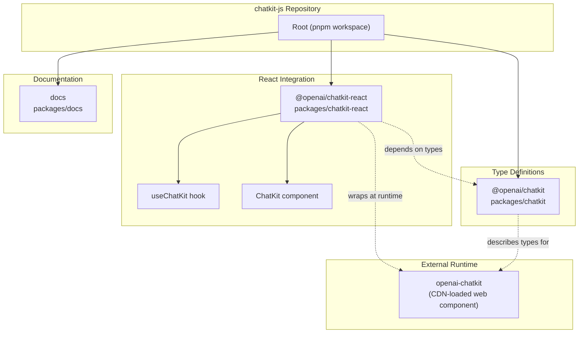
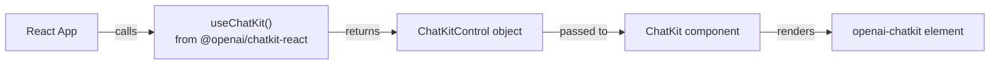
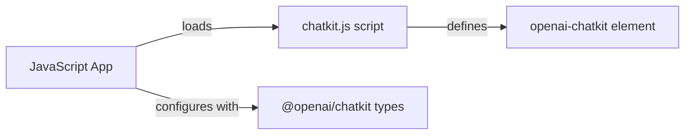

<!-- source: DeepWiki mcp.deepwiki.com · repo openai/chatkit-js · page 1 Overview · fetched 2026-10-26 -->

# Overview

Relevant source files

The following files were used as context for generating this wiki page:

- [README.md](README.md)
- [packages/chatkit-react/README.md](packages/chatkit-react/README.md)
- [packages/chatkit/README.md](packages/chatkit/README.md)

This document introduces the `chatkit-js` repository, a monorepo containing TypeScript type definitions and React bindings for the ChatKit web component. It explains the repository's purpose, structure, and the two primary integration approaches (React and vanilla JavaScript). For detailed architecture information, see [High-Level Architecture](#1.1). For package-specific details, see [Packages](#1.2).

## What is ChatKit.js

ChatKit.js is a framework for building AI-powered chat experiences. The repository provides type-safe wrappers and bindings that enable developers to embed a production-ready chat interface with minimal configuration [README.md:1-13](). The actual chat UI implementation is delivered via the `openai-chatkit` custom element, which is loaded from OpenAI's CDN [README.md:48-55]().

The framework supports two primary use cases:

1.  **React applications**: Using the `@openai/chatkit-react` package with the `useChatKit` hook and `ChatKit` component [packages/chatkit-react/README.md:1-9]().
2.  **Vanilla JavaScript applications**: Using the `@openai/chatkit` types with the `openai-chatkit` custom element directly [packages/chatkit/README.md:1-17]().

Sources: [README.md:1-19](), [packages/chatkit/README.md:1-17](), [packages/chatkit-react/README.md:1-9]()

## Repository Structure

The `chatkit-js` repository is organized as a monorepo with three distinct packages:

**Repository Structure: Monorepo Packages and Dependencies**

| Package | Path | Purpose |
| :--- | :--- | :--- |
| `@openai/chatkit` | `packages/chatkit` | TypeScript type definitions for the web component [packages/chatkit/README.md:1-3]() |
| `@openai/chatkit-react` | `packages/chatkit-react` | React hooks and components [packages/chatkit-react/README.md:1-4]() |
| `docs` | `packages/docs` | Documentation site infrastructure |

Sources: [README.md:42-46](), [packages/chatkit/README.md:1-17](), [packages/chatkit-react/README.md:1-9]()

## Integration Approaches

ChatKit.js supports two integration patterns, both interacting with the `openai-chatkit` custom element at runtime.

### React Integration

React applications use the `useChatKit` hook to configure the chat instance and obtain a `control` object, which is passed to the `ChatKit` component:

**React Integration Flow: Hook to Component to Web Element**

The hook accepts configuration and returns a control object used to manage the chat lifecycle and methods [README.md:60-84]().

Sources: [README.md:60-84](), [packages/chatkit-react/README.md:1-9]()

### Vanilla JavaScript Integration

Applications can also use the web component directly by including the script and using the `openai-chatkit` custom element:

**Vanilla JS Integration: Direct Web Component Usage**

The `@openai/chatkit` package provides TypeScript types to ensure the custom element is available globally in JSX or TypeScript environments [packages/chatkit/README.md:7-17]().

Sources: [README.md:48-55](), [packages/chatkit/README.md:1-17]()

## Backend Configuration

ChatKit requires a backend session to function, typically initialized by generating a client token on a server [README.md:21-40]().

| Configuration Area | Role | Implementation |
| :--- | :--- | :--- |
| **Server-side** | Session Creation | Call OpenAI API to create a session and return `client_secret` [README.md:34-39]() |
| **Client-side** | Token Retrieval | Implement `getClientSecret` to fetch the token from your server [README.md:64-79]() |

Sources: [README.md:21-40](), [README.md:64-79]()

## Key Capabilities

ChatKit provides the following capabilities out of the box [README.md:3-11]():

*   **Deep UI customization**: Tailor the interface to match your application's design.
*   **Built-in response streaming**: Interactive, natural conversations.
*   **Tool and workflow integration**: Visualizing agentic actions and chain-of-thought reasoning.
*   **Rich interactive widgets**: Rendered directly inside the chat.
*   **Attachment handling**: Support for file and image uploads.
*   **Thread and message management**: Organizing complex conversations.
*   **Source annotations and entity tagging**: Transparency and references.

Sources: [README.md:3-11]()

## Development Environment

The repository uses `pnpm` workspaces for monorepo management. For development setup instructions, including installing dependencies and running the documentation site locally, see [Development Setup](#1.3).

For information about the CI/CD pipeline and release process, see [Development Workflow](#6).

Sources: [README.md:42-46]()

---

