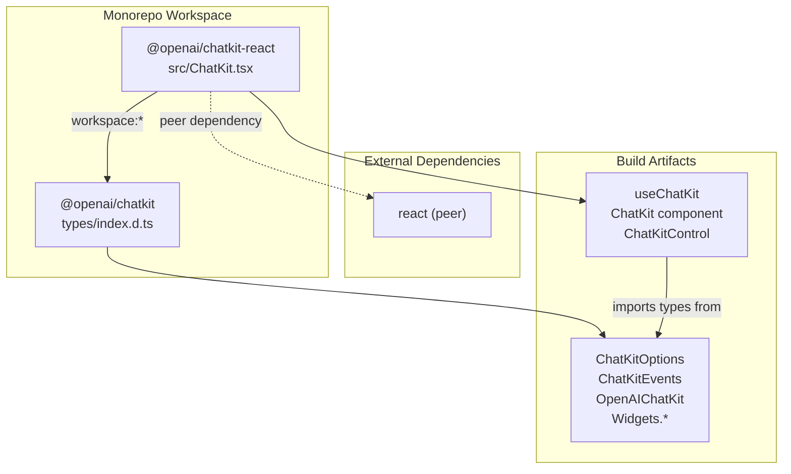
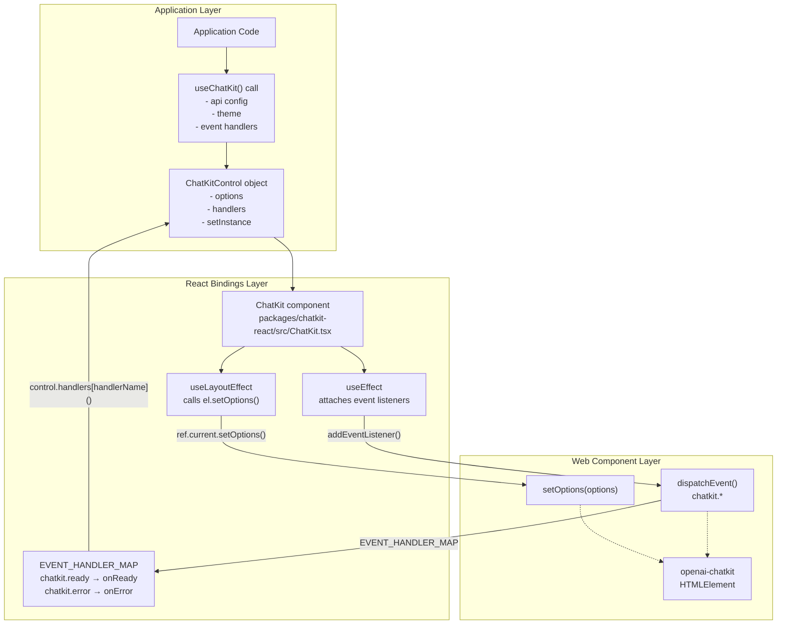
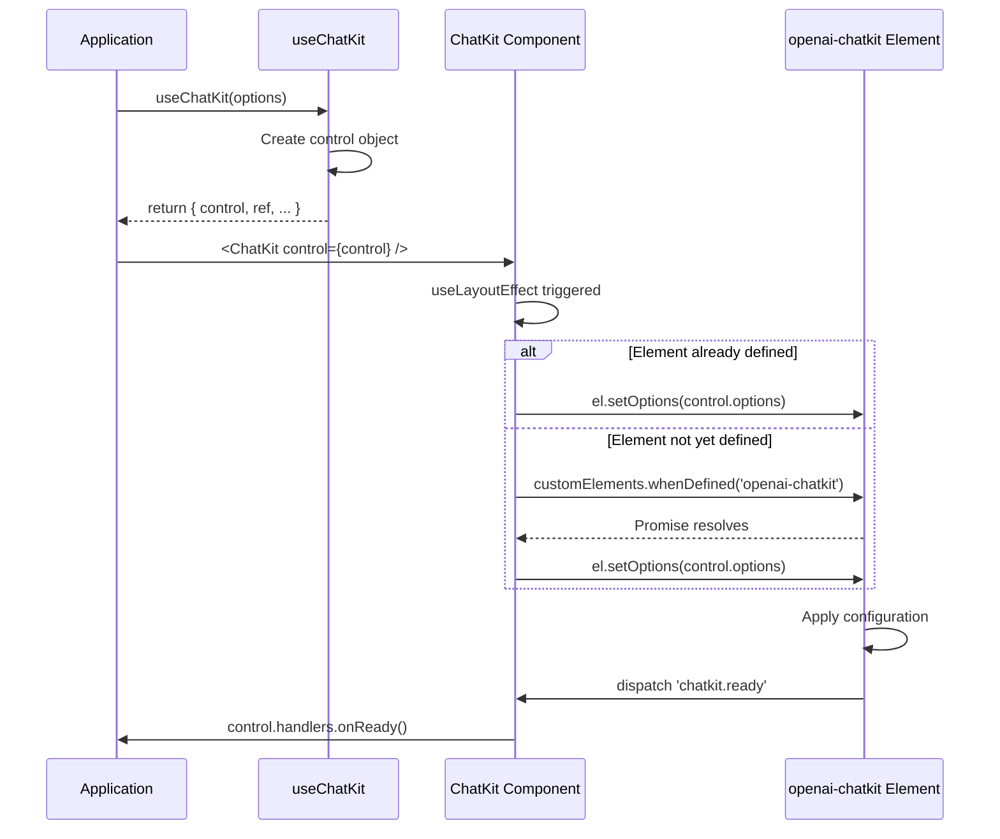
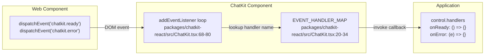
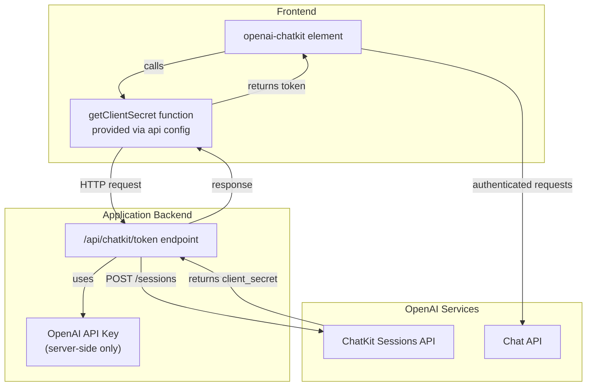

<!-- source: DeepWiki mcp.deepwiki.com · repo openai/chatkit-js · page 1.1 High-Level Architecture · fetched 2026-10-26 -->

# High-Level Architecture

<details>
<summary>Relevant source files</summary>

The following files were used as context for generating this wiki page:

- [.changeset/calm-geckos-glow.md](.changeset/calm-geckos-glow.md)
- [.changeset/real-coins-look.md](.changeset/real-coins-look.md)
- [packages/chatkit-react/src/ChatKit.tsx](packages/chatkit-react/src/ChatKit.tsx)
- [packages/chatkit/package.json](packages/chatkit/package.json)
- [packages/chatkit/types/index.d.ts](packages/chatkit/types/index.d.ts)

</details>


This document describes the three-layer architecture of ChatKit.js: the core web component, React bindings, and backend integration patterns. It explains how the packages in the monorepo relate to each other at build-time and runtime, and how configuration and events flow between layers.

For package-specific implementation details, see [Packages](#1.2). For development workflow and build processes, see [Development Setup](#1.3).

## Package Structure

ChatKit.js is organized as a monorepo containing two main NPM packages that serve distinct purposes:

| Package | Purpose | Build Output | Dependencies |
|---------|---------|--------------|--------------|
| `@openai/chatkit` | TypeScript type definitions for the web component | Types only (`types/index.d.ts`) | None |
| `@openai/chatkit-react` | React bindings for the web component | ESM + CJS + Types (`dist/`) | `@openai/chatkit` (workspace), `react>=18` (peer) |

The core package provides the `ChatKitOptions`, `ChatKitEvents`, `OpenAIChatKit`, and `Widgets` type definitions that describe the web component's interface. The React package depends on these types via a workspace dependency and provides the `useChatKit` hook and `ChatKit` component that integrate the web component into React applications.



**Sources:** [packages/chatkit/package.json:1-16](), [packages/chatkit/types/index.d.ts:1-5]()

## Three-Layer Runtime Architecture

The runtime architecture consists of three distinct layers that communicate through well-defined interfaces:

### Layer 1: Web Component (`openai-chatkit`)

The foundation is a custom web component registered as `openai-chatkit`. This component is defined externally and provides the core chat UI functionality. The TypeScript interface `OpenAIChatKit` describes its programmatic API:

- `setOptions(options: ChatKitOptions): void` - Configures the component.
- `focusComposer(): Promise<void>` - Focuses the message input.
- `setThreadId(threadId: string | null): Promise<void>` - Switches threads.
- `sendUserMessage(params): Promise<void>` - Sends a message programmatically.
- `sendCustomAction(action, itemId?): Promise<void>` - Sends widget actions to backend.
- `fetchUpdates(): Promise<void>` - Manually syncs with server.

**Sources:** [packages/chatkit/types/index.d.ts:786-919]()

### Layer 2: React Bindings

The React layer consists of two primary exports from `@openai/chatkit-react`:

**ChatKit Component** [packages/chatkit-react/src/ChatKit.tsx:38-107]()

A React component that renders the `<openai-chatkit>` custom element and manages its lifecycle:

- Accepts a `control` prop containing options and event handlers.
- Uses `useLayoutEffect` [packages/chatkit-react/src/ChatKit.tsx:42-61]() to call `setOptions()` when the web component is defined.
- Uses `useEffect` [packages/chatkit-react/src/ChatKit.tsx:63-84]() to attach event listeners with `AbortController` for cleanup.
- Forwards refs to the underlying web component element.
- Declares the `openai-chatkit` intrinsic element type [packages/chatkit-react/src/ChatKit.tsx:9-18]() for JSX support.

**useChatKit Hook**

Provides the `control` object consumed by the `ChatKit` component. The control object contains:
- `options`: The `ChatKitOptions` configuration.
- `handlers`: Event callbacks mapped to `ChatKitEvents`.
- `setInstance`: Internal method to track the web component instance.
- Methods proxied to the web component instance.

### Layer 3: Application

Application code interacts only with the React bindings:

```typescript
const { control, ref } = useChatKit({
  api: { getClientSecret: async () => fetchToken() },
  theme: 'dark',
  onReady: () => console.log('ChatKit initialized')
});

<ChatKit control={control} ref={ref} />
```



**Sources:** [packages/chatkit-react/src/ChatKit.tsx:38-107](), [packages/chatkit/types/index.d.ts:786-919]()

## Configuration Flow

Configuration flows through the layers via the `ChatKitOptions` interface [packages/chatkit/types/index.d.ts:9-118](), which defines all configurable aspects:

| Configuration Area | Type | Purpose |
|--------------------|------|---------|
| `api` | `CustomApiConfig \| HostedApiConfig` | Backend connectivity and authentication. |
| `theme` | `ColorScheme \| ThemeOption` | Visual appearance (colors, typography, density, radius). |
| `locale` | `SupportedLocale` | UI language override. |
| `initialThread` | `string \| null` | Thread to show on mount. |
| `header` | `HeaderOption` | Header visibility and custom actions. |
| `history` | `HistoryOption` | Thread history panel configuration. |
| `startScreen` | `StartScreenOption` | Greeting text and starter prompts. |
| `composer` | `ComposerOption` | Input placeholder and attachments. |
| `threadItemActions` | `ThreadItemActionsOption` | Feedback and retry buttons. |
| `disclaimer` | `DisclaimerOption` | Markdown text below composer. |
| `entities` | `EntitiesOption` | Tag search and preview widgets. |
| `widgets` | `WidgetsOption` | Widget action handler. |
| `onClientTool` | Function | Client-side tool execution. |

The configuration lifecycle:



The `ChatKit` component uses `useLayoutEffect` [packages/chatkit-react/src/ChatKit.tsx:42-61]() to call `setOptions()` synchronously after the DOM element is created but before paint, ensuring configuration is applied before the user sees the UI. It handles cases where the custom element definition may not be loaded yet by using `customElements.whenDefined()`.

**Sources:** [packages/chatkit/types/index.d.ts:9-118](), [packages/chatkit-react/src/ChatKit.tsx:42-61]()

## Event System

Events flow from the web component to the application through a mapping system. The web component emits DOM `CustomEvent` instances with names like `chatkit.ready`, `chatkit.error`, etc. [packages/chatkit/types/index.d.ts:924-957](). The `ChatKit` component maps these to React-style callback props:

```typescript
const EVENT_HANDLER_MAP: {
  [K in keyof ChatKitEvents]: ToEventHandlerKey<K>;
} = {
  'chatkit.error': 'onError',
  'chatkit.response.end': 'onResponseEnd',
  'chatkit.response.start': 'onResponseStart',
  'chatkit.log': 'onLog',
  'chatkit.thread.change': 'onThreadChange',
  'chatkit.thread.load.start': 'onThreadLoadStart',
  'chatkit.thread.load.end': 'onThreadLoadEnd',
  'chatkit.tool.change': 'onToolChange',
  'chatkit.ready': 'onReady',
  'chatkit.effect': 'onEffect',
  'chatkit.deeplink': 'onDeeplink',
};
```

The `useEffect` hook [packages/chatkit-react/src/ChatKit.tsx:63-84]() iterates through all event names, attaching listeners that invoke the corresponding handler from `control.handlers`. Event listeners are registered with an `AbortController` signal to ensure cleanup.



**Sources:** [packages/chatkit-react/src/ChatKit.tsx:20-84](), [packages/chatkit/types/index.d.ts:924-957]()

## Backend Integration

ChatKit supports two backend integration modes defined by the `api` configuration field [packages/chatkit/types/index.d.ts:16]():

### CustomApiConfig

For self-hosted backends that implement the ChatKit protocol [packages/chatkit/types/index.d.ts:564-590]():

```typescript
{
  api: {
    url: '/api/chatkit',
    domainKey: 'xxx',
    fetch?: customFetch,
    uploadStrategy: { type: 'two_phase' }
  }
}
```

The web component makes requests directly to the specified URL. The custom backend must handle message submission, thread management, and widget actions.

### HostedApiConfig

For OpenAI's managed ChatKit service [packages/chatkit/types/index.d.ts:592-597]():

```typescript
{
  api: {
    getClientSecret: async (currentSecret) => {
      const res = await fetch('/api/chatkit/token');
      const data = await res.json();
      return data.client_secret;
    }
  }
}
```

The `getClientSecret` function is called to fetch a short-lived token from your backend, which should proxy the request to OpenAI's sessions API. This keeps API keys secure on the server while enabling client-side functionality.



**Sources:** [packages/chatkit/types/index.d.ts:564-597]()

## Type System Integration

The core package exports TypeScript types that both consumers and the React bindings depend on [packages/chatkit/types/index.d.ts:1-4]():

- `ChatKitOptions`: Configuration interface.
- `ChatKitEvents`: Event payload types.
- `OpenAIChatKit`: Web component interface.
- `Widgets.*`: Widget type system (Card, ListView, BasicRoot).

The React bindings import these types and extend them for React usage, including the JSX namespace extension [packages/chatkit-react/src/ChatKit.tsx:9-18]() to enable `<openai-chatkit>` as a valid JSX element.

**Sources:** [packages/chatkit/types/index.d.ts:1-4](), [packages/chatkit-react/src/ChatKit.tsx:1-18]()

---

