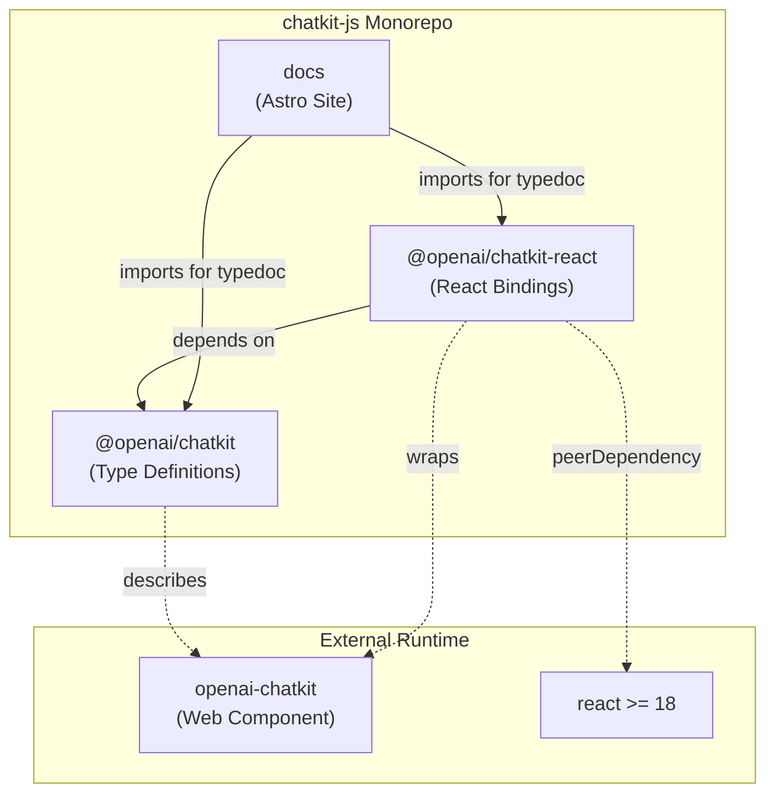
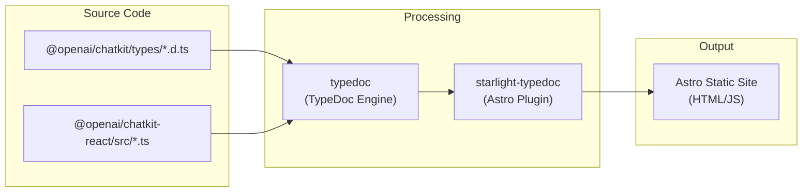

<!-- source: DeepWiki mcp.deepwiki.com · repo openai/chatkit-js · page 1.2 Packages · fetched 2026-10-26 -->

# Packages

Relevant source files

The following files were used as context for generating this wiki page:

- [packages/chatkit-react/CHANGELOG.md](packages/chatkit-react/CHANGELOG.md)
- [packages/chatkit-react/package.json](packages/chatkit-react/package.json)
- [packages/chatkit/package.json](packages/chatkit/package.json)
- [packages/docs/package.json](packages/docs/package.json)
- [pnpm-workspace.yaml](pnpm-workspace.yaml)

This document describes the three main packages in the `chatkit-js` monorepo: `@openai/chatkit` (type definitions), `@openai/chatkit-react` (React bindings), and `docs` (documentation site). Each package has a distinct purpose and is independently versioned and published.

## Package Overview

The `chatkit-js` repository is structured as a `pnpm` monorepo containing three packages defined in the workspace configuration:

[pnpm-workspace.yaml:1-3]()

| Package | NPM Name | Purpose | Published |
|---------|----------|---------|-----------|
| `chatkit` | `@openai/chatkit` | TypeScript type definitions for the ChatKit web component | Yes |
| `chatkit-react` | `@openai/chatkit-react` | React bindings and hooks for integrating ChatKit | Yes |
| `docs` | `docs` (private) | Documentation site built with Astro and Starlight | No |

Sources: [packages/chatkit/package.json:2-5](), [packages/chatkit-react/package.json:2-4](), [packages/docs/package.json:2-3](), [pnpm-workspace.yaml:1-3]()

## Package Dependencies and Flow

The following diagram illustrates how the packages relate to each other and to external dependencies like the core ChatKit Web Component.

### Monorepo Dependency Graph

Sources: [packages/chatkit-react/package.json:22-28](), [packages/docs/package.json:15-22]()

## @openai/chatkit (Core Types)

The `@openai/chatkit` package provides the TypeScript type definitions for the ChatKit web component. It contains no runtime logic; its primary purpose is to provide type safety for developers interacting with the `openai-chatkit` custom element.

### Configuration and Exports
The package exports only type definitions via the `types` field in `package.json`:

[packages/chatkit/package.json:11-16]()

- **Location**: `packages/chatkit/`
- **Version**: `1.6.0` [packages/chatkit/package.json:3]()
- **Main Entry**: `types/index.d.ts` [packages/chatkit/package.json:11]()

### Key Responsibilities
- **Interface Definitions**: Defines `ChatKitOptions`, which governs the configuration of the UI (themes, API endpoints, etc.).
- **Method Signatures**: Defines the public API of the `OpenAIChatKit` HTMLElement, including methods like `sendUserMessage` and `setThreadId`.
- **Event Mapping**: Provides types for the `ChatKitEvents` system (e.g., `ready`, `error`, `response`).

Sources: [packages/chatkit/package.json:1-30]()

## @openai/chatkit-react (React Bindings)

The `@openai/chatkit-react` package provides a React-idiomatic way to use ChatKit. It abstracts the manual DOM manipulation and event listener management required by the web component.

### Build and Distribution
The package is built using `tsup` to provide both ESM and CommonJS support:

[packages/chatkit-react/package.json:36-36]()

- **ESM Entry**: `dist/index.js` [packages/chatkit-react/package.json:12]()
- **CJS Entry**: `dist/index.cjs` [packages/chatkit-react/package.json:11]()
- **Peer Dependencies**: Requires `react` and `react-dom` version 18 or higher [packages/chatkit-react/package.json:22-25]().

### Recent Evolutions
As of version `1.5.0`, the React package has expanded to support deeper integration features:
- **Event Hooks**: Added support for `onDeeplink`, `onToolChange`, `onEffect`, and `onReady` [packages/chatkit-react/CHANGELOG.md:7-86]().
- **Method Proxies**: Exposes underlying web component methods such as `showHistory()` and `hideHistory()` through the `useChatKit` hook [packages/chatkit-react/CHANGELOG.md:40-40]().
- **Rich Content**: Updated `setComposerValue` and `sendUserMessage` to support rich-content segments and inference options [packages/chatkit-react/CHANGELOG.md:42-43]().

Sources: [packages/chatkit-react/package.json:1-51](), [packages/chatkit-react/CHANGELOG.md:1-119]()

## docs (Documentation Site)

The `docs` package is a private workspace package used to generate the project's documentation site. It is built using the **Astro** framework with the **Starlight** theme.

### Implementation Space to Code Entity Space
The documentation site bridges the gap between natural language guides and the underlying TypeScript entities using `starlight-typedoc`.

### Documentation Pipeline

### Key Technologies
- **Astro & Starlight**: The core site engine and documentation theme [packages/docs/package.json:15-18]().
- **TypeDoc Integration**: Uses `typedoc` and `starlight-typedoc` to automatically extract API references from the source code of the other two packages [packages/docs/package.json:22-24]().
- **Styling**: Uses Tailwind CSS for custom components [packages/docs/package.json:16-17]().

Sources: [packages/docs/package.json:1-33]()

## Summary of Package Scripts

Each package contains scripts for local development, type checking, and building.

| Package | Build Command | Type Check | Test Command |
|---------|---------------|------------|--------------|
| `chatkit` | N/A (Types only) | `pnpm types` | N/A |
| `chatkit-react` | `pnpm build` (`tsup`) | `pnpm types` | `pnpm test` (`vitest`) |
| `docs` | `pnpm build` (`astro build`) | `pnpm types` | N/A |

Sources: [packages/chatkit/package.json:17-20](), [packages/chatkit-react/package.json:35-41](), [packages/docs/package.json:5-13]()

---

