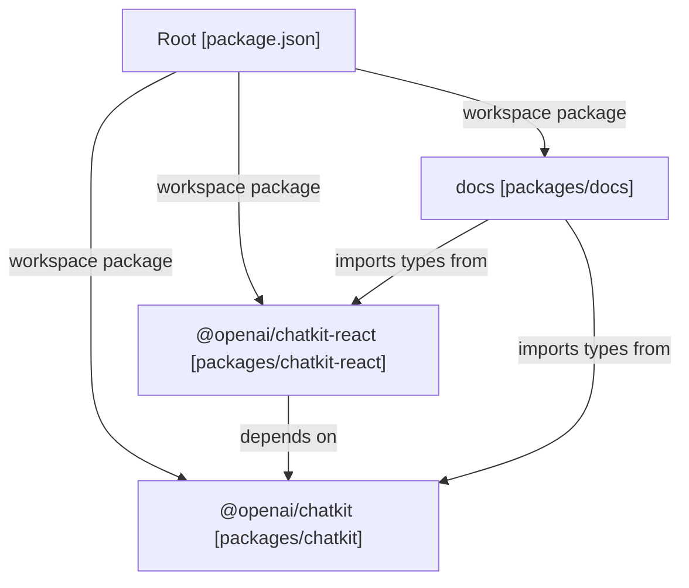
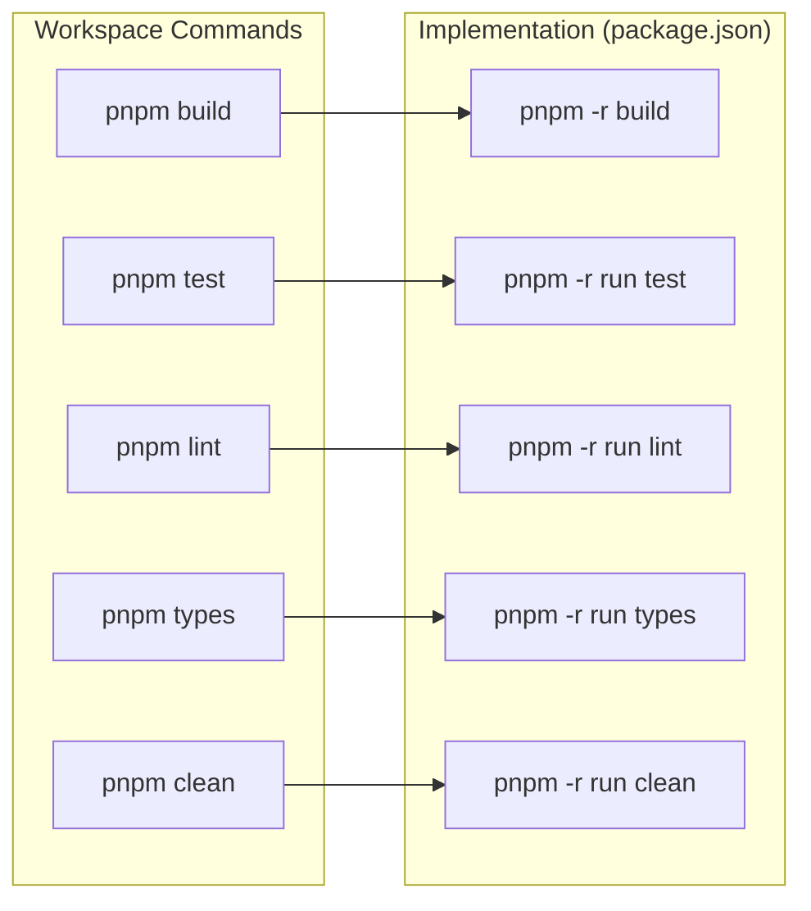
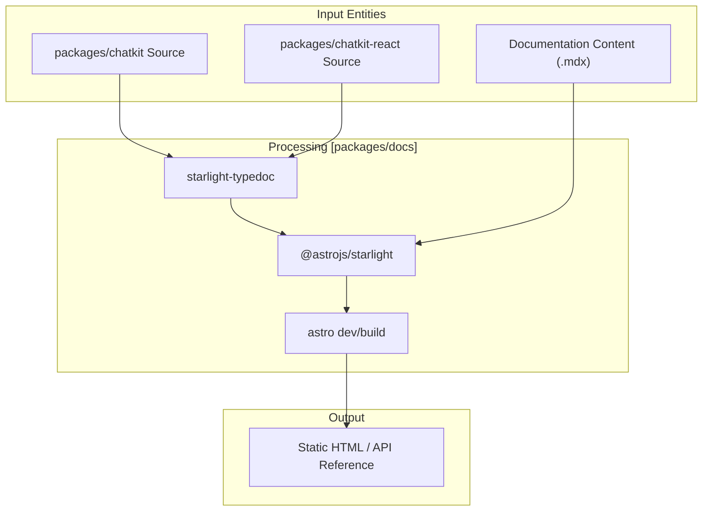

<!-- source: DeepWiki mcp.deepwiki.com · repo openai/chatkit-js · page 1.3 Development Setup · fetched 2026-10-26 -->

# Development Setup

<details>
<summary>Relevant source files</summary>

The following files were used as context for generating this wiki page:

- [.github/workflows/release.yml](.github/workflows/release.yml)
- [package.json](package.json)
- [pnpm-lock.yaml](pnpm-lock.yaml)
- [pnpm-workspace.yaml](pnpm-workspace.yaml)

</details>


This page provides instructions for setting up a local development environment for the `chatkit-js` monorepo. It covers prerequisites, repository setup, workspace structure, and common development commands.

## Prerequisites

The `chatkit-js` repository requires the following tools:

| Tool | Version | Purpose |
|------|---------|---------|
| Node.js | 22 | Runtime environment |
| pnpm | 10.11.0+ | Package manager |

### Installing pnpm

The repository uses `pnpm` as its package manager, as specified in [package.json:32](). Install pnpm globally:

```bash
npm install -g pnpm@10.11.0
```

Alternatively, use the GitHub Actions configuration as a reference for the environment setup:
- **Node Version**: 22 [[.github/workflows/release.yml:35]()]
- **pnpm Version**: 10.11.0 [[package.json:32]()]

**Sources:** [package.json:32](), [.github/workflows/release.yml:28-35]()

## Repository Setup

### Cloning the Repository

```bash
git clone https://github.com/openai/chatkit-js.git
cd chatkit-js
```

### Installing Dependencies

The monorepo uses `pnpm` workspaces. Install all dependencies across all packages:

```bash
pnpm install
```

This command installs dependencies for all workspace packages and links local packages together (e.g., `@openai/chatkit-react` depends on `@openai/chatkit` via the `workspace:*` specifier) [[pnpm-lock.yaml:58-60]()].

**Sources:** [.github/workflows/release.yml:30](), [pnpm-lock.yaml:58-60]()

## Workspace Structure

The repository is organized as a `pnpm` workspace monorepo defined in `pnpm-workspace.yaml` [[pnpm-workspace.yaml:1-3]()].

### Code Entity Space to System Names



**Sources:** [pnpm-workspace.yaml:1-3](), [pnpm-lock.yaml:54-129]()

## Development Commands

### Root-Level Commands

The root `package.json` defines scripts for managing the entire monorepo [[package.json:5-15]()].



**Command Reference**

| Command | Script | Description |
|---------|--------|-------------|
| `pnpm build` | `pnpm -r build` | Build all packages recursively [[package.json:6]()] |
| `pnpm dev:docs` | `pnpm -F docs dev` | Run documentation site in dev mode [[package.json:7]()] |
| `pnpm test` | `pnpm -r run test` | Run tests across all packages [[package.json:8]()] |
| `pnpm lint` | `pnpm -r run lint` | Lint all packages [[package.json:9]()] |
| `pnpm format` | `prettier --write .` | Format code using Prettier [[package.json:11]()] |
| `pnpm check` | `prettier --check . && pnpm -r run lint && pnpm types && pnpm -r run test` | Full CI-style check [[package.json:14]()] |

**Sources:** [package.json:5-15]()

## Running the Documentation Site

The documentation site is built with Astro and Starlight, located in `packages/docs`.

### Development Server

Start the local documentation server:

```bash
pnpm dev:docs
```

This targets the `docs` package specifically using the `--filter` (`-F`) flag [[package.json:7]()].

### Documentation Pipeline



**Sources:** [package.json:7](), [pnpm-lock.yaml:81-112]()

## Continuous Integration & Release

The repository uses GitHub Actions for releases. The `Release NPM` workflow automates the build and publishing process [[.github/workflows/release.yml:1-53]()].

### Release Workflow Logic

1.  **Setup**: Installs `pnpm` and `Node.js` (v22) [[.github/workflows/release.yml:27-38]()].
2.  **Build**: Runs `pnpm build` to compile all workspace packages [[.github/workflows/release.yml:43]()].
3.  **Publish**: Uses `@changesets/cli` to manage versioning and publish to NPM [[.github/workflows/release.yml:45-50]()].

**Sources:** [.github/workflows/release.yml:18-53](), [package.json:17]()

## Troubleshooting

- **pnpm version mismatch**: Ensure you are using version `10.11.0` as specified in `package.json` [[package.json:32]()].
- **Build failures**: Ensure you have run `pnpm install` at the root to link workspace packages.
- **Linting errors**: Run `pnpm format` to automatically fix formatting issues before running `pnpm lint` [[package.json:11,14]()].

**Sources:** [package.json:11-32]()

---

