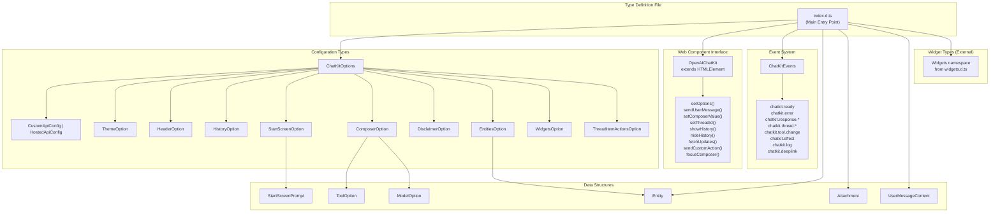
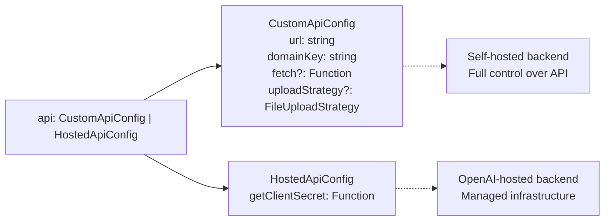
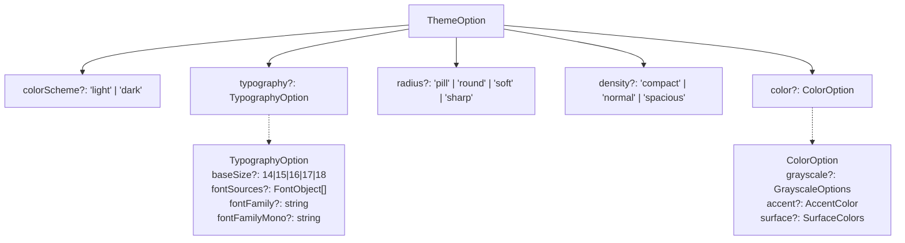

<!-- source: DeepWiki mcp.deepwiki.com · repo openai/chatkit-js · page 2 Core Package (@openai/chatkit) · fetched 2026-10-26 -->

# Core Package (@openai/chatkit)

<details>
<summary>Relevant source files</summary>

The following files were used as context for generating this wiki page:

- [.changeset/calm-geckos-glow.md](.changeset/calm-geckos-glow.md)
- [.changeset/real-coins-look.md](.changeset/real-coins-look.md)
- [packages/chatkit/CHANGELOG.md](packages/chatkit/CHANGELOG.md)
- [packages/chatkit/package.json](packages/chatkit/package.json)
- [packages/chatkit/types/index.d.ts](packages/chatkit/types/index.d.ts)

</details>


The `@openai/chatkit` package provides comprehensive TypeScript type definitions for the ChatKit web component system. This package does not contain implementation code; instead, it defines the public API contract for the `openai-chatkit` custom element and all associated configuration options, events, and data structures.

For React-specific integration patterns using these types, see [React Bindings (@openai/chatkit-react)](#3). For practical integration guides using these types in applications, see [Integration Guides](#4).

## Package Overview

The `@openai/chatkit` package is a pure type definition package published to NPM. It serves as the TypeScript interface layer between applications and the `openai-chatkit` web component, which is loaded from CDN at runtime.

**Package Structure:**
```
packages/chatkit/
├── types/
│   ├── index.d.ts      # Main type definitions
│   └── widgets.d.ts    # Widget type system
├── package.json        # Package configuration
└── README.md          # Basic setup instructions
```

The package exports types only, with no runtime JavaScript code. The `package.json` marks this explicitly with `"sideEffects": false` [packages/chatkit/package.json:6]() and exports only type definitions through the `types` field [packages/chatkit/package.json:11]().

**Key characteristics:**
- **No runtime code**: All files are `.d.ts` TypeScript declaration files.
- **Single entry point**: [packages/chatkit/types/index.d.ts:1-1104]()
- **Widget subsystem**: [packages/chatkit/types/widgets.d.ts]() (referenced at [packages/chatkit/types/index.d.ts:1]())
- **Version**: 1.6.0 as of current release [packages/chatkit/package.json:3]()

Sources: [packages/chatkit/package.json:1-30](), [packages/chatkit/types/index.d.ts:1-5]()

## Type Definition Architecture



The type system is organized hierarchically with `ChatKitOptions` as the central configuration interface. All configuration surfaces branch from this root type, enabling strongly-typed configuration of every aspect of the ChatKit UI.

Sources: [packages/chatkit/types/index.d.ts:1-118]()

## Primary Type Exports

### ChatKitOptions Interface

The `ChatKitOptions` type [packages/chatkit/types/index.d.ts:9-118]() is the primary configuration interface for initializing ChatKit. It aggregates all configuration options into a single object structure:

| Property | Type | Purpose | Required |
|----------|------|---------|----------|
| `api` | `CustomApiConfig \| HostedApiConfig` | Backend communication configuration | Yes |
| `locale` | `SupportedLocale` | UI language override | No |
| `theme` | `ColorScheme \| ThemeOption` | Visual appearance settings | No |
| `initialThread` | `string \| null` | Thread to show on mount | No |
| `onClientTool` | Function | Client-side tool handler | No |
| `header` | `HeaderOption` | Header configuration | No |
| `history` | `HistoryOption` | History panel configuration | No |
| `startScreen` | `StartScreenOption` | New thread screen configuration | No |
| `threadItemActions` | `ThreadItemActionsOption` | Message action buttons configuration | No |
| `composer` | `ComposerOption` | Input composer configuration | No |
| `disclaimer` | `DisclaimerOption` | Disclaimer text configuration | No |
| `entities` | `EntitiesOption` | Entity handling configuration | No |
| `widgets` | `WidgetsOption` | Widget action handlers | No |

**Backend Configuration Options:**

Two mutually exclusive backend configuration types exist:



- **CustomApiConfig** [packages/chatkit/types/index.d.ts:634-662](): For self-hosted backends with custom URL and domain verification.
- **HostedApiConfig** [packages/chatkit/types/index.d.ts:664-669](): For OpenAI-hosted backends using client secret authentication.

Sources: [packages/chatkit/types/index.d.ts:9-118](), [packages/chatkit/types/index.d.ts:634-669]()

### OpenAIChatKit Element Interface

The `OpenAIChatKit` interface [packages/chatkit/types/index.d.ts:894-1062]() extends `HTMLElement` and defines the web component's imperative API. This interface is implemented by the `openai-chatkit` custom element loaded from CDN.

```mermaid
graph TB
    ELEMENT["OpenAIChatKit interface<br/>extends HTMLElement"]
    
    CONFIG["Configuration Methods"]
    SETOPT["setOptions(options: ChatKitOptions): void"]
    
    MESSAGE["Message Methods"]
    SEND["sendUserMessage(params): Promise&lt;void&gt;"]
    SETCOMP["setComposerValue(params): Promise&lt;void&gt;"]
    CUSTOM["sendCustomAction(action, itemId?): Promise&lt;void&gt;"]
    
    NAV["Navigation Methods"]
    SETTHREAD["setThreadId(threadId): Promise&lt;void&gt;"]
    SHOWHIST["showHistory(): Promise&lt;void&gt;"]
    HIDEHIST["hideHistory(): Promise&lt;void&gt;"]
    
    UTIL["Utility Methods"]
    FOCUS["focusComposer(): Promise&lt;void&gt;"]
    FETCH["fetchUpdates(): Promise&lt;void&gt;"]
    
    EVENT["Event Methods"]
    ADDLIST["addEventListener&lt;K&gt;(type, listener, options?)"]
    REMLIST["removeEventListener&lt;K&gt;(type, listener, options?)"]
    
    ELEMENT --> CONFIG
    CONFIG --> SETOPT
    
    ELEMENT --> MESSAGE
    MESSAGE --> SEND
    MESSAGE --> SETCOMP
    MESSAGE --> CUSTOM
    
    ELEMENT --> NAV
    NAV --> SETTHREAD
    NAV --> SHOWHIST
    NAV --> HIDEHIST
    
    ELEMENT --> UTIL
    UTIL --> FOCUS
    UTIL --> FETCH
    
    ELEMENT --> EVENT
    EVENT --> ADDLIST
    EVENT --> REMLIST
```



**Method Signatures:**

- **setOptions** [packages/chatkit/types/index.d.ts:900](): Applies configuration. Note: Options are not merged; the full options object must be provided each time.
- **sendUserMessage** [packages/chatkit/types/index.d.ts:937-952](): Sends message with optional text, content, attachments, and inference options (`toolChoice`, `model`).
- **setComposerValue** [packages/chatkit/types/index.d.ts:954-971](): Pre-fills composer without sending, supports rich-content segments, optional tool/model selection, and file attachments.
- **setThreadId** [packages/chatkit/types/index.d.ts:906](): Switches active thread (pass `null` for new thread).
- **sendCustomAction** [packages/chatkit/types/index.d.ts:912-934](): Sends application-defined actions to backend.
- **showHistory/hideHistory** [packages/chatkit/types/index.d.ts:979-984](): Programmatically controls history panel visibility.
- **fetchUpdates** [packages/chatkit/types/index.d.ts:991](): Manually syncs thread state from server.
- **focusComposer** [packages/chatkit/types/index.d.ts:903](): Sets focus to composer input field.

Sources: [packages/chatkit/types/index.d.ts:894-1062]()

### ChatKitEvents Type Map

The `ChatKitEvents` type [packages/chatkit/types/index.d.ts:1067-1103]() defines all custom events emitted by the web component. Each event is typed as a `CustomEvent` with a specific detail payload.

| Event Name | Detail Type | Purpose |
|------------|-------------|---------|
| `chatkit.ready` | `void` | Frame loaded and ready |
| `chatkit.error` | `{ error: Error }` | Error occurred |
| `chatkit.effect` | `{ name: string; data?: Record }` | Server-pushed effect |
| `chatkit.response.start` | `void` | Assistant response begins |
| `chatkit.response.end` | `void` | Assistant response completes |
| `chatkit.thread.change` | `{ threadId: string \| null }` | Active thread changed |
| `chatkit.tool.change` | `{ toolId: string \| null }` | Composer tool selection changed |
| `chatkit.deeplink` | `{ url: string }` | Deeplink navigation triggered |
| `chatkit.log` | `{ name: string; data?: Record }` | Diagnostic event |

The `addEventListener` and `removeEventListener` methods on `OpenAIChatKit` are generically typed to accept these event names [packages/chatkit/types/index.d.ts:1005-1020]().

Sources: [packages/chatkit/types/index.d.ts:1067-1103]()

## Supporting Data Structures

### Entity Type

The `Entity` type [packages/chatkit/types/index.d.ts:507-535]() represents referenceable items like people, documents, or business objects that can be tagged, clicked, or previewed:

```typescript
type Entity = {
  title: string;           // Display name (e.g., "Harry Potter")
  id: string;              // Unique identifier
  icon?: string;           // Optional icon URL
  interactive?: boolean;   // Whether clickable/previewable
  group?: string;          // Optional grouping (e.g., "People")
  data?: Record<string, string>;  // Arbitrary metadata
}
```

Used in `EntitiesOption` [packages/chatkit/types/index.d.ts:202-227]() callbacks for tag autocomplete and preview rendering.

### Attachment Type

The `Attachment` type [packages/chatkit/types/index.d.ts:387-407]() represents uploaded files or images in messages:

```typescript
type Attachment = 
  | { type: 'file'; id: string; name: string; mime_type: string }
  | { type: 'image'; id: string; preview_url: string; name: string; mime_type: string }
```

Files must be uploaded to the server before being attached. The `id` field references the server-generated identifier.

### UserMessageContent Type

The `UserMessageContent` type [packages/chatkit/types/index.d.ts:547-559]() represents structured message segments for rich input:

```typescript
type UserMessageContent = 
  | { type: 'input_text'; text: string }
  | { type: 'input_tag'; text: string; id: string; group?: string; data?: Record; interactive?: boolean }
```

This mirrors the server-side SDK's content structure and enables messages with embedded entity tags.

Sources: [packages/chatkit/types/index.d.ts:387-559]()

## Configuration Type Deep Dive

### Theme Configuration

The `ThemeOption` type [packages/chatkit/types/index.d.ts:679-714]() controls visual appearance:



- **Typography** [packages/chatkit/types/index.d.ts:716-725](): Font family, size, and web font sources.
- **Color** [packages/chatkit/types/index.d.ts:727-740](): Grayscale palette, accent colors, and surface colors.
- **Radius**: Controls border-radius throughout UI.
- **Density**: Controls spacing between elements.

### Composer Configuration

The `ComposerOption` type [packages/chatkit/types/index.d.ts:253-308]() configures the message input area:

```typescript
type ComposerOption = {
  placeholder?: string;                // Default: "Message the AI"
  attachments?: {
    enabled: boolean;
    maxSize?: number;                  // Default: 100MB
    maxCount?: number;                 // Default: 10
    accept?: Record<string, string[]>; // MIME type filters
  };
  tools?: ToolOption[];                // Selectable tools
  models?: ModelOption[];              // Selectable models
  dictation?: boolean;                 // Voice input support
}
```

**ToolOption** [packages/chatkit/types/index.d.ts:461-494]() defines selectable tools with icons, labels, and behavior flags (`pinned`, `persistent`).

**ModelOption** [packages/chatkit/types/index.d.ts:616-632]() defines model choices with labels, descriptions, and disabled state.

Sources: [packages/chatkit/types/index.d.ts:253-308](), [packages/chatkit/types/index.d.ts:461-494](), [packages/chatkit/types/index.d.ts:616-632]()

## Icon Type Systems

ChatKit provides two distinct icon type unions for different UI contexts:

**ChatKitIcon** [packages/chatkit/types/index.d.ts:313-376](): General-purpose icons for tools, prompts, and UI elements. Supports Lucide icons via `lucide:` prefix [packages/chatkit/CHANGELOG.md:25]().

**HeaderIcon** [packages/chatkit/types/index.d.ts:412-456](): Header-specific icons for navigation and controls. Includes standard glyphs and recently added icons like `share` and `bug` [.changeset/calm-geckos-glow.md:3]().

Sources: [packages/chatkit/types/index.d.ts:313-456](), [.changeset/calm-geckos-glow.md:1-5]()

## Localization Support

ChatKit supports internationalization through the `locale` property in `ChatKitOptions` [packages/chatkit/types/index.d.ts:25]().

**Type hierarchy:**
- `TranslatedLocale` [packages/chatkit/types/index.d.ts:745-808](): 68 locales with actual translation files.
- `SupportedLocale` [packages/chatkit/types/index.d.ts:816-868](): Extends `TranslatedLocale` with language codes that map to translated locales (e.g., `'en'`, `'es'`, `'fr'`).

Sources: [packages/chatkit/types/index.d.ts:745-868]()

## Widget Type System

The package re-exports the entire `Widgets` namespace from `widgets.d.ts` [packages/chatkit/types/index.d.ts:1-3]():

```typescript
import type * as Widgets from './widgets';
export type { Widgets };
```

This namespace contains type definitions for all widget components. ChatKit threads now support `BasicRoot` widgets [.changeset/real-coins-look.md:5](). For detailed documentation of widget types, see [Widget System](#2.2).

Sources: [packages/chatkit/types/index.d.ts:1-3](), [.changeset/real-coins-look.md:1-6]()

---

