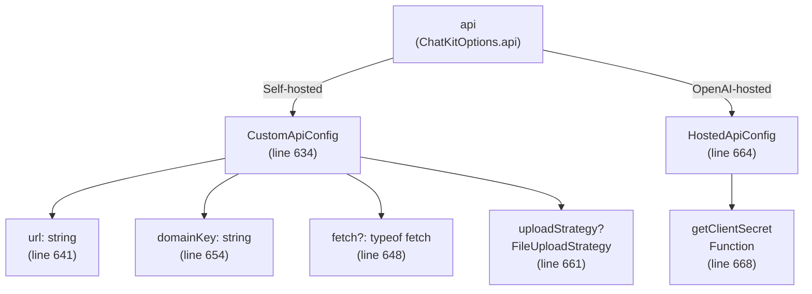

<!-- source: DeepWiki mcp.deepwiki.com · repo openai/chatkit-js · page 2.1 ChatKitOptions Configuration · fetched 2026-10-26 -->

# ChatKitOptions Configuration

<details>
<summary>Relevant source files</summary>

The following files were used as context for generating this wiki page:

- [.changeset/calm-geckos-glow.md](.changeset/calm-geckos-glow.md)
- [.changeset/real-coins-look.md](.changeset/real-coins-look.md)
- [packages/chatkit/CHANGELOG.md](packages/chatkit/CHANGELOG.md)
- [packages/chatkit/types/index.d.ts](packages/chatkit/types/index.d.ts)

</details>


This page documents the `ChatKitOptions` interface, which serves as the primary configuration object for initializing and customizing ChatKit. This interface controls all aspects of the ChatKit UI, including backend communication, visual appearance, component behavior, and interactive features.

For information about using these options in React applications, see [useChatKit Hook](#3.2). For details on the web component interface that accepts these options, see [OpenAIChatKit Element Interface](#2.3).

**Sources:** [packages/chatkit/types/index.d.ts:9-118]()

---

## Overview

The `ChatKitOptions` interface is defined at [packages/chatkit/types/index.d.ts:9-118](). It is passed to the web component via the `setOptions` method or provided to the React `useChatKit` hook. All configuration is declarative and can be tested interactively at https://chatkit.studio/playground.

### Configuration Structure

```mermaid
graph TB
    ChatKitOptions["ChatKitOptions<br/>(packages/chatkit/types/index.d.ts:9)"]
    
    api["api<br/>CustomApiConfig | HostedApiConfig<br/>(line 16)"]
    locale["locale?<br/>SupportedLocale<br/>(line 25)"]
    theme["theme?<br/>ColorScheme | ThemeOption<br/>(line 34)"]
    frameTitle["frameTitle?<br/>string<br/>(line 40)"]
    initialThread["initialThread?<br/>string | null<br/>(line 48)"]
    onClientTool["onClientTool?<br/>Function<br/>(line 57)"]
    
    header["header?<br/>HeaderOption<br/>(line 67)"]
    history["history?<br/>HistoryOption<br/>(line 74)"]
    startScreen["startScreen?<br/>StartScreenOption<br/>(line 81)"]
    threadItemActions["threadItemActions?<br/>ThreadItemActionsOption<br/>(line 88)"]
    composer["composer?<br/>ComposerOption<br/>(line 96)"]
    disclaimer["disclaimer?<br/>DisclaimerOption<br/>(line 103)"]
    entities["entities?<br/>EntitiesOption<br/>(line 110)"]
    widgets["widgets?<br/>WidgetsOption<br/>(line 117)"]
    
    ChatKitOptions --> api
    ChatKitOptions --> locale
    ChatKitOptions --> theme
    ChatKitOptions --> frameTitle
    ChatKitOptions --> initialThread
    ChatKitOptions --> onClientTool
    ChatKitOptions --> header
    ChatKitOptions --> history
    ChatKitOptions --> startScreen
    ChatKitOptions --> threadItemActions
    ChatKitOptions --> composer
    ChatKitOptions --> disclaimer
    ChatKitOptions --> entities
    ChatKitOptions --> widgets
```



**Configuration Categories**

| Category | Option Field | Required | Purpose |
|----------|-------------|----------|---------|
| Backend | `api` | Yes | Defines backend communication strategy |
| Localization | `locale` | No | Override UI language (defaults to browser) |
| Appearance | `theme` | No | Control colors, typography, spacing, radius |
| Accessibility | `frameTitle` | No | Accessible title for the iframe element |
| Navigation | `initialThread` | No | Set initial thread on mount |
| Interactivity | `onClientTool` | No | Handle client-side tool invocations |
| UI Components | `header` | No | Configure header bar |
| UI Components | `history` | No | Configure thread history panel |
| UI Components | `startScreen` | No | Configure new thread greeting and prompts |
| UI Components | `threadItemActions` | No | Configure feedback and retry buttons |
| UI Components | `composer` | No | Configure input, attachments, dictation |
| UI Components | `disclaimer` | No | Add disclaimer text below composer |
| Extensions | `entities` | No | Configure entity tags and previews |
| Extensions | `widgets` | No | Handle widget action callbacks |

**Sources:** [packages/chatkit/types/index.d.ts:9-118]()

---

## API Configuration

The `api` field is **required** and determines how ChatKit communicates with your backend. Two configuration types are supported: `CustomApiConfig` for self-hosted servers and `HostedApiConfig` for OpenAI-managed infrastructure.



### CustomApiConfig

Defined at [packages/chatkit/types/index.d.ts:634-662](), `CustomApiConfig` is used when you host your own ChatKit-compatible server (e.g., using the ChatKit Python SDK).

| Field | Type | Required | Description |
|-------|------|----------|-------------|
| `url` | `string` | Yes | Relative or absolute URL of your ChatKit API endpoint |
| `domainKey` | `string` | Yes | Domain verification key for your integration |
| `fetch` | `typeof fetch` | No | Custom fetch implementation for request interception |
| `uploadStrategy` | `FileUploadStrategy` | No | Required when `composer.attachments.enabled` is true |

**FileUploadStrategy** ([packages/chatkit/types/index.d.ts:499-501]()):
```typescript
type FileUploadStrategy =
  | { type: 'two_phase' }
  | { type: 'direct'; uploadUrl: string };
```

**Sources:** [packages/chatkit/types/index.d.ts:634-662]()

### HostedApiConfig

Defined at [packages/chatkit/types/index.d.ts:664-669](), `HostedApiConfig` is used when leveraging OpenAI's managed ChatKit service.

| Field | Type | Required | Description |
|-------|------|----------|-------------|
| `getClientSecret` | `(currentClientSecret: string \| null) => Promise<string>` | Yes | Function to retrieve or refresh client authentication token |

**Sources:** [packages/chatkit/types/index.d.ts:664-669]()

---

## Theme Configuration

The `theme` field controls visual appearance. It accepts either a simple `ColorScheme` string or a detailed `ThemeOption` object.

Defined at [packages/chatkit/types/index.d.ts:679-714]().

| Field | Type | Default | Description |
|-------|------|---------|-------------|
| `colorScheme` | `'light' \| 'dark'` | `'light'` | Base color mode |
| `typography` | `TypographyOption` | - | Font customization |
| `radius` | `'pill' \| 'round' \| 'soft' \| 'sharp'` | `'pill'` | Border roundness |
| `density` | `'compact' \| 'normal' \| 'spacious'` | `'normal'` | Spacing between elements |
| `color` | `ColorOption` | - | Color palette customization |

### TypographyOption

Defined at [packages/chatkit/types/index.d.ts:716-725]().

| Field | Type | Description |
|-------|------|-------------|
| `baseSize` | `14 \| 15 \| 16 \| 17 \| 18` | Base font size in pixels |
| `fontSources` | `FontObject[]` | Array of webfont sources to load |
| `fontFamily` | `string` | CSS font-family for body text |
| `fontFamilyMono` | `string` | CSS font-family for monospace text |

**Sources:** [packages/chatkit/types/index.d.ts:679-740](), [packages/chatkit/types/index.d.ts:564-614]()

---

## Header Configuration

The `header` field controls the header bar UI, including title display and custom action buttons.

Defined at [packages/chatkit/types/index.d.ts:120-161]().

| Field | Type | Default | Description |
|-------|------|---------|-------------|
| `enabled` | `boolean` | `true` | Show/hide the header |
| `title` | `object` | - | Title display configuration |
| `title.enabled` | `boolean` | `true` | Show/hide the title area |
| `title.text` | `string` | - | Static text (overrides thread title) |
| `leftAction` | `object` | - | Custom button on left side |
| `rightAction` | `object` | - | Custom button on right side |

### Header Actions

Both `leftAction` and `rightAction` accept:
- `icon`: A `HeaderIcon` type. Supported icons include standard glyphs and Lucide icons via the `lucide:` prefix [packages/chatkit/CHANGELOG.md:25](). Recent additions include `share` and `bug` icons [.changeset/calm-geckos-glow.md:3]().
- `onClick`: Callback function invoked when clicked.

**Sources:** [packages/chatkit/types/index.d.ts:120-161](), [packages/chatkit/CHANGELOG.md:25](), [.changeset/calm-geckos-glow.md:1-5]()

---

## Start Screen Configuration

The `startScreen` field customizes the greeting and starter prompts shown in the new thread view.

Defined at [packages/chatkit/types/index.d.ts:172-186]().

| Field | Type | Default | Description |
|-------|------|---------|-------------|
| `greeting` | `string` | `"What can I help with today?"` | Greeting text displayed in new thread view |
| `prompts` | `StartScreenPrompt[]` | - | Array of starter prompts |

### StartScreenPrompt

Defined at [packages/chatkit/types/index.d.ts:359-376](). Prompts now support entity tags in the content [packages/chatkit/CHANGELOG.md:34]().

**Sources:** [packages/chatkit/types/index.d.ts:172-186](), [packages/chatkit/types/index.d.ts:359-376](), [packages/chatkit/CHANGELOG.md:34]()

---

## Composer Configuration

The `composer` field controls the message input area, including placeholder text, file attachments, and dictation.

Defined at [packages/chatkit/types/index.d.ts:253-289]().

| Field | Type | Default | Description |
|-------|------|---------|-------------|
| `placeholder` | `string` | `"Message the AI"` | Placeholder text in composer input |
| `attachments` | `object` | - | File attachment configuration |
| `dictation` | `object` | - | Voice input configuration |

### Dictation

Voice input can be enabled via `composer.dictation.enabled`. This is disabled by default [packages/chatkit/CHANGELOG.md:13]().

### Attachments Configuration

| Field | Type | Default | Description |
|-------|------|---------|-------------|
| `enabled` | `boolean` | `false` | Enable/disable file attachments |
| `maxSize` | `number` | `104857600` (100MB) | Maximum file size in bytes |
| `maxCount` | `number` | `10` | Maximum attachments per message |

**Sources:** [packages/chatkit/types/index.d.ts:253-289](), [packages/chatkit/CHANGELOG.md:13]()

---

## Entities Configuration

The `entities` field enables entity tags, autocomplete, and previews.

Defined at [packages/chatkit/types/index.d.ts:202-227]().

| Field | Type | Description |
|-------|------|-------------|
| `onTagSearch` | `(query: string) => Promise<Entity[]>` | Returns entities for autocomplete |
| `showComposerMenu` | `boolean` | Renders a button to trigger tag search [packages/chatkit/CHANGELOG.md:19]() |
| `onClick` | `(entity: Entity) => void` | Called when rendered entity is clicked |
| `onRequestPreview` | `(entity: Entity) => Promise<preview>` | Returns widget preview for entity |

**Sources:** [packages/chatkit/types/index.d.ts:202-227](), [packages/chatkit/CHANGELOG.md:19]()

---

## Widgets Configuration

The `widgets` field configures handling of widget actions.

Defined at [packages/chatkit/types/index.d.ts:188-200]().

| Field | Type | Description |
|-------|------|-------------|
| `onAction` | `(action, widgetItem) => Promise<void>` | Called when widget action is triggered |

ChatKit threads now support `BasicRoot` widgets in addition to `Card` and `ListView` [.changeset/real-coins-look.md:5]().

**Sources:** [packages/chatkit/types/index.d.ts:188-200](), [.changeset/real-coins-look.md:1-6]()

---

## Option Handling

### Web Component Usage

The `OpenAIChatKit` element accepts options via the `setOptions` method:

```typescript
// packages/chatkit/types/index.d.ts:900
chatkit.setOptions({ /* ChatKitOptions */ });
```

### React Usage

In React applications, pass options to the `useChatKit` hook. The hook handles option stabilization to prevent unnecessary re-renders.

**Sources:** [packages/chatkit/types/index.d.ts:900]()

---

