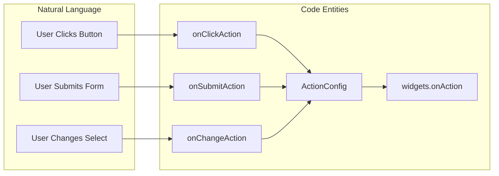

<!-- source: DeepWiki mcp.deepwiki.com · repo openai/chatkit-js · page 2.2 Widget System · fetched 2026-10-26 -->

# Widget System

<details>
<summary>Relevant source files</summary>

The following files were used as context for generating this wiki page:

- [.changeset/calm-geckos-glow.md](.changeset/calm-geckos-glow.md)
- [.changeset/late-falcons-scream.md](.changeset/late-falcons-scream.md)
- [.changeset/light-frogs-cry.md](.changeset/light-frogs-cry.md)
- [.changeset/real-coins-look.md](.changeset/real-coins-look.md)
- [packages/chatkit/types/index.d.ts](packages/chatkit/types/index.d.ts)
- [packages/chatkit/types/widgets.d.ts](packages/chatkit/types/widgets.d.ts)

</details>


The Widget System provides TypeScript type definitions for building rich, interactive user interfaces within ChatKit responses. Widgets are server-rendered UI components that can be included in assistant messages to display structured data, forms, and interactive elements beyond simple text.

For information about configuring widget action handlers in your application, see the `widgets` option in [ChatKitOptions Configuration](#2.1). For details on entity previews (which also use widgets), see the entities section in [ChatKitOptions Configuration](#2.1).

---

## Overview

Widgets are JSON-serializable UI components that your backend server can include in assistant responses. The widget type system defines the complete set of available components and their properties. All widget types are defined in the `Widgets` namespace exported from the core package [[packages/chatkit/types/index.d.ts:1-3]]().

The widget system supports:
- **Structured layouts**: Cards, lists, tables, and flexible box layouts [[packages/chatkit/types/widgets.d.ts:32-130]]().
- **Rich content**: Text, images, icons, badges, and markdown [[packages/chatkit/types/widgets.d.ts:134-223]]().
- **Form controls**: Inputs, selects, checkboxes, and date pickers [[packages/chatkit/types/widgets.d.ts:285-354]]().
- **Interactive actions**: Buttons and form submissions with custom action handlers [[packages/chatkit/types/widgets.d.ts:225-252]]().
- **Theming**: Light/dark mode support with customizable colors [[packages/chatkit/types/widgets.d.ts:37-39]]().

**Sources:** [packages/chatkit/types/widgets.d.ts:1-600](), [packages/chatkit/types/index.d.ts:1-118]()

---

## Type Hierarchy

The widget type system is organized into two main categories: root-level widgets that can be rendered directly, and component widgets that are composed within root widgets.

### Widget Type Structure

```mermaid
graph TB
    subgraph "Root Types"
        WidgetRoot["WidgetRoot"]
        Card["Card"]
        ListView["ListView"]
        BasicRoot["BasicRoot"]
    end
    
    subgraph "Component Types"
        WidgetComponent["WidgetComponent"]
        
        subgraph "Layout"
            Box["Box"]
            Row["Row"]
            Col["Col"]
            Form["Form"]
            Spacer["Spacer"]
            Divider["Divider"]
            Transition["Transition"]
            Table["Table"]
        end
        
        subgraph "Text"
            Title["Title"]
            Caption["Caption"]
            TextComponent["TextComponent"]
            Markdown["Markdown"]
        end
        
        subgraph "Content"
            Badge["Badge"]
            Icon["Icon"]
            Image["Image"]
            Button["Button"]
        end
        
        subgraph "Forms"
            Input["Input"]
            Textarea["Textarea"]
            Select["Select"]
            DatePicker["DatePicker"]
            Checkbox["Checkbox"]
            RadioGroup["RadioGroup"]
            Label["Label"]
        end
    end
    
    WidgetRoot --> Card
    WidgetRoot --> ListView
    WidgetRoot --> BasicRoot
    
    WidgetComponent --> Box
    WidgetComponent --> Row
    WidgetComponent --> Col
    WidgetComponent --> Form
    WidgetComponent --> Spacer
    WidgetComponent --> Divider
    WidgetComponent --> Transition
    WidgetComponent --> Table
    
    WidgetComponent --> Title
    WidgetComponent --> Caption
    WidgetComponent --> TextComponent
    WidgetComponent --> Markdown
    
    WidgetComponent --> Badge
    WidgetComponent --> Icon
    WidgetComponent --> Image
    WidgetComponent --> Button
    
    WidgetComponent --> Input
    WidgetComponent --> Textarea
    WidgetComponent --> Select
    WidgetComponent --> DatePicker
    WidgetComponent --> Checkbox
    WidgetComponent --> RadioGroup
    WidgetComponent --> Label
    
    Card -.->|"children"| WidgetComponent
    ListView -.->|"children"| ListViewItem["ListViewItem"]
    ListViewItem -.->|"children"| WidgetComponent
    BasicRoot -.->|"children"| WidgetComponent
    BasicRoot -.->|"children"| WidgetRoot
```



**Sources:** [packages/chatkit/types/widgets.d.ts:1-28](), [packages/chatkit/types/widgets.d.ts:32-66]()

---

## Widget Root Types

Root-level widgets are the top-level containers that can be rendered in assistant messages or entity previews. There are three root types available.

### Card

The `Card` type provides a contained, styled container for displaying structured content. Cards support status indicators, collapsible state, and optional confirmation/cancellation actions.

| Property | Type | Description |
|----------|------|-------------|
| `type` | `'Card'` | Widget type identifier |
| `children` | `WidgetComponent[]` | Child components to render |
| `background` | `string \| ThemeColor` | Background color override |
| `border` | `number \| Border \| Borders` | Border configuration [[packages/chatkit/types/widgets.d.ts:48]]() |
| `size` | `'sm' \| 'md' \| 'lg' \| 'full'` | Card width preset |
| `padding` | `number \| string \| Spacing` | Internal padding configuration |
| `status` | `WidgetStatus` | Optional status text with icon or favicon |
| `collapsed` | `boolean` | Whether card content is collapsed by default |
| `confirm` | `CardAction` | Optional confirmation action |
| `cancel` | `CardAction` | Optional cancellation action |
| `asForm` | `boolean` | Whether to render as a form element |
| `theme` | `'light' \| 'dark'` | Theme override for this widget |

**Sources:** [packages/chatkit/types/widgets.d.ts:41-56](), [.changeset/late-falcons-scream.md:5-5]()

### ListView

The `ListView` type displays a scrollable list of items with optional pagination. Each item can have custom actions triggered on click.

| Property | Type | Description |
|----------|------|-------------|
| `type` | `'ListView'` | Widget type identifier |
| `children` | `ListViewItem[]` | List items to display |
| `limit` | `number \| 'auto'` | Maximum visible items before pagination |
| `status` | `WidgetStatus` | Optional status text with icon or favicon |
| `theme` | `'light' \| 'dark'` | Theme override for this widget |

Each `ListViewItem` has its own structure:

| Property | Type | Description |
|----------|------|-------------|
| `type` | `'ListViewItem'` | Item type identifier |
| `children` | `WidgetComponent[]` | Components to render in the item |
| `onClickAction` | `ActionConfig` | Optional action triggered when item is clicked |
| `gap` | `number \| string` | Spacing between children |
| `align` | `Alignment` | Cross-axis alignment |

**Sources:** [packages/chatkit/types/widgets.d.ts:58-77]()

### BasicRoot

The `BasicRoot` type provides a simple container with flexible layout options. Unlike `Card` and `ListView`, it can nest other root widgets [[packages/chatkit/types/widgets.d.ts:36]]().

| Property | Type | Description |
|----------|------|-------------|
| `type` | `'Basic'` | Widget type identifier |
| `children` | `(WidgetComponent \| WidgetRoot)[]` | Child components or widgets |
| `theme` | `'light' \| 'dark'` | Theme override for this widget |
| `direction` | `'row' \| 'col'` | Layout direction |
| `gap` | `number \| string` | Spacing between children |
| `padding` | `number \| string \| Spacing` | Internal padding |
| `align` | `Alignment` | Cross-axis alignment |
| `justify` | `Justification` | Main-axis justification |

**Sources:** [packages/chatkit/types/widgets.d.ts:32-39](), [.changeset/real-coins-look.md:5-5]()

---

## Layout Components

Layout components organize and structure other widgets within their containers.

### Box, Row, and Col

These components provide flexible box model layouts with full control over spacing, alignment, and styling.

| Component | Type Value | Direction |
|-----------|------------|-----------|
| `Box` | `'Box'` | Configurable via `direction` prop |
| `Row` | `'Row'` | Horizontal (implicit) |
| `Col` | `'Col'` | Vertical (implicit) |

Common layout properties (defined in `BoxBaseProps`):

| Property | Type | Description |
|----------|------|-------------|
| `children` | `WidgetComponent[]` | Child components |
| `align` | `Alignment` | Cross-axis alignment: `'start' \| 'center' \| 'end' \| 'baseline' \| 'stretch'` |
| `justify` | `Justification` | Main-axis distribution: `'start' \| 'center' \| 'end' \| 'between' \| 'around' \| 'evenly' \| 'stretch'` |
| `wrap` | `'nowrap' \| 'wrap' \| 'wrap-reverse'` | Flex wrap behavior |
| `flex` | `number \| string` | Flex grow/shrink/basis shorthand |
| `gap` | `number \| string` | Spacing between children |
| `padding` | `number \| string \| Spacing` | Internal padding |
| `border` | `number \| Border \| Borders` | Border configuration |
| `background` | `string \| ThemeColor` | Background color |

**Sources:** [packages/chatkit/types/widgets.d.ts:81-98](), [packages/chatkit/types/widgets.d.ts:477-497]()

### Table

The Table system allows for tabular data representation using `Table`, `Table.Row`, and `Table.Cell` components [[packages/chatkit/types/widgets.d.ts:254-281]]().

| Component | Type Value | Description |
|-----------|------------|-------------|
| `Table` | `'Table'` | Parent container for rows |
| `TableRow` | `'Table.Row'` | Container for cells; can be marked as `header` |
| `TableCell` | `'Table.Cell'` | Individual cell containing `WidgetComponent[]` |

**Sources:** [packages/chatkit/types/widgets.d.ts:254-281](), [.changeset/light-frogs-cry.md:5-5]()

### Form

The `Form` component wraps form controls and handles submission via action handlers.

| Property | Type | Description |
|----------|------|-------------|
| `type` | `'Form'` | Widget type identifier |
| `onSubmitAction` | `ActionConfig` | Action triggered on form submission |
| `direction` | `'row' \| 'col'` | Layout direction |

**Sources:** [packages/chatkit/types/widgets.d.ts:100-106]()

---

## Text Components

### TextComponent

Body text with additional formatting options and streaming support.

| Property | Type | Description |
|----------|------|-------------|
| `type` | `'Text'` | Type identifier |
| `value` | `string` | Content |
| `streaming` | `boolean` | Whether text is being streamed [[packages/chatkit/types/widgets.d.ts:154]]() |
| `editable` | `false \| EditableConfig` | Inline editing configuration [[packages/chatkit/types/widgets.d.ts:160-171]]() |

**Sources:** [packages/chatkit/types/widgets.d.ts:149-172]()

### Markdown

Renders formatted markdown content with streaming support.

| Property | Type | Description |
|----------|------|-------------|
| `type` | `'Markdown'` | Type identifier |
| `value` | `string` | Markdown source |
| `streaming` | `boolean` | Whether content is being streamed [[packages/chatkit/types/widgets.d.ts:179]]() |

**Sources:** [packages/chatkit/types/widgets.d.ts:174-180]()

---

## Action System

Widgets support interactive actions triggered by user interactions. Actions are defined using the `ActionConfig` type.

### Action Mapping



**Sources:** [packages/chatkit/types/widgets.d.ts:458-460](), [packages/chatkit/types/index.d.ts:188-200]()

### Widget Action Handler

Widget actions are handled through the `onAction` callback in `WidgetsOption` [[packages/chatkit/types/index.d.ts:188-200]]():

```typescript
export type WidgetsOption = {
  onAction?: (
    action: { type: string; payload?: Record<string, unknown> },
    widgetItem: {
      id: string;
      widget: Widgets.Card | Widgets.ListView | Widgets.BasicRoot;
    },
  ) => Promise<void>;
};
```

**Sources:** [packages/chatkit/types/index.d.ts:188-200]()

---

## Content and Icons

### Icon System

The `Icon` widget displays glyphs from a predefined set.

| Property | Type | Description |
|----------|------|-------------|
| `type` | `'Icon'` | Type identifier |
| `name` | `WidgetIcon` | Icon name (e.g., `'share'`, `'bug'`, `'sparkle'`) |

The `WidgetIcon` union includes recent additions like `'share'` and `'bug'` [[.changeset/calm-geckos-glow.md:3-4]]().

**Sources:** [packages/chatkit/types/widgets.d.ts:195-202](), [packages/chatkit/types/widgets.d.ts:498-561]()

### Image

Displays an image with configurable sizing and positioning.

| Property | Type | Description |
|----------|------|-------------|
| `type` | `'Image'` | Type identifier |
| `src` | `string` | Image URL |
| `fit` | Object fit mode | `'cover' \| 'contain' \| 'fill' \| 'scale-down' \| 'none'` |

**Sources:** [packages/chatkit/types/widgets.d.ts:204-223]()

---

