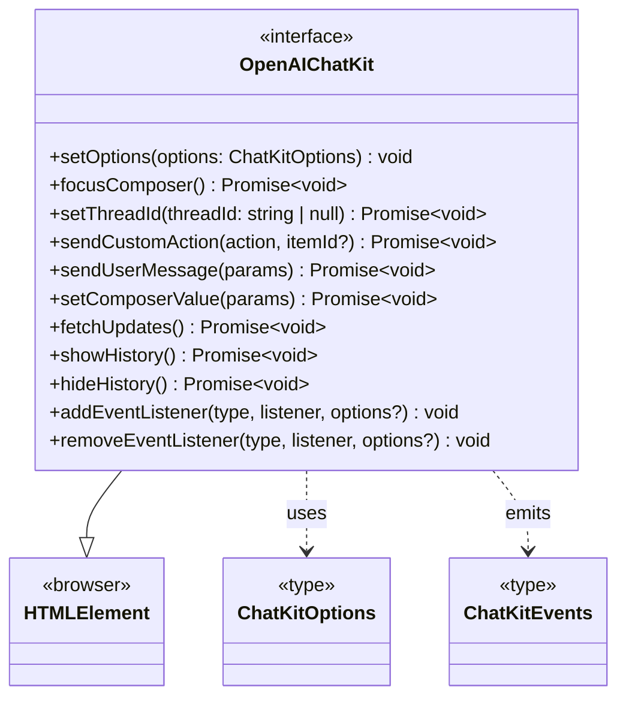
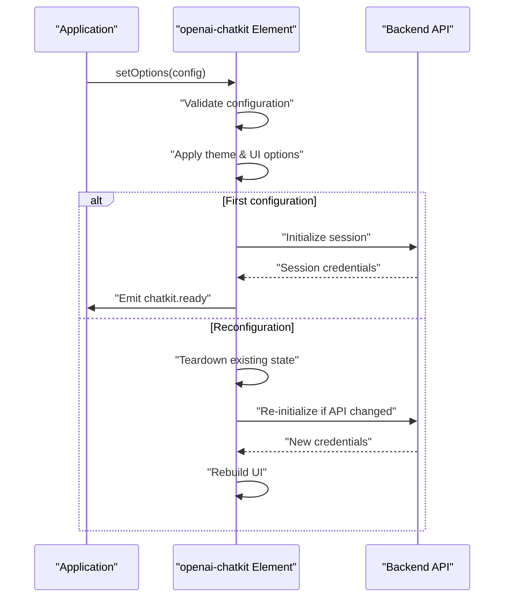
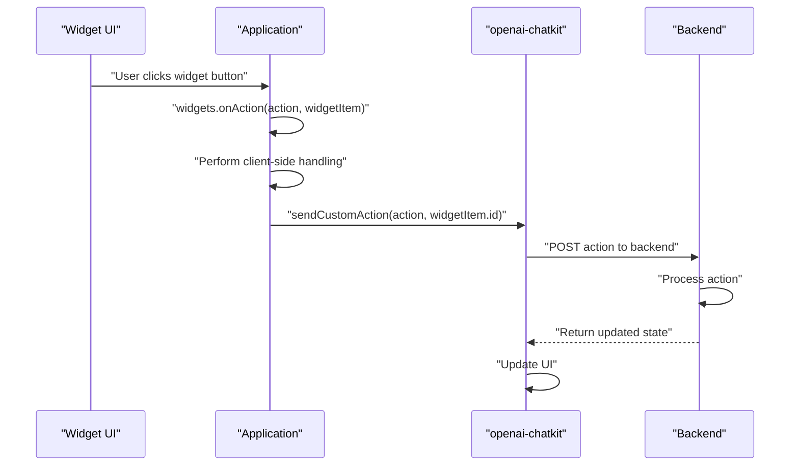
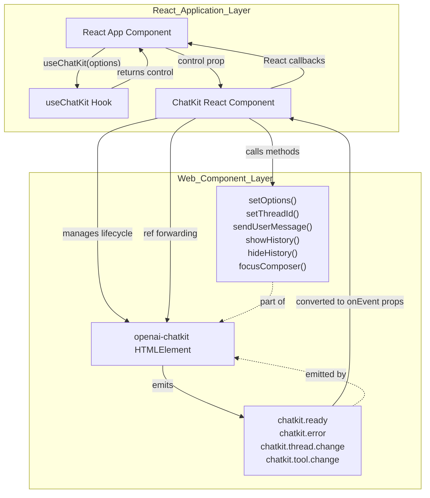

<!-- source: DeepWiki mcp.deepwiki.com · repo openai/chatkit-js · page 2.3 OpenAIChatKit Element Interface · fetched 2026-10-26 -->

# OpenAIChatKit Element Interface

<details>
<summary>Relevant source files</summary>

The following files were used as context for generating this wiki page:

- [.changeset/calm-geckos-glow.md](.changeset/calm-geckos-glow.md)
- [.changeset/real-coins-look.md](.changeset/real-coins-look.md)
- [packages/chatkit/types/dom-augment.d.ts](packages/chatkit/types/dom-augment.d.ts)
- [packages/chatkit/types/index.d.ts](packages/chatkit/types/index.d.ts)

</details>


This document describes the `OpenAIChatKit` interface, which defines the public API of the ChatKit Web Component. This interface exposes methods for configuration, thread management, message sending, and event handling that are available to both vanilla JavaScript and React integrations.

For information about configuration options passed to `setOptions`, see [ChatKitOptions Configuration](#2.1). For details about event types and event-driven communication, see [Event System](#2.4). For React-specific wrappers around this interface, see [ChatKit Component](#3.1) and [useChatKit Hook](#3.2).

---

## Interface Overview

The `OpenAIChatKit` interface extends `HTMLElement` and represents the `<openai-chatkit>` custom element. It provides imperative methods for controlling the ChatKit instance programmatically, allowing applications to manage configuration, threads, messages, and event subscriptions.

**OpenAIChatKit Interface Structure**



**Sources:** [packages/chatkit/types/index.d.ts:894-1061]()

---

## Configuration Method

### setOptions

**Signature:** `setOptions(options: ChatKitOptions): void`

Applies configuration options to the ChatKit instance. This method completely replaces the existing configuration rather than merging with it.

**Important:** This method does not merge new options with existing options. You must provide a complete `ChatKitOptions` object every time you call `setOptions`. The Web Component will reconfigure itself based on the new options, potentially triggering UI updates, authentication flows, or backend reconnections.

**Parameters:**
- `options`: Complete configuration object conforming to the `ChatKitOptions` interface [packages/chatkit/types/index.d.ts:9-118]()

**Example usage:**

```typescript
// Vanilla JS
const chatkit = document.querySelector('openai-chatkit');
chatkit.setOptions({
  api: {
    url: '/api/chatkit',
    domainKey: 'my-domain-key',
  },
  theme: 'dark',
  composer: {
    placeholder: 'Ask me anything...',
  },
});
```

**Configuration Lifecycle:**



**Sources:** [packages/chatkit/types/index.d.ts:895-900]()

---

## Thread Management Methods

### setThreadId

**Signature:** `setThreadId(threadId: string | null): Promise<void>`

Changes the active thread displayed in ChatKit. Pass `null` to switch to a new thread (showing the start screen). This method is asynchronous and resolves when the thread has been loaded.

**Parameters:**
- `threadId`: Thread identifier to load, or `null` for a new thread

**Behavior:**
1. Emits `chatkit.thread.load.start` event
2. Fetches thread content from backend if `threadId` is not `null`
3. Updates UI to display the thread
4. Emits `chatkit.thread.load.end` event
5. Emits `chatkit.thread.change` event

**Example usage:**

```typescript
// Load a specific thread
await chatkit.setThreadId('thread_abc123');

// Start a new thread
await chatkit.setThreadId(null);
```

**Sources:** [packages/chatkit/types/index.d.ts:906]()

---

### showHistory

**Signature:** `showHistory(): Promise<void>`

Opens the thread history view. This method is intended for applications with custom headers or navigation that need to show the history panel programmatically.

**Use cases:**
- Triggering history from a custom header button
- Opening history in response to application events
- Building custom navigation flows

**Example usage:**

```typescript
// Open history from custom button
document.getElementById('history-btn').addEventListener('click', async () => {
  await chatkit.showHistory();
});
```

**Sources:** [packages/chatkit/types/index.d.ts:973-979]()

---

### hideHistory

**Signature:** `hideHistory(): Promise<void>`

Closes the thread history view and returns to the current thread.

**Example usage:**

```typescript
// Close history programmatically
await chatkit.hideHistory();
```

**Sources:** [packages/chatkit/types/index.d.ts:981-984]()

---

### fetchUpdates

**Signature:** `fetchUpdates(): Promise<void>`

Manually fetches updates from the server to synchronize the client state. Use this method when you have modified thread or thread items on the backend and need the client to reflect those changes.

**Use cases:**
- After programmatically modifying thread data via backend API
- When implementing custom synchronization logic
- After handling widget actions that modify server state

**Example usage:**

```typescript
// After a backend operation that modifies the current thread
await fetch('/api/modify-thread', { method: 'POST', body: threadData });
await chatkit.fetchUpdates();
```

**Sources:** [packages/chatkit/types/index.d.ts:986-991]()

---

## Message Methods

### sendUserMessage

**Signature:** `sendUserMessage(params: SendUserMessageParams): Promise<void>`

Sends a user message programmatically. This method allows applications to submit messages on behalf of the user, useful for implementing custom UI flows or integrations.

**Parameters:**

| Parameter | Type | Required | Description |
|-----------|------|----------|-------------|
| `text` | `string` | No* | Message text content (use `text` or `content`, not both) |
| `content` | `UserMessageContent[]` | No* | Structured message content with text and entity tags |
| `reply` | `string` | No | ID of the message being replied to |
| `attachments` | `Attachment[]` | No | Array of uploaded file attachments |
| `newThread` | `boolean` | No | Whether to create a new thread for this message |
| `toolChoice` | `ToolChoice` | No | Tool to use for this message (server inference option) |
| `model` | `string` | No | Model to use for this message (server inference option) |

**Structured Content:**

When using `content` instead of `text`, you can include rich content segments such as text and entity tags. The `UserMessageContent` type is defined at [packages/chatkit/types/index.d.ts:547-559]():

- **Text segment:** `{ type: 'input_text', text: string }`
- **Tag segment:** `{ type: 'input_tag', text: string, id: string, group?: string, data?: Record<string, unknown>, interactive?: boolean }`

**Inference Options:**

The `toolChoice` and `model` parameters map directly to backend `inference_options` for the submitted user message. These options do not update the selected tool or model in the composer UI. To update the composer selection, use `setComposerValue({ selectedToolId, selectedModelId })`.

**Attachment Structure:**

Attachments must be uploaded to your server before being passed to `sendUserMessage`. The `Attachment` type is defined at [packages/chatkit/types/index.d.ts:387-407]() and includes:

- **File attachments:** `{ type: 'file', id: string, name: string, mime_type: string }`
- **Image attachments:** `{ type: 'image', id: string, preview_url: string, name: string, mime_type: string }`

**Example usage:**

```typescript
// Simple text message
await chatkit.sendUserMessage({
  text: 'What is the status of order #12345?',
});

// Message with structured content including entity tags
await chatkit.sendUserMessage({
  content: [
    { type: 'input_text', text: 'What is the status of ' },
    { type: 'input_tag', text: 'Order #12345', id: 'order_12345', group: 'Orders' },
    { type: 'input_text', text: '?' },
  ],
});
```

**Sources:** [packages/chatkit/types/index.d.ts:936-952](), [packages/chatkit/types/index.d.ts:387-407](), [packages/chatkit/types/index.d.ts:547-559](), [packages/chatkit/types/index.d.ts:541]()

---

### setComposerValue

**Signature:** `setComposerValue(params: SetComposerValueParams): Promise<void>`

Sets the content of the composer input without sending a message. This is useful for pre-populating the composer based on application state or user interactions.

**Parameters:**

| Parameter | Type | Required | Description |
|-----------|------|----------|-------------|
| `text` | `string` | No* | Text to populate in composer (use `text` or `content`, not both) |
| `content` | `UserMessageContent[]` | No* | Structured content with text and entity tags |
| `reply` | `string` | No | ID of message to reply to |
| `attachments` | `Attachment[]` | No | Attachments to add to composer (already uploaded) |
| `files` | `File[]` | No | Files to upload and attach to composer |
| `selectedToolId` | `string` | No | ID of tool to select in composer |
| `selectedModelId` | `string` | No | ID of model to select in composer |

**File Uploads:**

Use the `files` parameter to provide `File` objects that will be uploaded and attached to the composer. Use `attachments` when files are already uploaded and you have their server-generated IDs [packages/chatkit/types/index.d.ts:954-971]().

**Sources:** [packages/chatkit/types/index.d.ts:954-971](), [packages/chatkit/types/index.d.ts:547-559]()

---

### focusComposer

**Signature:** `focusComposer(): Promise<void>`

Focuses the composer input field, allowing the user to immediately begin typing. This method is useful for improving UX by directing attention to the input area after certain interactions.

**Sources:** [packages/chatkit/types/index.d.ts:902-903]()

---

## Action Methods

### sendCustomAction

**Signature:** `sendCustomAction(action: { type: string; payload?: Record<string, unknown> }, itemId?: string): Promise<void>`

Sends a custom application-defined action to your backend. This method enables bidirectional communication for widget interactions and custom application flows.

**Action Flow Diagram:**



**Sources:** [packages/chatkit/types/index.d.ts:908-934]()

---

## Event Listener Methods

### addEventListener

**Signature:** `addEventListener<K extends keyof ChatKitEvents>(type: K, listener: EventHandler<K>, options?: boolean | AddEventListenerOptions): void`

Adds an event listener for ChatKit events. The interface provides type-safe event handling with properly typed event detail objects.

**Common Events:**

| Event | Detail Type | Description |
|-------|-------------|-------------|
| `chatkit.ready` | `void` | ChatKit frame has loaded |
| `chatkit.error` | `{ error: Error }` | Error occurred |
| `chatkit.thread.change` | `{ threadId: string \| null }` | Active thread changed |

**Sources:** [packages/chatkit/types/index.d.ts:1005-1020](), [packages/chatkit/types/index.d.ts:1067-1103]()

---

### removeEventListener

**Signature:** `removeEventListener<K extends keyof ChatKitEvents>(type: K, listener: EventHandler<K>, options?: boolean | EventListenerOptions): void`

Removes a previously registered event listener.

**Sources:** [packages/chatkit/types/index.d.ts:1039-1061]()

---

## Integration Patterns

### React Integration

The React bindings wrap the `OpenAIChatKit` interface, providing a more idiomatic React experience. The `ChatKit` component manages the element lifecycle and exposes the underlying element via ref forwarding.

**Component Architecture:**



**Sources:** [packages/chatkit/types/index.d.ts:894-1061](), [packages/chatkit/types/dom-augment.d.ts:1-13]()

---

## Method Summary Table

| Method | Return Type | Purpose | Async |
|--------|-------------|---------|-------|
| `setOptions` | `void` | Configure ChatKit instance | No |
| `focusComposer` | `Promise<void>` | Focus composer input | Yes |
| `setThreadId` | `Promise<void>` | Change active thread | Yes |
| `sendCustomAction` | `Promise<void>` | Send custom action to backend | Yes |
| `sendUserMessage` | `Promise<void>` | Send user message programmatically | Yes |
| `setComposerValue` | `Promise<void>` | Pre-populate composer without sending | Yes |
| `fetchUpdates` | `Promise<void>` | Manually sync with server | Yes |
| `showHistory` | `Promise<void>` | Open history panel | Yes |
| `hideHistory` | `Promise<void>` | Close history panel | Yes |
| `addEventListener` | `void` | Register event listener | No |
| `removeEventListener` | `void` | Unregister event listener | No |

**Sources:** [packages/chatkit/types/index.d.ts:894-1061]()

---

