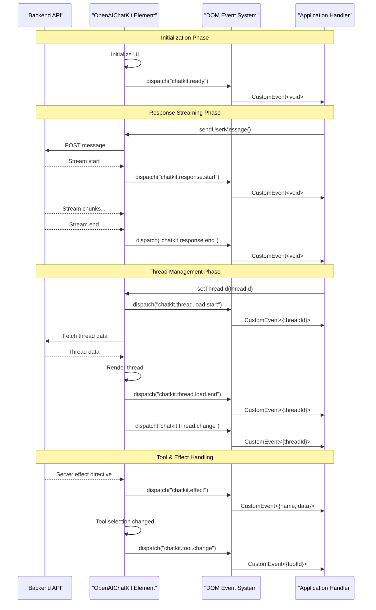
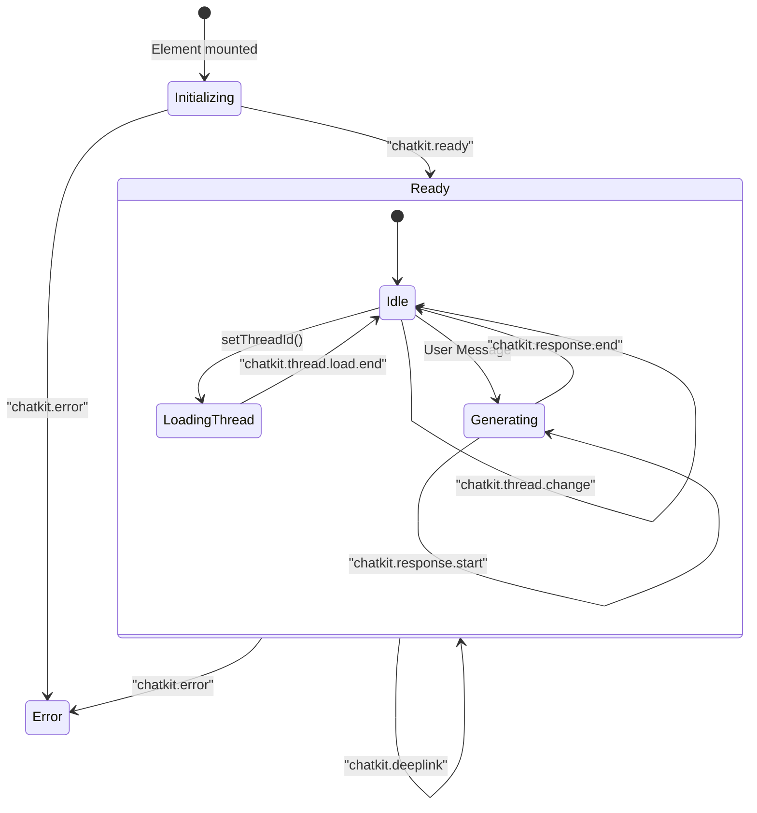

<!-- source: DeepWiki mcp.deepwiki.com · repo openai/chatkit-js · page 2.4 Event System · fetched 2026-10-26 -->

# Event System

<details>
<summary>Relevant source files</summary>

The following files were used as context for generating this wiki page:

- [.changeset/calm-geckos-glow.md](.changeset/calm-geckos-glow.md)
- [.changeset/real-coins-look.md](.changeset/real-coins-look.md)
- [packages/chatkit/CHANGELOG.md](packages/chatkit/CHANGELOG.md)
- [packages/chatkit/types/index.d.ts](packages/chatkit/types/index.d.ts)

</details>


The Event System provides the primary mechanism for the `openai-chatkit` web component to communicate state changes, lifecycle events, and errors back to the integrating application. This page documents all available `ChatKitEvents`, their payload structures, lifecycle timing, and usage patterns for both direct integration and React bindings.

For information about programmatically controlling the ChatKit instance, see [OpenAIChatKit Element Interface](2.3). For React-specific event handling patterns, see [useChatKit Hook](3.2).

## Overview

ChatKit emits strongly-typed DOM events through the standard Web Component event system. All events extend `CustomEvent` and follow the naming convention `chatkit.*`. The type definitions in [packages/chatkit/types/index.d.ts:921-972]() define several distinct event types organized into five categories:

| Category | Events | Purpose |
|----------|--------|---------|
| Lifecycle | `chatkit.ready` | Web component initialization complete |
| Response | `chatkit.response.start`, `chatkit.response.end` | Assistant response streaming boundaries |
| Thread | `chatkit.thread.change`, `chatkit.thread.load.start`, `chatkit.thread.load.end` | Thread state and navigation management |
| Tools | `chatkit.tool.change` | Tool selection updates |
| Effects & Diagnostics | `chatkit.effect`, `chatkit.deeplink`, `chatkit.error`, `chatkit.log` | Server-driven effects, deep linking, and monitoring |

The `OpenAIChatKit` interface [packages/chatkit/types/index.d.ts:786-919]() extends `HTMLElement` and provides type-safe `addEventListener` and `removeEventListener` methods that enforce correct event names and handler signatures.

**Sources:** [packages/chatkit/types/index.d.ts:921-972](), [packages/chatkit/types/index.d.ts:786-919]()

## Event Flow Architecture



This diagram shows how events flow from the web component through the DOM event system to application handlers. Events are dispatched synchronously except for response streaming, which follows the server's streaming timeline.

**Sources:** [packages/chatkit/types/index.d.ts:921-972]()

## Event Type Reference

### Lifecycle Events

#### `chatkit.ready`
Emitted once when the ChatKit web component has completed initialization and is ready for interaction.

```typescript
type ReadyEvent = CustomEvent<void>
```

**Timing:** Dispatched after the web component mounts and internal UI components are initialized. This is the earliest point at which methods like `focusComposer()` or `setThreadId()` can be called reliably [packages/chatkit/CHANGELOG.md:61-62]().

**Sources:** [packages/chatkit/types/index.d.ts:926](), [packages/chatkit/CHANGELOG.md:61-62]()

### Response Lifecycle Events

#### `chatkit.response.start`
Emitted when the assistant begins streaming a response to a user message.

```typescript
type ResponseStartEvent = CustomEvent<void>
```

**Timing:** Dispatched immediately when the first token of the assistant's response is received from the backend [packages/chatkit/types/index.d.ts:941]().

**Sources:** [packages/chatkit/types/index.d.ts:941]()

#### `chatkit.response.end`
Emitted when the assistant completes streaming a response [packages/chatkit/types/index.d.ts:944]().

**Sources:** [packages/chatkit/types/index.d.ts:944]()

### Thread Management Events

#### `chatkit.thread.change`
Emitted whenever the active thread changes, whether by user selection, programmatic call to `setThreadId()`, or when starting a new thread [packages/chatkit/types/index.d.ts:947]().

```typescript
type ThreadChangeEvent = CustomEvent<{ threadId: string | null }>
```

**Sources:** [packages/chatkit/types/index.d.ts:947]()

#### `chatkit.thread.load.start` / `chatkit.thread.load.end`
These events bracket the asynchronous operation of fetching and rendering thread data from the backend [packages/chatkit/types/index.d.ts:950-953]().

**Sources:** [packages/chatkit/types/index.d.ts:950-953]()

### Tool Events

#### `chatkit.tool.change`
Emitted when the selected tool for the conversation is updated.

```typescript
type ToolChangeEvent = CustomEvent<{ toolId: string | null }>
```

**Timing:** Dispatched when a user changes the tool selection in the UI or when the system automatically updates the selected tool [packages/chatkit/CHANGELOG.md:32]().

**Sources:** [packages/chatkit/types/index.d.ts:956](), [packages/chatkit/CHANGELOG.md:32]()

### Effect and Diagnostic Events

#### `chatkit.effect`
Emitted when the server sends a fire-and-forget effect directive. This enables server-driven client-side actions like opening modals or playing sounds [packages/chatkit/CHANGELOG.md:43]().

```typescript
type EffectEvent = CustomEvent<{
  name: string;
  data?: Record<string, unknown>;
}>
```

**Sources:** [packages/chatkit/types/index.d.ts:932-935](), [packages/chatkit/CHANGELOG.md:43]()

#### `chatkit.deeplink`
Emitted when a deep link action is triggered within the chat interface.

```typescript
type DeeplinkEvent = CustomEvent<{ url: string }>
```

**Sources:** [packages/chatkit/types/index.d.ts:938](), [packages/chatkit/CHANGELOG.md:7]()

#### `chatkit.error`
Emitted when an error occurs within the ChatKit component. Use this for integration with error tracking services [packages/chatkit/types/index.d.ts:929]().

**Sources:** [packages/chatkit/types/index.d.ts:929]()

## Event Handler Registration

### Direct Web Component Integration

The `OpenAIChatKit` interface provides type-safe event listener methods:

```typescript
const chatKit = document.querySelector('openai-chatkit');

// Type-safe event listener for thread changes
chatKit.addEventListener('chatkit.thread.change', (event) => {
  const { threadId } = event.detail;
  console.log('Active thread changed to:', threadId);
});
```

The interface definition at [packages/chatkit/types/index.d.ts:862-877]() shows the type-safe method signature, while [packages/chatkit/types/index.d.ts:880-884]() provides the internal overload for compatibility with standard DOM methods.

**Sources:** [packages/chatkit/types/index.d.ts:862-918]()

## Event Lifecycle State Machine



This state diagram illustrates the relationship between ChatKit's internal states and the events emitted during transitions.

**Sources:** [packages/chatkit/types/index.d.ts:921-972]()

## Type Definitions

All event types are defined in the `ChatKitEvents` interface at [packages/chatkit/types/index.d.ts:921-972](). This interface serves as a type map for the `addEventListener` and `removeEventListener` methods.

The `EventHandler` type at [packages/chatkit/types/index.d.ts:602-604]() provides the generic handler signature:

```typescript
export type EventHandler<K extends keyof ChatKitEvents> = (
  event: ChatKitEvents[K],
) => any;
```

**Sources:** [packages/chatkit/types/index.d.ts:602-604](), [packages/chatkit/types/index.d.ts:921-972]()

---

