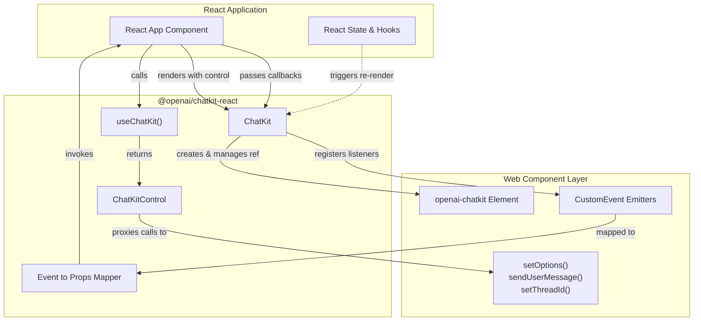
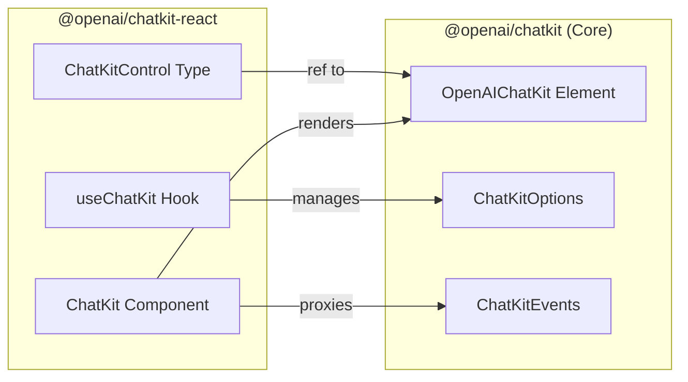

<!-- source: DeepWiki mcp.deepwiki.com · repo openai/chatkit-js · page 3 React Bindings (@openai/chatkit-react) · fetched 2026-10-26 -->

# React Bindings (@openai/chatkit-react)

Relevant source files

The following files were used as context for generating this wiki page:

- [packages/chatkit-react/CHANGELOG.md](packages/chatkit-react/CHANGELOG.md)
- [packages/chatkit-react/package.json](packages/chatkit-react/package.json)
- [packages/chatkit-react/src/index.ts](packages/chatkit-react/src/index.ts)

The `@openai/chatkit-react` package provides React-specific bindings for the ChatKit Web Component. It wraps the underlying `openai-chatkit` custom element with React-friendly APIs, offering a `useChatKit` hook for configuration management and a `ChatKit` component for rendering. This package handles the lifecycle integration between React's component model and the Web Component's imperative API, converting Web Component events to React callback props. [packages/chatkit-react/package.json:4-4]()

For the core type definitions and Web Component interface, see [Core Package (@openai/chatkit)](#2). For integration patterns specific to React applications, see [Integration Patterns](#3.3).

## Package Overview

The `@openai/chatkit-react` package is a peer-dependency-based React wrapper that requires React 18 or higher. [packages/chatkit-react/package.json:22-25](). It depends on `@openai/chatkit` for type definitions and exports both ESM and CommonJS formats. [packages/chatkit-react/package.json:26-28]().

**Package Configuration:**

| Property | Value |
|----------|-------|
| Name | `@openai/chatkit-react` |
| Version | 1.5.0 |
| Peer Dependencies | `react >=18`, `react-dom >=18` |
| Dependencies | `@openai/chatkit` (workspace) |
| Main Export | `./dist/index.cjs` (CJS) |
| Module Export | `./dist/index.js` (ESM) |
| Types | `./dist/index.d.ts` |

**Sources:** [packages/chatkit-react/package.json:1-51]()

## Architecture and Component Model

The React bindings implement a two-layer architecture: the `useChatKit` hook manages the Web Component lifecycle and configuration, while the `ChatKit` component handles rendering and event binding.

**Entity Mapping: Natural Language to Code**

| System Concept | Code Entity | File Reference |
|----------------|-------------|----------------|
| **React Hook** | `useChatKit` | [packages/chatkit-react/src/index.ts:4-4]() |
| **Control Interface** | `ChatKitControl` | [packages/chatkit-react/src/index.ts:7-7]() |
| **React Component** | `ChatKit` | [packages/chatkit-react/src/index.ts:2-2]() |
| **Config Interface** | `UseChatKitOptions` | [packages/chatkit-react/src/index.ts:5-5]() |

**Control Flow Diagram:**

**Sources:** [packages/chatkit-react/src/index.ts:1-9]()

## Main Exports

### useChatKit Hook

The `useChatKit` hook initializes and configures a ChatKit instance. It accepts options that match the `ChatKitOptions` interface from `@openai/chatkit` and returns a `ChatKitControl` object. [packages/chatkit-react/src/index.ts:4-8]().

**Hook Return Interface (`ChatKitControl`):**
The hook returns a control object that includes a `ref` to the underlying `OpenAIChatKit` DOM element. [packages/chatkit-react/CHANGELOG.md:103-103]().

**UseChatKitOptions Enhancements:**
Recent updates have expanded the options available in the hook:
- `onReady`: Callback for initialization. [packages/chatkit-react/CHANGELOG.md:86-86]()
- `onEffect`: Support for effect-based integrations. [packages/chatkit-react/CHANGELOG.md:55-55]()
- `onToolChange`: Callback for tool state updates. [packages/chatkit-react/CHANGELOG.md:39-39]()
- `onDeeplink`: Support for deep link handling. [packages/chatkit-react/CHANGELOG.md:7-7]()

For details, see [useChatKit Hook](#3.2).

### ChatKit Component

The `ChatKit` component renders the `openai-chatkit` Web Component and manages its lifecycle within React's rendering system. [packages/chatkit-react/src/index.ts:2-2]().

**Component Features:**
- **Ref Forwarding**: Exposes the underlying `OpenAIChatKit` DOM element. [packages/chatkit-react/CHANGELOG.md:103-103]()
- **Event Mapping**: Automatically converts Web Component events (e.g., `chatkit.ready`, `chatkit.error`) into React callback props.
- **Method Proxies**: Supports methods like `showHistory()`, `hideHistory()`, and rich-content updates via `setComposerValue()`. [packages/chatkit-react/CHANGELOG.md:40-42]()

For details, see [ChatKit Component](#3.1).

## TypeScript and Module Integration

The package provides full TypeScript support, exporting all core types from the base `@openai/chatkit` package alongside React-specific types. [packages/chatkit-react/src/index.ts:1-1]().

**Code Entity Space Mapping:**

**Build and Distribution:**
The package is built using `tsup` and supports dual-module formats (ESM and CJS) with full type definitions. [packages/chatkit-react/package.json:36-36]().

| Format | File |
|--------|------|
| **ESM** | `dist/index.js` |
| **CommonJS** | `dist/index.cjs` |
| **Types** | `dist/index.d.ts` |

**Sources:** [packages/chatkit-react/package.json:11-21](), [packages/chatkit-react/src/index.ts:1-9]()

## Version History and Evolution

The package has evolved to expose more of the underlying Web Component's imperative power to React users:

- **v1.1.0**: Exposed the `ref` to the underlying `OpenAIChatKit` element in the `useChatKit` return. [packages/chatkit-react/CHANGELOG.md:103-103]()
- **v1.4.0**: Added `onToolChange`, exposed `showHistory()`/`hideHistory()`, and updated `setComposerValue()` to support rich-content segments and file attachments. [packages/chatkit-react/CHANGELOG.md:39-44]()
- **v1.5.0**: Added `onDeeplink` support. [packages/chatkit-react/CHANGELOG.md:7-7]()

For detailed best practices on using these features, see [Integration Patterns](#3.3).

**Sources:** [packages/chatkit-react/CHANGELOG.md:1-119]()

---

