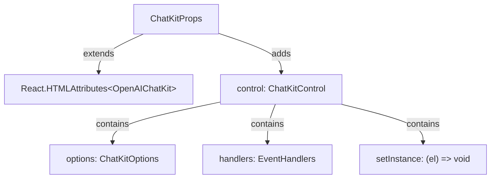
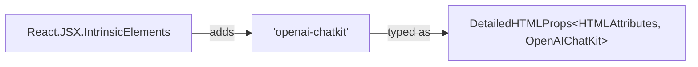
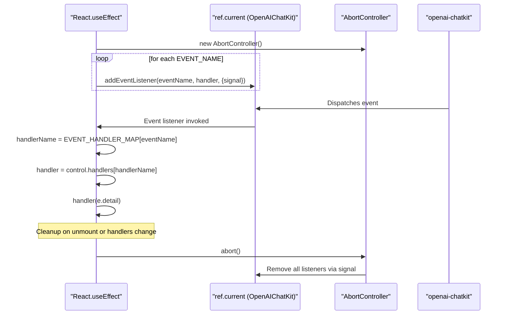
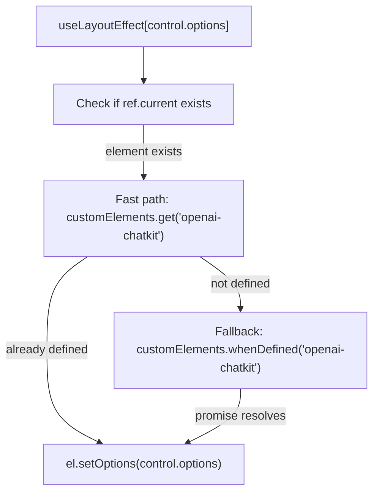
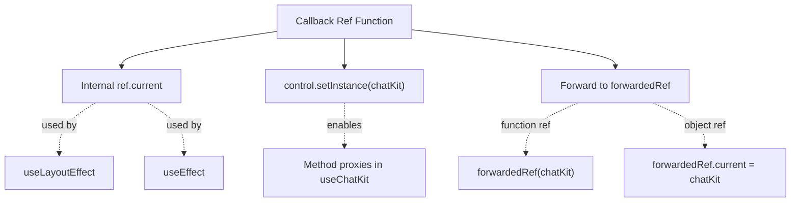
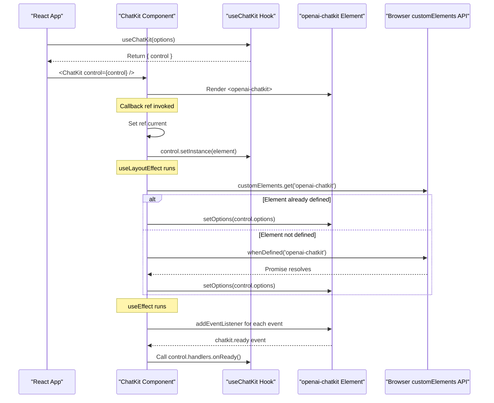

<!-- source: DeepWiki mcp.deepwiki.com · repo openai/chatkit-js · page 3.1 ChatKit Component · fetched 2026-10-26 -->

# ChatKit Component

<details>
<summary>Relevant source files</summary>

The following files were used as context for generating this wiki page:

- [packages/chatkit-react/src/ChatKit.tsx](packages/chatkit-react/src/ChatKit.tsx)
- [packages/docs/src/content/docs/quick-reference/chatkit-component.mdx](packages/docs/src/content/docs/quick-reference/chatkit-component.mdx)

</details>


The `ChatKit` component is a React wrapper that renders the `<openai-chatkit>` web component. It serves as the primary interface for embedding ChatKit in React applications, bridging React's declarative paradigm with the web component's imperative API. The component handles event handler transformation, option synchronization, and ref management. [packages/chatkit-react/src/ChatKit.tsx:38-107]()

For information about creating the `control` object, see **3.2 useChatKit Hook**. For details about the underlying web component interface, see **2.3 OpenAIChatKit Element Interface**.

## Component Interface

The `ChatKit` component is defined as a forward ref component that accepts `ChatKitProps` and forwards a ref to the underlying `OpenAIChatKit` element. [packages/chatkit-react/src/ChatKit.tsx:38-39]()

### Props



**Sources:** [packages/chatkit-react/src/ChatKit.tsx:5-7]()

The `ChatKitProps` interface extends standard HTML attributes and adds a required `control` property:

| Prop | Type | Required | Description |
|------|------|----------|-------------|
| `control` | `ChatKitControl` | Yes | Control object returned by `useChatKit` hook [packages/chatkit-react/src/ChatKit.tsx:6]() |
| `...htmlProps` | `React.HTMLAttributes<OpenAIChatKit>` | No | Standard DOM attributes (`className`, `style`, `aria-*`, etc.) [packages/chatkit-react/src/ChatKit.tsx:5]() |

**Sources:** [packages/chatkit-react/src/ChatKit.tsx:5-7](), [packages/docs/src/content/docs/quick-reference/chatkit-component.mdx:22-33]()

### JSX Type Declaration

The component declares the custom element type in React's JSX namespace to enable TypeScript support for the `<openai-chatkit>` element. [packages/chatkit-react/src/ChatKit.tsx:9-18]()



**Sources:** [packages/chatkit-react/src/ChatKit.tsx:9-18]()

This declaration allows TypeScript to recognize `<openai-chatkit>` as a valid JSX element and provides type checking for its attributes.

## Event Handler Mapping System

The component transforms React-style event handler props (e.g., `onError`, `onReady`) into web component event listeners (e.g., `chatkit.error`, `chatkit.ready`). [packages/chatkit-react/src/ChatKit.tsx:20-34]()

### Mapping Table

```mermaid
graph TB
    subgraph "React Event Handlers (ToEventHandlerKey)"
        onError["onError"]
        onReady["onReady"]
        onResponseStart["onResponseStart"]
        onResponseEnd["onResponseEnd"]
        onThreadChange["onThreadChange"]
        onToolChange["onToolChange"]
        onLog["onLog"]
        onThreadLoadStart["onThreadLoadStart"]
        onThreadLoadEnd["onThreadLoadEnd"]
        onEffect["onEffect"]
        onDeeplink["onDeeplink"]
    end
    
    subgraph "Web Component Events (ChatKitEvents)"
        errorEvent["chatkit.error"]
        readyEvent["chatkit.ready"]
        responseStartEvent["chatkit.response.start"]
        responseEndEvent["chatkit.response.end"]
        threadChangeEvent["chatkit.thread.change"]
        toolChangeEvent["chatkit.tool.change"]
        logEvent["chatkit.log"]
        threadLoadStartEvent["chatkit.thread.load.start"]
        threadLoadEndEvent["chatkit.thread.load.end"]
        effectEvent["chatkit.effect"]
        deeplinkEvent["chatkit.deeplink"]
    end
    
    onError -.->|"EVENT_HANDLER_MAP"| errorEvent
    onReady -.->|"EVENT_HANDLER_MAP"| readyEvent
    onResponseStart -.->|"EVENT_HANDLER_MAP"| responseStartEvent
    onResponseEnd -.->|"EVENT_HANDLER_MAP"| responseEndEvent
    onThreadChange -.->|"EVENT_HANDLER_MAP"| threadChangeEvent
    onToolChange -.->|"EVENT_HANDLER_MAP"| toolChangeEvent
    onLog -.->|"EVENT_HANDLER_MAP"| logEvent
    onThreadLoadStart -.->|"EVENT_HANDLER_MAP"| threadLoadStartEvent
    onThreadLoadEnd -.->|"EVENT_HANDLER_MAP"| threadLoadEndEvent
    onEffect -.->|"EVENT_HANDLER_MAP"| effectEvent
    onDeeplink -.->|"EVENT_HANDLER_MAP"| deeplinkEvent
```



**Sources:** [packages/chatkit-react/src/ChatKit.tsx:20-34]()

The `EVENT_HANDLER_MAP` constant defines the bidirectional mapping:

| Web Component Event | React Handler Prop |
|---------------------|-------------------|
| `chatkit.error` | `onError` |
| `chatkit.ready` | `onReady` |
| `chatkit.response.start` | `onResponseStart` |
| `chatkit.response.end` | `onResponseEnd` |
| `chatkit.thread.change` | `onThreadChange` |
| `chatkit.thread.load.start` | `onThreadLoadStart` |
| `chatkit.thread.load.end` | `onThreadLoadEnd` |
| `chatkit.tool.change` | `onToolChange` |
| `chatkit.log` | `onLog` |
| `chatkit.effect` | `onEffect` |
| `chatkit.deeplink` | `onDeeplink` |

**Sources:** [packages/chatkit-react/src/ChatKit.tsx:20-34]()

### Event Listener Registration

The component registers event listeners in a `useEffect` hook that depends on `control.handlers`. When handlers change, all listeners are removed and re-registered with the new handlers using an `AbortController`. [packages/chatkit-react/src/ChatKit.tsx:63-84]()



**Sources:** [packages/chatkit-react/src/ChatKit.tsx:63-84]()

## Lifecycle Management

The component uses two React hooks to manage initialization and updates:

### Option Synchronization (useLayoutEffect)

The component uses `useLayoutEffect` to synchronize options before browser paint. This ensures the web component displays with the correct configuration immediately. [packages/chatkit-react/src/ChatKit.tsx:42-61]()



**Sources:** [packages/chatkit-react/src/ChatKit.tsx:42-61]()

The implementation handles two scenarios:
1. **Fast path**: If the custom element is already defined via `customElements.get`, `setOptions` is called immediately. [packages/chatkit-react/src/ChatKit.tsx:47-50]()
2. **Fallback path**: If the element is not yet defined, it waits for the `customElements.whenDefined` promise to resolve. [packages/chatkit-react/src/ChatKit.tsx:53-57]()

The effect tracks an `active` flag to prevent calling `setOptions` after component unmount. [packages/chatkit-react/src/ChatKit.tsx:52-60]()

## Ref Management

The component handles ref forwarding through a callback ref that coordinates three responsibilities. [packages/chatkit-react/src/ChatKit.tsx:88-102]()



**Sources:** [packages/chatkit-react/src/ChatKit.tsx:88-102]()

The callback ref performs three assignments:
1. **Internal ref**: Sets `ref.current` for use by internal hooks. [packages/chatkit-react/src/ChatKit.tsx:89]()
2. **Control instance**: Calls `control.setInstance(chatKit)` to enable method proxies in `useChatKit`. [packages/chatkit-react/src/ChatKit.tsx:91]()
3. **Forwarded ref**: Forwards the element to the ref passed by the parent component, supporting both function refs and object refs. [packages/chatkit-react/src/ChatKit.tsx:93-97]()

## Component Rendering

The component renders the `<openai-chatkit>` custom element and spreads any additional HTML props. [packages/chatkit-react/src/ChatKit.tsx:87-104]()

```mermaid
graph LR
    Component["ChatKit Component"]
    JSXElement["&lt;openai-chatkit&gt;"]
    refCallback["ref callback"]
    htmlProps["...htmlProps"]
    
    Component -->|"renders"| JSXElement
    JSXElement -->|"receives"| refCallback
    JSXElement -->|"receives"| htmlProps
    
    htmlProps -.->|"can include"| className["className"]
    htmlProps -.->|"can include"| style["style"]
    htmlProps -.->|"can include"| ariaLabel["aria-*"]
```

**Sources:** [packages/chatkit-react/src/ChatKit.tsx:87-104]()

## Usage Patterns

### Basic Usage

The `ChatKit` component takes the `control` object returned by `useChatKit` and renders the underlying web component. [packages/docs/src/content/docs/quick-reference/chatkit-component.mdx:10-13]()

```tsx
import { ChatKit, useChatKit } from '@openai/chatkit-react';

function MyChat() {
  const { control } = useChatKit({
    api: {
      url: 'https://api.example.com',
    },
  });

  return <ChatKit control={control} />;
}
```

### With Layout Props

Any additional props are spread onto the `<openai-chatkit>` element. [packages/docs/src/content/docs/quick-reference/chatkit-component.mdx:31-33]()

```tsx
<ChatKit 
  control={control} 
  className="my-chat-container" 
  style={{ height: '500px' }} 
/>
```

## Initialization Flow



**Sources:** [packages/chatkit-react/src/ChatKit.tsx:38-107]()

---

